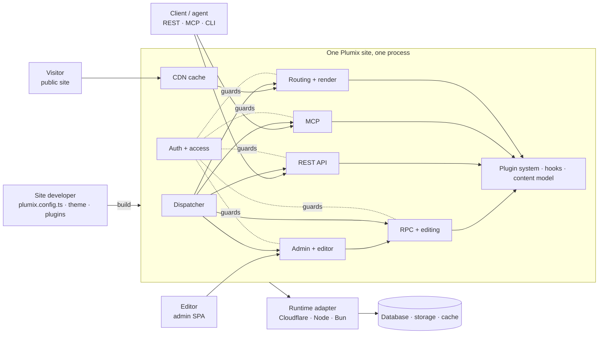

# Architecture

This is the map of Plumix: what the parts are, where they live, and what must stay true between
them. It stays at the level of boxes and arrows. Each box links to a page in
[`docs/architecture/`](docs/architecture/) that goes one level down, and the decisions behind the
boxes are in [`docs/adr/`](docs/adr/).

## The system

A site describes its content model, plugins and theme in TypeScript. Plumix builds the admin, the
public URLs, the APIs and the permission checks from that description, and serves all of it from
one process on the runtime the site picks.

## Subsystems

| Area       | Page                                                          | One line                                                              |
| ---------- | ------------------------------------------------------------- | --------------------------------------------------------------------- |
| Extending  | [Plugin system](docs/architecture/plugin-system.md)           | A descriptor declares everything a plugin contributes.                |
|            | [Hooks](docs/architecture/hooks.md)                           | Typed filters and actions core fires at fixed points.                 |
| Serving    | [Routing and render](docs/architecture/routing-and-render.md) | A public URL resolves to data, then renders through the theme.        |
|            | [Blocks and islands](docs/architecture/blocks-and-islands.md) | Content is blocks; client JavaScript is an island a block asks for.   |
|            | [CDN cache](docs/architecture/cdn-cache.md)                   | Anonymous renders are cached and purged by tag.                       |
| Editing    | [RPC and editing](docs/architecture/rpc-and-editing.md)       | Every admin write is an RPC procedure, guarded by token and lease.    |
|            | [Admin and editor](docs/architecture/admin-and-editor.md)     | A prebuilt SPA, extended only through registrations.                  |
| Interfaces | [REST API](docs/architecture/rest-api.md)                     | Opt-in, read-only core resources, plus plugin resources.              |
|            | [MCP](docs/architecture/mcp.md)                               | Read-only tools for agents, on in dev, opt-in in production.          |
| People     | [Auth and access](docs/architecture/auth-and-access.md)       | Sign-in methods, sessions, roles, capabilities, per-entry access.     |
|            | [Mail](docs/architecture/mail.md)                             | Mails declared by name and sent through a mailer slot.                |
| Platform   | [Runtimes](docs/architecture/runtimes.md)                     | One adapter per runtime, held to a shared conformance suite.          |
|            | [Migrations](docs/architecture/migrations.md)                 | Each table owner ships its history; data migrations run after schema. |
|            | [Sync and import](docs/architecture/sync-and-import.md)       | Moving content between installs; a sync replaces a scope.             |
|            | [Cron](docs/architecture/cron.md)                             | Scheduled tasks registered by core and plugins.                       |
|            | [Media and storage](docs/architecture/media-and-storage.md)   | Files in the storage slot; images by role.                            |
|            | [Search](docs/architecture/search.md)                         | Entry search in core, indexing in a plugin.                           |
|            | [i18n](docs/architecture/i18n.md)                             | Every user-facing string is a Lingui descriptor.                      |
| Tooling    | [Build and CLI](docs/architecture/build-and-cli.md)           | The `plumix` CLI, the Vite plugin and the scaffolder.                 |
|            | [Dev tooling](docs/architecture/dev-tooling.md)               | Error pages, debug bar and telemetry, compiled out of production.     |

## Codemap

- `packages/plumix`: the published umbrella. Every package outside the framework imports Plumix
  through its subpaths. It also holds the CLI (`src/cli`) and the Vite plugin (`src/vite`).
- `packages/core`: the engine, one package in five layers that import only downward
  (`packages/core/layers.ts`, [ADR 0010](docs/adr/0010-core-is-one-package-of-enforced-layers.md)):
  - **foundation**: `blocks/`, `i18n/` and small pure helpers.
  - **contracts**: `plugin/`, `hooks/`, `context/`, config, theme and template types.
  - **capabilities**: `db/`, `entries/`, `terms/`, `users/`, `auth/`, `access/`, `meta/`,
    `revisions/`, `search/`, `storage/`, `cdn/`, `route/`.
  - **surfaces**: `rpc/`, `rest/`, `mcp/`, `admin/`, `admin-bar/`, `dev/`, `cli/`.
  - **top**: `runtime/`, which wires everything into a request handler.
- `packages/admin`, `admin-editor`, `admin-ui`: the admin SPA, the visual editor and their UI
  primitives.
- `packages/plugins/*`: first-party plugins, built only on public seams.
- `packages/runtimes/*`: one adapter per runtime.
- `packages/create-plumix-app`: the scaffolder.
- `apps/*`: private sites built on Plumix (demo, docs, marketing).
- `tooling/*`: workspace configs and guards, such as the published-surface roster.

## Invariants

- Code outside the framework imports only `plumix` and its subpaths (the umbrella rule in
  `AGENTS.md`).
- Core's layers import only downward, and browser code never reaches a server-only module
  (`packages/core/src/layers.test.ts`).
- Request-path code in core and plugins uses only APIs every runtime provides. A runtime's own
  primitives live in its adapter ([ADR 0019](docs/adr/0019-a-runtime-adapter-uses-its-runtimes-primitives-and-is-tested-on-that-runtime.md)).
- Core owns what would be wrong without it; a plugin owns what would merely be absent
  ([ADR 0002](docs/adr/0002-core-owns-what-would-be-wrong.md)).
- A render that reads the principal is never shared
  ([ADR 0030](docs/adr/0030-a-render-that-reads-the-principal-is-never-shared.md)).
- Dev-only code sits behind an inline compile-time gate, so production builds drop it
  (`packages/plumix/src/vite/dev-gate-tree-shaking.test.ts`).

## Keeping this true

A change that moves a box, adds a surface or breaks an invariant updates this file and the page
for that subsystem in the same PR. Pages name files and symbols, never line numbers.
