# Architecture

This is the map of Plumix: what the parts are, where they live, and what must stay true between
them. It stays at the level of boxes and arrows. Each subsystem has a page in
[`docs/architecture/`](docs/architecture/) that goes one level down, and the decisions behind the
boxes are in [`docs/adr/`](docs/adr/).

## The system

A site describes its content model, plugins and theme in TypeScript. Plumix builds the admin, the
public URLs, the APIs and the capability checks from that description, and serves all of it from
one process on the runtime the site picks.

This is Plumix as it is designed to be at 1.0, following the vision (`VISION.md`, landing alongside this file). The code is a
snapshot on the way there. Every part of the design is drawn; a part the code does not have yet is drawn
green, and a relationship it does not have yet is a dashed arrow. [Not there yet](#not-there-yet) lists
each one with the seam to build on and when it is done, along with what the code has that the design
drops. Plumix is ready to tag 1.0 when that list is empty and the code matches every diagram here. Words used here mean what [`GLOSSARY.md`](GLOSSARY.md) says they mean.

The diagrams below follow the [C4 model](https://c4model.com). Context, containers and components
each zoom one level further in; the deployment diagram shows where the containers run;
the dynamic diagrams show the four flows most changes touch and two flows of the 1.0 design; a data model and a state diagram
follow. They are Mermaid, so GitHub draws them
and an agent reads every element and relationship from the text. Each box names its C4 type in
brackets. One key covers them all:

| Notation                              | Meaning                                                                                                                                       |
| ------------------------------------- | --------------------------------------------------------------------------------------------------------------------------------------------- |
| Dark blue box                         | Person                                                                                                                                        |
| Bright blue box                       | The software system in scope                                                                                                                  |
| Medium blue box or cylinder           | Container: something that runs, or a data store                                                                                               |
| Light blue box                        | Component inside a container                                                                                                                  |
| Grey box                              | Software system outside Plumix                                                                                                                |
| White box, blue border                | Infrastructure a deployment provides, such as a cache or cron                                                                                 |
| Green box                             | In the 1.0 design, not in the code yet                                                                                                        |
| Solid arrow                           | In the code; the label gives intent, then technology in brackets where it crosses a process. Arrows inside one container are in-process calls |
| Dashed arrow                          | In the 1.0 design, not in the code yet                                                                                                        |
| Dashed grey outline                   | Grouping or system boundary                                                                                                                   |
| Dashed green outline                  | Group of parts in the 1.0 design, not in the code yet                                                                                         |
| "(not yet)" or "not yet" inside a box | That part of an existing element is in the 1.0 design but not in the code yet                                                                 |
| Dashed blue outline                   | Container boundary, with its components inside                                                                                                |
| Solid outline                         | Deployment node, such as a browser, a server or a platform environment                                                                        |
| Data model lines                      | A line joins two tables; the end with a fork means many, a bar means exactly one, a circle means the link is optional                         |
| Rounded box, arrow (state diagram)    | A status, and the action that moves an entry to the next one                                                                                  |
| Sequence arrows (dynamic diagrams)    | A solid arrow is a call, a dashed arrow its reply, numbered in order; an `alt` box shows alternative paths                                    |

Acronyms: MCP is the Model Context Protocol, RPC a remote procedure call, REST an HTTP JSON API,
OTLP the OpenTelemetry protocol, LLM a large language model, SSO single sign-on, PKCE the OAuth proof
key for code exchange, TLS transport encryption. "Opt-in" means off in production until the site's config turns
it on.

### Context

Who and what surrounds one Plumix site. It shows only what core offers: a plugin's own outside
systems, such as the crawlers that read the SEO plugin's sitemaps, belong on that plugin's page. The
people are kinds of user, not roles. In the 1.0 design a role is a set of capabilities: a member holds
the `member` role, editors and designers hold `author`, `editor`, `admin` or a role the site defines.

Some things are left off on purpose. The runtime the site runs on is a deployment choice, so it is on
the deployment diagram. Multisite: one install serves one site. A plugin marketplace: plugins ship
through npm and are installed in code. An external cache server such as Redis: the key-value slot is
where a cache would live. Backups: the runtime host or provider owns them. Dev-only tooling such as the debug
bar: these diagrams describe the production system.

```mermaid
---
title: System Context diagram for a Plumix site
---
flowchart TB
  subgraph people["People"]
    dev["<b>Developer</b><br/><i>[Person]</i><br/>Builds the site in code,<br/>deploys it, runs the CLI"]
    editor["<b>Editor</b><br/><i>[Person]</i><br/>Writes and publishes content"]
    designer["<b>Designer</b><br/><i>[Person]</i><br/>Composes pages visually"]
    admin["<b>Site admin</b><br/><i>[Person]</i><br/>Manages users and settings"]
    member["<b>Member</b><br/><i>[Person]</i><br/>Signed-in visitor"]
    visitor["<b>Visitor</b><br/><i>[Person]</i><br/>Anonymous reader"]
  end

  subgraph callers["Software that calls the site"]
    agent["<b>Agent</b><br/><i>[Software System]</i><br/>An AI client, e.g. Claude Code"]
    api["<b>API client</b><br/><i>[Software System]</i><br/>Another app reading content"]
  end

  site["<b>Plumix site</b><br/><i>[Software System]</i><br/>Content model, theme, plugins,<br/>admin and visual editor,<br/>public site, APIs"]

  subgraph used["Systems the site depends on"]
    idp["<b>Identity providers</b><br/><i>[Software System]</i><br/>OAuth (GitHub and Google built in),<br/>or a single sign-on proxy"]
    mail["<b>Mail provider</b><br/><i>[Software System]</i><br/>Whatever the mailer slot points at"]
    cdnapi["<b>CDN provider</b><br/><i>[Software System]</i><br/>Optional; caches pages,<br/>purged by tag"]
  end

  subgraph ahead["In the design, not built yet"]
    llm["<b>LLM provider</b><br/><i>[Software System, not yet]</i><br/>Large language model behind<br/>the in-editor agent"]
    otel["<b>Telemetry sink</b><br/><i>[Software System, not yet]</i><br/>Any OpenTelemetry endpoint,<br/>behind the telemetry slot"]
    hooks["<b>Webhook receivers</b><br/><i>[Software System, not yet]</i><br/>Notified when content changes"]
  end

  dev -- "Builds, configures and deploys<br/>[code, plumix CLI]" --> site
  editor -- "Writes and publishes content<br/>[admin, in a browser]" --> site
  designer -- "Composes pages from blocks<br/>and design tokens [visual editor]" --> site
  admin -- "Manages users and settings<br/>[admin, in a browser]" --> site
  member -- "Signs in, reads members-only<br/>content [web]" --> site
  visitor -- "Reads public pages [web]" --> site
  agent -- "Reads content and the schema<br/>[MCP over HTTPS, opt-in]" --> site
  agent -. "Writes and publishes content, composes pages,<br/>within its token's capabilities [MCP]" .-> site
  api -- "Reads published content<br/>[REST, JSON over HTTPS, opt-in]" --> site
  site -- "Signs people in with<br/>[OAuth 2.0, or an SSO JWT checked against JWKS]" --> idp
  site -- "Sends sign-in links and<br/>notifications [provider API or SMTP]" --> mail
  site -- "Purges cached pages by tag<br/>[HTTPS API, token]" --> cdnapi
  site -. "Asks for page drafts [provider API]" .-> llm
  site -. "Exports traces [OTLP over HTTP]" .-> otel
  site -. "Notifies of content changes<br/>[HTTPS POST with its headers]" .-> hooks

  classDef person fill:#08427b,stroke:#052e56,color:#fff
  classDef system fill:#1168bd,stroke:#0b4884,color:#fff
  classDef cont fill:#438dd5,stroke:#2e6295,color:#fff
  classDef comp fill:#85bbf0,stroke:#5d82a8,color:#000
  classDef ext fill:#999999,stroke:#6b6b6b,color:#fff
  classDef goal fill:#2da44e,stroke:#1a7f37,color:#fff
  classDef infra fill:#ffffff,stroke:#438dd5,color:#1a1a1a
  class dev,editor,designer,admin,member,visitor person
  class site system
  class agent,api,idp,mail,cdnapi ext
  class llm,otel,hooks goal
  style people fill:none,stroke:#888,stroke-dasharray:4 4
  style callers fill:none,stroke:#888,stroke-dasharray:4 4
  style used fill:none,stroke:#888,stroke-dasharray:4 4
  style ahead fill:none,stroke:#1a7f37,stroke-dasharray:4 4
```

### Containers

The runnable parts of one site and the data stores they use. The CDN, image resizing, cron triggers
and environments vary by runtime, so they are on the deployment diagram. Scheduled tasks are fired by the platform's cron triggers, by a timer
inside the app process on Node and Bun, or by `plumix cron run`.

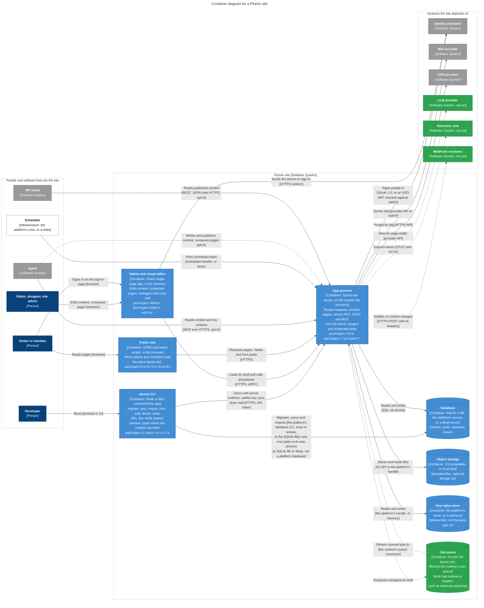

### Components of the app process

What runs inside the app process. Core's components live in `packages/core/src`; the theme and the
plugins are the site's own code, installed into the process. Infrastructure reaches core through config
slots, which the runtime packages and core's portable providers fill; the runtime adapter itself supplies
the entry module, static assets, the client address its own CLI commands (`dev` and `build` everywhere, plus `deploy`,
`preview` and `types` where the platform has them) and its `plumix doctor` diagnostics.

```mermaid
---
title: Component diagram for the app process
---
flowchart LR
  subgraph callers["What calls the app process"]
    adminapp["<b>Admin and visual editor</b><br/><i>[Container]</i>"]
    public["<b>Public site</b><br/><i>[Container]</i>"]
    agent["<b>Agent</b><br/><i>[Software System]</i>"]
    api["<b>API client</b><br/><i>[Software System]</i>"]
    cli["<b>plumix CLI</b><br/><i>[Container]</i>"]
    cron["<b>Scheduler</b><br/><i>[Infrastructure: cron trigger or in-process timer]</i><br/>The timer and the CLI take a run guard<br/>so replicas don't double-run tasks"]
  end

  subgraph app["App process [Container]"]
    builder["<b>App builder</b><br/><i>[Component: core runtime/app.ts]</i><br/>Builds the app once: installs plugins,<br/>merges schemas, validates the config"]
    entry["<b>Runtime handler</b><br/><i>[Component: runtimes/*/entry-codegen,<br/>core runtime/handler.ts]</i><br/>Builds the request context, hands off<br/>fetch and scheduled calls; the entry module<br/>is generated into .plumix/worker.ts at build"]
    dispatcher["<b>Dispatcher</b><br/><i>[Component: core runtime/dispatcher.ts]</i><br/>Checks CSRF and origin; routes to pages, admin shell,<br/>RPC, REST, MCP, sign-in, sync and plugin routes;<br/>runs sync transfer and settle (runtime/sync-*.ts);<br/>flushes CDN purges"]
    sched["<b>Scheduled tasks</b><br/><i>[Component: core runtime/scheduled.ts]</i><br/>Runs core's and plugins' tasks,<br/>and queued jobs (not yet)"]
    authc["<b>Auth and access</b><br/><i>[Component: core auth, access]</i><br/>Sign-in methods, sessions, tokens,<br/>capabilities, per-entry access policy"]
    surfaces["<b>RPC, REST and MCP</b><br/><i>[Component: core rpc, rest, mcp]</i><br/>Admin procedures with the write lifecycle,<br/>read API, agent tools"]
    cdn["<b>CDN read-through</b><br/><i>[Component: core cdn]</i><br/>Serves stored pages, stores shared ones,<br/>keys by segment, purges by tag"]
    render["<b>Routing and render</b><br/><i>[Component: core route]</i><br/>Resolves URLs, renders pages"]
    content["<b>Content services</b><br/><i>[Component: core entries, terms,<br/>users, revisions]</i><br/>Reads entries, terms and users<br/>with access applied"]
    pluginsys["<b>Plugin system and hooks</b><br/><i>[Component: core plugin, hooks]</i><br/>Holds what plugins registered,<br/>runs filters and actions"]
    mailc["<b>Mail</b><br/><i>[Component: core mail]</i><br/>Mails declared by name"]
    slots["<b>Config slots</b><br/><i>[Component: core contracts,<br/>runtime packages]</i><br/>Database, storage, key-value, CDN, mailer,<br/>image delivery, telemetry; queue and LLM, not yet"]
    theme["<b>Theme</b><br/><i>[Component: site code, React]</i><br/>Templates, blocks, design tokens"]
    policy["<b>Block list and style policy</b><br/><i>[Component, not yet]</i><br/>Which blocks the editor offers;<br/>custom values or design tokens only"]
    roles["<b>Site-defined roles</b><br/><i>[Component, not yet]</i><br/>Default roles plus roles a site<br/>declares from capabilities"]
    webhooks["<b>Webhooks</b><br/><i>[Component, not yet]</i><br/>POSTs a declared payload<br/>on content actions"]
    assistant["<b>In-editor agent</b><br/><i>[Component, not yet]</i><br/>Drafts and composes pages<br/>for the editor who asks"]
    plugins["<b>Plugins</b><br/><i>[Component: site code, definePlugin]</i><br/>Blocks, fields, routes, procedures, tools"]
  end

  subgraph stores["Data stores and outside systems"]
    db[("<b>Database</b><br/><i>[Container]</i>")]
    files[("<b>Object storage</b><br/><i>[Container]</i>")]
    kv[("<b>Key-value store</b><br/><i>[Container]</i>")]
    idp["<b>Identity providers</b><br/><i>[Software System]</i>"]
    mail["<b>Mail provider</b><br/><i>[Software System]</i>"]
    cdnapi["<b>CDN provider</b><br/><i>[Software System]</i>"]
    receivers["<b>Webhook receivers</b><br/><i>[Software System, not yet]</i>"]
    otelsink["<b>Telemetry sink</b><br/><i>[Software System, not yet]</i>"]
    llmsys["<b>LLM provider</b><br/><i>[Software System, not yet]</i>"]
    queuec[("<b>Job queue</b><br/><i>[Container, not yet]</i>")]
  end

  adminapp -- "Calls procedures [oRPC over HTTPS]" --> entry
  public -- "Requests pages [HTTPS]" --> entry
  agent -- "Reads content and the schema [MCP over HTTPS]" --> entry
  agent -. "Writes and publishes content, composes pages [MCP over HTTPS]" .-> entry
  api -- "Reads content [REST over HTTPS]" --> entry
  cli -- "Syncs with server runtimes, settles any sync, tests mail [HTTPS, API token]" --> entry
  cron -- "Fires scheduled tasks [scheduled handler or timer]" --> entry
  entry -- "Builds the app once, then reuses it" --> builder
  builder -- "Installs plugins through" --> pluginsys
  builder -- "Fires theme:ready for" --> theme
  entry -- "Hands requests to" --> dispatcher
  entry -- "Hands scheduled calls to" --> sched
  dispatcher -- "Routes sign-in, loads the user, gates by<br/>access policy, picks the cache segment" --> authc
  dispatcher -- "Matches the URL to a route" --> render
  dispatcher -- "Hands API calls to" --> surfaces
  dispatcher -- "Hands page renders to, defers purges" --> cdn
  dispatcher -- "Runs plugin routes from" --> pluginsys
  cdn -- "Renders on a miss" --> render
  cdn -- "Stores and purges through" --> slots
  surfaces -- "Authenticates, checks capabilities" --> authc
  surfaces -- "Reads through, checks the user may edit the entry" --> content
  surfaces -- "Writes through [guarded UPDATE]" --> slots
  surfaces -- "Runs filters, actions and registered<br/>procedures, resources and tools from" --> pluginsys
  surfaces -- "Sends mail through" --> mailc
  render -- "Reads entries through" --> content
  render -- "Uses registered routes and blocks from" --> pluginsys
  render -- "Renders through" --> theme
  sched -- "Runs registered tasks from" --> pluginsys
  authc -- "Sends sign-in links through" --> mailc
  authc -- "Signs people in [OAuth 2.0]" --> idp
  content -- "Reads through" --> slots
  pluginsys -- "Installs and calls" --> plugins
  pluginsys -- "Queues purge tags from entry actions" --> cdn
  authc -- "Stores OAuth state and sessions<br/>[SQL via drizzle]" --> slots
  sched -- "Publishes due entries, prunes sessions<br/>[SQL via drizzle]" --> slots
  sched -- "Fires the entry actions of scheduled publishing" --> pluginsys
  sched -- "Flushes purges after a run" --> cdn
  mailc -- "Delivers through" --> slots
  slots -- "Reads and writes [SQL via drizzle]" --> db
  slots -- "Stores files [S3 API, the platform's handle or file system]" --> files
  slots -- "Reads and writes [the platform's handle, or memory]" --> kv
  slots -- "Sends mail [provider API or SMTP]" --> mail
  slots -- "Purges by tag [HTTPS API]" --> cdnapi

  pluginsys -. "Hands content actions to" .-> webhooks
  webhooks -. "Enqueues each delivery through" .-> slots
  slots -. "Enqueues [the queue slot]" .-> queuec
  queuec -. "Delivers queued jobs [the runtime's queue consumer]" .-> entry
  entry -. "Hands queued jobs to" .-> sched
  sched -. "Runs webhook deliveries through" .-> webhooks
  webhooks -. "Delivers [HTTPS POST with its headers]" .-> receivers
  slots -. "Exports traces [the published OTLP consumer]" .-> otelsink
  assistant -. "Asks for drafts [the llm slot]" .-> slots
  slots -. "Calls the model [provider API]" .-> llmsys
  theme -. "Declare the block list<br/>and style policy" .-> policy
  policy -. "Reaches the editor in the plugin manifest,<br/>built by the Vite plugin" .-> adminapp
  surfaces -. "Hold agents' writes to the same<br/>policy, leases and capabilities" .-> policy
  authc -. "Resolves roles from the database and config" .-> roles
  roles -. "Stored through [SQL via drizzle]" .-> slots
  surfaces -. "Hand page-draft requests to" .-> assistant
  assistant -. "Draft through the same<br/>procedures as an editor" .-> surfaces

  classDef person fill:#08427b,stroke:#052e56,color:#fff
  classDef system fill:#1168bd,stroke:#0b4884,color:#fff
  classDef cont fill:#438dd5,stroke:#2e6295,color:#fff
  classDef comp fill:#85bbf0,stroke:#5d82a8,color:#000
  classDef ext fill:#999999,stroke:#6b6b6b,color:#fff
  classDef goal fill:#2da44e,stroke:#1a7f37,color:#fff
  classDef infra fill:#ffffff,stroke:#438dd5,color:#1a1a1a
  class adminapp,public,cli,db,files,kv cont
  class agent,api,idp,mail,cdnapi ext
  class cron infra
  class builder,entry,dispatcher,sched,authc,surfaces,cdn,render,content,pluginsys,mailc,slots,theme,plugins comp
  class policy,roles,assistant,webhooks,receivers,otelsink,queuec,llmsys goal
  style callers fill:none,stroke:#888,stroke-dasharray:4 4
  style app fill:none,stroke:#438dd5,stroke-dasharray:4 4
  style stores fill:none,stroke:#888,stroke-dasharray:4 4
```

Where to start, for each component and the containers around it:

| Component               | Code                                                                                                                                        | Read first                                                                                                                      |
| ----------------------- | ------------------------------------------------------------------------------------------------------------------------------------------- | ------------------------------------------------------------------------------------------------------------------------------- |
| Runtime handler         | `packages/runtimes/*/src/entry-codegen.ts` (generates `.plumix/worker.ts`), `packages/core/src/runtime/handler.ts` (`createRuntimeHandler`) | [runtimes](docs/architecture/runtimes.md)                                                                                       |
| Dispatcher              | `packages/core/src/runtime/dispatcher.ts` (`createPlumixDispatcher`), `sync-transfer.ts`, `sync-settle.ts`                                  | [routing and render](docs/architecture/routing-and-render.md)                                                                   |
| Scheduled tasks         | `packages/core/src/runtime/scheduled.ts` (`runScheduledTasks`); the run guard is `scheduled-guard.ts`                                       | [cron](docs/architecture/cron.md)                                                                                               |
| Auth and access         | `packages/core/src/auth`, `access`                                                                                                          | [auth and access](docs/architecture/auth-and-access.md)                                                                         |
| RPC, REST and MCP       | `packages/core/src/rpc` (writes: `rpc/procedures/entry/update.ts`, `lifecycle.ts`), `rest`, `mcp`                                           | [RPC and editing](docs/architecture/rpc-and-editing.md), [REST](docs/architecture/rest-api.md), [MCP](docs/architecture/mcp.md) |
| CDN read-through        | `packages/core/src/cdn`                                                                                                                     | [CDN cache](docs/architecture/cdn-cache.md)                                                                                     |
| Routing and render      | `packages/core/src/route`                                                                                                                   | [routing and render](docs/architecture/routing-and-render.md)                                                                   |
| Content services        | `packages/core/src/entries`, `terms`, `users`, `revisions` (reads)                                                                          | [RPC and editing](docs/architecture/rpc-and-editing.md)                                                                         |
| Plugin system and hooks | `packages/core/src/plugin`, `hooks`                                                                                                         | [plugin system](docs/architecture/plugin-system.md), [hooks](docs/architecture/hooks.md)                                        |
| Mail                    | `packages/core/src/mail`                                                                                                                    | [mail](docs/architecture/mail.md)                                                                                               |
| Config slots            | `packages/core/src/runtime/contract/slots.ts`, `auth/contract/mailer.ts`, `context/telemetry.ts`, `packages/runtimes/*`                     | [runtimes](docs/architecture/runtimes.md), [media and storage](docs/architecture/media-and-storage.md)                          |
| Theme                   | the site's theme, `packages/core/src/blocks`                                                                                                | [blocks and islands](docs/architecture/blocks-and-islands.md)                                                                   |
| Plugins                 | `packages/plugins/*`                                                                                                                        | [plugin system](docs/architecture/plugin-system.md)                                                                             |
| Admin and visual editor | `packages/admin`, `admin-editor`, `admin-ui`                                                                                                | [admin and editor](docs/architecture/admin-and-editor.md)                                                                       |
| plumix CLI and build    | `packages/plumix/src/cli`, `vite`                                                                                                           | [build and CLI](docs/architecture/build-and-cli.md), [sync and import](docs/architecture/sync-and-import.md)                    |

### Deployment

Where the containers run. Every runtime deploys the same shape, so one diagram covers them all: each
box names the kind of thing it is, and the table below names what fills it on each runtime.

Runtimes come in two shapes. A managed platform provides TLS, static assets, image
resizing, cron and an origin cache in front of the app, and runs one copy of this diagram per
environment. A server runtime (Node and Bun today) runs behind a reverse proxy that terminates TLS, and
serves static assets, resizes images and fires scheduled tasks inside its own process. Either can sit
behind a CDN, which caches pages by its own rules; the app decorates each shareable page with cache
headers and tags and purges by tag. The CDN provider on the context diagram is that CDN here.

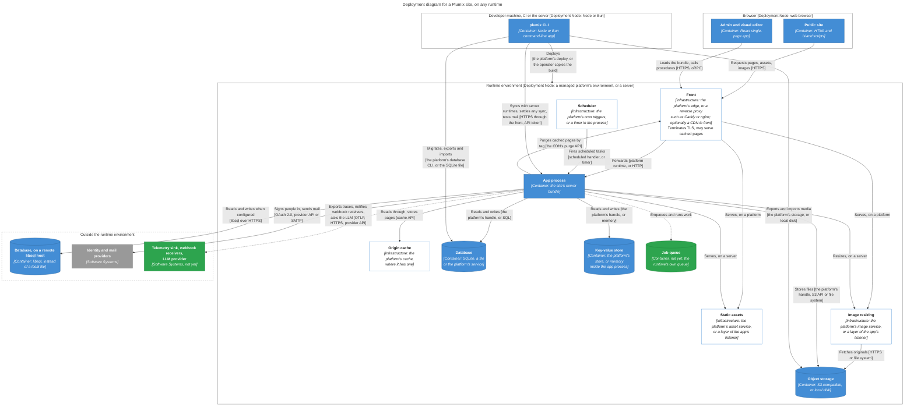

| Part           | Cloudflare                                                                                                                                       | Node                                                                             | Bun                                                     |
| -------------- | ------------------------------------------------------------------------------------------------------------------------------------------------ | -------------------------------------------------------------------------------- | ------------------------------------------------------- |
| Server         | Worker module with `fetch` and `scheduled`                                                                                                       | `node:http`, behind a reverse proxy                                              | `Bun.serve`, behind a reverse proxy                     |
| Database       | `d1()`                                                                                                                                           | `nodeSqlite()`                                                                   | `bunSqlite()`                                           |
| Object storage | `r2()`                                                                                                                                           | `diskStorage()`                                                                  | `diskStorage()` or `bunS3()`                            |
| Key-value      | `kv()`                                                                                                                                           | `memoryKv()` from `plumix/runtime`, optional                                     | `memoryKv()` from `plumix/runtime`, optional            |
| Page cache     | Workers Caching in front, purged with `cache.purge`; the Workers Cache API read-through. Use `@plumix/runtime-cloudflare/cdn`, which purges both | a CDN zone in front, purged via `plumix/cdn/cloudflare`                          | a CDN zone in front, purged via `plumix/cdn/cloudflare` |
| Image resizing | `images()`: Image Transformations                                                                                                                | `images()`: `sharp`, an optional peer                                            | `images()`: `Bun.Image`                                 |
| Static assets  | `ASSETS` binding, served before the Worker                                                                                                       | a layer in the listener                                                          | a layer in the listener                                 |
| Scheduler      | `triggers.crons` in the wrangler config                                                                                                          | in-process timer, or `cron: false` and `plumix cron run`                         | in-process timer                                        |
| Migrations     | `plumix deploy` migrates first                                                                                                                   | a SQLite file is migrated before the server listens; libsql uses its own tooling | the same as Node                                        |
| Deploy         | `plumix deploy` (wrangler)                                                                                                                       | copy the build                                                                   | copy the build                                          |

Every runtime can also use the portable providers: `plumix/db/libsql` for the database and
`plumix/storage/s3` for object storage. The full matrix is in [runtimes](docs/architecture/runtimes.md).

### Behaviour

Four flows that most changes touch, then two of the 1.0 design. Each step names the component that owns it. In the sign-in
flow, the very first user of a site is created by a passkey by default; OAuth creates the first admin
only with `bootstrapVia: "first-method-wins"`.

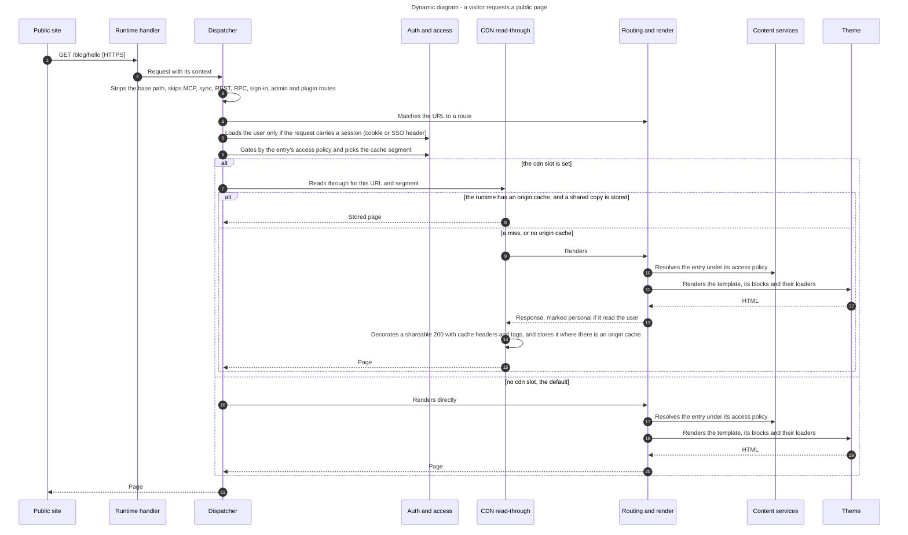

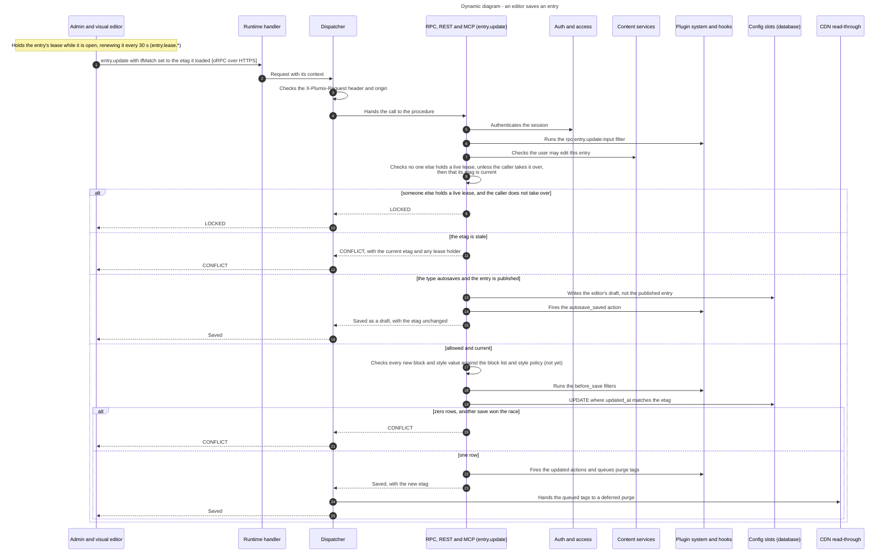

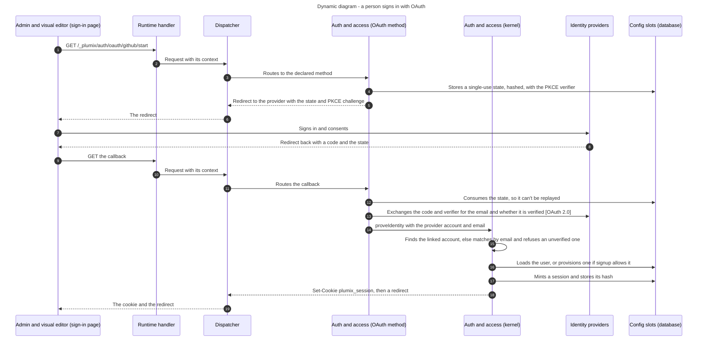

How a site starts. The runtime handler builds the app once per process or instance, before the first
request is served.

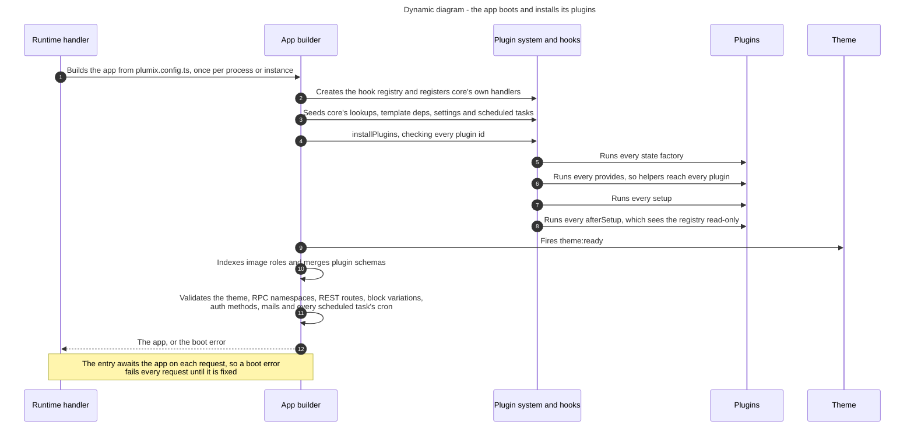

Two flows of the 1.0 design that the code does not run yet:

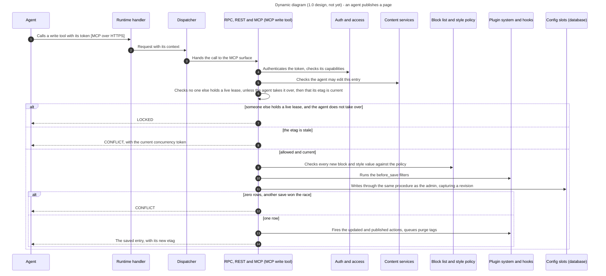

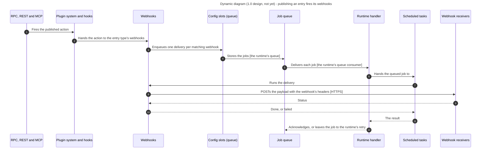

### Content model

What core stores. Revisions and autosaves are rows of `entries` with reserved types (`revision`,
`autosave`). Fields and meta live in a JSON `meta` column on entries, terms and users. An edit lease points at an entry, term, user or settings group by kind and id, so it has no foreign
key to them. A table whose name ends in `_not_yet` is in the 1.0 design but not in the code yet, and a
dashed line is a relationship the code does not have yet. Each plugin
that owns tables ships them with its own migration history
([ADR 0027](docs/adr/0027-each-table-owner-ships-its-own-migration-history.md)), so they are not
drawn here.

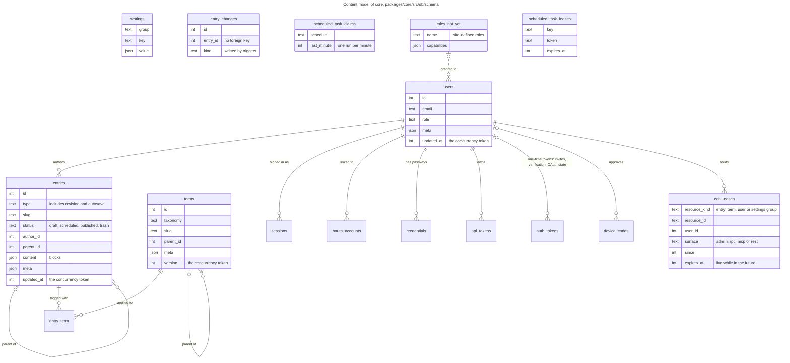

### Entry lifecycle

The statuses an entry moves through. `entry.update` accepts any status, so every move between draft,
scheduled and published is one save. Each move fires actions, type-scoped first
(`entry:<type>:<action>`) and then generic: a save that changes a column fires `updated`, a status change also
fires `transition`, and reaching published fires `published`; a save that only changes meta fires
`entry:meta_changed`. Trash, restore and permanent
delete fire `trashed`, `restored` and `deleted`. The scheduled task publishes due entries every five
minutes.

On a type that autosaves, saving a published entry does not touch it: the editor's changes go to their
own autosave row and fire `autosave_saved`, until publishing promotes them (`updated`) or the editor
discards them (`autosave_discarded`).

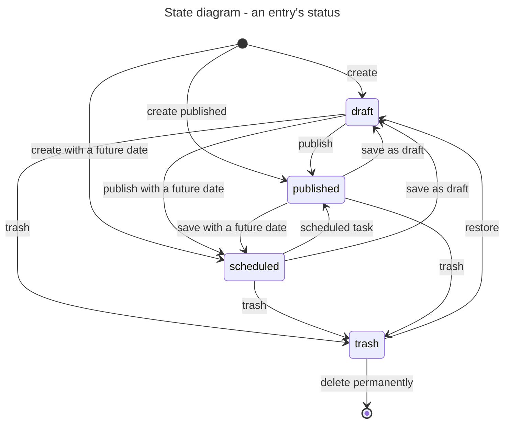

## Not there yet

The difference between this design and the code. Each row is drawn green or dashed, or marked "(not yet)", above until it is
done. Plumix is ready for 1.0 when this list is empty.

To build:

| Part of the design              | Seam to build on                                                                                                                                                                                                                                                                                                                                                                                                    | Done when                                                                                                                                                                                                                                                                                                                                                                                                                               | The code today                                                                                        |
| ------------------------------- | ------------------------------------------------------------------------------------------------------------------------------------------------------------------------------------------------------------------------------------------------------------------------------------------------------------------------------------------------------------------------------------------------------------------- | --------------------------------------------------------------------------------------------------------------------------------------------------------------------------------------------------------------------------------------------------------------------------------------------------------------------------------------------------------------------------------------------------------------------------------------- | ----------------------------------------------------------------------------------------------------- |
| Agents author like editors      | MCP write tools in `packages/core/src/mcp` that call the same procedures as the admin; `EDIT_LEASE_SURFACES` already includes `mcp`                                                                                                                                                                                                                                                                                 | An agent writes, composes and publishes under its token's capabilities, leases, revisions and the block and style policy, through the same procedures as the admin                                                                                                                                                                                                                                                                      | Read-only MCP tools                                                                                   |
| In-editor agent                 | An RPC procedure the admin calls, gated by the asking editor's own capabilities for the entry, that drafts through the same procedures as an editor; an `llm` config slot in `runtime/contract/slots.ts` keeps model keys on the server                                                                                                                                                                             | An editor asks the visual editor for a page draft and gets one built only from the site's blocks and design tokens, held to the same block list, style policy, leases and capabilities as the editor                                                                                                                                                                                                                                    | None                                                                                                  |
| Block list                      | The theme declares the blocks the editor offers; the admin reads it from the plugin manifest that `packages/plumix/src/vite/manifest.ts` builds, next to `coreBlocks` in `packages/admin-editor/src/runtime.ts`; the server enforces it in `assertContentValidAgainstRegistries` (`rpc/procedures/entry/content.ts`), which create, update and revision restore all call                                            | A site can remove any core block; neither the editor nor an agent can add a new instance of it, and an entry that already holds one keeps it, renders it and can still be saved                                                                                                                                                                                                                                                         | Every core block is always offered                                                                    |
| Style policy                    | The theme sets custom values or design tokens only; the editor's style controls read it from the plugin manifest, and the server enforces it in `assertContentValidAgainstRegistries` (`rpc/procedures/entry/content.ts`)                                                                                                                                                                                           | With tokens only, neither the editor nor an agent can store a new literal style value                                                                                                                                                                                                                                                                                                                                                   | Every style control offers Token and Custom                                                           |
| Site-defined roles              | Roles become sets of capabilities, stored in the database and declarable in config, the two merged. Seams: `USER_ROLES` (`users/contract/roles.ts`), the default grants in `access/contract/capability.ts`, `registerCapability`, whose `minRole` becomes the default roles a plugin grants, `ROLE_LEVEL` and `STAFF_MIN_ROLE` in `access/contract/rbac.ts`, and `rolePolicy` in `access/policy.ts`                 | Defaults member, author, editor and admin, each with default grants; a site adds roles in the admin or config; opening the admin is the `admin:access` capability; gated content requires a capability, not a minimum role; nothing compares roles by rank; gated content is segmented by capability (`capability:<name>`, replacing `role:<role>`); the _Code today_ lines are gone from Role, Capability and Segment in `GLOSSARY.md` | A ranked ladder: subscriber, contributor, author, editor, admin; staff and `rolePolicy` compare ranks |
| Every credential from a session | `authenticateSession` in `auth/authenticator.ts`, adopted by each surface ADR 0024 lists under "Still to adopt"                                                                                                                                                                                                                                                                                                     | Every surface that creates a credential resolves its caller through `authenticateSession`                                                                                                                                                                                                                                                                                                                                               | Passkey add-device only                                                                               |
| Outbound webhooks               | Declared in code per entry type, as Builder does per model: several per type, each a URL, custom headers (secrets through `EnvInput`), the events it wants (publish, unpublish, trash, delete, scheduled publish) and a payload (the full entry, none, or chosen fields). A core module subscribes to the entry actions, like the purge subscriber in `cdn/purge.ts`, and sends each delivery through the job queue | Publishing an entry sends a POST to each webhook its entry type declares for publish, with its headers and payload                                                                                                                                                                                                                                                                                                                      | None                                                                                                  |
| OTLP consumer                   | The exporter `otelConsumer` in `packages/core/src/telemetry-otel.ts`, for the existing `telemetry` config slot (`config.ts`)                                                                                                                                                                                                                                                                                        | A site imports the consumer from a `plumix` subpath and its traces reach any OpenTelemetry endpoint in production                                                                                                                                                                                                                                                                                                                       | The slot exists, but the OTLP consumer cannot be imported by a site                                   |
| Job queue slot                  | A `queue` slot in `runtime/contract/slots.ts`, filled by each runtime's own queue with that runtime's guarantees, and delivered back through the runtime handler to scheduled tasks                                                                                                                                                                                                                                 | Core and plugins enqueue work that outlives the request, and each runtime that provides a queue runs it                                                                                                                                                                                                                                                                                                                                 | None; `ctx.defer` only extends a request                                                              |

To remove, because the design drops them:

| In the code                                        | Why it goes                                                       | Done when                                                                                                                                                                          |
| -------------------------------------------------- | ----------------------------------------------------------------- | ---------------------------------------------------------------------------------------------------------------------------------------------------------------------------------- |
| The `contributor` role, and `subscriber` as a name | The design has four default roles and site-defined ones           | A data migration renames subscribers to `member`, and creates a stored `contributor` role with the same capabilities and moves contributors to it, so nobody gains or loses rights |
| The `plugin:manage` capability                     | Plugins are installed in code; no screen enables or disables them | The capability is gone from `access/contract/capability.ts`                                                                                                                        |
| The function form of `definePlugin`                | One way to define a plugin: the descriptor                        | Every plugin, the media plugin included, uses the descriptor form                                                                                                                  |
| The `password_reset` token type in `auth_tokens`   | There is no password sign-in, and nothing uses it                 | The value is gone from `AUTH_TOKEN_TYPES` in `db/schema/auth_tokens.ts`                                                                                                            |

## Quality goals

What Plumix optimizes for, in order. When two pull apart, the higher one wins. Each is held by a
decision and a test, so a change that weakens one fails a check.

| Goal                                                               | Held by                                                                                                                                                                    | Checked by                                                                                                     |
| ------------------------------------------------------------------ | -------------------------------------------------------------------------------------------------------------------------------------------------------------------------- | -------------------------------------------------------------------------------------------------------------- |
| Nobody sees what they may not, and a personal page is never shared | [ADR 0030](docs/adr/0030-a-render-that-reads-the-principal-is-never-shared.md), [ADR 0037](docs/adr/0037-a-public-surface-asks-per-entry-not-per-type.md)                  | `packages/core/src/route/render/personal-render.test.ts`, `packages/core/src/access/gate.integration.test.tsx` |
| No edit is lost or silently overwritten                            | [ADR 0048](docs/adr/0048-core-guards-every-edit-with-a-required-token-and-an-enforced-lease.md)                                                                            | `packages/core/src/rpc/procedures/entry/concurrency.test.ts`, `lease.test.ts`                                  |
| No content is lost on upgrade                                      | [ADR 0027](docs/adr/0027-each-table-owner-ships-its-own-migration-history.md), [ADR 0044](docs/adr/0044-data-migrations-run-in-typescript-after-every-schema-migration.md) | `pnpm migrations:check`                                                                                        |
| The developer's code is the contract, and a mistake fails early    | [ADR 0009](docs/adr/0009-a-renamed-hook-breaks-at-compile-time.md), [ADR 0013](docs/adr/0013-a-published-type-is-true-at-every-boundary-it-crosses.md)                     | `pnpm typecheck`, `pnpm surface:check`, `packages/core/src/runtime/app-*-validation.test.ts`                   |
| The same behaviour on every runtime                                | [ADR 0019](docs/adr/0019-a-runtime-adapter-uses-its-runtimes-primitives-and-is-tested-on-that-runtime.md)                                                                  | the conformance suites in `plumix/test/conformance`                                                            |
| The anonymous request path only gets cheaper                       | `CODING_STANDARDS.md`, Performance                                                                                                                                         | `packages/core/src/runtime/cold-path.test.ts`                                                                  |

## Trust boundaries

What Plumix trusts and where each untrusted input is checked. The full threat model is in
[`SECURITY.md`](SECURITY.md).

| Boundary                                                       | Check                                                                                          | Where                                                                                           |
| -------------------------------------------------------------- | ---------------------------------------------------------------------------------------------- | ----------------------------------------------------------------------------------------------- |
| A browser request to the admin, RPC, sign-in and plugin routes | The `X-Plumix-Request` header and the origin; MCP, REST and sync take an API token instead     | `enforcePlumixCsrf` in `runtime/dispatcher.ts`                                                  |
| Who is calling                                                 | The authenticator chain: session cookie, then API token, or a site's own                       | `defaultAuthenticator` in `auth/authenticator.ts`                                               |
| What a token may do                                            | Its scopes, intersected with its owner's capabilities                                          | `tokenScopesOf`, `makeAuthCan`                                                                  |
| An admin action                                                | The capability, then whether the user may edit the entry, then the lease and concurrency token | `requireCapability`, `assertCanEditEntry`, `assertLeaseAllows`                                  |
| A public page                                                  | The entry's access policy, and a personal render never cached shared                           | `policyForMatch`, `resolveAccess`, `trackPrincipalReads`                                        |
| A credential being created                                     | Only a signed-in session may create one, never a token (not yet on every surface)              | `authenticateSession`, [ADR 0024](docs/adr/0024-a-credential-is-created-only-from-a-session.md) |
| Stored content rendered later                                  | Escaped on output; style values sanitized                                                      | the renderer, `blocks/styles/sanitize-css.ts`                                                   |

Trusted, and so not checked: the site owner, `plumix.config.ts` and its secrets, the installed
plugins and theme (they run as part of the app), and the runtime and its bound services.

## Failure modes

What happens when things go wrong, and who handles it.

| When                                 | What happens                                                                                      |
| ------------------------------------ | ------------------------------------------------------------------------------------------------- |
| Two people edit the same entry       | The second gets `LOCKED` while the first holds a live lease, unless they choose to take it over   |
| A save is made from a stale copy     | `CONFLICT`, carrying the current concurrency token                                                |
| Two saves race                       | The guarded `UPDATE` matches no row for the loser, which gets `CONFLICT`                          |
| An action handler throws             | The others still run; the failure is reported, not raised (`doAction` uses `Promise.allSettled`)  |
| A filter handler throws              | The request fails, except for isolated array filters, which skip that handler                     |
| A CDN purge fails                    | It is logged; the write it followed still succeeds                                                |
| A scheduled task fails               | Its siblings still run; the run reports `failed`                                                  |
| Two replicas fire the same task      | The run guard lets one run (the in-process timer and `plumix cron run`)                           |
| A plugin registers something twice   | Boot fails with `DuplicateRegistrationError`                                                      |
| The config or a task's cron is wrong | Boot fails; the deploy still goes out, and every request returns the boot error until it is fixed |
| No mailer is configured              | Sending throws `MailerNotConfigured`; surfaces that need mail say so                              |

## Agents

Agents are users of Plumix twice over: they build sites, and they work inside running ones.

- **Building with Plumix.** An agent starts at `AGENTS.md`, then `VISION.md` for what to build toward,
  this file for how the system fits, and the subsystem page for the area it changes. `GLOSSARY.md`
  fixes the vocabulary.
- **Inside a running site.** An agent connects to `/_plumix/mcp` with an API token. It reads content
  and the content model through core's tools and any tools plugins register with `ctx.registerMcpTool`.
  The token's scopes limit what it can do, and in production MCP is off until the config turns it on.
- **In the 1.0 design.** An agent writes, composes and publishes through the same procedures as the
  admin, held to the same rules: its token's capabilities, leases, revisions, the block list and the
  style policy. What it may do is what its token may do; a person steers it by choosing that token.

## How do I

Where to start for common changes. Each row names the entry point and the page to read first.

| To                        | Start at                                                                                                            | Read                                                          |
| ------------------------- | ------------------------------------------------------------------------------------------------------------------- | ------------------------------------------------------------- |
| Add a block               | `ctx.registerBlock` in a plugin, or the theme's `blocks`                                                            | [blocks and islands](docs/architecture/blocks-and-islands.md) |
| Add a field type          | `ctx.registerFieldType`                                                                                             | [plugin system](docs/architecture/plugin-system.md)           |
| Add a hook core fires     | the module that declares the hook name (for example `packages/core/src/rpc/hooks.ts`), and the caller that fires it | [hooks](docs/architecture/hooks.md)                           |
| Add an admin procedure    | `packages/core/src/rpc/procedures/`, or `ctx.registerRpcRouter` in a plugin                                         | [RPC and editing](docs/architecture/rpc-and-editing.md)       |
| Add a REST resource       | `ctx.registerRestResource`                                                                                          | [REST](docs/architecture/rest-api.md)                         |
| Add an agent tool         | `ctx.registerMcpTool`                                                                                               | [MCP](docs/architecture/mcp.md)                               |
| Add a scheduled task      | `ctx.registerScheduledTask`                                                                                         | [cron](docs/architecture/cron.md)                             |
| Add an admin page         | `ctx.registerAdminPage`                                                                                             | [admin and editor](docs/architecture/admin-and-editor.md)     |
| Add a table or change one | the owner's drizzle schema, then `db:generate`                                                                      | [migrations](docs/architecture/migrations.md)                 |
| Support a new runtime     | `RuntimeAdapter`, the config slots, and the conformance suites                                                      | [runtimes](docs/architecture/runtimes.md)                     |

## Subsystems

| Area       | Page                                                          | One line                                                                |
| ---------- | ------------------------------------------------------------- | ----------------------------------------------------------------------- |
| Extending  | [Plugin system](docs/architecture/plugin-system.md)           | A descriptor declares everything a plugin contributes.                  |
|            | [Hooks](docs/architecture/hooks.md)                           | Typed filters and actions core fires at fixed points.                   |
| Serving    | [Routing and render](docs/architecture/routing-and-render.md) | A public URL resolves to data, then renders through the theme.          |
|            | [Blocks and islands](docs/architecture/blocks-and-islands.md) | Content is blocks; client JavaScript is an island a block asks for.     |
|            | [CDN cache](docs/architecture/cdn-cache.md)                   | Anonymous renders are cached and purged by tag.                         |
| Editing    | [RPC and editing](docs/architecture/rpc-and-editing.md)       | Every admin write is an RPC procedure, guarded by token and lease.      |
|            | [Admin and editor](docs/architecture/admin-and-editor.md)     | A prebuilt SPA, extended only through registrations.                    |
| Interfaces | [REST API](docs/architecture/rest-api.md)                     | Opt-in, read-only core resources, plus plugin resources.                |
|            | [MCP](docs/architecture/mcp.md)                               | Agent tools; writes are not yet. On in dev, opt-in in production.       |
| People     | [Auth and access](docs/architecture/auth-and-access.md)       | Sign-in methods, sessions, roles, capabilities, per-entry access.       |
|            | [Mail](docs/architecture/mail.md)                             | Mails declared by name and sent through a mailer slot.                  |
| Platform   | [Runtimes](docs/architecture/runtimes.md)                     | One adapter per runtime, held to a shared conformance suite.            |
|            | [Migrations](docs/architecture/migrations.md)                 | Each table owner ships its history; data migrations run after schema.   |
|            | [Sync and import](docs/architecture/sync-and-import.md)       | Moving content between installs; a sync replaces a scope.               |
|            | [Cron](docs/architecture/cron.md)                             | Scheduled tasks registered by core and plugins.                         |
|            | [Media and storage](docs/architecture/media-and-storage.md)   | Files in the storage slot; images by role.                              |
|            | [Search](docs/architecture/search.md)                         | Entry search in core, indexing in a plugin.                             |
|            | [i18n](docs/architecture/i18n.md)                             | Every user-facing string is a Lingui descriptor.                        |
| Tooling    | [Build and CLI](docs/architecture/build-and-cli.md)           | The `plumix` CLI, the Vite plugin and the scaffolder.                   |
|            | [Dev tooling](docs/architecture/dev-tooling.md)               | Error pages, debug bar and request history, compiled out of production. |

## Codemap

- `packages/plumix`: the published umbrella. Every package outside the framework imports Plumix
  through its subpaths. It also holds the CLI (`src/cli`) and the Vite plugin (`src/vite`).
- `packages/core`: the engine, one package in five layers that import only downward
  (`packages/core/layers.ts`, [ADR 0010](docs/adr/0010-core-is-one-package-of-enforced-layers.md)):
  - **foundation**: `blocks/`, `i18n/` and small pure helpers.
  - **contracts**: `plugin/`, `hooks/`, `context/`, `db/schema/`, every `*/contract/` folder, config,
    theme and template types.
  - **capabilities**: `db/`, `meta/`, `access/`, `auth/`, `mail/`, `entries/`, `terms/`, `users/`,
    `revisions/`, `search/`, `seo/`, `images/`, `storage/`, `cdn/`, `route/`.
  - **surfaces**: `rpc/`, `rest/`, `mcp/`, `admin-area/`, `admin-bar/`, `admin/`, `dev/`,
    `dev-client/`, `cli/`, `welcome/`.
  - **top**: `runtime/`, which wires everything into a request handler.
- `packages/admin`, `admin-editor`, `admin-ui`: the admin SPA, the visual editor and their UI
  primitives.
- `packages/plugins/*`: first-party plugins, built only on public seams.
- `packages/runtimes/*`: one adapter per runtime.
- `packages/create-plumix-app`: the scaffolder.
- `apps/*`: private sites built on Plumix (demo, docs, marketing).
- `tooling/*`: workspace configs and guards, such as the published-surface roster.
- `scripts/`: scripts the repo runs, such as `pnpm test:mutation`.

## API boundaries

- **The published surface** is the `plumix` package and its subpaths, plus each plugin's and runtime
  adapter's exports. `tooling/published-surface` records a reason for every export, and
  `pnpm surface:check` fails on one without. Internal `@plumix/*` packages are free to change.
- **The plugin seam** is `definePlugin` from `plumix/plugin`: a plugin declares what it contributes and
  never reaches into core's internals.
- **The runtime contract** is `RuntimeAdapter` and the config slots in `plumix/runtime`; each adapter
  proves it with the conformance suites in `plumix/test/conformance`.
- **The wire** between the admin and the app process is oRPC, which is internal and may change in any
  minor. REST (`/_plumix/api/v1`) and MCP (`/_plumix/mcp`) are the external APIs.
- **Stability.** Before 1.0, any minor may break the published surface, hook names, REST v1 or the
  config shape, and its changeset says how to move. From 1.0, as the vision commits, those hold for every `1.x`; internal
  `@plumix/*` packages, the oRPC wire and the admin's markup never do.

## Cross-cutting concerns

- **Errors.** Each area throws its own named errors from an `errors.ts`; the admin shows a failure
  through a localized descriptor, never its message
  ([ADR 0018](docs/adr/0018-the-admin-shows-a-failure-through-a-descriptor-it-chose.md)).
- **Testing.** Three tiers: unit, e2e and smoke
  ([ADR 0042](docs/adr/0042-tests-come-in-three-tiers.md), [`CODING_STANDARDS.md`](CODING_STANDARDS.md#tests)).
- **Security.** Access is decided per entry on every surface, and a render that reads the principal is
  never shared; see [auth and access](docs/architecture/auth-and-access.md) and
  [`SECURITY.md`](SECURITY.md).
- **Caching.** Pages are cached by segment and purged by tag; see
  [CDN cache](docs/architecture/cdn-cache.md).
- **Internationalization.** Every user-facing string is a Lingui descriptor; see
  [i18n](docs/architecture/i18n.md).
- **Observability.** In development, request history, error pages and the debug bar; see
  [dev tooling](docs/architecture/dev-tooling.md). Production export goes through the OTLP consumer (not yet).

## Invariants

Each is stated as something that never happens, with what guards it.

- Nothing outside the framework imports an internal `@plumix/*` package; it imports `plumix` and its
  subpaths (the umbrella rule in `AGENTS.md`, the `noInternalImports` lint config).
- No core layer imports a layer above it, and no browser code reaches a server-only module
  (`packages/core/src/layers.test.ts`).
- Core and plugin request-path code never touches a runtime's own primitives; those live in its adapter
  ([ADR 0019](docs/adr/0019-a-runtime-adapter-uses-its-runtimes-primitives-and-is-tested-on-that-runtime.md)).
- Core never takes on what would merely be absent without it; that belongs to a plugin
  ([ADR 0002](docs/adr/0002-core-owns-what-would-be-wrong.md)).
- A render that reads the principal never reaches a shared cache
  ([ADR 0030](docs/adr/0030-a-render-that-reads-the-principal-is-never-shared.md)).
- No write lands from a stale copy or over someone else's live lease
  ([ADR 0048](docs/adr/0048-core-guards-every-edit-with-a-required-token-and-an-enforced-lease.md)).
- No dev-only code ships in a production build; each gate is an inline compile-time constant
  (`packages/plumix/src/vite/dev-gate-tree-shaking.test.ts`).

## Decisions by area

The ADRs behind each part of the system, in [`docs/adr/`](docs/adr/).

| Area                | ADRs                                                                                                                                                                                                                                                                                                                                                       |
| ------------------- | ---------------------------------------------------------------------------------------------------------------------------------------------------------------------------------------------------------------------------------------------------------------------------------------------------------------------------------------------------------- |
| Shape of the system | 0001 one platform context, 0002 core owns what would be wrong, 0010 core is one package of layers, 0011 the context carries config once                                                                                                                                                                                                                    |
| Runtimes            | 0019 an adapter uses its runtime's primitives and is tested on it, 0045 remote databases come from platform config                                                                                                                                                                                                                                         |
| Plugins and hooks   | 0005 composite field hooks, 0007 an extension point hands out a query, 0009 a renamed hook breaks at compile time, [0043 a plugin's state comes from its factory](docs/adr/0043-a-plugins-per-install-state-comes-from-its-state-factory.md)                                                                                                               |
| Content and fields  | 0004 image roles are an open set, 0026 a field default is the starting value                                                                                                                                                                                                                                                                               |
| Editing             | [0003 an autosave stores edits](docs/adr/0003-an-autosave-stores-edits-not-a-snapshot.md), 0048 every edit needs a token and a lease                                                                                                                                                                                                                       |
| Routing and render  | 0008 an archive is one entry query, 0012 a term is addressed by its slug, 0015 page data comes from core, 0016 a render context resolves descriptors, 0025 page kinds, 0029 a turned-off route is never compiled, 0031 page transitions, 0032 page outcomes, 0033 redirect status, 0035 an app page is a view, 0040 block deps                             |
| Access and auth     | 0022 a capability is named by what it guards, 0024 a credential comes only from a session, 0030 a personal render is never shared, 0037 access is per entry, 0041 a sign-in method is an extension                                                                                                                                                         |
| Mail                | 0036 a mail is declared by name                                                                                                                                                                                                                                                                                                                            |
| Interfaces          | 0013 a published type is true at every boundary, 0020 REST resources are bound by core                                                                                                                                                                                                                                                                     |
| Admin               | 0014 the admin offers only what the deployment can do, 0018 failures shown through descriptors, 0023 admin-ui owns its primitives                                                                                                                                                                                                                          |
| Data and operations | 0027 each owner ships its migrations, 0034 operator tasks are CLI or config, 0039 a sync replaces a scope, 0044 data migrations run after schema                                                                                                                                                                                                           |
| Plugins' outputs    | 0006 a card renderer declares what it reads, 0028 sitemap sources                                                                                                                                                                                                                                                                                          |
| Build and tests     | [0003 dev config mirrors the dev layers](docs/adr/0003-dev-config-mirrors-the-dev-layers.md), 0021 tests run in Node or a browser (superseded by 0042), 0038 coupled invariants, 0042 three test tiers, [0043 a build ships licences](docs/adr/0043-a-site-build-ships-the-licences-of-what-it-bundles.md), 0046 the scaffold smoke, 0049 mutation testing |

## Keeping this true

A change that moves a box, adds a surface or breaks an invariant updates this file and the page
for that subsystem in the same PR. Pages name files and symbols, never line numbers. Each page's
Not there yet rows are that subsystem's share of the rows above, so a row closes on both at once.
