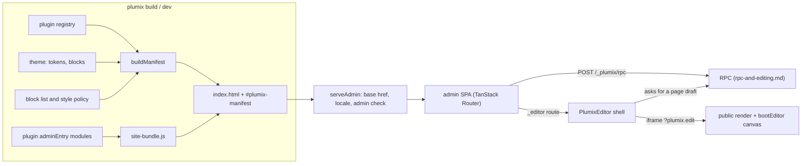

# Admin and editor

The admin is a prebuilt React single-page app that editors, designers and site admins use to manage content, users and settings. It is served at `/_plumix/admin/` and is the "Admin and visual editor" container in [`ARCHITECTURE.md`](../../ARCHITECTURE.md). Its shape for a given site comes from the plugin manifest, computed at build time from the plugin registry. Plugin authors extend it declaratively, with admin pages, meta boxes, dashboard widgets, field types, blocks and settings pages, and put their React code in an `adminEntry` module. The visual editor is a second app: an editor shell inside the admin, plus a canvas runtime booted inside the site's own rendered page. The code lives in `packages/admin` (the app), `packages/admin-ui` (UI primitives), `packages/admin-editor` (the visual editor), and `packages/plumix/src/vite/` (staging and the plugin manifest).

## At a glance

## Surface

| Piece                                                                                                                                              | Where                                                                 | Public?                            |
| -------------------------------------------------------------------------------------------------------------------------------------------------- | --------------------------------------------------------------------- | ---------------------------------- |
| `adminEntry`, `adminCss` on a plugin descriptor                                                                                                    | `packages/core/src/plugin/define.ts`                                  | public                             |
| `adminChunk` (pre-built JS)                                                                                                                        | same                                                                  | public                             |
| `registerAdminPage({ path, title, nav?, capability?, component })`                                                                                 | plugin setup context                                                  | public                             |
| `registerDashboardWidget({ id, title, capability?, component, priority? })`                                                                        | plugin setup context                                                  | public                             |
| `registerFieldType({ type, component })`                                                                                                           | plugin setup context                                                  | public                             |
| `registerEntryMetaBox` / `registerTermMetaBox` / `registerUserMetaBox`                                                                             | plugin setup context                                                  | public                             |
| `registerSettingsGroup` / `registerSettingsPage`                                                                                                   | plugin setup context                                                  | public                             |
| `registerBlock` / `registerMark` / `registerPattern` (canvas and inserter)                                                                         | plugin setup context, see [blocks and islands](blocks-and-islands.md) | public                             |
| `createPluginRpcClient`, `isSlotConfigured`, `basePath`, `getRuntime`, `describeRpcError`, `useEditLease`, `EditLeaseBanner`, `EditConflictDialog` | `plumix/admin`                                                        | public                             |
| `plumix/admin/auth-client`                                                                                                                         | the admin's `authClient`, for plugin admin code                       | public                             |
| `plumix/admin/ui`                                                                                                                                  | `packages/admin-ui` components                                        | public, markup and props are API   |
| `plumix/admin/react`, `/react-dom`, `/react-query`, `/radix`, …                                                                                    | shims onto `window.plumix.runtime`                                    | internal build contract            |
| `window.plumix.register*` (`registerPluginPage`, `registerPluginDashboardWidget`, `registerPluginFieldType`, `registerPluginBlock`, …)             | `packages/admin/src/lib/plumix-globals.ts`                            | internal, called by generated code |
| `PlumixEditor`, `bootEditor`                                                                                                                       | `@plumix/admin-editor`, `plumix/editor-runtime`                       | internal                           |

Admin routes (`packages/admin/src/routes/`):

| Layout                                                            | Routes                                                                                                                                                                                                   |
| ----------------------------------------------------------------- | -------------------------------------------------------------------------------------------------------------------------------------------------------------------------------------------------------- |
| `_auth`                                                           | `login`, `bootstrap`, `accept-invite/$token`                                                                                                                                                             |
| `_authenticated` (needs a session, `requireAuthenticatedSession`) | dashboard `index`, `entries/$slug`, `terms/$name` (+ `create`, `$id/edit`), `users` (+ `create`, `$id/edit`), `roles`, `settings` + `settings/$page`, `profile`, `auth/device`, `pages/$` (plugin pages) |
| `_editor`                                                         | `entries/$slug/create`, `entries/$slug/$id/edit` (visual editor or plain form)                                                                                                                           |

## How it works

**Staging.** The `plumix` Vite plugin builds the admin in `.plumix/admin-staging` and swaps it into `_plumix/admin/` under the site's `publicDir` only when it differs (`stageAdminAssets` in `packages/plumix/src/vite/index.ts`). `stageAdminInto` writes the plugin manifest into `index.html` through `injectManifestIntoHtml`, which throws when the placeholder is missing, and adds plugin script tags between `<!-- plumix:plugin-chunks -->` markers. `computeManifestAndRegistry` (`packages/plumix/src/vite/manifest.ts`) installs the plugins and fires `theme:ready` before it calls `buildManifest`, so the plugin manifest matches what the app process registers. See [build and CLI](build-and-cli.md).

**Plugin code.** `assemblePluginAdminBundle` (`packages/plumix/src/vite/admin-plugin-bundle.ts`) compiles every plugin's `adminEntry` into one `site-bundle.js` with esbuild. It aliases `react`, `@tanstack/*` and `@orpc/*` to the host's shared instances, and generates `window.plumix.registerPluginPage`, `registerPluginDashboardWidget`, `registerPluginFieldType`, `registerPluginMarkSchema` and `registerPluginBlock` calls from the registry. Every first-party plugin with admin code uses `adminEntry` (audit-log, comments, forms, media, menu, og, seo).

**Plugin manifest and gating.** `buildManifest` (`packages/core/src/plugin/build-manifest.ts`) projects entry types, taxonomies, meta boxes, settings, nav, widgets, blocks, the theme's block list and style policy, design tokens, i18n, `configuredSlots` and `refusedAdminAreas`. It throws on duplicate admin slugs or a meta box whose scope doesn't exist. The admin reads it once (`readManifest` in `packages/admin/src/lib/manifest.ts`) and filters every surface by the session's capabilities: `visibleAdminNav`, `visibleDashboardWidgets`, `entryMetaBoxesForType` (which also drops fields one by one), `visibleSettingsPages` (needs `settings:manage`). `pages/$` redirects when the user lacks the page's capability. All checks go through `hasCap` (`lib/caps.ts`). Under [ADR 0014](../adr/0014-the-admin-offers-only-what-the-deployment-can-do.md), what the deployment can do is a separate question: `configuredSlots` and `refusedAdminAreas` travel in the plugin manifest, and `ADMIN_AREA_SURFACES` (`lib/admin-areas.ts`) hides each refused area's cards.

**Serving.** `serveAdmin` (`packages/core/src/runtime/dispatcher.ts`) answers only `GET` and `HEAD`. It fetches the shell from `ctx.assets` and redirects a signed-in user to `/` unless one of their roles grants the `admin:access` capability. Nothing compares roles by rank. It rewrites `lang`/`dir` for the request's locale, injects the base href so one build serves under any `basePath`, and marks the response `private, no-cache`. In development, `packages/admin` can also run on `:5174` and proxy `/_plumix/rpc` and `/_plumix/auth` (`CONTRIBUTING.md`, "The admin").

**UI primitives** ([ADR 0023](../adr/0023-admin-ui-owns-the-primitives-it-took-from-shadcn.md)). `packages/admin-ui/src` is Plumix source: fully linted, with labels passed in as props and icons only from `icons.ts`. `ui:add` runs `shadcn add` and then `roster:sync`, which regenerates the `exports` map and `src/index.ts`.

**Visual editor.** The `_editor/entries/$slug/$id/edit` route mounts `PlumixEditor` (`packages/admin-editor/src/plumix-editor.tsx`), or the plain form for types that don't use the canvas (`packages/admin/src/editor/resolve-editor-mode.ts`). The canvas is an iframe of the entry's public URL with `?plumix.edit`. `resolveEditMode` (`packages/core/src/route/edit-mode.ts`) decides whether that render injects the runtime, and `injectEditorBootstrap` (`route/render/inject-editor-bootstrap.ts`) adds `.plumix/editor-entry.ts`. That entry is generated by `editor-entry-codegen.ts` and calls `bootEditor` with the site's plugin block and shortcode specs. `mountEditorRuntime` mounts `EditorCanvas` on `[data-plumix-content-root]`, seeded from embedded JSON, and the canvas offers `coreBlocks` plus the plugin blocks, narrowed to the theme's block list (`packages/admin-editor/src/runtime.ts`). An entry that already holds a block the list removed keeps it, renders it on the canvas and can still be saved; the server refuses a save that adds one (`assertContentValidAgainstRegistries`). The style controls (`packages/admin-editor/src/style-control.tsx`, `style-field-state.ts`) read the theme's style policy: with tokens only they offer no Custom input, and a save cannot store a new literal style value. Messages between the shell and the canvas are pinned to the host origin (`host-origin.ts`). Saves go through core's save queue and the admin's autosave (`packages/core/src/admin/save-queue.ts`, `packages/admin/src/editor/entry-autosave.ts`), on the RPC described in [RPC and editing](rpc-and-editing.md), holding the entry's edit lease (`useEditLease`).

**In-editor agent.** An editor asks the visual editor for a page draft. The shell calls an RPC procedure that drafts through the same procedures as an editor and reaches a model through the `llm` config slot (`runtime/contract/slots.ts`), so model keys stay on the server. The draft is built only from the site's blocks and design tokens and saved under the editor's own lease, capabilities and revisions.

**Roles screen.** A `roles` route under `_authenticated`, behind a capability, lets a site admin add a role and pick its capabilities, on RPC procedures that read and write the stored roles. The defaults are `member`, `author`, `editor` and `admin`. The user screens (`users/-constants.ts`, `lib/user-role-labels.ts`) list roles from the server.

**Tests.** Unit tests sit beside the code (`packages/admin/src/lib/*.test.ts`, `packages/admin-editor/src`). The admin e2e specs (`packages/admin/e2e/*.spec.ts`) run against `vite preview` of the built admin with RPC mocked (`e2e/support/rpc-mock.ts`), so they check the built `dist/`, not a live server; the visual editor's run against `playground/`. The real-server path is covered by the scaffold smoke.

## Invariants

- The admin shows an affordance only when the deployment can do it, decided separately from capabilities ([ADR 0014](../adr/0014-the-admin-offers-only-what-the-deployment-can-do.md), `lib/admin-areas.test.ts`, `build-manifest.test.ts`).
- The admin never renders a caught error's `message` ([ADR 0018](../adr/0018-the-admin-shows-a-failure-through-a-descriptor-it-chose.md), `plumix/no-error-message-in-ui`).
- admin-ui primitives are linted and localized, and upstream changes come in by review, never `--overwrite` ([ADR 0023](../adr/0023-admin-ui-owns-the-primitives-it-took-from-shadcn.md)).
- A stale admin build fails loudly: `injectManifestIntoHtml` throws when the plugin manifest placeholder is missing.
- The plugin manifest is computed from the same registry and `theme:ready` the app process uses (`packages/plumix/src/vite/manifest.test.ts`).
- The scaffold smoke drives the editor under `plumix dev` with an installed plugin's block ([ADR 0046](../adr/0046-the-scaffold-smoke-drives-the-editor-under-plumix-dev.md)).
- New admin routes add an e2e spec that runs axe-core against WCAG 2.1 AA (`CONTRIBUTING.md`; `packages/admin/e2e/support/axe.ts`).
- Capability checks in the admin are hints; the server checks every procedure again (see [auth and access](auth-and-access.md)).
