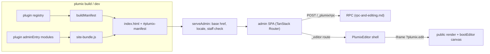

# Admin and editor

The admin is a prebuilt React single-page app that staff use to manage content, users and settings. It is served at `/_plumix/admin/`. Its shape for a given site comes from a plugin manifest computed at build time from the plugin registry. Plugin authors extend it declaratively, with admin pages, meta boxes, dashboard widgets, field types, blocks and settings pages, and put their React code in an `adminEntry` module. The visual editor is a second app: an editor shell inside the admin, plus a canvas runtime booted inside the site's own rendered page. The code lives in `packages/admin` (the app), `packages/admin-ui` (UI primitives), `packages/admin-editor` (the visual editor), and `packages/plumix/src/vite/` (staging and manifest).

## At a glance

## Surface

| Piece                                                                                                                                              | Where                                                                    | Public?                            |
| -------------------------------------------------------------------------------------------------------------------------------------------------- | ------------------------------------------------------------------------ | ---------------------------------- |
| `adminEntry`, `adminCss` on a plugin descriptor                                                                                                    | `packages/core/src/plugin/define.ts`                                     | public                             |
| `adminChunk` (prebuilt JS, legacy)                                                                                                                 | same                                                                     | public, legacy                     |
| `registerAdminPage({ path, title, nav?, capability?, component })`                                                                                 | plugin setup context                                                     | public                             |
| `registerDashboardWidget({ id, title, capability?, component, priority? })`                                                                        | plugin setup context                                                     | public                             |
| `registerFieldType({ type, component })`                                                                                                           | plugin setup context                                                     | public                             |
| `registerEntryMetaBox` / `registerTermMetaBox` / `registerUserMetaBox`                                                                             | plugin setup context                                                     | public                             |
| `registerSettingsGroup` / `registerSettingsPage`                                                                                                   | plugin setup context                                                     | public                             |
| `registerBlock` / `registerMark` / `registerPattern` (canvas and inserter)                                                                         | plugin setup context, see [blocks-and-islands.md](blocks-and-islands.md) | public                             |
| `createPluginRpcClient`, `isSlotConfigured`, `basePath`, `getRuntime`, `describeRpcError`, `useEditLease`, `EditLeaseBanner`, `EditConflictDialog` | `plumix/admin`                                                           | public                             |
| `plumix/admin/ui`                                                                                                                                  | `packages/admin-ui` components                                           | public, markup and props are API   |
| `plumix/admin/react`, `/react-dom`, `/react-query`, `/radix`, …                                                                                    | shims onto `window.plumix.runtime`                                       | internal build contract            |
| `window.plumix.register*` (`registerPluginPage`, `registerPluginDashboardWidget`, `registerPluginFieldType`, `registerPluginBlock`, …)             | `packages/admin/src/lib/plumix-globals.ts`                               | internal, called by generated code |
| `PlumixEditor`, `bootEditor`                                                                                                                       | `@plumix/admin-editor`, `plumix/editor-runtime`                          | internal                           |

Admin routes (`packages/admin/src/routes/`):

| Layout                                                            | Routes                                                                                                                                                                                          |
| ----------------------------------------------------------------- | ----------------------------------------------------------------------------------------------------------------------------------------------------------------------------------------------- |
| `_auth`                                                           | `login`, `bootstrap`, `accept-invite/$token`                                                                                                                                                    |
| `_authenticated` (needs a session, `requireAuthenticatedSession`) | dashboard `index`, `entries/$slug`, `terms/$name` (+ `create`, `$id/edit`), `users` (+ `create`, `$id/edit`), `settings` + `settings/$page`, `profile`, `auth/device`, `pages/$` (plugin pages) |
| `_editor`                                                         | `entries/$slug/create`, `entries/$slug/$id/edit` (visual editor or plain form)                                                                                                                  |

## How it works

**Staging.** The plumix Vite plugin copies `@plumix/admin`'s `dist/` into `_plumix/admin/` under the site's `publicDir`. `stageAdminInto` (`packages/plumix/src/vite/index.ts`) writes the manifest into `index.html` with `injectManifestIntoHtml`, which throws when the placeholder is missing. It also adds plugin script tags between `<!-- plumix:plugin-chunks -->` markers. `computeManifestAndRegistry` (`packages/plumix/src/vite/manifest.ts`) installs the plugins and fires `theme:ready` before it calls `buildManifest`, so the manifest matches what the worker registers.

**Plugin code.** `assemblePluginAdminBundle` (`packages/plumix/src/vite/admin-plugin-bundle.ts`) compiles every plugin's `adminEntry` into one `site-bundle.js` with esbuild. It aliases `react`, `@tanstack/*` and `@orpc/*` to the host's shared instances, and generates `window.plumix.registerPluginPage`, `registerPluginFieldType`, `registerPluginMarkSchema` and `registerPluginBlock` calls from the registry. Every first-party plugin uses `adminEntry` (audit-log, comments, forms, media, menu, og, seo).

**Manifest and gating.** `buildManifest` (`packages/core/src/plugin/build-manifest.ts`) projects entry types, taxonomies, meta boxes, settings, nav, widgets, blocks, tokens, i18n, `configuredSlots` and `refusedAdminAreas`. It throws on duplicate admin slugs or a meta box whose scope doesn't exist. The admin reads the manifest once (`readManifest` in `packages/admin/src/lib/manifest.ts`). It filters every surface by the session's capabilities: `visibleAdminNav`, `visibleDashboardWidgets`, `entryMetaBoxesForType` (which also drops fields per field), `visibleSettingsPages` (needs `settings:manage`). `pages/$` redirects when the user lacks the page's capability. All checks go through `hasCap` (`lib/caps.ts`). Under [ADR 0014](../adr/0014-the-admin-offers-only-what-the-deployment-can-do.md), what the deployment can do is a separate question: `configuredSlots` and `refusedAdminAreas` travel in the manifest, and `ADMIN_AREA_SURFACES` (`lib/admin-areas.ts`) hides each refused area's cards.

**Serving.** `serveAdmin` (`packages/core/src/runtime/dispatcher.ts`) answers only `GET` and `HEAD`. It fetches the shell from `ctx.assets` and redirects a signed-in non-staff user to `/` (`canAccessAdmin`: `contributor` and above). It rewrites `lang`/`dir` for the request's locale, injects the base href so one build serves under any `basePath`, and marks the response `private, no-cache`. In development, `packages/admin` can also run on `:5174` and proxy `/_plumix/rpc` and `/_plumix/auth` (CONTRIBUTING.md, "The admin").

**UI primitives** ([ADR 0023](../adr/0023-admin-ui-owns-the-primitives-it-took-from-shadcn.md)). `packages/admin-ui/src` is Plumix source: fully linted, with labels passed in as props and icons only from `icons.ts`. `ui:add` runs `shadcn add` and then `roster:sync`, which regenerates the `exports` map and `src/index.ts`.

**Visual editor.** The `_editor/entries/$slug/$id/edit` route mounts `PlumixEditor` (`packages/admin-editor/src/plumix-editor.tsx`), or the plain form for types that don't use the canvas (`packages/admin/src/editor/resolve-editor-mode.ts`). The canvas is an iframe of the entry's public URL with `?plumix.edit`. `resolveEditMode` (`packages/core/src/route/edit-mode.ts`) decides whether that render injects the runtime, and `injectEditorBootstrap` adds `.plumix/editor-entry.ts`. That entry is generated by `editor-entry-codegen.ts` and calls `bootEditor` with the site's plugin block and shortcode specs. `mountEditorRuntime` mounts `EditorCanvas` on `[data-plumix-content-root]`, seeded from embedded JSON. Messages between the shell and the canvas are pinned to the host origin (`host-origin.ts`). Saves go through the admin's save queue and autosave (`packages/admin/src/editor/save-queue.ts`, `entry-autosave.ts`), on the RPC described in [rpc-and-editing.md](rpc-and-editing.md).

## Invariants

- The admin shows an affordance only when the deployment can do it, decided separately from capabilities ([ADR 0014](../adr/0014-the-admin-offers-only-what-the-deployment-can-do.md), `lib/admin-areas.test.ts`, `build-manifest.test.ts`).
- The admin never renders a caught error's `message` ([ADR 0018](../adr/0018-the-admin-shows-a-failure-through-a-descriptor-it-chose.md), `plumix/no-error-message-in-ui`).
- admin-ui primitives are linted and localized, and upstream changes come in by review, never `--overwrite` ([ADR 0023](../adr/0023-admin-ui-owns-the-primitives-it-took-from-shadcn.md)).
- A stale admin build fails loudly, not silently: `injectManifestIntoHtml` throws when the manifest placeholder is missing.
- The manifest is computed from the same registry and `theme:ready` the worker uses (`packages/plumix/src/vite/manifest.test.ts`).
- The scaffold smoke drives the editor under `plumix dev` with an installed plugin's block ([ADR 0046](../adr/0046-the-scaffold-smoke-drives-the-editor-under-plumix-dev.md)).
- New admin routes add an e2e spec that runs axe-core against WCAG 2.1 AA (CONTRIBUTING.md; `packages/admin/e2e/support/axe.ts`).

## Status

- **Shipped:** the admin shell, routing, manifest gating, plugin pages, field types, meta boxes, settings pages, refused areas and slot gating. Unit tests live beside the code in `packages/admin/src/lib/*.test.ts`. E2e specs are `packages/admin/e2e/*.spec.ts` (app-shell, auth, dashboard, editor, entries, meta-box-fields, plain-form, plugins, settings, taxonomies, users). They run against `vite preview` of the built admin with RPC mocked (`e2e/support/rpc-mock.ts`), so they check the built `dist/` and not a live server.
- **Shipped:** the visual editor, with about 60 unit test files in `packages/admin-editor/src` and `e2e/editor-visual.spec.ts` (against `playground/`). The real-server path is covered by the scaffold smoke (ADR 0046).
- **In progress:** one editing-copy module for lease, conflict and read-only state across the seven editors: #3241, #3242, #3243, #3244, #3245, #3246, #3247.

## Gaps

- **A declared dashboard widget never mounts.** `DashboardWidgetOptions.component` is documented as an "export name in the plugin's admin chunk, resolved at render". But `admin-plugin-bundle.ts` generates no `registerPluginDashboardWidget` call. `mountedDashboardWidgets` looks components up by widget `id` and skips a missing one silently. No first-party plugin calls `registerDashboardWidget`, and the only mount in the repo is the e2e stub in `packages/admin/e2e/plugins.spec.ts`.
- **An admin page without `nav` can't be reached.** `addAdminPageNavItems` skips a page with no `nav`, and `findPluginPageByPath` looks only in `adminNav`. So `pages/$` returns 404 for a page registered with no nav, even though `nav` is optional on `AdminPageOptions`. Every first-party page sets `nav`.
- **`adminChunk` has no first-party consumer.** It is marked "legacy" and tested only in `packages/plumix/test/vite-plugin-chunks.test.ts` and `vite/errors.test.ts`.
- **A comment names the wrong route.** The comment on `findPluginPageByPath` says `/p/<path>`, but the route is `/pages/<path>`.
- **The package READMEs say nothing about architecture.** The READMEs for `packages/admin`, `admin-editor` and `admin-ui` are boilerplate. The only notes on how these packages work are in CONTRIBUTING.md.
