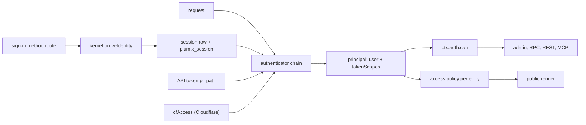

# Auth and access

Auth decides who a request is. Access decides what that principal may do or read. Sign-in methods (passkey, invite, magic link, OAuth, and any a plugin declares) prove identity, and core's kernel mints the `plumix_session` cookie. Authenticators only read credentials: the session cookie, an API token, or an identity provider's assertion such as Cloudflare Access. Roles and capabilities gate the admin, RPC, REST and MCP. Per-entry access policies gate public renders. Site developers configure the `auth()` block and policies. Plugin authors register capabilities, sign-in methods and policied routes. Editors and operators manage users, sessions and API tokens. The code lives in `packages/core/src/auth/`, `packages/core/src/access/`, `packages/core/src/route/render/personal-render.ts` and `packages/runtimes/cloudflare/src/cf-access.ts`.

## At a glance

`plumix_session` lasts 30 days and slides on use, up to 90 days in total (`DEFAULT_SESSION_POLICY`).

## Surface

| Piece                                                                                                                                                                   | Kind                                                                                          | Where                                               | Public                         |
| ----------------------------------------------------------------------------------------------------------------------------------------------------------------------- | --------------------------------------------------------------------------------------------- | --------------------------------------------------- | ------------------------------ |
| `auth({ passkey, sessions?, oauth?, magicLink?, authenticator?, bootstrapVia?, allowedDomains?, selfSignup?, loginPath? })`                                             | config block; `passkey` required                                                              | `context/auth-config.ts`, `auth/config.ts`          | `plumix/auth`                  |
| `github()`, `google()`                                                                                                                                                  | OAuth providers                                                                               | `auth/oauth/providers/`                             | `plumix/auth`                  |
| `defineAuthMethod`, descriptor `authMethods`                                                                                                                            | sign-in method seam ([ADR 0041](../adr/0041-a-sign-in-method-is-a-registered-extension.md))   | `plugin/auth-method.ts`, `auth/declared-methods.ts` | `plumix/plugin`                |
| `/_plumix/auth/<method>/...`, `/_plumix/auth/device/{code,token}`, `/_plumix/auth/signout`, `/_plumix/auth/verify-email`                                                | routes                                                                                        | `auth/core-methods.ts`, `runtime/dispatcher.ts`     | yes                            |
| `sessionAuthenticator`, `apiTokenAuthenticator`, `chainAuthenticators`, `defaultAuthenticator`                                                                          | authenticators                                                                                | `auth/authenticator.ts`                             | `plumix/auth`                  |
| `cfAccess({ teamDomain, ... })`, `cfAccessLogoutUrl`                                                                                                                    | authenticator                                                                                 | `packages/runtimes/cloudflare/src/cf-access.ts`     | `@plumix/runtime-cloudflare`   |
| `authenticateSession`                                                                                                                                                   | credential-kind gate ([ADR 0024](../adr/0024-a-credential-is-created-only-from-a-session.md)) | `auth/authenticator.ts`                             | internal                       |
| `CORE_CAPABILITIES`, `ROLE_LEVEL`, `STAFF_MIN_ROLE`, `canAccessAdmin`, `entryCapability`, `termCapability`                                                              | roles and capabilities                                                                        | `access/contract/`                                  | `plumix/auth`, `plumix/plugin` |
| `ctx.registerCapability(name, minRole \| { minRole, defaultGrants })`                                                                                                   | plugin registration                                                                           | `plugin/setup-context-types.ts`                     | `plumix/plugin`                |
| `requireCapability(cap)`                                                                                                                                                | RPC middleware                                                                                | `rpc/require-capability.ts`                         | internal                       |
| `definePolicy`, `rolePolicy`, `anonymousPolicy`, `authenticatedPolicy`, `grant`, `entitlement`, `challenge`, `redirectToLogin`, `entryPolicyAdmits`, `anonymousContext` | access policies                                                                               | `access/policy.ts`, `access/anonymous-context.ts`   | `plumix/auth`                  |
| entry type `access: { default, policies }`, archive type / view / route `access`                                                                                        | policy slots                                                                                  | `plugin/registry.ts`, `access/gate.ts`              | yes                            |
| `authClient`, `defineAuthMethodClient`, `useSession`, `useAuthMethods`                                                                                                  | browser client                                                                                | `auth/client/`                                      | `plumix/auth/client`           |
| `auth.apiTokens.*`, `auth.deviceFlow.*`, `auth.sessions.*`, `auth.credentials.*`                                                                                        | RPC procedures                                                                                | `rpc/procedures/auth/`                              | admin wire                     |

Plugin capabilities registered today are `audit_log:read` (admin), `comment:moderate` (editor), `form_submission:moderate` (editor) and `search:reindex` (admin).

## How it works

**Sign-in.** `coreAuthMethods` declares `passkey`, `invite`, `magic-link` and `oauth` with `defineAuthMethod`. `declareAuthMethods` merges them with each plugin's `authMethods` at boot and refuses names that would cover `device`, `signout` or `verify-email`. A method's handler receives a kernel from `createAuthMethodKernel`. The method proves identity and calls `kernel.proveIdentity`. Core then provisions or loads the user, mints the session and cookie (`mintSessionAndCookie`), fires the sign-in action and picks the redirect. There is no password method.

**Signup and bootstrap.** `allowedDomains` maps an email domain to its signup role. `selfSignup.defaultRole` opens signup to any address (`auth/signup-role.ts`). `provisionUser` in `auth/bootstrap.ts` makes the first user admin in one `INSERT` (`CASE WHEN (SELECT COUNT(*) ...) = 0`), so two concurrent first sign-ups cannot both become admin. `bootstrapVia: "passkey"`, the default, refuses external signup while no user exists. `"first-method-wins"` lets any verified flow create the first admin (`auth/identity.ts`).

**Reading the principal.** `defaultAuthenticator` chains `sessionAuthenticator` then `apiTokenAuthenticator`. `auth.authenticator` replaces the chain. Each returns `AuthResult` with a required `credential` (`"session"` or `"api-token"`). `tokenScopesOf` returns a token's scopes, or `null` for a session. `makeAuthCan` in `auth/with-user.ts` checks the role through the capability resolver. For a token it also requires the capability to be in the token's scopes. Tokens are `pl_pat_`-prefixed and stored hashed (`auth/api-tokens.ts`). The CLI gets one from `--token`, `PLUMIX_API_TOKEN`, or the device flow (`packages/plumix/src/cli/api-token.ts`, RFC 8628).

**Capabilities.** Entry and term capabilities derive from `POST_TYPE_CAPABILITY_ACTIONS` and `TERM_TAXONOMY_CAPABILITY_ACTIONS` per `capabilityType`. Types that share a `capabilityType` pool one namespace ([ADR 0022](../adr/0022-a-capability-is-named-by-what-it-guards.md)).

**Surfaces.**

- Admin shell: the dispatcher authenticates only when `ctxHasSession`, and redirects a non-staff role (`canAccessAdmin`) to `/`.
- RPC: the `authenticated` middleware (`rpc/authenticated.ts`) plus `requireCapability`. See [rpc-and-editing.md](rpc-and-editing.md).
- REST and MCP: bearer token only (`auth/bearer.ts`, `rest/principal.ts`). See [rest-api.md](rest-api.md) and [mcp.md](mcp.md).
- Public render: the user loads only when `requestHasSession` (`runtime/load-user-for-public-request.ts`). `trackPrincipalReads` marks a render personal when it reads `user`, `tokenScopes` or `auth.can` (ADR 0030). `policyForMatch` and `selectEntryPolicy` in `access/gate.ts` pick the entry's policy. `gateToResponse` turns its gate into a redirect, a challenge or a render. See [routing-and-render.md](routing-and-render.md) and [cdn-cache.md](cdn-cache.md).
- Themes and islands use `authClient` from `plumix/auth/client`: `signIn.<method>`, `useSession`, `url()`.

## Invariants

- An authenticator never mints a session. Only `proveIdentity` does. [ADR 0041](../adr/0041-a-sign-in-method-is-a-registered-extension.md); `packages/core/src/auth/method-kernel.test.ts`.
- A surface that creates a credential resolves the caller with `authenticateSession`, so an API-token caller reads as anonymous there. ADR 0024; `auth/authenticator.test.ts` ("treats an api-token caller as anonymous"). Passkey add-device is the only adopter (see Gaps).
- `AuthResult.credential` is required, so a custom authenticator that omits it fails to compile. ADR 0024.
- A token can only narrow its user's role, never widen it. `auth/auth-can-scopes.test.ts`.
- The first user is admin, even under concurrency. `auth/bootstrap.test.ts`.
- A sign-in method cannot mount over core's auth routes, and two owners cannot share a name. `auth/declared-methods.test.ts`.
- A render that reads the principal leaves as `private, no-store` and is never cached in a shared segment. [ADR 0030](../adr/0030-a-render-that-reads-the-principal-is-never-shared.md); `route/render/personal-render.test.ts`.
- Read rules apply each entry's policy for the request's own principal. `anonymousContext` is the only way to ask on someone else's behalf. [ADR 0037](../adr/0037-a-public-surface-asks-per-entry-not-per-type.md); `access/policy.test.ts`, `access/anonymous-context.test.ts`, `access/gate.integration.test.tsx`.
- A capability is named by what it guards. [ADR 0022](../adr/0022-a-capability-is-named-by-what-it-guards.md); `access/contract/entry-capabilities.test.ts`.

## Status

| Piece                                               | State                                  | Evidence                                                                                                                                                             |
| --------------------------------------------------- | -------------------------------------- | -------------------------------------------------------------------------------------------------------------------------------------------------------------------- |
| Passkey, invite, magic link, OAuth (GitHub, Google) | shipped                                | `auth/passkey/*.test.ts`, `auth/magic-link/*.test.ts`, `auth/oauth/*.test.ts`; `packages/admin/e2e/auth.spec.ts`; `packages/plugins/comments/e2e/magic-link.spec.ts` |
| Plugin sign-in methods                              | shipped, no first-party plugin uses it | only `packages/core/playground/auth/email-code/` declares `authMethods`; `packages/core/e2e/email-code.spec.ts`                                                      |
| Sessions, API tokens, device flow                   | shipped                                | `auth/sessions.test.ts`, `auth/api-tokens.test.ts`, `auth/device-flow*.test.ts`                                                                                      |
| Cloudflare Access                                   | shipped (Cloudflare runtime)           | `packages/runtimes/cloudflare/src/cf-access.test.ts`                                                                                                                 |
| Roles, capabilities, token scopes                   | shipped                                | `auth/rbac.test.ts`, `access/contract/rbac.test.ts`                                                                                                                  |
| Access policies, personal renders                   | shipped                                | `access/*.test.ts`, `route/render/personal-render.test.ts`                                                                                                           |
| `authClient` sign-in and session                    | shipped                                | `auth/client/*.test.ts`; `packages/core/e2e/auth-client.spec.ts`, `auth-island.spec.ts`                                                                              |
| `authClient` own-account management                 | planned                                | PRD #3227, slices #3234-#3240 (open)                                                                                                                                 |
| Sharing verdict in one module                       | planned                                | #3248, #3250, #3251 (open)                                                                                                                                           |

## Gaps

- Not every surface that creates a credential resolves the caller with `authenticateSession` yet. ADR 0024 keeps the list under "Still to adopt".
- #3265 (open): Workers caching serves the anonymous page to members and keeps segment hits past revocation.
- #3230 (open): core's auth depends on the deprecated `@oslojs/crypto` and `@oslojs/webauthn`.
- `selectEntryPolicy` falls back to `default` when a stored policy key no longer exists. Removing a policy that was stricter than the default silently relaxes every entry that chose it. The code comment states this, and nothing warns the site.
- The plugin sign-in seam has no first-party consumer. Its only coverage outside unit tests is the core playground's `email-code` method.
