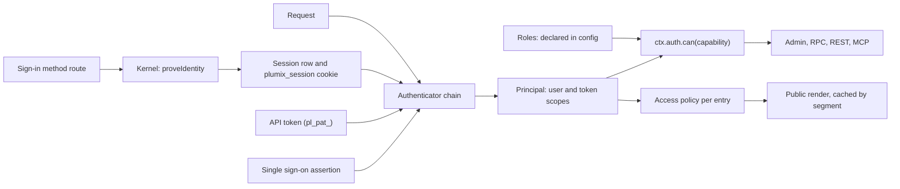

# Auth and access

Auth decides who a request is. Access decides what that principal may do or read. Sign-in methods (passkey, invite, magic link, OAuth, and any a plugin declares) prove identity, and core's kernel mints the `plumix_session` cookie. Authenticators only read credentials: the session cookie, an API token, or an identity provider's assertion such as a single sign-on proxy's JWT. Roles grant capabilities, and capabilities gate the admin, RPC, REST and MCP. Per-entry access policies gate public renders. Site developers configure the `auth()` block, roles and policies. Plugin authors register capabilities, sign-in methods and policied routes. Site admins manage users, the role each holds, sessions and API tokens. This is the **Auth and access** component in [ARCHITECTURE.md](../../ARCHITECTURE.md#components-of-the-app-process). The code lives in `packages/core/src/auth/`, `packages/core/src/access/`, `packages/core/src/route/render/personal-render.ts`, and each runtime adapter's own authenticators (`packages/runtimes/cloudflare/src/cf-access.ts`).

## At a glance

`plumix_session` lasts 30 days and slides on use, up to 90 days in total (`DEFAULT_SESSION_POLICY` in `auth/sessions.ts`).

## Surface

| Piece                                                                                                                                                                                                     | Kind                                                                                          | Where                                               | Public                         |
| --------------------------------------------------------------------------------------------------------------------------------------------------------------------------------------------------------- | --------------------------------------------------------------------------------------------- | --------------------------------------------------- | ------------------------------ |
| `auth({ passkey, sessions?, oauth?, magicLink?, authenticator?, bootstrapVia?, allowedDomains?, selfSignup?, loginPath? })`                                                                               | config block; `passkey` required                                                              | `context/auth-config.ts`, `auth/config.ts`          | `plumix/auth`                  |
| `github()`, `google()`                                                                                                                                                                                    | OAuth providers                                                                               | `auth/oauth/providers/`                             | `plumix/auth`                  |
| `defineAuthMethod`, descriptor `authMethods`                                                                                                                                                              | sign-in method seam ([ADR 0041](../adr/0041-a-sign-in-method-is-a-registered-extension.md))   | `plugin/auth-method.ts`, `auth/declared-methods.ts` | `plumix/plugin`                |
| `/_plumix/auth/<method>/...`, `/_plumix/auth/device/{code,token}`, `/_plumix/auth/signout`, `/_plumix/auth/verify-email`                                                                                  | routes                                                                                        | `auth/core-methods.ts`, `runtime/dispatcher.ts`     | yes                            |
| `sessionAuthenticator`, `apiTokenAuthenticator`, `chainAuthenticators`, `defaultAuthenticator`                                                                                                            | authenticators                                                                                | `auth/authenticator.ts`                             | `plumix/auth`                  |
| `cfAccess({ teamDomain, ... })`, `cfAccessLogoutUrl`                                                                                                                                                      | authenticator for one runtime                                                                 | `packages/runtimes/cloudflare/src/cf-access.ts`     | `@plumix/runtime-cloudflare`   |
| `authenticateSession`                                                                                                                                                                                     | credential-kind gate ([ADR 0024](../adr/0024-a-credential-is-created-only-from-a-session.md)) | `auth/authenticator.ts`                             | internal                       |
| `CORE_CAPABILITIES`, `entryCapability`, `termCapability`                                                                                                                                                  | roles and capabilities                                                                        | `access/contract/`                                  | `plumix/auth`, `plumix/plugin` |
| `ctx.registerCapability`                                                                                                                                                                                  | plugin registration, naming which default roles get the capability                            | `plugin/setup-context-types.ts`                     | `plumix/plugin`                |
| `requireCapability(cap)`                                                                                                                                                                                  | RPC middleware                                                                                | `rpc/require-capability.ts`                         | internal                       |
| `definePolicy`, `anonymousPolicy`, `authenticatedPolicy`, `capabilityPolicy`, `grant`, `entitlement`, `challenge`, `redirectToLogin`, `entryPolicyAdmits`, `anonymousContext`                             | access policies                                                                               | `access/policy.ts`, `access/anonymous-context.ts`   | `plumix/auth`                  |
| entry type `access: { default, policies }`, archive type, view and route `access`                                                                                                                         | policy slots                                                                                  | `plugin/registry.ts`, `access/gate.ts`              | yes                            |
| `authClient`, `defineAuthMethodClient`, `useSession`, `useAuthMethods`, `useAccount`, `account.update`, `account.setLocale`, `sessions.*`, `passkey.*`, `oauth.accounts`, `oauth.unlink`, `can`, `useCan` | browser client                                                                                | `auth/client/`                                      | `plumix/auth/client`           |
| `auth.apiTokens.*`, `auth.deviceFlow.*`, `auth.sessions.*`, `auth.credentials.*`, `auth.oauthAccounts.*`                                                                                                  | RPC procedures                                                                                | `rpc/procedures/auth/`                              | admin wire                     |
| `plumix({ roles })`                                                                                                                                                                                       | config                                                                                        | `access/contract/roles.ts`                          | yes                            |

The first-party plugins register `audit_log:read` and `search:reindex` (granted to `admin`), and `comment:moderate` and `form_submission:moderate` (granted to `editor`).

## How it works

**Sign-in.** `coreAuthMethods` declares `passkey`, `invite`, `magic-link` and `oauth` with `defineAuthMethod`. `declareAuthMethods` merges them with each plugin's `authMethods` at boot and refuses names that would cover `device`, `signout` or `verify-email`, or whose camelCase form is one of the auth client's own keys (`AUTH_CLIENT_KERNEL_KEYS` in `auth/client/kernel-keys.ts`). A method's handler receives a kernel from `createAuthMethodKernel`. The method proves identity and calls `kernel.proveIdentity`. Core then provisions or loads the user, mints the session and cookie (`mintSessionAndCookie`), fires the sign-in action and picks the redirect. There is no password sign-in.

**Signup and bootstrap.** `allowedDomains` maps an email domain to its signup role. `selfSignup.defaultRole` opens signup to any address (`auth/signup-role.ts`). `provisionUser` in `auth/bootstrap.ts` makes the first user admin in one `INSERT` (`CASE WHEN (SELECT COUNT(*) ...) = 0`), so two concurrent first sign-ups cannot both become admin. `bootstrapVia: "passkey"`, the default, refuses external signup while no user exists. `"first-method-wins"` lets any verified flow create the first admin.

**Reading the principal.** `defaultAuthenticator` chains `sessionAuthenticator` then `apiTokenAuthenticator`, and `auth.authenticator` replaces the chain. Each returns an `AuthResult` with a required `credential` (`"session"` or `"api-token"`). `tokenScopesOf` returns a token's scopes and `apiTokenOf` its id and name, each `null` for a session. API tokens are `pl_pat_`-prefixed and stored hashed (`auth/api-tokens.ts`). A token can carry an `audience`, the one URL it works on, and the OAuth `clientId` it was issued to; such a token is `pl_aud_`-prefixed. `validateApiToken` refuses a bound token unless the caller names its audience, so `apiTokenAuthenticator`, and with it RPC, REST and plugin routes, never accepts one. Only `/_plumix/mcp` names an audience, its own URL with the `basePath`. A token's scopes are capability names. `null` scopes take the owner's capabilities as they are, and a list narrows them. `auth.apiTokens.create` also takes a `preset` (`auth/token-presets.ts`): `read_only` keeps the owner's capabilities whose action only reads (`read`, `read_revisions`, `list`), and `draft_only` drops `publish`, `delete` and `restore_revision`. The preset resolves to an explicit list at mint, so a later grant never widens the token. The CLI gets a token from `--token`, `PLUMIX_API_TOKEN`, or the device flow (`packages/plumix/src/cli/api-token.ts`, RFC 8628).

**Roles and capabilities.** A role is a named set of capability grants ([ADR 0055](../adr/0055-a-role-is-a-set-of-capabilities-declared-in-code.md)). Core ships four default roles, `member`, `author`, `editor` and `admin`, each with default grants (`access/contract/capability.ts`). A site declares more in config under `roles` (`access/contract/roles.ts`), each with a `label`, an `extends` naming a role whose capabilities it adds, and `can` grouping its grants by what they guard. A config role with a default's name replaces that default's grants; `admin` can't be declared and resolves to every registered capability. A grant, entry type, taxonomy or `extends` target nothing registered fails `plumix build` and dev (`unknownRoleGrants`, checked by the Vite plugin), and the running resolver ignores it. The user's role column and the invite role are free text, and a stored role the config doesn't declare holds no capabilities. A plugin that registers a capability names which default roles get it, and a site grants it to any role. At boot core resolves one table from each role to its capabilities (`auth/rbac.ts`), and every "may this role do X" reads it: `hasCapability`, the capability list sent with the session, `ctx.auth.can` (`makeAuthCan` in `auth/with-user.ts`) and the token scope intersection. For an API token it also requires the capability to be in the token's scopes. Opening the admin is the `admin:access` capability. Nothing compares roles by rank.

Entry and term capabilities derive from `POST_TYPE_CAPABILITY_ACTIONS` and `TERM_TAXONOMY_CAPABILITY_ACTIONS` per `capabilityType`. Types that share a `capabilityType` pool one namespace ([ADR 0022](../adr/0022-a-capability-is-named-by-what-it-guards.md)). A type's `capabilities` override names, per action, the default roles that receive it, and pooled types combine what they name by union, so registration order never changes a grant.

**Surfaces.**

- Admin shell: the dispatcher authenticates only when the request has a session, and sends a user without `admin:access` to `/`.
- RPC: the `authenticated` middleware (`rpc/authenticated.ts`) plus `requireCapability`. See [RPC and editing](rpc-and-editing.md).
- REST and MCP: API token only (`authenticateBearer` in `auth/bearer.ts`, `rest/principal.ts`). See [REST API](rest-api.md) and [MCP](mcp.md).
- Public render: the user loads only when `requestHasSession` (`runtime/load-user-for-public-request.ts`). `trackPrincipalReads` marks a render personal when it reads `user`, `tokenScopes` or `auth.can` ([ADR 0030](../adr/0030-a-render-that-reads-the-principal-is-never-shared.md)). `policyForMatch` and `selectEntryPolicy` in `access/gate.ts` pick the entry's policy; a stored policy key that no longer exists falls back to the type's `default`. `gateToResponse` turns its gate into a redirect, a challenge or a render. A gate grants a segment: `anonymous`, `authenticated`, `private`, `capability:<name>`, or an `entitlement:<label>`. Everyone holding a capability shares one cached copy of a page it gates, whatever their role. See [routing and render](routing-and-render.md) and [CDN cache](cdn-cache.md).
- Themes and islands use `authClient` from `plumix/auth/client`: `signIn.<method>`, `useSession`, `url()`, and `useAccount` and `account.update` for the signed-in user's own profile. The account store loads through `user.get` on first use and holds the `etag` itself; `account.update` sends it to `user.update` and always takes over the edit lease. `account.setLocale` calls `user.setLocale`, which moves the user's token, so the store reloads a loaded account after it. `sessions.list`, `revoke` and `revokeOthers` wrap `auth.sessions.*` as plain promises and leave the session store alone. `passkey.list/rename/remove` wrap the self-scoped `auth.credentials` procedures through the method kernel's `rpc`. `oauth.accounts` and `oauth.unlink` call `auth.oauthAccounts.list` and `unlink`; `unlink` refuses (`last_sign_in_method`) when the user would keep no passkey, no other linked provider and no listed method other than passkey and OAuth, with the check in the DELETE's WHERE so concurrent unlinks can't both pass. Lists are promises with no cache, and `can` reads the session's capabilities, never a record ([ADR 0050](../adr/0050-the-auth-client-manages-the-signed-in-users-own-account.md)).

**Personal data.** A site admin exports or erases everything the site stores about one person from that user's screen in the admin: the user row and its meta, sessions, credentials, OAuth accounts and API tokens, plus each plugin's share, which a plugin contributes through a hook alongside its tables. Erasing removes the person and keeps the entries they wrote, reassigned to another user.

## Invariants

- An authenticator never mints a session. Only `proveIdentity` does. [ADR 0041](../adr/0041-a-sign-in-method-is-a-registered-extension.md); `packages/core/src/auth/method-kernel.test.ts`.
- A surface that creates a credential resolves the caller with `authenticateSession`, so an API-token caller reads as anonymous there. [ADR 0024](../adr/0024-a-credential-is-created-only-from-a-session.md); `auth/authenticator.test.ts` ("treats an api-token caller as anonymous").
- `AuthResult.credential` is required, so a custom authenticator that omits it fails to compile. ADR 0024.
- A token can only narrow its owner's capabilities, never widen them. `auth/auth-can-scopes.test.ts`.
- An audience-bound token works only on the surface its audience names: MCP accepts one bound to its own URL, and RPC and REST refuse every bound token. `mcp/dispatch.test.ts` ("audience-bound tokens"), `auth/authenticator.dispatcher.test.ts` ("API tokens on RPC"), `rest/dispatch.test.ts` ("a token bound to the MCP audience").
- The session's capability list and `hasCapability` read one role table and never disagree. `auth/role-capabilities.test.ts`.
- A plugin capability goes to the default roles its `grantTo` names plus `admin`, and to `admin` alone without it. `auth/role-capabilities.test.ts`.
- A config role resolves exactly its grants plus its `extends` target's, `admin` holds every registered capability, and a name nothing registered fails the build but is ignored at runtime. [ADR 0055](../adr/0055-a-role-is-a-set-of-capabilities-declared-in-code.md); `auth/role-capabilities.test.ts`, `packages/plumix/src/vite/emit-plumix-sources.test.ts`.
- Assigning a role, by invite or by edit, needs every capability it grants, and an edit also needs `user:promote`, so nobody assigns past themselves. `rpc/procedures/user/user.test.ts`.
- The first user is admin, even under concurrency. `auth/bootstrap.test.ts`.
- A sign-in method cannot mount over core's auth routes, and two owners cannot share a name. `auth/declared-methods.test.ts`.
- A sign-in method cannot take one of the auth client's own keys, by its name or its camelCase form. [ADR 0050](../adr/0050-the-auth-client-manages-the-signed-in-users-own-account.md); `runtime/app-auth-method-validation.test.ts`.
- A theme never holds the account's `etag`, and the user's own save takes over the edit lease. ADR 0050; `auth/client/account.test.ts`.
- Unlinking an OAuth account never removes the user's last way to sign in, even when two unlinks race. ADR 0050; `auth/client/oauth-accounts.test.ts`.
- A render that reads the principal leaves as `private, no-store` and is never cached in a shared segment. [ADR 0030](../adr/0030-a-render-that-reads-the-principal-is-never-shared.md); `route/render/personal-render.test.ts`.
- Read rules apply each entry's policy for the request's own principal. `anonymousContext` is the only way to ask on someone else's behalf. [ADR 0037](../adr/0037-a-public-surface-asks-per-entry-not-per-type.md); `access/policy.test.ts`, `access/anonymous-context.test.ts`, `access/gate.integration.test.tsx`.
- A capability is named by what it guards. [ADR 0022](../adr/0022-a-capability-is-named-by-what-it-guards.md); `access/contract/entry-capabilities.test.ts`.
