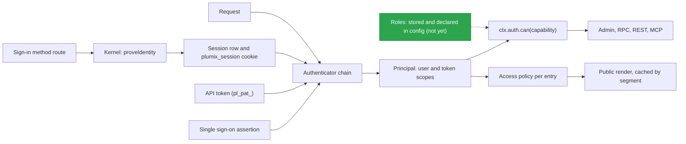

# Auth and access

Auth decides who a request is. Access decides what that principal may do or read. Sign-in methods (passkey, invite, magic link, OAuth, and any a plugin declares) prove identity, and core's kernel mints the `plumix_session` cookie. Authenticators only read credentials: the session cookie, an API token, or an identity provider's assertion such as a single sign-on proxy's JWT. Roles grant capabilities, and capabilities gate the admin, RPC, REST and MCP. Per-entry access policies gate public renders. Site developers configure the `auth()` block, roles and policies. Plugin authors register capabilities, sign-in methods and policied routes. Site admins manage users, roles, sessions and API tokens. This is the **Auth and access** component in [ARCHITECTURE.md](../../ARCHITECTURE.md#components-of-the-app-process). The code lives in `packages/core/src/auth/`, `packages/core/src/access/`, `packages/core/src/route/render/personal-render.ts`, and each runtime adapter's own authenticators (`packages/runtimes/cloudflare/src/cf-access.ts`).

## At a glance

`plumix_session` lasts 30 days and slides on use, up to 90 days in total (`DEFAULT_SESSION_POLICY` in `auth/sessions.ts`).

## Surface

| Piece                                                                                                                                                                   | Kind                                                                                          | Where                                               | Public                         |
| ----------------------------------------------------------------------------------------------------------------------------------------------------------------------- | --------------------------------------------------------------------------------------------- | --------------------------------------------------- | ------------------------------ |
| `auth({ passkey, sessions?, oauth?, magicLink?, authenticator?, bootstrapVia?, allowedDomains?, selfSignup?, loginPath? })`                                             | config block; `passkey` required                                                              | `context/auth-config.ts`, `auth/config.ts`          | `plumix/auth`                  |
| `github()`, `google()`                                                                                                                                                  | OAuth providers                                                                               | `auth/oauth/providers/`                             | `plumix/auth`                  |
| `defineAuthMethod`, descriptor `authMethods`                                                                                                                            | sign-in method seam ([ADR 0041](../adr/0041-a-sign-in-method-is-a-registered-extension.md))   | `plugin/auth-method.ts`, `auth/declared-methods.ts` | `plumix/plugin`                |
| `/_plumix/auth/<method>/...`, `/_plumix/auth/device/{code,token}`, `/_plumix/auth/signout`, `/_plumix/auth/verify-email`                                                | routes                                                                                        | `auth/core-methods.ts`, `runtime/dispatcher.ts`     | yes                            |
| `sessionAuthenticator`, `apiTokenAuthenticator`, `chainAuthenticators`, `defaultAuthenticator`                                                                          | authenticators                                                                                | `auth/authenticator.ts`                             | `plumix/auth`                  |
| `cfAccess({ teamDomain, ... })`, `cfAccessLogoutUrl`                                                                                                                    | authenticator for one runtime                                                                 | `packages/runtimes/cloudflare/src/cf-access.ts`     | `@plumix/runtime-cloudflare`   |
| `authenticateSession`                                                                                                                                                   | credential-kind gate ([ADR 0024](../adr/0024-a-credential-is-created-only-from-a-session.md)) | `auth/authenticator.ts`                             | internal                       |
| `CORE_CAPABILITIES`, `entryCapability`, `termCapability`, `ROLE_LEVEL`, `STAFF_MIN_ROLE`, `canAccessAdmin`                                                              | roles and capabilities; the last three go with ranking                                        | `access/contract/`                                  | `plumix/auth`, `plumix/plugin` |
| `ctx.registerCapability(name, minRole \| { minRole, defaultGrants })`                                                                                                   | plugin registration                                                                           | `plugin/setup-context-types.ts`                     | `plumix/plugin`                |
| `requireCapability(cap)`                                                                                                                                                | RPC middleware                                                                                | `rpc/require-capability.ts`                         | internal                       |
| `definePolicy`, `rolePolicy`, `anonymousPolicy`, `authenticatedPolicy`, `grant`, `entitlement`, `challenge`, `redirectToLogin`, `entryPolicyAdmits`, `anonymousContext` | access policies                                                                               | `access/policy.ts`, `access/anonymous-context.ts`   | `plumix/auth`                  |
| entry type `access: { default, policies }`, archive type, view and route `access`                                                                                       | policy slots                                                                                  | `plugin/registry.ts`, `access/gate.ts`              | yes                            |
| `authClient`, `defineAuthMethodClient`, `useSession`, `useAuthMethods`                                                                                                  | browser client                                                                                | `auth/client/`                                      | `plumix/auth/client`           |
| `auth.apiTokens.*`, `auth.deviceFlow.*`, `auth.sessions.*`, `auth.credentials.*`                                                                                        | RPC procedures                                                                                | `rpc/procedures/auth/`                              | admin wire                     |
| Roles declared in config, roles managed in the admin (not yet)                                                                                                          | config and admin screen                                                                       | to build on `users/contract/roles.ts`               | yes                            |

Plugin capabilities registered today are `audit_log:read` and `search:reindex` (granted to `admin`), and `comment:moderate` and `form_submission:moderate` (granted to `editor`).

## How it works

**Sign-in.** `coreAuthMethods` declares `passkey`, `invite`, `magic-link` and `oauth` with `defineAuthMethod`. `declareAuthMethods` merges them with each plugin's `authMethods` at boot and refuses names that would cover `device`, `signout` or `verify-email`. A method's handler receives a kernel from `createAuthMethodKernel`. The method proves identity and calls `kernel.proveIdentity`. Core then provisions or loads the user, mints the session and cookie (`mintSessionAndCookie`), fires the sign-in action and picks the redirect. There is no password sign-in.

**Signup and bootstrap.** `allowedDomains` maps an email domain to its signup role. `selfSignup.defaultRole` opens signup to any address (`auth/signup-role.ts`). `provisionUser` in `auth/bootstrap.ts` makes the first user admin in one `INSERT` (`CASE WHEN (SELECT COUNT(*) ...) = 0`), so two concurrent first sign-ups cannot both become admin. `bootstrapVia: "passkey"`, the default, refuses external signup while no user exists. `"first-method-wins"` lets any verified flow create the first admin.

**Reading the principal.** `defaultAuthenticator` chains `sessionAuthenticator` then `apiTokenAuthenticator`, and `auth.authenticator` replaces the chain. Each returns an `AuthResult` with a required `credential` (`"session"` or `"api-token"`). `tokenScopesOf` returns a token's scopes, or `null` for a session. API tokens are `pl_pat_`-prefixed and stored hashed (`auth/api-tokens.ts`). A token's scopes are capability names. `null` scopes take the owner's capabilities as they are, and a list narrows them. The CLI gets a token from `--token`, `PLUMIX_API_TOKEN`, or the device flow (`packages/plumix/src/cli/api-token.ts`, RFC 8628).

**Roles and capabilities.** In the 1.0 design a role is a named set of capability grants. Core ships four default roles, `member`, `author`, `editor` and `admin`, each with default grants. A site declares more in config or adds them in the admin, and the two sources merge (not yet). `ctx.auth.can` (`makeAuthCan` in `auth/with-user.ts`) answers whether the principal's role grants the capability. For an API token it also requires the capability to be in the token's scopes. Opening the admin is the `admin:access` capability (not yet). Nothing compares roles by rank. Code today: roles are a fixed ladder `subscriber < contributor < author < editor < admin` (`USER_ROLES`), each capability names a minimum role (`CORE_CAPABILITIES`, `registerCapability`), and `canAccessAdmin` admits `contributor` and up.

Entry and term capabilities derive from `POST_TYPE_CAPABILITY_ACTIONS` and `TERM_TAXONOMY_CAPABILITY_ACTIONS` per `capabilityType`. Types that share a `capabilityType` pool one namespace ([ADR 0022](../adr/0022-a-capability-is-named-by-what-it-guards.md)).

**Surfaces.**

- Admin shell: the dispatcher authenticates only when the request has a session, and sends a user who may not open the admin to `/` (`canAccessAdmin` today, `admin:access` in the design).
- RPC: the `authenticated` middleware (`rpc/authenticated.ts`) plus `requireCapability`. See [RPC and editing](rpc-and-editing.md).
- REST and MCP: API token only (`authenticateBearer` in `auth/bearer.ts`, `rest/principal.ts`). See [REST API](rest-api.md) and [MCP](mcp.md).
- Public render: the user loads only when `requestHasSession` (`runtime/load-user-for-public-request.ts`). `trackPrincipalReads` marks a render personal when it reads `user`, `tokenScopes` or `auth.can` ([ADR 0030](../adr/0030-a-render-that-reads-the-principal-is-never-shared.md)). `policyForMatch` and `selectEntryPolicy` in `access/gate.ts` pick the entry's policy; a stored policy key that no longer exists falls back to the type's `default`. `gateToResponse` turns its gate into a redirect, a challenge or a render. A gate grants a segment: `anonymous`, `authenticated`, `private`, `capability:<name>` (not yet; `role:<role>` from `rolePolicy` today), or an `entitlement:<label>`. See [routing and render](routing-and-render.md) and [CDN cache](cdn-cache.md).
- Themes and islands use `authClient` from `plumix/auth/client`: `signIn.<method>`, `useSession`, `url()`.

## Invariants

- An authenticator never mints a session. Only `proveIdentity` does. [ADR 0041](../adr/0041-a-sign-in-method-is-a-registered-extension.md); `packages/core/src/auth/method-kernel.test.ts`.
- A surface that creates a credential resolves the caller with `authenticateSession`, so an API-token caller reads as anonymous there. [ADR 0024](../adr/0024-a-credential-is-created-only-from-a-session.md); `auth/authenticator.test.ts` ("treats an api-token caller as anonymous").
- `AuthResult.credential` is required, so a custom authenticator that omits it fails to compile. ADR 0024.
- A token can only narrow its owner's capabilities, never widen them. `auth/auth-can-scopes.test.ts`.
- The first user is admin, even under concurrency. `auth/bootstrap.test.ts`.
- A sign-in method cannot mount over core's auth routes, and two owners cannot share a name. `auth/declared-methods.test.ts`.
- A render that reads the principal leaves as `private, no-store` and is never cached in a shared segment. [ADR 0030](../adr/0030-a-render-that-reads-the-principal-is-never-shared.md); `route/render/personal-render.test.ts`.
- Read rules apply each entry's policy for the request's own principal. `anonymousContext` is the only way to ask on someone else's behalf. [ADR 0037](../adr/0037-a-public-surface-asks-per-entry-not-per-type.md); `access/policy.test.ts`, `access/anonymous-context.test.ts`, `access/gate.integration.test.tsx`.
- A capability is named by what it guards. [ADR 0022](../adr/0022-a-capability-is-named-by-what-it-guards.md); `access/contract/entry-capabilities.test.ts`.

## Not there yet

To build:

| Part of the design              | Seam to build on                                                                                                                                                                                                                                                                                                                                                          | Done when                                                                                                                                                                                                          |
| ------------------------------- | ------------------------------------------------------------------------------------------------------------------------------------------------------------------------------------------------------------------------------------------------------------------------------------------------------------------------------------------------------------------------- | ------------------------------------------------------------------------------------------------------------------------------------------------------------------------------------------------------------------ |
| Site-defined roles              | A `roles` table of names and capability grants, merged at boot with roles declared in config. `USER_ROLES` (`users/contract/roles.ts`) stops being a closed list; the default grants in `access/contract/capability.ts` become the four default roles' grants; `registerCapability`'s `minRole` becomes the default roles a plugin grants; the admin gains a roles screen | A site adds a role in config or in the admin and grants it any registered capability; `ctx.auth.can` reads the merged grants; the _Code today_ lines are gone from Role and Capability in `GLOSSARY.md`            |
| No role ranking                 | `ROLE_LEVEL`, `roleLevel` and `STAFF_MIN_ROLE` in `access/contract/rbac.ts`, `canAccessAdmin` (used by `runtime/dispatcher.ts` and `route/render/personal-render.ts`), and `rolePolicy` in `access/policy.ts`                                                                                                                                                             | Opening the admin and showing the admin bar check the `admin:access` capability; gated content requires a capability, not a minimum role; nothing compares roles by rank                                           |
| Capability segments             | `isBuiltinSegment` and `ROLE_PREFIX` in `access/policy.ts`, `access/contract/segments.ts`                                                                                                                                                                                                                                                                                 | A capability gate grants `capability:<name>`, replacing `role:<role>`, so everyone holding that capability shares one cached copy whatever their role; the _Code today_ line is gone from Segment in `GLOSSARY.md` |
| Every credential from a session | `authenticateSession` in `auth/authenticator.ts`; ADR 0024 lists the surfaces still to adopt it                                                                                                                                                                                                                                                                           | Every surface that creates a credential resolves its caller through `authenticateSession`, not passkey add-device alone, and ADR 0024's "Still to adopt" list is empty                                             |

To remove:

| In the code                                        | Why it goes                                                       | Done when                                                                                                                                                                                                                                       |
| -------------------------------------------------- | ----------------------------------------------------------------- | ----------------------------------------------------------------------------------------------------------------------------------------------------------------------------------------------------------------------------------------------- |
| The `contributor` role, and `subscriber` as a name | The design has four default roles and site-defined ones           | A data migration renames subscribers to `member`, creates a stored `contributor` role with the same capabilities and moves contributors to it, so nobody gains or loses rights; signup roles in `allowedDomains` and `selfSignup` name `member` |
| The `plugin:manage` capability                     | Plugins are installed in code; no screen enables or disables them | The capability is gone from `CORE_CAPABILITIES` in `access/contract/capability.ts`                                                                                                                                                              |
| The `password_reset` token type in `auth_tokens`   | There is no password sign-in, and nothing uses it                 | The value is gone from `AUTH_TOKEN_TYPES` in `db/schema/auth_tokens.ts`                                                                                                                                                                         |
