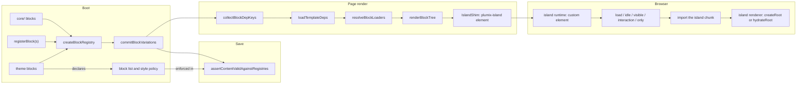

# Blocks and islands

Blocks are the named components an entry's content tree is made of. Core ships the `core/` set; plugins and themes add their own. One walker, `renderBlockTree`, renders a tree in three hosts: public server rendering, edit-mode server rendering, and the editor canvas iframe. Islands are the client-interactive parts of that otherwise static HTML. A module that starts with `"use client"` becomes an island, and a page with no island ships no JavaScript. Block authors and theme authors use this subsystem; editors and designers see its output in the canvas. It backs the **Theme** component in [ARCHITECTURE.md](../../ARCHITECTURE.md#components-of-the-app-process), and the **Block list and style policy** component sits beside it. It lives in `packages/core/src/blocks/`, with the island build step in `packages/plumix/src/vite/island-transform.ts`.

## At a glance

## Surface

| Piece                                                                                                                                                     | Where                                                           | Public?                              |
| --------------------------------------------------------------------------------------------------------------------------------------------------------- | --------------------------------------------------------------- | ------------------------------------ |
| `defineBlock(spec)` with `render`, `inputs`, `loaders`, `deps`, `variations`, `transforms`, `errorFallback`, `requiresParent`, `entryTypes`, `capability` | `plumix/blocks`                                                 | public                               |
| `registerBlock`, `registerBlocks` (the `core/` namespace throws)                                                                                          | plugin setup context                                            | public                               |
| Theme `blocks`, `shortcodes` on `defineTheme`                                                                                                             | `plumix/theme`                                                  | public                               |
| `registerMark(spec)` (`MarkSpec`; `adminSchema` names the Tiptap mark)                                                                                    | plugin setup context                                            | public                               |
| `registerShortcode(spec)` (server only), descriptor `shortcodes` (server and canvas), `defineShortcode`                                                   | plugin setup context, `definePlugin`, `plumix/blocks`           | public                               |
| `registerPattern(spec)`, `definePattern`, `block()`                                                                                                       | plugin setup context, `plumix/blocks`                           | public                               |
| `BlockRenderer`, `BlockTree`, `PlumixProvider`, `Link`, `Image`, `SignedIn`, `SignedOut`, `useAuth`, `useIsLive`, `useSingleFlight`                       | `plumix/blocks/renderer`                                        | public                               |
| Island client runtime and renderer                                                                                                                        | `plumix/blocks/island-runtime`, `plumix/blocks/island-renderer` | public (loaded by generated entries) |
| `blocks.htmlAllowlist`                                                                                                                                    | `plumix()` config                                               | public                               |
| Hooks `block:before_render`, `block:after_render`, `blocks:loader:error`                                                                                  | `packages/core/src/hooks/block-render.ts`                       | public                               |
| `entry.resolveBlockDeps`, `entry.refreshBlockLoader`                                                                                                      | `packages/core/src/rpc/procedures/entry/`                       | internal (editor)                    |
| The theme's block list and style policy                                                                                                                   | `defineTheme`, read by the editor from the plugin manifest      | public                               |

Core blocks (`packages/core/src/blocks/core-blocks.ts`): `core/rich-text`, `separator`, `code`, `group`, `section`, `columns`, `column`, `button`, `details`, `video`, `embed`, `html`, `table` and its row and cell blocks. Core shortcodes: `[year]`, `[month]`. Core marks (`packages/core/src/blocks/marks/core/metadata.ts`): `bold`, `italic`, `strike`, `code`, `link`, `underline`, `subscript`, `superscript`, `highlight`, `kbd`, `abbr`, `cite`, `small`.

## How it works

- **Registry.** `buildApp` in `packages/core/src/runtime/app.ts` builds the registry from `coreBlocks` plus `collectContributedBlocks` (`packages/core/src/plugin/build-manifest.ts`). Last write wins, so core < plugin < theme. `commitBlockVariations` walks every variation's inner blocks at boot and throws on unknown names or undeclared attributes. `isReservedBlockName` rejects a `core/` name from a plugin (`packages/core/src/plugin/setup-context.ts`) and from a theme (`packages/core/src/theme.ts`).
- **Validation on save.** `assertContentValidAgainstRegistries` (`packages/core/src/rpc/procedures/entry/content.ts`) runs `validateEntryContent` (`packages/core/src/blocks/validate-content.ts`) against the registry and throws `INVALID_BLOCK_CONTENT`. `entry.create`, `entry.update`, `entry.duplicate` and revision restore all call it, each with the stored content the save starts from: none for a create, the entry's live content and the caller's autosave for an update, the revision and live for a restore, the source for a duplicate. A node of an unregistered block passes when that content holds a node with the same `id` and `name`, each stored node matching once, so an entry keeps a block whose plugin is gone while a new instance or a copied id is refused (`unknown_block_type`). The parent and slot checks apply to every node. It also enforces the theme's block list and style policy.
- **Block list.** The theme declares the blocks the editor offers, and a site can remove any core block. The admin reads the list from the plugin manifest that `packages/plumix/src/vite/manifest.ts` builds, next to `coreBlocks` in `packages/admin-editor/src/runtime.ts`. Neither the editor nor an agent can add a new instance of a removed block; an entry that already holds one keeps it, renders it and can still be saved.
- **Style policy.** The theme allows custom values or tokens only. The editor's style controls (`packages/admin-editor/src/style-control.tsx`) read the policy from the plugin manifest. With tokens only, neither the editor nor an agent can store a new literal style value. The in-editor agent ([RPC and editing](rpc-and-editing.md)) builds its drafts from the same block list and style policy.
- **Walker.** `renderBlockTree` (`packages/core/src/blocks/render-block-tree.ts`) threads a `BlockContext`: `entry`, `parent`, `depth`, `locale`, `shortcodes`, `editing` and `t`. `t` resolves a `{ id, message }` descriptor against the catalog the host passes ([ADR 0016](../adr/0016-a-render-context-resolves-descriptors.md)). An unregistered node renders nothing in production and a `<template data-plumix-unknown-block>` marker in dev. In edit mode it renders a selectable placeholder that names it and none of its attributes or descendants. Unknown nodes render through `packages/core/src/blocks/unknown-node.ts`.
- **Deps.** A block's `deps` is a static declaration or a pure function of its attributes (`packages/core/src/blocks/deps.ts`). `renderThroughTheme` collects every rendered tree's keys with `collectBlockDepKeys`, unions them with the template's, and loads each kind once. `render` receives its own keys as `deps` ([ADR 0040](../adr/0040-a-block-declares-its-deps-like-a-template.md)).
- **Loaders.** `resolveBlockLoaders` (`packages/core/src/blocks/loaders.ts`) runs each block's loaders per instance. A rejection is isolated to that block and reported through `blocks:loader:error`; in dev the first rejection escalates to `BlockLoaderError`. On an entry page outside the editor, a thrown page outcome ends the request ([ADR 0032](../adr/0032-a-page-step-ends-the-request-by-throwing-an-outcome.md)). Archive listings run loaders only when the template sets `prefetchArchiveLoaders`.
- **Shortcodes.** `expandShortcodes` (`packages/core/src/blocks/shortcodes/expand.ts`) expands `[tag]` macros to escaped strings. `assembleShortcodeRegistry` (`packages/core/src/runtime/shortcode-registry.ts`) merges core < plugin < theme. `core/rich-text` expands, then sanitises once with the HTML allowlist. Descriptor `shortcodes` reach the canvas through `packages/plumix/src/vite/editor-entry-codegen.ts`.
- **Marks.** Rich-text bodies are stored as HTML, so a mark is markup the sanitiser allows. `MarkSpec` is plugin manifest data for the editor's bubble menu.
- **Styles.** A block's style values are emitted as CSS by `packages/core/src/blocks/styles/style-emitter.ts`, and `sanitizeCssValue` (`packages/core/src/blocks/styles/sanitize-css.ts`) drops any value that could break out of its declaration. A design token is stored as the `var()` string `tokenIdToCssVar` builds.
- **Island build.** `findUseClientIslands` reads the directive prologue. `scanUserSources` walks the site and workspace-symlinked packages. Each module becomes its own Rollup input, and `transformUseClientModule` replaces each export with an `IslandShim` wrapper.
- **Island server render.** `IslandShim` (`packages/core/src/blocks/island-shim.ts`) renders the component and wraps it in `<plumix-island>` with the chunk URL, export name, serialized props (`packages/core/src/blocks/serialize.ts`) and the `client` and `prefetch` attributes. Inside an island, a nested component without a `client` directive renders inline. `injectIslandsBootstrap` (`packages/core/src/route/render/inject-islands-bootstrap.ts`) adds the runtime script only when the body contains `<plumix-island`.
- **Hydration.** The custom element (`packages/core/src/blocks/island-element.ts`) waits for any ancestor island that still carries `ssr`, then runs its strategy (`packages/core/src/blocks/island-strategies/`). It imports the chunk with one retry and mounts through `packages/core/src/blocks/island-renderer.ts`: `hydrateRoot` in dev, which reports mismatches, and `createRoot` in production. `shouldHydrate` (`packages/core/src/blocks/island-mode.ts`) keeps islands static in edit mode.

## Invariants

- A host passes a catalog, never a resolved string; with no catalog `t` returns the English `message`. [ADR 0016](../adr/0016-a-render-context-resolves-descriptors.md); `packages/core/src/blocks/i18n-label.test.ts`.
- A block declares its deps like a template, and deps load once per page. [ADR 0040](../adr/0040-a-block-declares-its-deps-like-a-template.md); `packages/core/src/route/block-deps.dispatch.test.tsx`, `packages/core/src/rpc/procedures/entry/resolve-block-deps.test.ts`.
- A loader outcome ends the request only on the page's own content and never in the editor. [ADR 0032](../adr/0032-a-page-step-ends-the-request-by-throwing-an-outcome.md); `packages/core/src/route/page-outcome.dispatch.test.tsx`.
- Plugins and themes cannot register a `core/` block. `packages/core/src/runtime/app-block-aggregate.test.ts`.
- No write stores a node of an unregistered block that the content it starts from didn't already hold. `packages/core/src/blocks/validate-content.test.ts`, `packages/core/src/rpc/procedures/entry/update.test.ts`.
- `__proto__`, `constructor` and `prototype` are never island exports. `packages/plumix/src/vite/island-transform.test.ts`, `packages/core/src/blocks/island-mode.test.ts`.
- Dev-only island error reporting is gated inline on `process.env.PLUMIX_DEV`, so it tree-shakes. `packages/plumix/src/vite/dev-gate-tree-shaking.test.ts`.
- `blocks/` is a client-safe `foundation` folder and imports nothing above it. [ADR 0010](../adr/0010-core-is-one-package-of-enforced-layers.md); `packages/core/src/layers.test.ts`.
