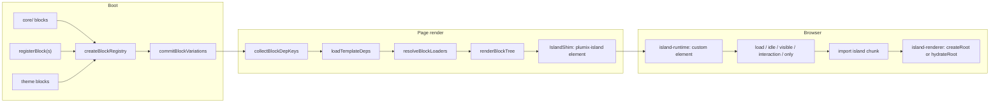

# Blocks and islands

Blocks are the named components an entry's content tree is made of. Core ships the `core/` set; plugins and themes add their own. One walker, `renderBlockTree`, renders a tree in three hosts: public SSR, edit-mode SSR, and the editor canvas iframe. Islands are the client-interactive parts of that otherwise static HTML. A module that starts with `"use client"` becomes an island, and a page with no island ships no JavaScript. Block authors and theme authors use this subsystem; editors see its output in the canvas. It lives in `packages/core/src/blocks/`, with the island build step in `packages/plumix/src/vite/island-transform.ts`.

## At a glance

## Surface

| Piece                                                                                                                                                     | Where                                                           | Public?                              |
| --------------------------------------------------------------------------------------------------------------------------------------------------------- | --------------------------------------------------------------- | ------------------------------------ |
| `defineBlock(spec)` with `render`, `inputs`, `loaders`, `deps`, `variations`, `transforms`, `errorFallback`, `requiresParent`, `entryTypes`, `capability` | `plumix/blocks`                                                 | public                               |
| `registerBlock`, `registerBlocks` (the `core/` namespace throws)                                                                                          | plugin setup context                                            | public                               |
| Theme `blocks`, `shortcodes` on `defineTheme`                                                                                                             | `plumix/theme`                                                  | public                               |
| `registerMark(spec)` (`MarkSpec`, `adminSchema` names the Tiptap mark)                                                                                    | plugin setup context                                            | public                               |
| `registerShortcode(spec)` (server only), descriptor `shortcodes` (server and canvas), `defineShortcode`                                                   | plugin setup context, `definePlugin`, `plumix/blocks`           | public                               |
| `registerPattern(spec)`, `definePattern`, `block()`                                                                                                       | plugin setup context, `plumix/blocks`                           | public                               |
| `BlockRenderer`, `BlockTree`, `PlumixProvider`, `Link`, `Image`, `SignedIn`, `SignedOut`, `useAuth`, `useIsLive`, `useSingleFlight`                       | `plumix/blocks/renderer`                                        | public                               |
| Island client runtime and renderer                                                                                                                        | `plumix/blocks/island-runtime`, `plumix/blocks/island-renderer` | public (loaded by generated entries) |
| `blocks.htmlAllowlist`                                                                                                                                    | `plumix()` config                                               | public                               |
| Filters `block:before_render`, `block:after_render`, `blocks:loader:error`                                                                                | `packages/core/src/hooks/block-render.ts`                       | public                               |
| `entry.resolveBlockDeps`, `entry.refreshBlockLoader`                                                                                                      | `packages/core/src/rpc/procedures/entry/`                       | internal (editor)                    |

Core blocks (`packages/core/src/blocks/core-blocks.ts`): `core/rich-text`, `separator`, `code`, `group`, `section`, `columns`, `column`, `button`, `details`, `video`, `embed`, `html`, `table` and its row and cell blocks. Core shortcodes: `[year]`, `[month]`. Core marks (`packages/core/src/blocks/marks/core/metadata.ts`): `bold`, `italic`, `strike`, `code`, `link`, `underline`, `subscript`, `superscript`, `highlight`, `kbd`, `abbr`, `cite`, `small`.

## How it works

- **Registry.** `buildApp` in `packages/core/src/runtime/app.ts` builds the registry from `coreBlocks` plus `collectContributedBlocks` (`packages/core/src/plugin/build-manifest.ts`). Last write wins, so core < plugin < theme. `commitBlockVariations` walks every variation's inner blocks at boot and throws on unknown names or undeclared attrs. `packages/core/src/theme.ts` rejects a theme block in `core/`.
- **Walker.** `renderBlockTree` (`packages/core/src/blocks/render-block-tree.ts`) threads a `BlockContext`: `entry`, `parent`, `depth`, `locale`, `shortcodes`, `editing`, and `t`. `t` resolves a `{ id, message }` descriptor against the catalog the host passes (ADR 0016). Unknown nodes render through `packages/core/src/blocks/unknown-node.ts`.
- **Deps.** A block's `deps` is a static `TemplateDepDeclarations` or a pure function of its attrs (`packages/core/src/blocks/deps.ts`). `renderThroughTheme` collects every rendered tree's keys with `collectBlockDepKeys`, unions them with the template's, and loads each kind once. `render` receives its own keys as `deps` (ADR 0040).
- **Loaders.** `resolveBlockLoaders` (`packages/core/src/blocks/loaders.ts`) runs each block's loaders per instance. A rejection is isolated to that block and reported through `blocks:loader:error`. In dev the first rejection escalates to `BlockLoaderError`. On an entry page outside the editor, a thrown page outcome ends the request (ADR 0032). Archive listings run loaders only when the template sets `prefetchArchiveLoaders`.
- **Shortcodes.** `expandShortcodes` (`packages/core/src/blocks/shortcodes/expand.ts`) expands `[tag]` macros to escaped strings. `assembleShortcodeRegistry` (`packages/core/src/runtime/shortcode-registry.ts`) merges core < plugin < theme. `core/rich-text` expands, then sanitises once with the HTML allowlist. Descriptor `shortcodes` reach the canvas through `packages/plumix/src/vite/editor-entry-codegen.ts`.
- **Marks.** Rich-text bodies are stored as HTML, so a mark is markup the sanitiser allows. `MarkSpec` is manifest data for the editor's bubble menu.
- **Island build.** `findUseClientIslands` reads the directive prologue. `scanUserSources` walks the site and workspace-symlinked packages. Each module becomes its own Rollup input. `transformUseClientModule` replaces each export with an `IslandShim` wrapper.
- **Island SSR.** `IslandShim` (`packages/core/src/blocks/island-shim.ts`) renders the component and wraps it in `<plumix-island>` with the chunk URL, export name, serialized props (`packages/core/src/blocks/serialize.ts`) and the `client`/`prefetch` attributes. Inside an island, a nested component without a `client` directive renders inline. `injectIslandsBootstrap` (`packages/core/src/route/render/inject-islands-bootstrap.ts`) adds the runtime script only when the body contains `<plumix-island`.
- **Hydration.** The custom element (`packages/core/src/blocks/island-element.ts`) waits for any ancestor island that still carries `ssr`, then runs its strategy (`packages/core/src/blocks/island-strategies/`). It imports the chunk with one retry and mounts through `packages/core/src/blocks/island-renderer.ts`. In dev that is `hydrateRoot`, which reports mismatches. In production it is `createRoot`. `shouldHydrate` keeps islands static in edit mode (`packages/core/src/blocks/island-mode.ts`).

## Invariants

- A host passes a catalog, never a resolved string; with no catalog `t` returns the English `message`. [ADR 0016](../adr/0016-a-render-context-resolves-descriptors.md); `packages/core/src/blocks/i18n-label.test.ts`.
- A block declares its deps like a template, deps load once per page, and `BlockContext.siteSettings` is gone. [ADR 0040](../adr/0040-a-block-declares-its-deps-like-a-template.md); `packages/core/src/route/block-deps.dispatch.test.tsx`, `packages/core/src/rpc/procedures/entry/resolve-block-deps.test.ts`.
- A loader outcome ends the request only on the page's own content and never in the editor. [ADR 0032](../adr/0032-a-page-step-ends-the-request-by-throwing-an-outcome.md); `packages/core/src/route/page-outcome.dispatch.test.tsx`.
- Plugins and themes cannot register a `core/` block. `packages/core/src/runtime/app-block-aggregate.test.ts`.
- `__proto__`, `constructor` and `prototype` are never island exports. `packages/plumix/src/vite/island-transform.test.ts`, `packages/core/src/blocks/island-mode.test.ts`.
- Dev-only island error reporting is gated inline on `process.env.PLUMIX_DEV` so it tree-shakes. `packages/plumix/src/vite/dev-gate-tree-shaking.test.ts`.
- `blocks/` is a client-safe `foundation` folder and imports nothing above it. [ADR 0010](../adr/0010-core-is-one-package-of-enforced-layers.md); `packages/core/src/layers.test.ts`.

## Status

| Piece                                           | Status  | Evidence                                                                                                                                                                                                                      |
| ----------------------------------------------- | ------- | ----------------------------------------------------------------------------------------------------------------------------------------------------------------------------------------------------------------------------- |
| Registry, `defineBlock`, variations, transforms | Shipped | `packages/core/src/blocks/block-registry.test.ts`, `packages/core/src/blocks/commit-block-variations.test.ts`                                                                                                                 |
| Walker and render hooks                         | Shipped | `packages/core/src/blocks/render-block-tree.test.tsx`, `packages/core/src/blocks/render-block-tree.edit.test.tsx`                                                                                                             |
| Block deps and canvas re-resolve                | Shipped | `packages/core/src/route/block-deps.dispatch.test.tsx`                                                                                                                                                                        |
| Loaders and isolation                           | Shipped | `packages/core/src/blocks/loaders.test.ts`                                                                                                                                                                                    |
| Shortcodes                                      | Shipped | `packages/core/src/blocks/shortcodes/expand.test.ts`                                                                                                                                                                          |
| Patterns                                        | Shipped | `packages/core/src/blocks/pattern-registry.test.ts`                                                                                                                                                                           |
| Islands, strategies, nesting, edit mode         | Shipped | `packages/core/e2e/islands.spec.ts`, `packages/core/e2e/island-strategies.spec.ts`, `packages/core/e2e/islands-nested.spec.ts`, `packages/core/e2e/islands-edit-mode.spec.ts`, `packages/core/e2e/dev-island-overlay.spec.ts` |
| Sanitiser and allowlist                         | Shipped | `packages/core/e2e/html-sanitizer.spec.ts`, `packages/core/src/blocks/html/sanitize.test.ts`                                                                                                                                  |

No open issue targets blocks or islands (checked with `gh issue list -R withplumix/plumix --state open`).

## Gaps

- `registerMark`'s doc comment says "Names colliding with core marks throw". `claimKey` in `packages/core/src/plugin/setup-context.ts` checks only `registry.markSpecs`, which holds plugin marks, and `buildApp` concatenates `coreMarks` with plugin marks without checking. A plugin `bold` mark registers.
- `renderInline` and `renderInlineAll` in `packages/core/src/blocks/marks/render-inline.tsx` have no caller outside their test. The `marks` comment on `PlumixApp` in `packages/core/src/runtime/app.ts` still says rendering "uses the hardcoded `renderInline` walker". This is dead code to report, not delete here.
- ADR 0016 names `@plumix/blocks` and `packages/blocks/locales`. That package was folded into `packages/core/src/blocks/` under ADR 0010.
- `ShortcodeContext` still carries `siteSettings`, while ADR 0040 moved block reads to `deps`. `core/rich-text` fills it from its own `deps: { settings: ["site"] }`, so a shortcode gets only the `site` group.
- ADR 0006, listed for this area, is about `@plumix/plugin-og` card renderers and does not touch blocks or islands.
