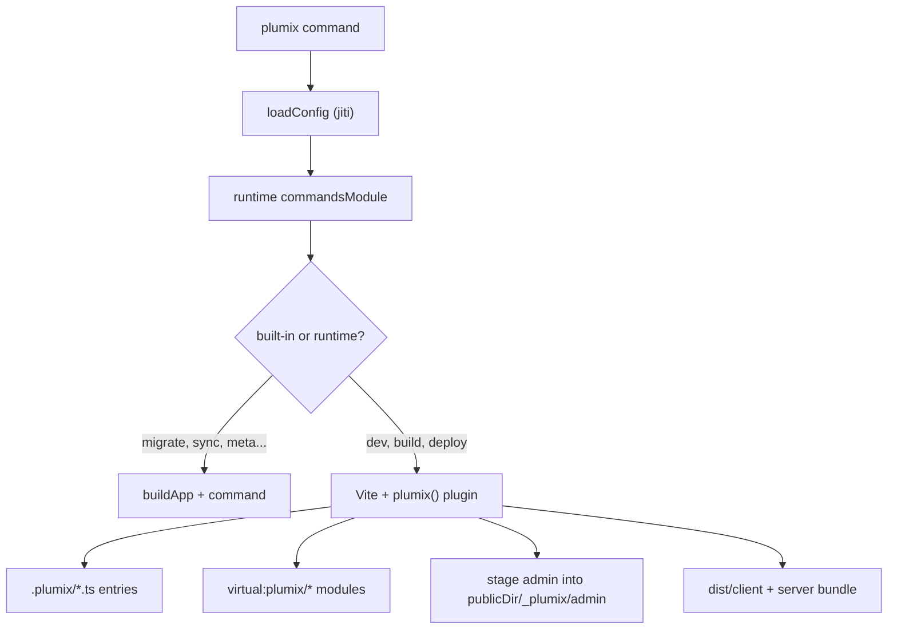

# Build and CLI

The `plumix` bin is how a developer runs, builds, migrates and operates a site. It is the "plumix CLI" container in [`ARCHITECTURE.md`](../../ARCHITECTURE.md), with the build behind the "plumix CLI and build" row of its component table. It loads `plumix.config.ts`, adds the commands of the runtime the config names, and runs one. `dev` and `build` hand off to Vite with the `plumix` Vite plugin, which generates the site's entry files under `.plumix/`, serves virtual modules, wires islands, and stages the admin SPA with each plugin's admin code. `create-plumix-app` scaffolds a new site. The code lives in `packages/plumix/src/cli/`, `packages/plumix/src/vite/`, each runtime's `src/commands/` under `packages/runtimes/`, and `packages/create-plumix-app/`.

## At a glance

## Surface

CLI commands. Global flags parsed before the command name: `--cwd`, `--config`, `--help`/`-h`, `--version`/`-v`, `--verbose`.

| Command             | Owner                 | What it does                                                                                                     |
| ------------------- | --------------------- | ---------------------------------------------------------------------------------------------------------------- |
| `migrate`           | built-in              | Applies each owner's schema then data migrations, or generates the site's. See [migrations.md](./migrations.md). |
| `sync`, `import`    | built-in              | Replace local or deployed data. See [sync-and-import.md](./sync-and-import.md).                                  |
| `meta`              | built-in              | Reports or settles stored field values.                                                                          |
| `cron`              | built-in              | Lists scheduled tasks or fires one. See [cron.md](./cron.md).                                                    |
| `mail`              | built-in              | Sends core's `mailTest`. See [mail.md](./mail.md).                                                               |
| `doctor`            | built-in              | Prints a diagnostic snapshot.                                                                                    |
| `i18n`              | built-in              | Extract and compile catalogs. Runs with no config. See [i18n.md](./i18n.md).                                     |
| `dev`               | node, bun, cloudflare | Migrates the local database, then starts the dev server. `deferApp: true`.                                       |
| `build`             | node, bun, cloudflare | Node/Bun: `dist/client` and `dist/server`. Cloudflare: the Worker bundle.                                        |
| `deploy`, `preview` | cloudflare            | Build, migrate the target database, then hand off to the platform's deploy or preview. Takes `--env`.            |
| `types`             | cloudflare            | Generates the platform's binding types.                                                                          |

Vite plugin and helpers (`plumix/vite`, public):

| Export                             | Use                                                                          |
| ---------------------------------- | ---------------------------------------------------------------------------- |
| `plumix(options)` (default)        | The Vite plugin. `configFile` names the config; `adminDir` is a test seam.   |
| `runBuildCommand`, `runDevCommand` | Shared build and dev for server runtimes (Node, Bun).                        |
| `emitPlumixSources`                | Writes the `.plumix/` entry files before Vite starts.                        |
| `buildAppClientFirst`              | Builder order: client first, so the server bakes the client's Vite manifest. |
| `serverEnvironment`                | Server environment options for a runtime's bundle.                           |
| `defineTestConfig`                 | Vitest config that mirrors the repo's test tiers.                            |

Generated files and virtual modules:

| Name                                | Source                               | Content                                                                                             |
| ----------------------------------- | ------------------------------------ | --------------------------------------------------------------------------------------------------- |
| `.plumix/schema.ts`                 | `generateSchemaSource` (core)        | Merged Drizzle schema of core, plugins and site.                                                    |
| `.plumix/worker.ts`                 | `config.runtime.generateEntry`       | The runtime's server entry, e.g. `createNodeSite` in `packages/runtimes/node/src/entry-codegen.ts`. |
| `.plumix/client-entry.ts`           | `generateClientEntrySource`          | Imports theme CSS so Vite hashes it.                                                                |
| `.plumix/islands-entry.ts`          | inline                               | Imports `plumix/blocks/island-runtime`.                                                             |
| `.plumix/islands-renderer-entry.ts` | `generateIslandsRendererEntrySource` | React renderer plus each sign-in method's client half.                                              |
| `.plumix/editor-entry.ts`           | `generateEditorEntrySource`          | Block and shortcode modules for the editor canvas.                                                  |
| `.plumix/admin-plugins-entry.mjs`   | `assemblePluginAdminBundle`          | Synthesised entry for the per-site admin bundle.                                                    |
| `.plumix/admin-staging/`            | `stageAdminAssets`                   | The admin built in full before it is swapped into `publicDir`.                                      |
| `.plumix/public/`                   | default `publicDir`                  | Staged user `public/` plus `_plumix/admin`.                                                         |
| `virtual:plumix/asset-manifest`     | `loadAssetManifest`                  | Client `.vite/manifest.json`, `{}` in dev.                                                          |
| `virtual:plumix/worker-exports`     | `generateWorkerExportsSource`        | `export *` per `runtime.workerExports` entry.                                                       |
| `virtual:plumix/plugin-catalogs`    | `generatePluginCatalogsSource`       | Plugin catalogs by locale, for SSR.                                                                 |
| `virtual:plumix/island-serialize`   | inline                               | Re-exports `IslandShim` from `plumix/blocks`.                                                       |
| `virtual:plumix/data-migrations`    | `buildDataMigrations`                | Entry of the data-migration bundle written beside a Node or Bun server.                             |

`define`d constants (all `""` when `command === "build"`): `process.env.PLUMIX_DEV` (`"1"` in dev), `PLUMIX_DEV_ALLOW_REMOTE`, `PLUMIX_EDITOR`, `PLUMIX_EDITOR_PATH_MAP`, `PLUMIX_FORWARD_ERRORS`. `WORKERS_CI` and `WORKERS_CI_BRANCH` pass through from the build environment.

`create-plumix-app` flags: `--runtime` (default `node`), `-p/--plugins`, `--auth`, `--pm`, `--no-install`, `--no-db`, `--no-git`, `-y/--yes`.

## How it works

**CLI.** `run` in `packages/plumix/src/cli/index.ts` parses global flags up to the first other token, which is the command, and passes the rest through unparsed. A `--help` or `-h` anywhere in the rest prints that command's help (`formatCommandHelp`) and returns before anything builds, migrates or runs. For `dev` it sets `process.env.PLUMIX_DEV = "1"` before the config is evaluated. It loads the config through `loadConfig` (jiti, cached by path, `fresh` on a config edit), resolves `runtime.commandsModule` from the site root, and looks the command up in `BUILT_IN_COMMANDS` first, then in the runtime's `commands`. Unless the command sets `deferApp`, it calls `buildApp(config)` and passes the app in. The runtime module also exports `migrations`, `diagnose` and `sync`, which built-ins use to reach that runtime's database ([ADR 0034](../adr/0034-an-operator-task-is-a-cli-command-or-config-not-an-admin-screen.md), [ADR 0045](../adr/0045-a-runtime-names-its-remote-databases-from-its-platform-config.md)). Core's barrel is imported lazily through `loadOnce`, so `--help`, `--version`, `dev` and `i18n` never load it.

**Vite plugin.** `config()` adds the `define`s, `build.manifest`, `build.license`, the client inputs (four `.plumix/*` entries plus one input per `"use client"` module found by `scanUserSources`), path aliases, and merges `config.vite`. `buildStart` calls `regenerate`, which writes the `.plumix/` files with `writeIfChanged`, runs `computeManifestAndRegistry` (a second `installPlugins`), stages user `public/`, then stages the admin. `transform` replaces SSR `"use client"` modules with island shims; see [blocks-and-islands.md](./blocks-and-islands.md). `configureServer` adds loopback-only dev error endpoints, and on a `plumix.config.ts` change it regenerates, restages and sends a full reload; see [dev-tooling.md](./dev-tooling.md).

**Admin staging.** `stageAdminAssets` copies `@plumix/admin`'s `dist` into `.plumix/admin-staging`, adds each plugin's `adminChunk`/`adminCss` under `plugins/`, compiled plugin catalogs, and a `site-bundle.js`/`.css` built with esbuild and Tailwind from every `adminEntry`, theme and plugin block modules, and method clients. Bare `react` and similar imports are aliased to `plumix/admin/*` shims, so the plugins share the admin's single React. It injects the plugin manifest and chunk tags into `index.html`, and `stageIntoPlace` swaps the result into `<publicDir>/_plumix/admin` only when it differs. See [admin-and-editor.md](./admin-and-editor.md).

**Build.** Node and Bun call `runBuildCommand`: emit sources, build `dist/client` then the server environment, copy each owner's migration history beside the server, and bundle data migrations (`buildDataMigrations`). The Cloudflare adapter's `build` runs `createCloudflareVite` (the `plumix` plugin, `workersCaching`, which binds the platform's cache when its config turns caching on, and the platform's Vite plugin) with `buildAppClientFirst`. Its `deploy` and `preview` take `--env` (else the ambient environment variable), build for that environment, call `migrateBeforeDeploy`, then hand the remaining args to the platform's CLI.

**Plugin manifest.** `computeManifestAndRegistry` (`packages/plumix/src/vite/manifest.ts`) installs the plugins, fires `theme:ready`, and calls `buildManifest` with the theme's tokens, breakpoints, blocks, block list and style policy, the configured slots and the refused admin areas. The result is the plugin manifest the admin reads, so the editor finds the block list and style policy beside the blocks; see [admin and editor](./admin-and-editor.md). A config change restages the admin with them.

**Scaffold.** `create-plumix-app` reads runtime and plugin metadata from each package's `package.json` `plumix.scaffold` block (`src/registry.ts`). `prepack` bakes it into `registry.json` (`scripts/build-snapshot.mjs`) so the published CLI works outside the monorepo. `src/compose/` writes `plumix.config.ts`, `package.json` and, for Cloudflare, the platform config over the `base/` skeleton. `runPostScaffold` installs, runs `plumix migrate`, and inits git. A plugin is recommended when its `plumix.scaffold` block says so (`seo` and `feeds`).

Key files: `packages/plumix/bin/plumix.mjs`, `packages/plumix/src/cli/index.ts`, `packages/plumix/src/cli/load-config.ts`, `packages/plumix/src/cli/site-run.ts`, `packages/plumix/src/vite/index.ts`, `packages/plumix/src/vite/admin-plugin-bundle.ts`, `packages/plumix/src/vite/build-command.ts`, `packages/plumix/src/vite/dev-command.ts`, `packages/runtimes/*/src/commands/index.ts`, `packages/create-plumix-app/src/cli.ts`.

## Invariants

- Dev-only code is gated on the inline `process.env.PLUMIX_DEV` constant, `""` in a build, so it tree-shakes out. Guarded by `packages/plumix/src/vite/dev-gate-tree-shaking.test.ts` (AGENTS.md, "Env & secrets").
- The client builds before the server, or a cold build ships no theme CSS. Guarded by `packages/plumix/src/vite/build-order.test.ts`.
- Every site build writes `THIRD-PARTY-NOTICES.md` through `build.license` ([ADR 0043, licences](../adr/0043-a-site-build-ships-the-licences-of-what-it-bundles.md)).
- A runtime command uses its runtime's primitives and is tested on that runtime ([ADR 0019](../adr/0019-a-runtime-adapter-uses-its-runtimes-primitives-and-is-tested-on-that-runtime.md)).
- The CLI entry's static import graph never reaches core's root barrel; `buildApp` stays behind a dynamic import. Guarded by `packages/plumix/src/cli/cold-start.test.ts`.
- Each runtime's `all-plugins` scaffold boots `plumix dev` and drives the editor from the packed tarballs ([ADR 0046](../adr/0046-the-scaffold-smoke-drives-the-editor-under-plumix-dev.md)). Guarded by `packages/create-plumix-app/smoke/dev-editor/editor.spec.ts` via `pnpm smoke:scaffold`.
- `adminEntry` and `adminChunk` on one plugin is an error (`adminEntryAndChunkBothSet`).
