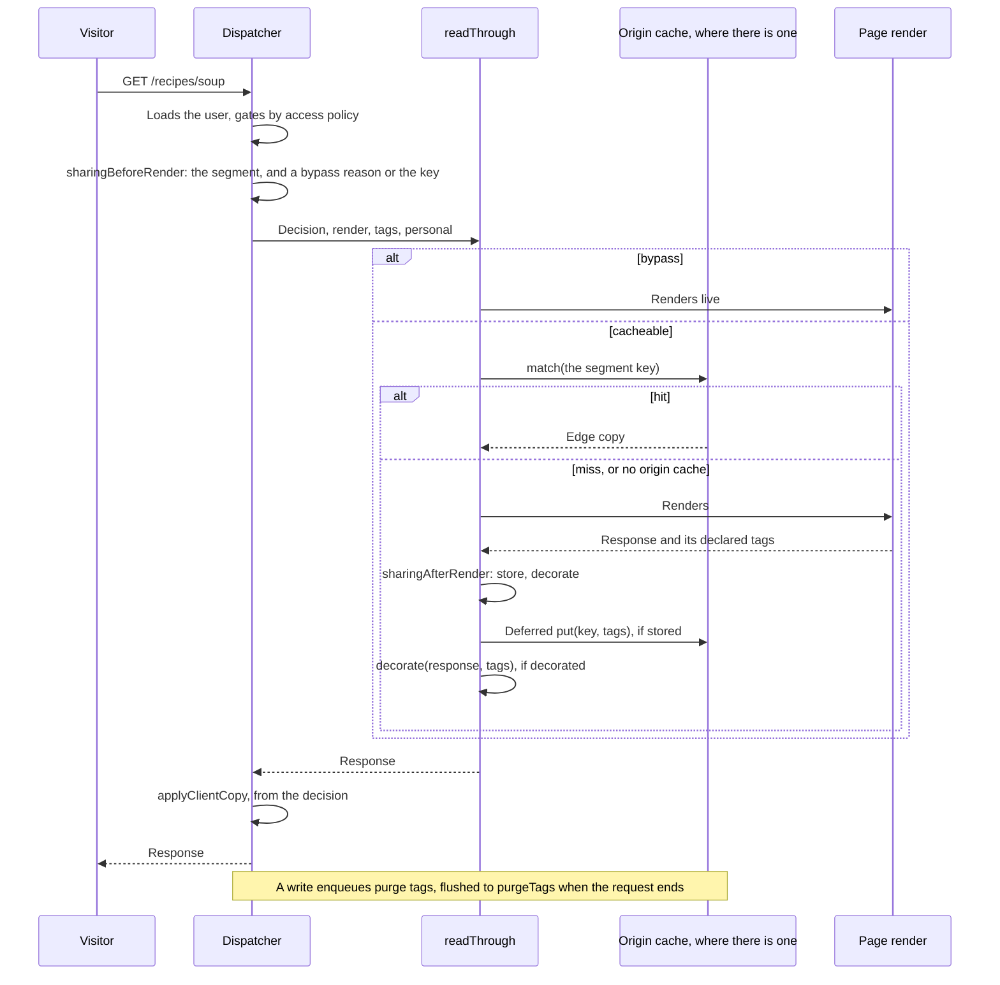

# CDN cache

The CDN cache serves public renders read-through, one shared copy per segment. A hit returns the edge copy with the segment's client headers. A miss renders live, stores the response in the background under its cache tags where the runtime has an origin cache, and decorates it with cache headers and tags for a CDN in front. A later write purges those tags. Operators turn it on with the `cdn` config slot. Site developers and plugin authors meet it through `cacheable` opt-ins and the tag helpers. Editors only see that a publish shows up. It is the **CDN read-through** component in [ARCHITECTURE.md](../../ARCHITECTURE.md#components-of-the-app-process), and the origin cache on its deployment diagram. It lives in `packages/core/src/cdn/`, with the dispatch glue in `packages/core/src/runtime/dispatcher.ts`.

## At a glance

## Surface

| Piece                                                                                                                                                                                                                                  | Where                                                                   | Public?  |
| -------------------------------------------------------------------------------------------------------------------------------------------------------------------------------------------------------------------------------------- | ----------------------------------------------------------------------- | -------- |
| `cdn` slot, filled by a `CdnProvider`                                                                                                                                                                                                  | `plumix()` config                                                       | public   |
| `CdnProvider`, `ConnectedCdn` (`decorate`, `store?`, `segmentVary?`, `purgeTags?`, `purgeAll?`), `CdnStore`                                                                                                                            | `plumix` (`packages/core/src/runtime/contract/slots.ts`)                | public   |
| CDN conformance suite                                                                                                                                                                                                                  | `plumix/test/conformance` (`packages/core/src/test/conformance/cdn.ts`) | public   |
| `fakeCdn()` (`assertStored`, `assertNotStored`, `assertPurged`, `assertNotPurged`, `assertNothingPurged`), an in-memory cdn that passes the suite, for the dispatcher harness's `cdn` option; `testSite` always uses it, as `site.cdn` | `plumix/test` (`packages/core/src/test/cdn-fake.ts`)                    | public   |
| `cacheable: true` on `registerArchiveType`, `registerView`, `registerPublicRoute`, `registerRoute`                                                                                                                                     | plugin setup context                                                    | public   |
| `tagCdnEntry(ctx, tags)`                                                                                                                                                                                                               | `plumix/plugin`                                                         | public   |
| `enqueuePurgeTags`, `entryTag`, `typeTag`, `termPurgeTags`, `entryPurgeTags`                                                                                                                                                           | `plumix/db`                                                             | public   |
| `compileEntryQuery(ctx, query)`, an entry query's condition that stores the response under the type tag of each type it can list                                                                                                       | `plumix/db` (`packages/core/src/entries/query.ts`)                      | public   |
| `taxonomyTermRows(ctx, taxonomy)`, a taxonomy's term rows that store the response under its list tag                                                                                                                                   | `plumix/db` (`packages/core/src/terms/listing.ts`)                      | public   |
| `ctx.cache.reads(key?)`, `ctx.cache.changed(key?)`, in a namespace named after the calling plugin                                                                                                                                      | `AppContext` (`packages/core/src/cdn/plugin-cache.ts`)                  | public   |
| `LookupAdapter.kind` (`entry`, `term` or `user`), `LookupAdapter.embeddedCacheTags`                                                                                                                                                    | `plumix/plugin`                                                         | public   |
| `ctx.entries` (`create`, `update`, `delete`)                                                                                                                                                                                           | `AppContext`                                                            | public   |
| `ctx.terms` (`create`, `update`, `delete`, `assign`)                                                                                                                                                                                   | `AppContext`                                                            | public   |
| `ctx.memo(key, load, tags?)`, `memoBatch`                                                                                                                                                                                              | `AppContext`, `plumix/plugin`                                           | public   |
| `sharingBeforeRender`, `sharingAfterRender`, `routeSharingBeforeRender`, `routeSharingAfterRender`, `readThrough`, `readThroughRoute`, `pageTags`, `declarePageTags`, `registerCorePurgeInvalidator`, `flushPurgeTags`                 | `packages/core/src/cdn/`                                                | internal |

Tag vocabulary (`packages/core/src/cdn/contract/tags.ts`): `t:<type>`, `e:<id>`, `s:<group>`, `tm:<id>`, which a rendered term (an archive, an entry's chip) and a term slug lookup declare and an edit or meta-only save of that term purges, `tm:slugs`, which only drops the memo's term slug lookups, `tx:<taxonomy>`, which `taxonomyTermRows` declares and a create or delete of a term in that taxonomy purges along with the term's `tm:<id>`, `u:<id>`, which author resolution declares and any write to that user purges, `u:slugs`, which only drops the memo's author slug lookups, and a plugin's namespace: `p:<plugin>` on everything `ctx.cache.reads` declared, `p:<plugin>:<key>` on a keyed read and `p:<plugin>*` on a whole-namespace read. `normalizeTag` lower-cases every tag.

What fills the slot on each runtime:

| Runtime    | Provider                                                         | Origin cache (`store`)                   | Purge                                                                          |
| ---------- | ---------------------------------------------------------------- | ---------------------------------------- | ------------------------------------------------------------------------------ |
| Cloudflare | `cloudflare()` from `@plumix/runtime-cloudflare/cdn`             | the Workers Cache API (`caches.default`) | the zone's purge API, plus Workers Caching's, run inside its cached entrypoint |
| Node, Bun  | `cloudflare()` from `plumix/cdn/cloudflare`, for a zone in front | none                                     | the zone's purge API                                                           |

## How it works

- **Connect.** A provider's `connect(env)` returns `null` when it should stay inert. `cloudflare()` in `packages/core/src/cdn/cloudflare/cloudflare.ts` does that when `zoneId` or `purgeToken` resolves empty. Where the runtime has an origin cache, the provider adds a `store`; without one it only decorates headers for the CDN in front. The Cloudflare adapter's wrapper (`packages/runtimes/cloudflare/src/cdn.ts`) adds the Workers Caching purge when the build bound it (`packages/runtimes/cloudflare/src/commands/workers-caching.ts`). That purge is an RPC call to the cached entrypoint, because Workers Caching purges only what the calling entrypoint stored, and a refused one is recorded on the request's `cdn` telemetry.
- **Gate.** On Cloudflare, Workers Caching sits in front of a named entrypoint, not the Worker's default export. The generated entry's default export forwards a request to it only when `mayServeFromSharedCache` (`packages/core/src/runtime/shared-cache.ts`, on `plumix/runtime`) allows it: a GET or HEAD with no session by the app's authenticator, no `Authorization`, no ephemeral grant and a path outside `<basePath>/_plumix/`. `sharedCacheRequest` (`packages/runtimes/cloudflare/src/shared-cache.ts`) strips its cookies and marketing parameters and sorts its query first. Everything else renders live.
- **Decide.** The sharing verdict (`packages/core/src/cdn/sharing-verdict.ts`) decides for content pages and policied plugin routes, from facts the dispatcher gathers. Before the render, `sharingBeforeRender` picks the segment: an ephemeral grant (`?preview`, `?plumix.edit`) renders `private`, then an `anonymous` grant (or no policy) to a privileged request renders `private`, else the policy's segment stands. A request with a session, no `Authorization` header and no principal personal from the start (the admin bar, or a locale of its own), to a page with no policy that the `anonymous` segment would read through, gets a `read-universal` decision instead: it looks up the anonymous key and is served only a copy marked universal ([ADR 0030](../adr/0030-a-render-that-reads-the-principal-is-never-shared.md#the-universal-copy)). It then refuses a page no public route matched (`no-route`), anything but `GET` and `HEAD` (`method`), the `private` segment (`private`), a non-anonymous segment the provider cannot key (`segment-unsupported`), and any intent outside `entry`, `entryType`, `term` and `frontPage` (`intent`), unless an archive type or view set `cacheable`; a policied plugin route never reaches the CDN. A provider can key segments when it has a `store` or a `segmentVary`. Otherwise it returns the CDN key. After the render, `sharingAfterRender` says whether the edge copy is stored and decorated, and which client copy the response leaves with. Cacheable and raw plugin routes ask the verdict's route entry point, which has no segment axis and never reads or marks the universal copy: `routeSharingBeforeRender` sends a privileged or grant-bearing request to a public route to a live `private` render, refuses anything but `GET` and `HEAD` (`method`), and otherwise returns the route's key; `routeSharingAfterRender` decides the same store and decoration.
- **Key.** `segmentCdnKey` keys `anonymous` under the plain URL and other segments under `__plumix_segment=<segment>`. A gated page is stored once per `capability:<name>` segment, shared by every reader who holds that capability, whatever role grants it. It drops any client-supplied marker and the cookie. `routeCdnKey` keys a cacheable plugin route by its full URL, without the cookie. Both set `__plumix_build=<id>` from `process.env.PLUMIX_BUILD_ID`, which the `plumix` Vite plugin defines as one UUID per build (`"dev"` under the dev server), so a deploy never reads a page the previous build stored, and both drop a client-supplied `__plumix_build` first.
- **Store.** The after-render verdict shares a page only when it is a 200 and the render is not personal ([ADR 0030](../adr/0030-a-render-that-reads-the-principal-is-never-shared.md)), and decorates only the `anonymous` segment's. The stored copy of a page with no policy carries the universal marker (`packages/core/src/cdn/universal-copy.ts`), which the store keeps and every client copy strips. A `read-universal` render is never stored; `lookupOrRender` in `packages/core/src/cdn/read-through.ts` does the I/O. A cacheable plugin route must also be unprivileged, carry no ephemeral grant, set no cookie, and not say `private` or `no-store`; a raw route still serves a privileged request its stored copy. Only `GET` fills the store. `put` is deferred, and the verdict never decorates a `Set-Cookie` response.
- **Tag.** The dispatcher's `tags` callback unions `pageTags` (`packages/core/src/cdn/tags.ts`, derived from the intent and the resolved entity) with `declaredPageTags`: what the render declared through `declarePageTags`. That covers settings deps (`packages/core/src/template-deps-core.ts`), embedded lookups (each requested id under its adapter's `kind` tag, plus `embeddedCacheTags`, whether it hydrated or not, so publishing a referenced draft purges the page), `compileEntryQuery` (`packages/core/src/entries/query.ts`), which declares the type tag of each type its query can list, or of every public type for a query that names none, `taxonomyTermRows` (`packages/core/src/terms/listing.ts`), `tagCdnEntry` and `ctx.cache.reads`. A plugin archive, a view and a contributed sitemap source return no tags: they are stored under what their handler read through core's read helpers, and core runs an archive's or view's `resolve` in its plugin's frame so `ctx.cache.reads` names that plugin. A read through `anonymousContext` declares on the request it was made from (`declareThrough`), so a sitemap read for every visitor still tags its response. Cacheable plugin routes carry only declared tags.
- **Purge.** `registerCorePurgeInvalidator` (`packages/core/src/cdn/purge.ts`) subscribes to the `entry`, `term` and `user` events and to `settings.groupChanged`, all unscoped. `enqueuePurgeTags` drops the matching request-memo entries at once and collects the tags. `flushPurgeTags` runs once at the end of a request, a scheduled run or a runtime handler call, and defers `purgeTags`. A purge failure is logged and never fails the write. `ctx.entries` (`packages/core/src/rpc/procedures/entry/writes.ts`) and `ctx.terms` (`packages/core/src/rpc/procedures/term/writes.ts`) are the write paths core's entry and term procedures take, so a plugin's entry or term write emits the same events. `ctx.terms.assign` emits no event; it enqueues the entry's `e:<id>` and the term's `tm:<id>` itself. A settings group written through `ctx.settings.write` (`packages/core/src/settings/write.ts`), which `settings.upsert` calls too, emits `settings.groupChanged` itself, so a plugin never emits it by hand. A private (`_internal`) group's write emits no event, since its values are secrets, and enqueues the group's settings tag itself. A direct write through `ctx.db` emits no event, so its writer enqueues tags itself through `plumix/db`, or calls `ctx.cache.changed` for the plugin's own data. `ctx.cache` reads the calling plugin from `pluginStore` (`packages/core/src/context/stores.ts`), which core sets around a plugin's routes and public routes, archive and view resolvers, template deps, RPC procedures and its event and filter handlers; anywhere else it throws. A sync's settle calls `purgeAll` (`packages/core/src/context/settle-sync.ts`).
- **Memo.** `createRequestMemo` (`packages/core/src/context/memo.ts`) dedupes per-request loads by key. A load registers tags, and `invalidate(tags)` drops them, so a read after a write in the same request sees the write.
- **No-store surfaces.** `withNoStore` (`packages/core/src/runtime/contract/http.ts`) wraps `/_plumix/rpc`, `/_plumix/api`, `/_plumix/mcp` and the sync endpoints. Every non-anonymous segment's client copy leaves `private, no-store` with `vary: cookie` and no `cache-tag`, on a hit as on a miss: the verdict picks the client copy from the before-render decision, and the dispatcher applies it (`applyClientCopy` in `packages/core/src/cdn/client-copy.ts`). A `read-universal` hit leaves `private, no-cache` with `vary: cookie` and no `cache-tag`, and its live render leaves `private, no-store`. A public page that leaves without a `Cache-Control` gets `private, no-cache`, so Workers Caching never stores a bypassed, non-200 or CDN-less page under its own defaults. A page outcome redirect leaves `private, no-store`.

## Invariants

- A render that reads the principal is never stored in a shared segment and leaves `private, no-store`; the segment's edge copy still serves its next member. [ADR 0030](../adr/0030-a-render-that-reads-the-principal-is-never-shared.md); `packages/core/src/cdn/read-through.test.ts`, `packages/core/src/route/render/personal-render.test.ts`.
- The segment decides the client copy on a hit as on a miss: only the `anonymous` segment's copy leaves shareable. [ADR 0030](../adr/0030-a-render-that-reads-the-principal-is-never-shared.md); `packages/core/src/cdn/cloudflare/cloudflare.test.ts`, `packages/core/src/runtime/dispatcher.test.ts`.
- A signed-in request is served only the universal copy or its own live render, and never stores. [ADR 0030](../adr/0030-a-render-that-reads-the-principal-is-never-shared.md#the-universal-copy); `packages/core/tests/feature/reading-the-universal-copy-while-signed-in.test.tsx`, `packages/core/src/cdn/read-through.test.ts`.
- The universal marker never leaves on a response. `packages/core/src/cdn/client-copy.test.ts`, `packages/core/tests/feature/reading-the-universal-copy-while-signed-in.test.tsx`.
- A view or archive type is stored only on `cacheable: true`. [ADR 0035](../adr/0035-an-app-page-is-a-view-not-an-archive.md); `packages/core/src/route/view.dispatch.test.tsx`, `packages/core/src/cdn/sharing-verdict.test.ts`.
- Archive pages are the same for every visitor, which is what lets the CDN store them, and they carry the type tags of what their query can list. [ADR 0008](../adr/0008-an-archive-is-one-entry-query.md); `packages/core/src/cdn/tags.test.ts`.
- A page-step redirect is never stored. [ADR 0032](../adr/0032-a-page-step-ends-the-request-by-throwing-an-outcome.md); `packages/core/tests/feature/ending-a-page-with-an-outcome.test.tsx`.
- A provider may narrow sharing in `decorate`, never widen it. Only `CdnStore.put` widens, and it drops `Set-Cookie`. `packages/core/src/test/conformance/cdn.ts`, `packages/core/src/cdn/cloudflare/cloudflare.test.ts`, `packages/runtimes/cloudflare/src/cdn.test.ts`.
- A client-supplied `__plumix_segment` never selects which stored segment is served. `packages/core/src/cdn/decision.test.ts`.
- A stored page is read only by the build that rendered it, and a client-supplied `__plumix_build` never selects another build's entry. `packages/core/src/cdn/decision.test.ts`, `packages/core/src/cdn/cloudflare/cloudflare.test.ts`.
- `cdn/` is a client-safe `capabilities` folder. [ADR 0010](../adr/0010-core-is-one-package-of-enforced-layers.md); `packages/core/src/layers.test.ts`.
