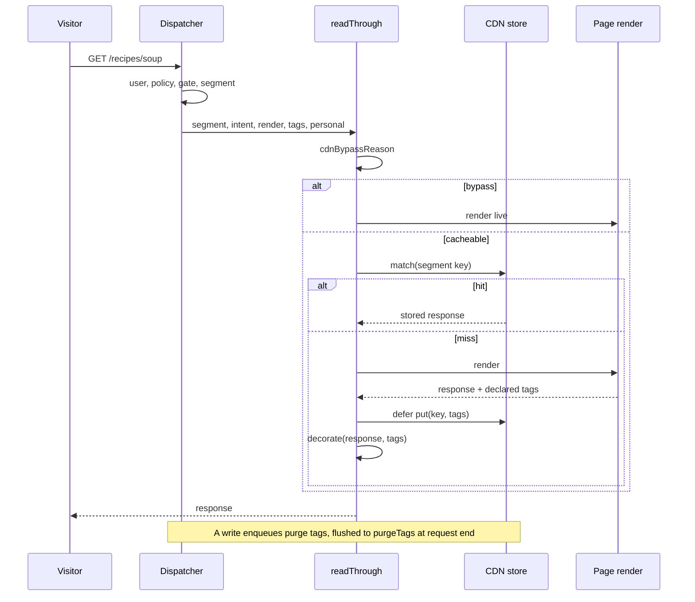

# CDN cache

The CDN cache stores anonymous, and segment-keyed, public renders and serves them read-through. A hit returns the stored response. A miss renders live, then stores the response in the background under cache tags, and a later write purges those tags. Operators turn it on with the `cdn` config slot. Site developers and plugin authors meet it through `cacheable` opt-ins and the tag helpers. Editors only see that a publish shows up. It lives in `packages/core/src/cdn/`, with the dispatch glue in `packages/core/src/runtime/dispatcher.ts` and a Workers-Caching wrapper in `packages/runtimes/cloudflare/src/cdn.ts`.

## At a glance

## Surface

| Piece                                                                                                                                 | Where                                                                   | Public?                         |
| ------------------------------------------------------------------------------------------------------------------------------------- | ----------------------------------------------------------------------- | ------------------------------- |
| `cdn` slot: `cloudflare({ ttl, staleWhileRevalidate?, zoneId, purgeToken })`                                                          | `plumix/cdn/cloudflare`                                                 | public                          |
| Same provider, also purging Workers Caching                                                                                           | `@plumix/runtime-cloudflare/cdn`                                        | public                          |
| `CdnProvider`, `ConnectedCdn` (`decorate`, `store?`, `segmentVary?`, `purgeTags?`, `purgeAll?`), `CdnStore`                           | `plumix` (`packages/core/src/runtime/contract/slots.ts`)                | public                          |
| CDN conformance suite                                                                                                                 | `plumix/test/conformance` (`packages/core/src/test/conformance/cdn.ts`) | public                          |
| `cacheable: true` on `registerArchiveType`, `registerView`, `registerPublicRoute`, `registerRoute`                                    | plugin setup context                                                    | public                          |
| `tagCdnEntry(ctx, tags)`                                                                                                              | `plumix/plugin`                                                         | public (removal planned, #3264) |
| `enqueuePurgeTags`, `entryTag`, `typeTag`, `termPurgeTags`, `entryPurgeTags`                                                          | `plumix/db`                                                             | public (removal planned, #3264) |
| `LookupAdapter.embeddedCacheTags`                                                                                                     | `plumix/plugin`                                                         | public (removal planned, #3264) |
| `ctx.memo(key, load, tags?)`, `memoBatch`                                                                                             | `AppContext`, `plumix/plugin`                                           | public                          |
| `readThrough`, `readThroughRoute`, `cdnBypassReason`, `pageTags`, `declarePageTags`, `registerCorePurgeInvalidator`, `flushPurgeTags` | `packages/core/src/cdn/`                                                | internal                        |

Tag vocabulary (`packages/core/src/cdn/contract/tags.ts`): `t:<type>`, `e:<id>`, `s:<group>`, and `u:<id>`, which only drops a memoized user row. Every tag is lower-cased by `normalizeTag`.

## How it works

- **Connect.** A provider's `connect(env)` returns `null` when it should stay inert. `cloudflare()` in `packages/core/src/cdn/cloudflare/cloudflare.ts` does that when `zoneId` or `purgeToken` resolves empty. With `caches.default` present it adds a `store` (the Workers Cache API). Without one, it only decorates headers for the zone cache. The runtime-cloudflare wrapper adds `cache.purge` calls when the build bound Workers Caching (`packages/runtimes/cloudflare/src/commands/workers-caching.ts` reads `cache.enabled` from the wrangler config).
- **Decide.** `cdnBypassReason` (`packages/core/src/cdn/decision.ts`) refuses non-`GET`/`HEAD` (`method`), the `private` segment (`private`), and a non-anonymous segment the provider cannot key (`segment-unsupported`). It also refuses any intent outside `entry`, `entryType`, `term`, `frontPage` (`intent`), unless an archive type or view set `cacheable`. The dispatcher picks the segment first. An ephemeral grant (`?preview`, `?plumix.edit`) or a privileged request on the `anonymous` segment renders `private`.
- **Key.** `segmentCdnKey` keys `anonymous` under the plain URL and other segments under `__plumix_segment=<segment>`. It drops any client-supplied marker and the cookie. `routeCdnKey` keys a cacheable plugin route by its full URL without the cookie.
- **Store.** `lookupOrRender` in `packages/core/src/cdn/read-through.ts` shares a response only when it is a 200 and the render is not personal (ADR 0030). A plugin route must also be unprivileged, set no cookie, and not say `private` or `no-store`. Only `GET` fills the store. `put` is deferred, and a `Set-Cookie` response is never decorated.
- **Tag.** The dispatcher's `tags` callback unions `pageTags` (`packages/core/src/cdn/tags.ts`, derived from the intent and resolved entity) with `declaredPageTags`. Those are what the render declared through `declarePageTags`: settings deps (`packages/core/src/template-deps-core.ts`), embedded lookups, an archive's or view's returned `tags`, and `tagCdnEntry`. Cacheable plugin routes carry only declared tags.
- **Purge.** `registerCorePurgeInvalidator` (`packages/core/src/cdn/purge.ts`) subscribes to entry, user, term and `settings:group_changed` actions. `enqueuePurgeTags` invalidates the request memo at once and collects tags. `flushPurgeTags` runs once at the end of a request, scheduled task or handler call, and defers `purgeTags`. A purge failure is logged and never fails the write. `purgeAll` is called by `plumix sync` settle (`packages/core/src/context/settle-sync.ts`).
- **Memo.** `createRequestMemo` (`packages/core/src/context/memo.ts`) dedupes per-request loads by key. A load registers tags, and `invalidate(tags)` drops them, so a read after a write in the same request sees the write.
- **No-store surfaces.** `withNoStore` (`packages/core/src/runtime/contract/http.ts`) wraps `/_plumix/rpc`, `/_plumix/api`, `/_plumix/mcp` and the sync endpoints. Every non-anonymous segment's client copy leaves `private, no-store` with `vary: cookie` (`markAudience` in the dispatcher). A page outcome redirect leaves `private, no-store`.

## Invariants

- A render that reads the principal is never stored in a shared segment and leaves `private, no-store`; a stored copy still serves the next member. [ADR 0030](../adr/0030-a-render-that-reads-the-principal-is-never-shared.md); `packages/core/src/cdn/read-through.test.ts`, `packages/core/src/route/render/personal-render.test.ts`.
- A view or archive type is stored only on `cacheable: true`. [ADR 0035](../adr/0035-an-app-page-is-a-view-not-an-archive.md); `packages/core/src/route/view.dispatch.test.tsx`, `packages/core/src/cdn/decision.test.ts`.
- Archive pages are the same for every visitor, which is what lets the CDN store them, and they carry the type tags of what their query can list. [ADR 0008](../adr/0008-an-archive-is-one-entry-query.md); `packages/core/src/cdn/tags.test.ts`.
- A page-step redirect is never stored. [ADR 0032](../adr/0032-a-page-step-ends-the-request-by-throwing-an-outcome.md); `packages/core/src/route/page-outcome.dispatch.test.tsx`.
- A provider may narrow sharing in `decorate`, never widen it. Only `CdnStore.put` widens, and it drops `Set-Cookie`. `packages/core/src/test/conformance/cdn.ts`, `packages/core/src/cdn/cloudflare/cloudflare.test.ts`, `packages/runtimes/cloudflare/src/cdn.test.ts`.
- A client-supplied `__plumix_segment` never selects a variant. `packages/core/src/cdn/decision.test.ts`.
- `cdn/` is a client-safe `capabilities` folder. [ADR 0010](../adr/0010-core-is-one-package-of-enforced-layers.md); `packages/core/src/layers.test.ts`.

## Status

| Piece                                                | Status                                   | Evidence                                                                                                                           |
| ---------------------------------------------------- | ---------------------------------------- | ---------------------------------------------------------------------------------------------------------------------------------- |
| Read-through, segment keys, personal renders         | Shipped                                  | `packages/core/src/cdn/read-through.test.ts`, `packages/core/src/access/gate.integration.test.tsx`                                 |
| Cloudflare zone provider and Workers Cache API store | Shipped                                  | `packages/core/src/cdn/cloudflare/cloudflare.test.ts`                                                                              |
| Workers Caching purge                                | Shipped, unverified on a deployed Worker | `packages/runtimes/cloudflare/src/cdn.test.ts`; #3265                                                                              |
| Tag purge on entry, user, term and settings writes   | Partial                                  | `packages/core/src/cdn/purge.test.ts`; media, user meta and menu writes purge nothing (#3249, #3256, #3257, #3261)                 |
| One sharing verdict                                  | Planned                                  | #3248, #3250, #3251                                                                                                                |
| Tags derived from reads, `ctx.cache`, `fakeCdn()`    | Planned                                  | #3249, #3252, #3254, #3262, #3264                                                                                                  |
| Node and Bun CDN providers                           | Not built                                | no `CdnProvider` under `packages/runtimes/node/src` or `packages/runtimes/bun/src`; they use `plumix/cdn/cloudflare` behind a zone |

## Gaps

- **#3265 (ready-for-human).** With Workers Caching on, a segment page's Cache API hit leaves `public, s-maxage`, because `forStorage` widened it and `lookupOrRender` returns `hit` as stored. The anonymous document carries no `Vary`, so Workers Caching serves it to signed-in visitors. Undecorated responses (search, a 404, any page while the provider is inert) get stored by status default with no tag. The deployment docs and the scaffold's `wrangler.jsonc` comment say the opposite.
- Author and date archives are tagged in `pageTags` but missing from `CACHEABLE_INTENTS`, so they always render live. `apps/docs/src/content/docs/deployment/cdn.mdx` admits this.
- `apps/docs/src/content/docs/deployment/cdn.mdx` names a registered archive type as the only opt-in page kind. A view with `cacheable: true` is cached too.
- `ConnectedCdn.segmentVary` is documented "Not yet called". `readThrough` only checks whether it is defined, to decide `canKeySegments`.
- The share-or-private rule is spread over the dispatcher, `packages/core/src/cdn/decision.ts` and `packages/core/src/cdn/read-through.ts`. The `set-cookie` refusal appears in `routeResponseIsShareable`, `lookupOrRender` and the Cloudflare `decorate`. The policied public-route path skips the ephemeral-grant check (#3248).
- Purges reach only writes that fire core's lifecycle actions. A plugin writing core tables through `ctx.db` purges nothing (#3249, #3263).
