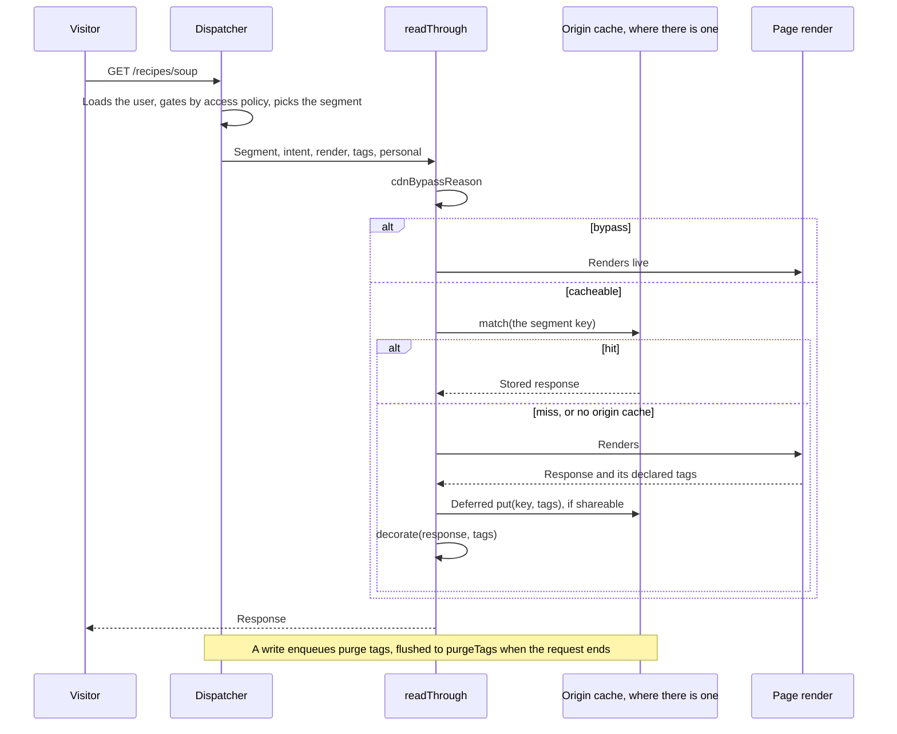

# CDN cache

The CDN cache serves public renders read-through, one shared copy per segment. A hit returns the stored response. A miss renders live, stores the response in the background under its cache tags where the runtime has an origin cache, and decorates it with cache headers and tags for a CDN in front. A later write purges those tags. Operators turn it on with the `cdn` config slot. Site developers and plugin authors meet it through `cacheable` opt-ins and the tag helpers. Editors only see that a publish shows up. It is the **CDN read-through** component in [ARCHITECTURE.md](../../ARCHITECTURE.md#components-of-the-app-process), and the origin cache on its deployment diagram. It lives in `packages/core/src/cdn/`, with the dispatch glue in `packages/core/src/runtime/dispatcher.ts`.

## At a glance

## Surface

| Piece                                                                                                                                 | Where                                                                   | Public?  |
| ------------------------------------------------------------------------------------------------------------------------------------- | ----------------------------------------------------------------------- | -------- |
| `cdn` slot, filled by a `CdnProvider`                                                                                                 | `plumix()` config                                                       | public   |
| `CdnProvider`, `ConnectedCdn` (`decorate`, `store?`, `segmentVary?`, `purgeTags?`, `purgeAll?`), `CdnStore`                           | `plumix` (`packages/core/src/runtime/contract/slots.ts`)                | public   |
| CDN conformance suite                                                                                                                 | `plumix/test/conformance` (`packages/core/src/test/conformance/cdn.ts`) | public   |
| `cacheable: true` on `registerArchiveType`, `registerView`, `registerPublicRoute`, `registerRoute`                                    | plugin setup context                                                    | public   |
| `tagCdnEntry(ctx, tags)`                                                                                                              | `plumix/plugin`                                                         | public   |
| `enqueuePurgeTags`, `entryTag`, `typeTag`, `termPurgeTags`, `entryPurgeTags`                                                          | `plumix/db`                                                             | public   |
| `LookupAdapter.embeddedCacheTags`                                                                                                     | `plumix/plugin`                                                         | public   |
| `ctx.memo(key, load, tags?)`, `memoBatch`                                                                                             | `AppContext`, `plumix/plugin`                                           | public   |
| `readThrough`, `readThroughRoute`, `cdnBypassReason`, `pageTags`, `declarePageTags`, `registerCorePurgeInvalidator`, `flushPurgeTags` | `packages/core/src/cdn/`                                                | internal |

Tag vocabulary (`packages/core/src/cdn/contract/tags.ts`): `t:<type>`, `e:<id>`, `s:<group>`, and `u:<id>`, which only drops a memoized user row. `normalizeTag` lower-cases every tag.

What fills the slot on each runtime:

| Runtime    | Provider                                                         | Origin cache (`store`)                   | Purge                                                        |
| ---------- | ---------------------------------------------------------------- | ---------------------------------------- | ------------------------------------------------------------ |
| Cloudflare | `cloudflare()` from `@plumix/runtime-cloudflare/cdn`             | the Workers Cache API (`caches.default`) | the zone's purge API, plus `cache.purge` for Workers Caching |
| Node, Bun  | `cloudflare()` from `plumix/cdn/cloudflare`, for a zone in front | none                                     | the zone's purge API                                         |

## How it works

- **Connect.** A provider's `connect(env)` returns `null` when it should stay inert. `cloudflare()` in `packages/core/src/cdn/cloudflare/cloudflare.ts` does that when `zoneId` or `purgeToken` resolves empty. Where the runtime has an origin cache, the provider adds a `store`; without one it only decorates headers for the CDN in front. The Cloudflare adapter's wrapper (`packages/runtimes/cloudflare/src/cdn.ts`) adds the Workers Caching purge when the build bound it (`packages/runtimes/cloudflare/src/commands/workers-caching.ts`).
- **Decide.** `cdnBypassReason` (`packages/core/src/cdn/decision.ts`) refuses anything but `GET` and `HEAD` (`method`), the `private` segment (`private`), and a non-anonymous segment the provider cannot key (`segment-unsupported`). A provider can key segments when it has a `store` or a `segmentVary`. It also refuses any intent outside `entry`, `entryType`, `term` and `frontPage` (`intent`), unless an archive type or view set `cacheable`. The dispatcher picks the segment first: an ephemeral grant (`?preview`, `?plumix.edit`) or a privileged request on the `anonymous` segment renders `private`.
- **Key.** `segmentCdnKey` keys `anonymous` under the plain URL and other segments under `__plumix_segment=<segment>`. It drops any client-supplied marker and the cookie. `routeCdnKey` keys a cacheable plugin route by its full URL, without the cookie.
- **Store.** `lookupOrRender` in `packages/core/src/cdn/read-through.ts` shares a response only when it is a 200 and the render is not personal ([ADR 0030](../adr/0030-a-render-that-reads-the-principal-is-never-shared.md)). A plugin route must also be unprivileged, set no cookie, and not say `private` or `no-store`. Only `GET` fills the store. `put` is deferred, and a `Set-Cookie` response is never decorated.
- **Tag.** The dispatcher's `tags` callback unions `pageTags` (`packages/core/src/cdn/tags.ts`, derived from the intent and the resolved entity) with `declaredPageTags`: what the render declared through `declarePageTags`. That covers settings deps (`packages/core/src/template-deps-core.ts`), embedded lookups, an archive type's or view's returned `tags`, and `tagCdnEntry`. Cacheable plugin routes carry only declared tags.
- **Purge.** `registerCorePurgeInvalidator` (`packages/core/src/cdn/purge.ts`) subscribes to entry, user and term actions and `settings:group_changed`. `enqueuePurgeTags` drops the matching request-memo entries at once and collects the tags. `flushPurgeTags` runs once at the end of a request, a scheduled run or a runtime handler call, and defers `purgeTags`. A purge failure is logged and never fails the write. A direct write through `ctx.db` fires no action, so its writer enqueues tags itself through `plumix/db`. A sync's settle calls `purgeAll` (`packages/core/src/context/settle-sync.ts`).
- **Memo.** `createRequestMemo` (`packages/core/src/context/memo.ts`) dedupes per-request loads by key. A load registers tags, and `invalidate(tags)` drops them, so a read after a write in the same request sees the write.
- **No-store surfaces.** `withNoStore` (`packages/core/src/runtime/contract/http.ts`) wraps `/_plumix/rpc`, `/_plumix/api`, `/_plumix/mcp` and the sync endpoints. Every non-anonymous segment's client copy leaves `private, no-store` with `vary: cookie` (`markAudience` in the dispatcher). A page outcome redirect leaves `private, no-store`.

## Invariants

- A render that reads the principal is never stored in a shared segment and leaves `private, no-store`; a stored copy still serves the next member of the segment. [ADR 0030](../adr/0030-a-render-that-reads-the-principal-is-never-shared.md); `packages/core/src/cdn/read-through.test.ts`, `packages/core/src/route/render/personal-render.test.ts`.
- A view or archive type is stored only on `cacheable: true`. [ADR 0035](../adr/0035-an-app-page-is-a-view-not-an-archive.md); `packages/core/src/route/view.dispatch.test.tsx`, `packages/core/src/cdn/decision.test.ts`.
- Archive pages are the same for every visitor, which is what lets the CDN store them, and they carry the type tags of what their query can list. [ADR 0008](../adr/0008-an-archive-is-one-entry-query.md); `packages/core/src/cdn/tags.test.ts`.
- A page-step redirect is never stored. [ADR 0032](../adr/0032-a-page-step-ends-the-request-by-throwing-an-outcome.md); `packages/core/src/route/page-outcome.dispatch.test.tsx`.
- A provider may narrow sharing in `decorate`, never widen it. Only `CdnStore.put` widens, and it drops `Set-Cookie`. `packages/core/src/test/conformance/cdn.ts`, `packages/core/src/cdn/cloudflare/cloudflare.test.ts`, `packages/runtimes/cloudflare/src/cdn.test.ts`.
- A client-supplied `__plumix_segment` never selects which stored segment is served. `packages/core/src/cdn/decision.test.ts`.
- `cdn/` is a client-safe `capabilities` folder. [ADR 0010](../adr/0010-core-is-one-package-of-enforced-layers.md); `packages/core/src/layers.test.ts`.

## Not there yet

| Part of the design                       | Seam to build on                                                                                                                                                                                                         | Done when                                                                                                                                                                          | The code today                                                                 |
| ---------------------------------------- | ------------------------------------------------------------------------------------------------------------------------------------------------------------------------------------------------------------------------ | ---------------------------------------------------------------------------------------------------------------------------------------------------------------------------------- | ------------------------------------------------------------------------------ |
| Gated content is segmented by capability | The built-in `Segment` type in `packages/core/src/access/contract/access.ts` and `isBuiltinSegment` in `packages/core/src/access/policy.ts`; `segmentCdnKey` already keys any segment, so the key itself does not change | A gated page is stored once per `capability:<name>` segment, shared by every reader who holds that capability whatever role grants it; no `role:<role>` segment is stored or keyed | A gated page is stored once per `role:<role>` segment that `rolePolicy` grants |

This is part of the site-defined roles row in [ARCHITECTURE.md](../../ARCHITECTURE.md#not-there-yet); [routing and render](routing-and-render.md) and [auth and access](auth-and-access.md) have the rest of it.
