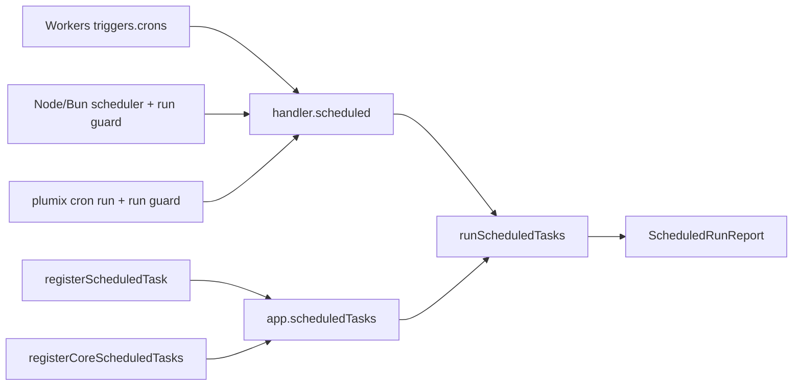

# Cron

Scheduled tasks are work a site runs on a schedule rather than on a request: core's session cleanup
and scheduled publishing, and whatever plugins register (audit-log and forms retention purges, the
search index drain). A plugin author registers a task; core matches each firing against the tasks'
declared crons and runs them with a request-shaped `AppContext`; each runtime decides what fires a
schedule. An operator meets it as wrangler `triggers.crons`, the in-process scheduler on Node and
Bun, or `plumix cron list|run`. The core lives in `packages/core/src/runtime/` (`scheduled*.ts`,
`scheduler.ts`, `contract/cron.ts`, `contract/schedules.ts`); the CLI in
`packages/plumix/src/cli/commands/cron.ts`.

## At a glance

## Surface

| Piece                                                                  | What it is                                                                                             | Public                                                                                            |
| ---------------------------------------------------------------------- | ------------------------------------------------------------------------------------------------------ | ------------------------------------------------------------------------------------------------- |
| `ctx.registerScheduledTask({ id, cron?, handler })`                    | `id` unique per plugin; without `cron` a task runs on every firing                                     | yes, plugin setup context                                                                         |
| Core tasks                                                             | `session-cleanup` (`0 3 * * *`), `publish-scheduled` (`*/5 * * * *`)                                   | registered by core                                                                                |
| `PlumixHandler.scheduled(event, invocation)`                           | `ScheduledEvent { scheduledTime, cron }`; returns `ScheduledRunReport` (`ran`, `failed`, or `aborted`) | yes, `plumix/runtime`                                                                             |
| `parseCron`, `CronSyntaxError`                                         | Core's portable five-field dialect, matched in UTC                                                     | yes, `plumix/runtime`                                                                             |
| `scheduledTasksFor`, `declaredSchedules`                               | Which tasks a firing runs; the distinct schedules a site declares                                      | yes, `plumix/runtime`                                                                             |
| `startScheduledRunner`, `createScheduler`                              | The in-process loop with its database run guard                                                        | `startScheduledRunner` on `plumix/runtime` and `@plumix/runtime-node`; `createScheduler` internal |
| `createScheduledRunGuard`, `connectScheduledDb`, `scheduledLeaseScope` | Claim per schedule-minute, plus an optional lease                                                      | yes, `plumix/runtime`                                                                             |
| `plumix cron list` / `plumix cron run "<expr>"`                        | Print schedules and their tasks; fire one now under the guard                                          | yes (CLI)                                                                                         |
| `node({ cron })`                                                       | `false` stops the in-process scheduler so an external cron drives `plumix cron run`                    | yes                                                                                               |
| `surfaceScheduledFailure(report, firing)`                              | Cloudflare: throw on a failed run, `noRetry()` once any task ran                                       | yes, `@plumix/runtime-cloudflare`                                                                 |

Per runtime:

|                 | Cloudflare                              | Node                                    | Bun                                    |
| --------------- | --------------------------------------- | --------------------------------------- | -------------------------------------- |
| What fires      | `triggers.crons` in the wrangler config | `createNodeSite` scheduler after listen | `createBunSite` scheduler after listen |
| Guard           | none (the platform fires once)          | claim + lease in the database           | claim + lease in the database          |
| Off switch      | omit the trigger                        | `cron: false`                           | none                                   |
| In `plumix dev` | not wired by Plumix                     | yes, `lease: false`                     | no                                     |

## How it works

`buildApp` calls `registerCoreScheduledTasks` before plugins install, then parses every declared
`cron` and fails boot with `AppBootError.invalidScheduledTaskCron` for one it cannot fire. The
dialect rejects numeric weekdays and Quartz extensions, because Cloudflare and Unix cron read them
differently. `handler.scheduled` opens an internal context on a synthetic
`/_plumix/internal/scheduled?cron=…` request. A context that cannot open (missing binding) returns
the `aborted` arm. `runScheduledTasks` runs the matching tasks in order, each in a `cron: <id>`
telemetry span. It catches each failure so siblings run, then flushes CDN purge tags and delivers
the telemetry snapshot.

The Node and Bun scheduler wakes each minute, serialises firings, and runs each through the run
guard. The claim (`scheduled_task_claims`) lets one replica run a schedule-minute. The lease
(`scheduled_task_leases`, 5-minute TTL with a heartbeat) stops a long run overlapping the next. The
lease is shared when any task has no cron and per schedule otherwise. `plumix cron run` takes the
same claim and lease under a `cli:<host>:<pid>` holder, fires the declared spelling of the
expression, and exits non-zero on a failed or aborted run. A skipped run exits zero with a message.

- `packages/core/src/runtime/register-core-scheduled-tasks.ts`: `registerCoreScheduledTasks`.
- `packages/core/src/runtime/scheduled.ts`: `runScheduledTasks`. `handler.ts`: `scheduled`.
- `packages/core/src/runtime/scheduler.ts`, `scheduled-runner.ts`, `scheduled-guard.ts`.
- `packages/core/src/runtime/contract/cron.ts` (`parseCron`) and `contract/schedules.ts`.
- `packages/core/src/db/schema/scheduled_runs.ts`: `scheduledTaskClaims`, `scheduledTaskLeases`.
- `packages/runtimes/cloudflare/src/entry-codegen.ts` (`scheduled` export) and `scheduled.ts`.
- `packages/runtimes/node/src/site.ts` and `bun/src/site.ts`: `startCron`, and the scheduler stop on shutdown within the drain deadline.
- `packages/plumix/src/cli/commands/cron.ts`: `cronCommand`.

## Invariants

- A schedule fires at the same UTC minutes on every runtime. Core's dialect drives Bun instead of `Bun.cron`. [ADR 0019](../adr/0019-a-runtime-adapter-uses-its-runtimes-primitives-and-is-tested-on-that-runtime.md); `packages/runtimes/bun/src/cron-parity.test.ts`, `packages/core/src/runtime/contract/cron.test.ts`.
- An unfireable cron fails boot rather than never running. `packages/core/src/runtime/app-cron-validation.test.ts`.
- One task's failure never stops its siblings, and the report names it. `packages/core/src/runtime/scheduled.test.ts`.
- A schedule-minute runs once across replicas that share a database, and a live lease is never taken. `packages/core/src/runtime/scheduled-guard.test.ts`, `scheduled-runner.test.ts`, `scheduler.test.ts`.
- A scheduled publish purges the CDN like a request does. `packages/core/src/runtime/scheduled-publish-purge.test.ts`.
- `plumix cron run` never exits green having done nothing. `packages/plumix/src/cli/commands/cron.test.ts`.
- On Cloudflare a firing that did some work is not replayed. `packages/runtimes/cloudflare/src/scheduled.test.ts`.

## Status

- Shipped: registration, the two core tasks, boot-time cron validation, `handler.scheduled` with its report, the guarded in-process scheduler on Node and Bun, `node({ cron: false })`, `plumix cron list|run`, and Cloudflare failure surfacing. The scaffold `packages/runtimes/cloudflare/scaffold/wrangler.jsonc` ships core's two crons.
- Tests: `packages/core/src/runtime/*sched*.test.ts`, `packages/runtimes/{node,bun}/src/site.test.ts`, `packages/runtimes/cloudflare/src/{scheduled,entry-codegen}.test.ts`.
- Planned under #3266: a per-task `timeoutMs` budget (5-minute default), a required `ctx.signal`, and `timedOut` in the report (#3269). Aborting a running task when a Node or Bun site shuts down, via `Invocation.signal`, is #3270, blocked by #3269. `ctx.fetch` timeouts are #3267 and #3268. None of these exist yet: `ScheduledTask` has only `id`, `cron` and `handler` (`packages/core/src/plugin/registry.ts`).

## Gaps

- No task has a time budget. A hung task stalls every task after it in its firing, and on Node and Bun the serialised scheduler waits behind it. That is what #3269 fixes.
- Cloudflare's `triggers.crons` is hand-written. Nothing checks it against `declaredSchedules`: `diagnose.ts` has no cron check, and `grep -rn cron packages/runtimes/cloudflare/src/commands` matches nothing. A plugin task on a new schedule (audit-log's `purgeAt`, forms' `RETENTION_CRON`) never fires until the operator adds its expression.
- `plumix cron run` connects through `connectScheduledDb(ctx.app, process.env)` outside its error wrapper. On a Cloudflare site, `d1().connect` reads a binding a CLI process does not have. `cron.test.ts` does not cover a D1 site.
- Bun has no `cron` off switch, and `bunDevOptions` starts no scheduler, so tasks never fire in `plumix dev` on Bun. Node starts them with `lease: false`.
- With the default `nodeSqlite`, each replica has its own file, so the run guard does not dedupe across pods. `apps/docs/src/content/docs/deployment/node.mdx` documents this; the code does not warn.
- No runtime README mentions cron. The operator material is only in `apps/docs/src/content/docs/deployment/`.
