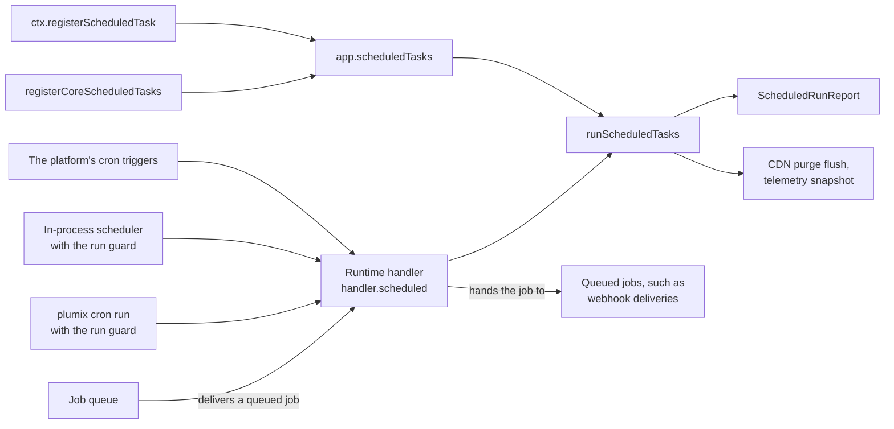

# Cron

Scheduled tasks are work a site runs on a schedule rather than on a request: core's session cleanup
and scheduled publishing, and whatever plugins register (audit-log and forms retention purges, the
search index drain). A plugin author registers a task; core matches each firing against the tasks'
declared crons and runs them with a request-shaped `AppContext`; each runtime decides what fires a
schedule. The same component also runs queued jobs, such as webhook deliveries, that the
runtime's queue hands back through the runtime handler. An operator meets it as
the platform's cron triggers, the in-process scheduler on a server runtime, or `plumix cron list|run`.
This page is the **Scheduled tasks** component of the app process in
[`ARCHITECTURE.md`](../../ARCHITECTURE.md#components-of-the-app-process). The core lives in
`packages/core/src/runtime/` (`scheduled*.ts`, `scheduler.ts`, `contract/cron.ts`,
`contract/schedules.ts`); the CLI in `packages/plumix/src/cli/commands/cron.ts`.

## At a glance

## Surface

| Piece                                                                  | What it is                                                                                                         | Public                                                                                            |
| ---------------------------------------------------------------------- | ------------------------------------------------------------------------------------------------------------------ | ------------------------------------------------------------------------------------------------- |
| `ctx.registerScheduledTask({ id, cron?, timeoutMs?, handler })`        | `id` unique per plugin; without `cron` a task runs on every firing; `timeoutMs` defaults to 5 minutes              | yes, plugin setup context                                                                         |
| Core tasks                                                             | `session-cleanup` (`0 3 * * *`), `publish-scheduled` (`*/5 * * * *`)                                               | registered by core                                                                                |
| `PlumixHandler.scheduled(event, invocation)`                           | `ScheduledEvent { scheduledTime, cron }`; returns `ScheduledRunReport` (`ran`, `failed`, `timedOut`, or `aborted`) | yes, `plumix/runtime`                                                                             |
| `parseCron`, `CronSyntaxError`                                         | Core's portable five-field dialect, matched in UTC                                                                 | yes, `plumix/runtime`                                                                             |
| `scheduledTasksFor`, `declaredSchedules`                               | Which tasks a firing runs; the distinct schedules a site declares                                                  | yes, `plumix/runtime`                                                                             |
| `startScheduledRunner`, `createScheduler`                              | The in-process loop with its database run guard                                                                    | `startScheduledRunner` on `plumix/runtime` and `@plumix/runtime-node`; `createScheduler` internal |
| `createScheduledRunGuard`, `connectScheduledDb`, `scheduledLeaseScope` | The run guard: a claim per schedule-minute, plus an optional lease                                                 | yes, `plumix/runtime`                                                                             |
| `plumix cron list` / `plumix cron run "<expr>"`                        | Print schedules and their tasks; fire one now under the run guard                                                  | yes (CLI)                                                                                         |
| `node({ cron })`                                                       | `false` stops the in-process scheduler so an external cron drives `plumix cron run`                                | yes                                                                                               |
| `surfaceScheduledFailure(report, firing)`                              | Cloudflare: throw on a failed run (not on a timeout alone), `noRetry()` once any task ran                          | yes, `@plumix/runtime-cloudflare`                                                                 |

Per runtime:

|                 | Cloudflare                              | Node                                    | Bun                                    |
| --------------- | --------------------------------------- | --------------------------------------- | -------------------------------------- |
| What fires      | `triggers.crons` in the wrangler config | `createNodeSite` scheduler after listen | `createBunSite` scheduler after listen |
| Run guard       | none (the platform fires once)          | claim + lease in the database           | claim + lease in the database          |
| Off switch      | omit the trigger                        | `cron: false`                           | none                                   |
| In `plumix dev` | not wired by Plumix                     | yes, `lease: false`                     | no                                     |
| Queued jobs     | the platform's queue                    | the runtime's queue                     | the runtime's queue                    |

## How it works

`buildApp` calls `registerCoreScheduledTasks` before plugins install, then parses every declared
`cron` and fails boot with `AppBootError.invalidScheduledTaskCron` for one it cannot fire. The
dialect rejects numeric weekdays and Quartz extensions, because platform cron and Unix cron read them
differently. `handler.scheduled` opens an internal context on a synthetic
`/_plumix/internal/scheduled?cron=…` request. A context that cannot open (a missing binding) returns
the `aborted` arm. `runScheduledTasks` runs the matching tasks in order, each in a `cron: <id>`
telemetry span. It catches each failure so siblings run, then flushes CDN purge tags and delivers
the telemetry snapshot. Each task runs within its budget (`timeoutMs`, five minutes by default) on
a context of its own whose `ctx.signal`, and the `ctx.fetch` that follows it, aborts with a
`TimeoutError` (cause `"timeout"`) when the budget runs out. Core then stops waiting, reports the
task in `timedOut`, logs a warning, ends its span `cancelled`, and runs the next task; a task that
ignores its signal keeps running in the background. The signal also follows the invocation's
`signal`, which the Node and Bun scheduler aborts on `stop()` with an `AbortError` (cause
`"shutdown"`); such a task is reported in `timedOut` with `shut down` as its reason. Cloudflare passes
no signal
([ADR 0059](../adr/0059-a-scheduled-task-runs-within-a-budget-and-a-timeout-is-not-a-failure.md)).

The in-process scheduler wakes each minute, serialises firings, and runs each through the run
guard. The claim (`scheduled_task_claims`) lets one replica run a schedule-minute. The lease
(`scheduled_task_leases`, a five-minute TTL with a heartbeat) stops a long run overlapping the next.
The lease is shared when any task has no cron and per schedule otherwise. The run guard dedupes only
replicas that share a database. `plumix cron run` takes the same claim and lease under a
`cli:<host>:<pid>` holder, fires the declared spelling of the expression, prints `N ran · N failed · N timed out` with each
timed-out task and its budget, and exits non-zero on a failed, timed-out or aborted run. A skipped
run exits zero with a message.

Work that outlives a request goes to the `queue` slot (see [runtimes](runtimes.md)). The runtime's
own queue delivers each job back through the runtime handler, which hands it to scheduled tasks to
run and report, as `scheduled` hands a firing to `runScheduledTasks`, and acknowledges it or leaves
it to the runtime's retry. Retry, ordering and delivery guarantees are the runtime queue's, not
core's. Webhook deliveries are queued jobs: when an entry is published, the webhooks module enqueues
one delivery per webhook its entry type declares for publish, and scheduled tasks send each POST,
with its headers and payload, when the queue delivers it.

- `packages/core/src/runtime/register-core-scheduled-tasks.ts`: `registerCoreScheduledTasks`.
- `packages/core/src/runtime/scheduled.ts`: `runScheduledTasks`. `handler.ts`: `scheduled`.
- `packages/core/src/runtime/scheduler.ts`, `scheduled-runner.ts`, `scheduled-guard.ts`.
- `packages/core/src/runtime/contract/cron.ts` (`parseCron`) and `contract/schedules.ts`.
- `packages/core/src/db/schema/scheduled_runs.ts`: `scheduledTaskClaims`, `scheduledTaskLeases`.
- `packages/core/src/plugin/registry.ts`: `ScheduledTask` (`id`, `cron`, `handler`).
- `packages/runtimes/cloudflare/src/entry-codegen.ts` (the `scheduled` export) and `scheduled.ts`; the scaffold's `packages/runtimes/cloudflare/scaffold/wrangler.jsonc` lists core's two crons.
- `packages/runtimes/node/src/site.ts` and `bun/src/site.ts`: `startCron`, and the scheduler stop on shutdown within the drain deadline.
- `packages/plumix/src/cli/commands/cron.ts`: `cronCommand`.

## Invariants

- A schedule fires at the same UTC minutes on every runtime. Core's dialect drives Bun instead of `Bun.cron`. [ADR 0019](../adr/0019-a-runtime-adapter-uses-its-runtimes-primitives-and-is-tested-on-that-runtime.md); `packages/runtimes/bun/src/cron-parity.test.ts`, `packages/core/src/runtime/contract/cron.test.ts`.
- An unfireable cron fails boot rather than never running. `packages/core/src/runtime/app-cron-validation.test.ts`.
- One task's failure never stops its siblings, and the report names it. `packages/core/src/runtime/scheduled.test.ts`.
- A task that outruns its budget is reported timed out, not failed, and the next task and the next firing still run. `packages/core/src/runtime/scheduled.test.ts`, `scheduler.test.ts`.
- Stopping the Node or Bun scheduler aborts a running task's `ctx.signal`. `packages/core/src/runtime/scheduler.test.ts`, `scheduled.test.ts`, `packages/runtimes/node/src/site.test.ts`, `packages/runtimes/bun/src/site.test.ts`.
- A schedule-minute runs once across replicas that share a database, and a live lease is never taken. `packages/core/src/runtime/scheduled-guard.test.ts`, `scheduled-runner.test.ts`, `scheduler.test.ts`.
- A scheduled publish purges the CDN like a request does. `packages/core/src/runtime/scheduled-publish-purge.test.ts`.
- `plumix cron run` never exits green having done nothing. `packages/plumix/src/cli/commands/cron.test.ts`.
- On Cloudflare a firing that did some work is not replayed. `packages/runtimes/cloudflare/src/scheduled.test.ts`.
