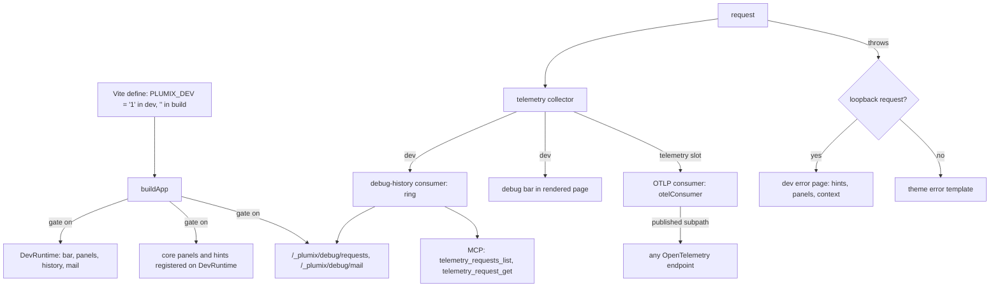

# Dev tooling

The dev tooling is what `plumix dev` adds on top of the app a deploy runs: the dev error page and its hints, the debug bar and its panels, the captured request history, the browser-side error overlays, and the `plumix doctor` snapshot. Site developers see it while they build. Plugin authors extend it through registrations (`registerDebugPanel`, `registerErrorPanel`, `registerErrorHint`), and a runtime adapter adds hints through its `errorHints`. It shares one pipeline with production observability: every request's telemetry goes to the consumers of the `telemetry` config slot, and in dev the debug bar and request history are two more consumers. In ARCHITECTURE.md's component diagram it sits in the Dispatcher (dev routes, error page) and the Config slots (telemetry). The server side lives in `packages/core/src/dev/`, the browser side in `packages/core/src/dev-client/` and `packages/core/src/dev/ui/`, the Vite half (the `PLUMIX_DEV` define, the overlay endpoints) in `packages/plumix/src/vite/`, and the OTLP exporter in `packages/core/src/telemetry-otel.ts`. Nothing dev-only ships in a production bundle.

## At a glance

## Surface

| Piece                                                                                                                         | Where                                                                                                                        | Public?                                                                       |
| ----------------------------------------------------------------------------------------------------------------------------- | ---------------------------------------------------------------------------------------------------------------------------- | ----------------------------------------------------------------------------- |
| `process.env.PLUMIX_DEV`                                                                                                      | `define` in `packages/plumix/src/vite/index.ts`; the CLI also sets it for `plumix dev` in `packages/plumix/src/cli/index.ts` | Public convention (`apps/docs/src/content/docs/going-further/dev-server.mdx`) |
| `PLUMIX_DEV_ALLOW_REMOTE`, `PLUMIX_EDITOR`, `PLUMIX_EDITOR_PATH_MAP`, `PLUMIX_FORWARD_ERRORS`                                 | Vite `define` / dev client                                                                                                   | Public env vars                                                               |
| `telemetry: { consumers }` (`TelemetryConfig`)                                                                                | `packages/core/src/config.ts`, `packages/core/src/context/telemetry.ts`                                                      | Public config slot                                                            |
| `otelConsumer`, `OtelConsumerOptions` (`endpoint`, `logsEndpoint`, `headers`, `serviceName`, `sample`, `tailSample`, `fetch`) | `@plumix/core/telemetry-otel` (`packages/core/src/telemetry-otel.ts`)                                                        | Public, re-exported from a `plumix` subpath                                   |
| `dev.bar` (`DebugBarInput`: `false` or `{ position, defaultOpen }`)                                                           | `DevInput` in `packages/core/src/config.ts`                                                                                  | Public config                                                                 |
| `dev.panels` (`DebugPanelsInput`, keyed by `DebugPanelRegistry`)                                                              | same                                                                                                                         | Public config                                                                 |
| `dev.history` (`DebugHistoryStoreOptions`: `maxEntries`, `maxTotalBytes`, `maxStringLength`)                                  | same; also bounds caught mail                                                                                                | Public config                                                                 |
| `DebugPanelRegistry`                                                                                                          | `packages/core/src/context/dev-runtime.ts`, augmented via `declare module "plumix"`                                          | Public type                                                                   |
| `DebugPanel`, `DebugKV`, `DebugSection`, `DebugKVRow`                                                                         | `plumix/plugin` (`packages/plumix/src/plugin.ts`)                                                                            | Public                                                                        |
| `registerDebugPanel` (`DebugPanel`)                                                                                           | plugin setup context, `packages/core/src/plugin/setup-context.ts`; stored on `DevRuntime.debugPanels`                        | Public registration                                                           |
| `registerErrorPanel` (`DevErrorPanel`) / `registerErrorHint` (`DevErrorHintRegistration`)                                     | same; stored on `DevRuntime.errorPanels` / `.errorHints`                                                                     | Public registrations                                                          |
| `RuntimeAdapter.errorHints`                                                                                                   | `packages/core/src/context/runtime-adapter.ts`                                                                               | Public adapter field                                                          |
| `auth: "development"` plugin route gate                                                                                       | `PluginRouteAuth` in `packages/core/src/plugin/registry.ts`                                                                  | Public                                                                        |
| `GET /_plumix/debug/requests[/<id>][?format=html]`                                                                            | `packages/core/src/dev/history-routes.tsx`                                                                                   | Dev-only route                                                                |
| `/_plumix/debug/mail/*`                                                                                                       | `packages/core/src/dev/mail/routes.tsx` (see [mail](mail.md))                                                                | Dev-only route                                                                |
| `installDevClient`                                                                                                            | `plumix/core/dev-client` -> `@plumix/core/dev-client`                                                                        | Public subpath, called by the generated client entry                          |
| `renderDevBootErrorResponse`, `isTrustedDevHost`                                                                              | `@plumix/core` root, `plumix/runtime`                                                                                        | Internal to runtimes and the Vite plugin                                      |
| `/@plumix-dev-error-source`, `-stack`, `-terminal`, `/@plumix-dev-client-errors`                                              | constants in `packages/core/src/dev/ui/frames.ts`, served by the Vite plugin                                                 | Internal dev endpoints                                                        |
| MCP `telemetry_requests_list`, `telemetry_request_get`, `error_list`                                                          | `packages/core/src/mcp/telemetry-tools.ts`, `error-tools.ts` (see [MCP](mcp.md))                                             | Dev-only tools                                                                |
| `plumix doctor`                                                                                                               | `packages/plumix/src/cli/commands/doctor.ts`; per-runtime `diagnose`                                                         | Public CLI                                                                    |

Core panel ids (`CORE_DEBUG_PANEL_IDS`): `app`, `request`, `database`, `template`, `timeline`, `mail`.

## How it works

**The gate.** The `plumix` Vite plugin defines `process.env.PLUMIX_DEV` as `"1"` under serve and `""` under build. Every dev branch tests that literal inline, so Rolldown drops the branch and every module only it imports. A helper or an exported constant standing in for the literal is not guaranteed to fold (see AGENTS.md "Env & secrets"). `buildApp` builds the `DevRuntime`, registers core's panels and hints and the runtime adapter's `errorHints` on it, and mounts the dev routes only inside that branch. The setup context's `registerDebugPanel`, `registerErrorPanel` and `registerErrorHint` write to it behind the same inline test, so outside `plumix dev` they do nothing and `dev/registrations.ts` leaves the bundle. `app.dev` / `ctx.dev` is `undefined` outside it, and that absence is the dev signal: CSRF localhost relaxation, MCP auto-enable and MCP dev trust all test `process.env.PLUMIX_DEV && dev !== undefined`.

**Loopback trust.** `isTrustedDevRequest` is statically `false` in a build and otherwise checks that the request `Host` is loopback, unless `PLUMIX_DEV_ALLOW_REMOTE` is set. Off loopback the bar is not rendered, `auth: "development"` routes answer 404 rather than 401, and a failure gets the theme's error template. Under `plumix dev` a middleware ahead of everything Vite serves answers a non-loopback `Host` with 403 (`packages/plumix/src/vite/dev-command.ts`), so the per-surface checks are the second line on that server.

**Telemetry.** Each request gets a telemetry collector (`packages/core/src/context/telemetry.ts`) only when some consumer samples it; otherwise it gets `NOOP_TELEMETRY`, whose `span` still calls through. `sampleTelemetryConsumers` in `packages/core/src/context/app.ts` collects the consumers: in dev, the bar consumer (it only marks the request sampled) and the `debug-history` consumer, which always registers; then every consumer in `config.telemetry.consumers`. Each consumer's `sample` votes. When the dispatcher or a scheduled run finishes, `deliverTelemetrySnapshot` (`packages/core/src/runtime/telemetry-delivery.ts`) stamps the request envelope, so `request.durationMs` ends at the response, and hands the runtime's own `defer` (a Workers `waitUntil`, or the handler's drain on Node and Bun) a delivery that waits for the request's deferred work. Each `ctx.defer` call on a sampled request is a `defer` span under the span current at the call (`deferred` in `packages/core/src/context/collector.ts`). The spans its argument opened before the call, and that are still running, move under it, so `ctx.defer(cdn.purgeTags(tags))` nests the purge there; work that starts later from a `.then` registered by the caller stays under the caller's span. The span ends when the promise settles, and a rejection is its error and is still logged. The collector tracks that work, work it defers in turn included, and the delivery builds one `TelemetrySnapshot` once it has all settled or after a fixed 10s, whichever is first, and hands it to each consumer's `onRequestEnd`. The delivery and the consumers' exports are not deferred work the snapshot waits for. A span still running when the snapshot is built is copied as `unfinished`, its duration up to that moment, and finishing later changes nothing delivered. When a self-hosted `dispose()` reaches its drain deadline with work still running, it delivers every waiting snapshot at once, so export never blocks the response, one rejecting consumer does not starve the rest, and a shutdown loses no snapshot. `error_list` lists a request whose `defer` span failed even when it answered 2xx, and the timeline model (`buildTimeline` in `packages/core/src/dev/debug-panels/timeline-model.ts`) marks a span that started after the response time it is given as after-response work.

**Span logs.** `createAppContext` wraps `ctx.logger` as it wraps `ctx.defer` (`wrapLogger` in `packages/core/src/context/app.ts`). Every call reaches the underlying logger, whatever its implementation, with `requestId` merged into its meta; a caller's own `requestId` wins, so no call site adds it by hand. The wrapper then hands the call to the request's collector, which keeps it on the span current at the call (read from `traceStore`) as `{ at, level, message, attributes }`, at every level, with the meta made JSON-safe and an `Error` in a span error's shape. With no span current, or under `NOOP_TELEMETRY`, nothing is kept. A request keeps at most 1000 span logs and counts the rest in `dropped.logs`. Span logs travel inside spans, so the timeline panel lists each span's logs under it with their level, and request history and `telemetry_request_get` return them; `error_list` does not, and an agent pivots from an error's `requestId` to `telemetry_request_get`. Why logs sit on spans: [ADR 0053](../adr/0053-the-telemetry-snapshot-holds-a-requests-logs-and-deferred-work.md).

**OTLP export.** `otelConsumer` turns a snapshot into OTLP/JSON spans and POSTs them to an OTLP/HTTP traces endpoint. It joins an inbound `traceparent`, drops the query string from the URL, supports head sampling (`sample`) and a tail vote (`tailSample`), and logs a failed export rather than failing the request. With `logsEndpoint`, an OTLP/HTTP logs URL sent the same `headers`, each span log also goes out as an OTLP log record carrying its span's trace id and span id, its level as severity, its message as body, its attributes and `at` as its timestamp, and `dropped.logs` becomes `plumix.dropped_logs` on the root span. The logs request follows the same sampling and failure rules as the traces request and goes out only when there is a log. Without `logsEndpoint` no logs are sent and the traces payload carries no log data. Records stay events on the root span either way. An `unfinished` span is exported with its status unset and `plumix.unfinished: true`, as OTLP has no such status. A site imports it from a `plumix` subpath and fills the `telemetry` slot with it, and its traces reach any OpenTelemetry endpoint in production, on every runtime.

**Request history.** At request end the `debug-history` consumer projects a JSON `DebugSnapshot` (context, spans, records) into a bounded ring. Requests to the ring's own readers (`/_plumix/debug/requests`, `/_plumix/debug/mail`, `/_plumix/mcp`) are not recorded, so polling never evicts what it reads. The query string is never captured.

**Panels.** A `DebugPanel` renders from a `DebugSnapshot`, never from live context, so a stored request replays like the live one. The bar renders the current request's panels on the server and injects them into the page (`render-template.tsx`, skipped in edit mode). Its switcher fetches `/_plumix/debug/requests/<id>?format=html` for past requests. Panels show by `order`, then registration order: core's first, then each plugin's in config order. `dev.panels` closes the set of names config can hide; `registerDebugPanel` stays open to any id ([ADR 0003](../adr/0003-dev-config-mirrors-the-dev-layers.md)), and an id already registered, a core panel's included, fails boot. The `og` plugin is the first-party example of an augmented panel (`packages/plugins/og/src/chain-trace.ts`, `src/dev/panel.tsx`).

**Dev error page.** The dispatcher's failure path calls `devFailureResponse`, which for a trusted request returns `devErrorResponse`: the registered hints whose `matches` accepts the error (core's, then the runtime's, then each plugin's), request context from the same collectors the bar reads, and the registered panels whose `visible` accepts it, each rendered in isolation. A non-HTML request gets JSON. If the error surface itself throws, it returns `null` and the plain 500 answers. When `buildApp` throws, a runtime handler renders `renderDevBootErrorResponse` with `matchCoreErrorHints` only, since no `DevRuntime` exists yet. Core hints match `ThemeRegistrationError`, `ThemeError`, `no such table` and a missing secret.

**Dev client.** The generated client entry dynamically imports `plumix/core/dev-client` under `import.meta.hot` and calls `installDevClient` (`packages/plumix/src/vite/client-entry-codegen.ts`). It installs the island error overlay and terminal forwarding (gated on `PLUMIX_DEV`) and the compile-error overlay (it needs the HMR client; Vite's own overlay is off, so an early `vite:error` is replayed). Stack resolution, source previews and terminal forwarding go through the Vite middlewares in `dev-error-stack.ts`, `dev-error-source.ts` and `dev-error-terminal.ts`.

**Doctor.** `plumix doctor` prints the working directory, config path, runtime, database kind, plugins, table count, Node version and platform, then the runtime module's `diagnose(cwd)` findings (`packages/runtimes/*/src/commands/diagnose.ts`).

Key files and symbols:

- `packages/core/src/runtime/app.ts`: the `buildApp` gate; `packages/core/src/runtime/dev.ts`: `createDevRuntime`
- `packages/core/src/context/dev-runtime.ts`: `DevRuntime`, `DebugSnapshot`, `DebugPanel`, `DevErrorPanel`, `DevErrorHintRegistration`, `DebugPanelRegistry`, `CORE_DEBUG_PANEL_IDS`
- `packages/core/src/dev/registrations.ts`: `registerDevItem`, the one duplicate-id check for all three
- `packages/core/src/context/telemetry.ts`, `packages/core/src/telemetry-snapshot.ts`, `packages/core/src/runtime/telemetry-delivery.ts`, `packages/core/src/telemetry-otel.ts`
- `packages/core/src/dev/trust.ts`: `isTrustedDevRequest`, `isTrustedDevHost`
- `packages/core/src/dev/request-history/`: `createDebugHistoryStore`, `debugHistoryConsumer`, `projectDebugSnapshot`
- `packages/core/src/dev/debug-panels/`: `registerCoreDebugPanels`, `collectDebugPanels`, `builtin/*`
- `packages/core/src/dev/debug-bar/`: `debugBarChrome`, `PlumixDebugBar`, the switcher
- `packages/core/src/dev/server/`: `devErrorResponse`, `renderDevBootErrorResponse`, the hint and panel collectors
- `packages/core/src/runtime/dispatcher.ts`: `devFailureResponse`, `enforceOrigin`, `dispatchMcp`, the `"development"` gate
- `packages/core/layers.ts`: `dev/` is a server surface; `dev/ui/` and `dev-client/` are client surfaces; `telemetry-otel` is foundation

## Invariants

- No gated dev module reaches a production bundle. Guard: `packages/plumix/src/vite/dev-gate-tree-shaking.test.ts` (builds core with `PLUMIX_DEV` `"1"` and `""`).
- The dev cluster imports one way: capture, then panels, then bar and routes, and the two surfaces never import each other. Guard: `packages/core/src/dev/debug-layers.test.ts`; [ADR 0003](../adr/0003-dev-config-mirrors-the-dev-layers.md).
- Dev runtime state lives under `app.dev` / `ctx.dev` only, mirroring `config.dev`; there is no top-level dev slot ([ADR 0003](../adr/0003-dev-config-mirrors-the-dev-layers.md)).
- Only registered panel ids are nameable in `dev.panels`, and the core id list equals what `registerCoreDebugPanels` contributes. Guard: `packages/core/src/dev/debug-panels/config.test.ts`, `packages/core/src/dev/debug-bar/plugin-panel.test.tsx`.
- `dev-client/` imports only browser-safe `dev/ui` code. Guard: the layer map in `packages/core/layers.ts` (`packages/core/src/layers.test.ts`).
- A throwing `render`, `visible` or `matches` hides only its own panel or hint and is logged through `ctx.logger`; it never takes down the bar or the error page. Guard: `packages/core/src/dev/debug-panels/render-panels.test.tsx`, `packages/core/src/dev/server/hints/collect.test.ts`, `panels/collect.test.tsx`.
- A debug panel, error panel or error hint id is registered once; a second registration fails boot. Guard: `packages/core/src/dev/registrations.test.ts`.
- Dev surfaces answer loopback requests only. Guard: `packages/core/src/dev/trust.test.ts`.
- A telemetry export never blocks a response or fails a request: delivery is deferred and `otelConsumer` swallows and logs its own failures. Guard: `packages/core/src/telemetry-otel.test.ts`.
