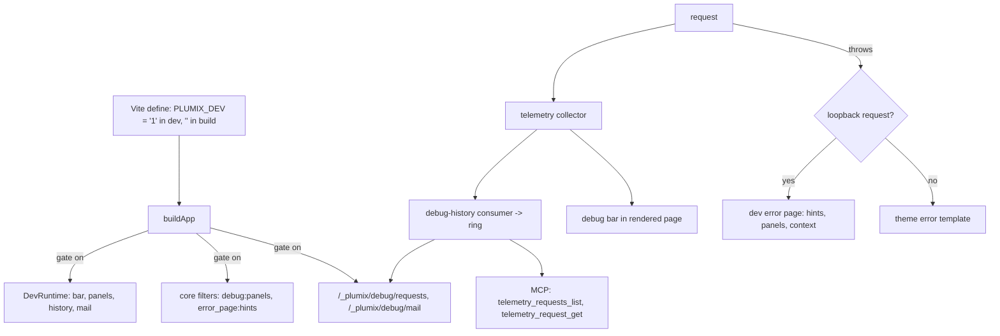

# Dev tooling

The dev tooling is everything `plumix dev` adds on top of the worker a deploy runs: the dev error page and its hints, the debug bar and its panels, the captured request history, the browser-side error overlays, and the `plumix doctor` snapshot. Site developers see it while they build. Plugin authors extend it through filters (`debug:panels`, `error_page:hints`, `error_page:panels`). The server side lives in `packages/core/src/dev/`, the browser side in `packages/core/src/dev-client/` and `packages/core/src/dev/ui/`, and the Vite half (the `PLUMIX_DEV` define, the overlay endpoints) in `packages/plumix/src/vite/`. Nothing here ships in a production bundle.

## At a glance

## Surface

| Piece                                                                                         | Where                                                                                                                        | Public?                                                                        |
| --------------------------------------------------------------------------------------------- | ---------------------------------------------------------------------------------------------------------------------------- | ------------------------------------------------------------------------------ |
| `process.env.PLUMIX_DEV`                                                                      | `define` in `packages/plumix/src/vite/index.ts`; the CLI also sets it for `plumix dev` in `packages/plumix/src/cli/index.ts` | Public convention (documented in `apps/docs/.../going-further/dev-server.mdx`) |
| `PLUMIX_DEV_ALLOW_REMOTE`, `PLUMIX_EDITOR`, `PLUMIX_EDITOR_PATH_MAP`, `PLUMIX_FORWARD_ERRORS` | Vite `define` / dev client                                                                                                   | Public env vars                                                                |
| `dev.bar` (`DebugBarInput`: `false` or `{ position, defaultOpen }`)                           | `DevInput` in `packages/core/src/config.ts`                                                                                  | Public config                                                                  |
| `dev.panels` (`DebugPanelsInput`, keyed by `DebugPanelRegistry`)                              | same                                                                                                                         | Public config                                                                  |
| `dev.history` (`DebugHistoryStoreOptions`: `maxEntries`, `maxTotalBytes`, `maxStringLength`)  | same; also bounds caught mail                                                                                                | Public config                                                                  |
| `DebugPanelRegistry`                                                                          | `packages/core/src/context/dev-runtime.ts`, augmented via `declare module "plumix"`                                          | Public type                                                                    |
| `DebugPanel`, `DebugKV`, `DebugSection`, `DebugKVRow`                                         | `plumix/plugin` (`packages/plumix/src/plugin.ts`)                                                                            | Public                                                                         |
| `debug:panels` filter                                                                         | `packages/core/src/dev/debug-panels/types.ts`                                                                                | Public hook                                                                    |
| `error_page:hints` / `error_page:panels` filters                                              | `packages/core/src/dev/server/hints/types.ts`, `.../panels/types.ts`                                                         | Public hooks                                                                   |
| `auth: "development"` plugin route gate                                                       | `PluginRouteAuth` in `packages/core/src/plugin/registry.ts`                                                                  | Public                                                                         |
| `GET /_plumix/debug/requests[/<id>][?format=html]`                                            | `packages/core/src/dev/history-routes.tsx`                                                                                   | Dev-only route                                                                 |
| `/_plumix/debug/mail/*`                                                                       | `packages/core/src/dev/mail/routes.tsx` (see [mail.md](mail.md))                                                             | Dev-only route                                                                 |
| `installDevClient`                                                                            | `plumix/core/dev-client` -> `@plumix/core/dev-client`                                                                        | Public subpath, called by generated client entry                               |
| `renderDevBootErrorResponse`, `isTrustedDevHost`                                              | `@plumix/core` root, `plumix/runtime`                                                                                        | Internal to runtimes and the Vite plugin                                       |
| `/@plumix-dev-error-source`, `-stack`, `-terminal`, `/@plumix-dev-client-errors`              | constants in `packages/core/src/dev/ui/frames.ts`, served by the Vite plugin                                                 | Internal dev endpoints                                                         |
| MCP `telemetry_requests_list`, `telemetry_request_get`, `error_list`                          | `packages/core/src/mcp/telemetry-tools.ts`, `error-tools.ts` (see [mcp.md](mcp.md))                                          | Dev-only tools                                                                 |
| `plumix doctor`                                                                               | `packages/plumix/src/cli/commands/doctor.ts`; per-runtime `diagnose`                                                         | Public CLI                                                                     |

Core panel ids (`CORE_DEBUG_PANEL_IDS`): `app`, `request`, `database`, `template`, `timeline`, `mail`.

## How it works

**The gate.** The `plumix` Vite plugin defines `process.env.PLUMIX_DEV` as `"1"` under serve and `""` under build. Every dev branch tests that literal inline, so Rolldown drops the branch and every module only it imports. A helper or an exported constant standing in for the literal is not guaranteed to fold (see AGENTS.md "Env & secrets"). `buildApp` registers core panels and hints, builds the `DevRuntime`, and mounts the dev routes only inside that branch. `app.dev` / `ctx.dev` is `undefined` outside it, and that absence is the dev signal: CSRF localhost relaxation, MCP auto-enable and MCP dev trust all test `process.env.PLUMIX_DEV && dev !== undefined`.

**Loopback trust.** `isTrustedDevRequest` is statically `false` in a build and otherwise checks that the request `Host` is loopback, unless `PLUMIX_DEV_ALLOW_REMOTE` is set. Off-loopback the bar is not rendered, `auth: "development"` routes 404 rather than 401, and a failure gets the theme's error template. Under `plumix dev` a middleware ahead of everything Vite serves answers a non-loopback `Host` with 403 (`packages/plumix/src/vite/dev-command.ts`), so the per-surface checks are the second line on that server.

**Capture.** Each request gets a telemetry collector (`packages/core/src/context/telemetry.ts`). In dev, `sampleTelemetryConsumers` in `packages/core/src/context/app.ts` adds the bar consumer (only marks the request sampled) and the `debug-history` consumer, which always registers and never declines. At request end it projects a JSON `DebugSnapshot` (context, spans, records) into the bounded ring. Requests to the ring's own readers (`/_plumix/debug/requests`, `/_plumix/debug/mail`, `/_plumix/mcp`) are not recorded, so polling never evicts what it reads. The query string is never captured.

**Panels.** A `DebugPanel` renders from a `DebugSnapshot`, never live context, so a stored request replays like the live one. The bar renders the current request's panels server-side and injects them into the page (`render-template.tsx`, skipped in edit mode). Its switcher fetches `/_plumix/debug/requests/<id>?format=html` for past requests. `dev.panels` closes the set of names config can hide; the `debug:panels` filter stays open to any id ([ADR 0003](../adr/0003-dev-config-mirrors-the-dev-layers.md)). The `og` plugin is the first-party example of an augmented panel (`packages/plugins/og/src/chain-trace.ts`, `src/dev/panel.tsx`).

**Dev error page.** The dispatcher's failure path calls `devFailureResponse`, which for a trusted request returns `devErrorResponse`: hints from `error_page:hints`, request context from the same collectors the bar reads, and `error_page:panels` panels each rendered in isolation. A non-HTML request gets JSON. If the error surface itself throws it returns `null` and the plain 500 answers. When `buildApp` throws, `renderDevBootErrorResponse` renders the page with `matchCoreErrorHints` only, since no hook registry exists yet. Core hints match `ThemeRegistrationError`, `ThemeError`, `no such table` and `missing secret`.

**Dev client.** The generated client entry dynamically imports `plumix/core/dev-client` under `import.meta.hot` and calls `installDevClient` (`packages/plumix/src/vite/client-entry-codegen.ts`). It installs the island error overlay and terminal forwarding (gated on `PLUMIX_DEV`) and the compile-error overlay (needs the HMR client; Vite's own overlay is off, so an early `vite:error` is replayed). Stack resolution, source previews and terminal forwarding go through the Vite middlewares in `dev-error-stack.ts`, `dev-error-source.ts`, `dev-error-terminal.ts`.

**Doctor.** `plumix doctor` prints cwd, config path, runtime, database kind, plugins, table count, Node version and platform, then the runtime module's `diagnose(cwd)` findings. Cloudflare checks Workers Logs and lists D1 targets from the wrangler config; Node and Bun return one static logging note.

Key files and symbols:

- `packages/core/src/runtime/app.ts` — `buildApp` gate; `packages/core/src/runtime/dev.ts` — `createDevRuntime`
- `packages/core/src/context/dev-runtime.ts` — `DevRuntime`, `DebugSnapshot`, `DebugPanelRegistry`, `CORE_DEBUG_PANEL_IDS`
- `packages/core/src/dev/trust.ts` — `isTrustedDevRequest`, `isTrustedDevHost`
- `packages/core/src/dev/request-history/` — `createDebugHistoryStore`, `debugHistoryConsumer`, `projectDebugSnapshot`
- `packages/core/src/dev/debug-panels/` — `registerCoreDebugPanels`, `collectDebugPanels`, `builtin/*`
- `packages/core/src/dev/debug-bar/` — `debugBarChrome`, `PlumixDebugBar`, switcher
- `packages/core/src/dev/server/` — `devErrorResponse`, `renderDevBootErrorResponse`, hints and panels collectors
- `packages/core/src/runtime/dispatcher.ts` — `devFailureResponse`, `enforceOrigin`, `dispatchMcp`, the `"development"` gate
- `packages/core/layers.ts` — `dev/` is a server surface; `dev/ui/` and `dev-client/` are client surfaces

## Invariants

- No gated dev module reaches a production bundle; a dev bundle contains all of them. Guard: `packages/plumix/src/vite/dev-gate-tree-shaking.test.ts` (builds core with `PLUMIX_DEV` `"1"` and `""`).
- The dev cluster imports one way: capture <- panels <- bar / routes, and the two surfaces never import each other. Guard: `packages/core/src/dev/debug-layers.test.ts`; [ADR 0003](../adr/0003-dev-config-mirrors-the-dev-layers.md).
- Dev runtime state lives under `app.dev` / `ctx.dev` only, mirroring `config.dev`; no top-level dev slot. [ADR 0003](../adr/0003-dev-config-mirrors-the-dev-layers.md).
- Only registered panel ids are nameable in `dev.panels`, and the core id list equals what `registerCoreDebugPanels` contributes. Guard: `packages/core/src/dev/debug-panels/config.test.ts`; `packages/core/src/dev/debug-bar/plugin-panel.test.tsx`.
- `dev-client/` imports only browser-safe `dev/ui` code. Guard: the layer map in `packages/core/layers.ts` (`packages/core/src/layers.test.ts`).
- A throwing hint or panel contributor never takes down the error page (`applyFilterIsolated`, per-panel fallback). Guard: `packages/core/src/dev/server/hints/collect.test.ts`, `panels/collect.test.tsx`.
- Dev surfaces answer loopback requests only. Guard: `packages/core/src/dev/trust.test.ts`.

## Status

| Piece                                          | Status                                                   | Evidence                                                                                                        |
| ---------------------------------------------- | -------------------------------------------------------- | --------------------------------------------------------------------------------------------------------------- |
| `PLUMIX_DEV` gate + tree-shaking guard         | Shipped                                                  | `dev-gate-tree-shaking.test.ts`                                                                                 |
| Dev error page, hints, error panels            | Shipped                                                  | `dev/server/*.test.ts(x)`, `packages/core/e2e/dev-error-page.spec.ts`                                           |
| Boot error page                                | Shipped on Cloudflare entry, Node site, Vite dev command | `packages/runtimes/node/src/commands/dev.test.ts` ("a boot failure renders the dev boot-error page")            |
| Debug bar, panels, switcher                    | Shipped                                                  | `dev/debug-bar/*.test.tsx`, `dev/debug-panels/*.test.ts(x)`; no e2e suite                                       |
| Request history ring + read routes             | Shipped                                                  | `dev/request-history/*.test.ts`, `dev/history-routes.test.tsx`                                                  |
| Dev MCP telemetry tools                        | Shipped                                                  | see [mcp.md](mcp.md)                                                                                            |
| Island / compile overlays, terminal forwarding | Shipped                                                  | `packages/core/e2e/dev-island-overlay.spec.ts`, `dev-compile-overlay.spec.ts`, `dev-terminal-forward.spec.ts`   |
| `plumix doctor`                                | Shipped                                                  | `packages/plumix/src/cli/commands/doctor.test.ts`, `packages/runtimes/cloudflare/src/commands/diagnose.test.ts` |

No open issues match "debug bar", "dev error", "PLUMIX_DEV", "debug panel", "doctor", "dev-client" or "overlay" (`gh issue list -R withplumix/plumix --state open`, 2026-10-20).

## Gaps

- The tree-shaking guard's `GATED_DEV_MODULES` omits modules the code calls gated: `packages/core/src/mcp/telemetry-tools.ts` and `error-tools.ts` (registry comment: "inline so the build eliminates the `telemetry-tools` graph"), `dev/server/render.tsx`, `dev/server/context.ts`, `dev/ui/error-page.tsx` and the five non-mail `builtin/*` panels. A leak of any of these alone would pass.
- The guard bundles only `buildApp`, `createPlumixDispatcher` and `createRuntimeHandler`, so the `renderDevBootErrorResponse` gates in the runtime entries (`packages/runtimes/cloudflare/src/entry-codegen.ts`, `packages/runtimes/node/src/site.ts`) and plugin dev gates (`packages/plugins/og/src/index.ts`) are not covered by any bundle test.
- Bun's `createBunSite` (`packages/runtimes/bun/src/site.ts`) has no boot-error branch, while Node's `site.ts` renders `renderDevBootErrorResponse` when `buildApp` rejects. Bun's `dev.test.ts` has no boot-failure case; Node's has one.
- The debug bar has no e2e suite; injection, switcher and panel rendering are unit-tested only, although the bar is browser behavior.
- Debug panel titles are localized `Label`s, error-page panel titles are plain English strings (`DevErrorPanel.title`), and `dev.panels` cannot hide an error-page panel. The two panel kinds share `DEFAULT_PANEL_ORDER` but nothing else.
- Node and Bun `diagnose` return the same static finding and have no test; `doctor`'s "deploy" section says nothing runtime-specific on either.
