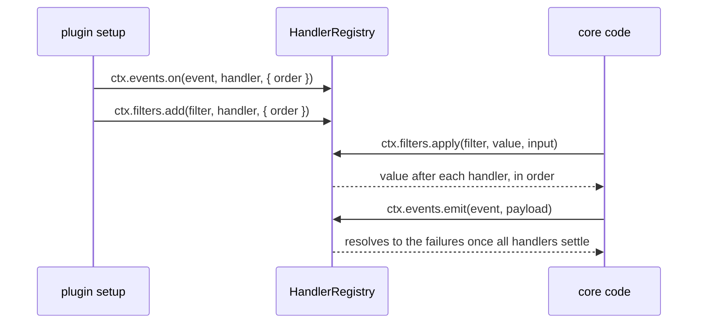
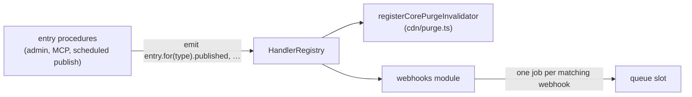

# Events and filters

Events and filters are core's declared extension points, the "events and filters" half of the "Plugin system, events and filters" component in the component diagram of [`ARCHITECTURE.md`](../../ARCHITECTURE.md). A plugin extends core through declared events, filters and registrations ([ADR 0052](../adr/0052-a-plugin-extends-core-through-declared-events-filters-and-registrations.md)).

An **event** announces that something happened; a **filter** changes a value core is about to use. Each is a value declared with `defineEvent<Payload>(id)` or `defineFilter<Value, Input>(id, { sync })` from `plumix/plugin`, with an id written `<owner>:<name>`, a `DeclarationId` the compiler checks. A plugin subscribes in `setup` or `afterSetup` with `ctx.events.on(event, handler, { order })` and `ctx.filters.add(filter, handler, { order })`, and code fires them through the request's `ctx.events.emit(event, payload)` and `ctx.filters.apply(filter, value, input)`. Core's own subjects are `block`, `render`, `sync`, `entry`, `term`, `settings`, `user` and `auth`.

Every handler lives in one `HandlerRegistry` per app, in `packages/core/src/events-and-filters/`.

## Declared events and filters

A plugin declares its own events and filters as exported values, grouped into one namespace named after its subject, and lists each in its descriptor so a duplicate id fails boot whether or not anything subscribes. No `declare module` is needed:

```ts
import { defineEvent, defineFilter, definePlugin } from "plumix/plugin";

export const review = {
  posted: defineEvent<{ readonly review: Review }>("reviews:posted"),
  stars: defineFilter<number, { readonly review: Review }>("reviews:stars", {
    sync: false,
  }),
};

export const reviews = definePlugin("reviews", {
  events: [review.posted],
  filters: [review.stars],
  setup: (ctx) => {
    /* … */
  },
});

// Another plugin, subscribing:
ctx.events.on(review.posted, ({ review }, ctx) => {
  /* … */
});
ctx.filters.add(review.stars, (stars, { review }) => stars, { order: "late" });

// The firing code, on a request:
await ctx.events.emit(review.posted, { review });
const stars = await ctx.filters.apply(review.stars, 5, { review });
```

| API                                           | Behaviour                                                                                                                                                                                               |
| --------------------------------------------- | ------------------------------------------------------------------------------------------------------------------------------------------------------------------------------------------------------- |
| `defineEvent<Payload>(id)`                    | An event value carrying its id and payload type.                                                                                                                                                        |
| `defineFilter<Value, Input>(id, { sync })`    | A filter value carrying its id, value and input types, and its sync flag. A sync filter's handler can't return a promise, which the types reject.                                                       |
| `ctx.events.on(event, handler, { order })`    | In `setup` and `afterSetup`. The handler is `(payload, ctx)`. A filter is a type error here.                                                                                                            |
| `ctx.filters.add(filter, handler, { order })` | In `setup` and `afterSetup`. The handler is `(value, input, ctx)`. An event is a type error here.                                                                                                       |
| `ctx.events.emit(event, payload)`             | Starts every handler in order, awaits all of them, and resolves to the failures as `{ plugin, error }` (`plugin` is `null` for core). Traced as one `event: <id>` span per handler.                     |
| `ctx.filters.apply(filter, value, input)`     | Runs the handlers in sequence. A sync filter returns the value; an async one returns a promise, gives each step a `structuredClone` of the value, and is traced as one `filter: <id>` span per handler. |

`ctx` in a handler is the `AppContext` that fired it. Core's contexts that change what a handler reads (`withUser`, `withSignal`, the dispatcher's rooted and sessionless contexts, REST's anonymous one) rebind through `rebindDispatch`, as they rebind `settings`. A context spread without rebinding hands handlers the one it was spread from: `asAuthenticated` in `rpc/procedures/entry/writes.ts` changes only the type, so nothing differs; a plugin can't reach `rebindDispatch`, so the og plugin's locale-pinned card context fires with the request's locale.

Handlers run `early`, then unset, then `late`. Within each band scoped handlers run before unscoped ones (see below), then core's own handlers run first, then the plugins' in the site's `plugins` config order, then in registration order, so a plugin's `afterSetup` handler still runs before a later plugin's `setup` one.

Core's subjects are exported from `plumix/plugin`. `block` (`packages/core/src/events-and-filters/block-render.ts`) is fired from `route/render/render-template.tsx`:

| Value                | Kind        | Payload or value / input                               |
| -------------------- | ----------- | ------------------------------------------------------ |
| `block.loaderFailed` | event       | `{ spec, node, key, error }`, once per rejected loader |
| `block.beforeRender` | sync filter | the block's element / `{ node, context }`              |
| `block.afterRender`  | sync filter | the wrapped element / `{ node, context }`              |

`render` (`packages/core/src/events-and-filters/render.ts`) holds the filters on a page's render:

| Value                   | Kind         | Value / input                                      | Fired from                                        |
| ----------------------- | ------------ | -------------------------------------------------- | ------------------------------------------------- |
| `render.document`       | async filter | the page's `DocumentManifest` / `{ data, title }`  | `route/render/render-template.tsx`                |
| `render.single`         | async filter | `EntryData`                                        | `resolveEntryData` in `route/render/page-data.ts` |
| `render.archive`        | async filter | `EntryTypeArchiveData`                             | `route/render/page-data.ts`                       |
| `render.term`           | async filter | `TermArchiveData`                                  | `route/render/page-data.ts`                       |
| `render.author`         | async filter | `AuthorArchiveData`                                | `route/render/page-data.ts`                       |
| `render.date`           | async filter | `DateArchiveData`                                  | `route/render/page-data.ts`                       |
| `render.frontPage`      | async filter | `FrontPageData`                                    | `route/render/page-data.ts`                       |
| `render.search`         | async filter | `SearchData`                                       | `route/resolve.ts`                                |
| `render.archiveEntries` | sync filter  | the archive's `EntryQuery` / `{ archive, params }` | `archiveEntries` in `route/archive-entries.ts`    |

A `render.document` result whose `meta` names `viewport`, `theme-color` or `color-scheme` throws `DocumentManifestError`, because the renderer writes those tags from the manifest's `viewport` field. `render.document` also runs on an error page (`data.kind === "error"`), where a throwing handler, or a result with one of those names, is logged through `ctx.logger` and the page renders its unfiltered document, so the error page still renders. `render.archiveEntries` takes and returns an `EntryQuery`, and the public-entries rule is reapplied after it, so a handler can hide an entry but never reveal one ([ADR 0007](../adr/0007-an-extension-point-hands-out-a-query-not-a-filter.md), [ADR 0008](../adr/0008-an-archive-is-one-entry-query.md)).

`sync` (`packages/core/src/events-and-filters/sync.ts`) holds `sync.after`, an event with the `SyncAfterEvent` (`{ scopes, direction }`) as its payload, emitted by `settleSync` in `context/settle-sync.ts` once per sync, on a pull and a push alike.

`entry` and `term` hold the content lifecycle. `entry`'s events and `beforeSave` filter live in `packages/core/src/events-and-filters/entry.ts`, `term`'s events in `events-and-filters/term.ts`, and their `rpc` input and output filters in `rpc/filters.ts`, because their types come from the procedures' schemas; `events-and-filters/subjects.ts` joins them into the values `plumix/plugin` exports. Payloads are objects keyed by glossary nouns:

| Value                                                                                               | Kind         | Payload or value                                                                    | Fired from                               |
| --------------------------------------------------------------------------------------------------- | ------------ | ----------------------------------------------------------------------------------- | ---------------------------------------- |
| `entry.published`, `trashed`, `restored`, `deleted`                                                 | event        | `{ entry }`                                                                         | `rpc/procedures/entry/lifecycle.ts`      |
| `entry.updated`                                                                                     | event        | `{ entry, previous }`                                                               | `rpc/procedures/entry/lifecycle.ts`      |
| `entry.transition`                                                                                  | event        | `{ entry, previousStatus }`, only when the status changed                           | `rpc/procedures/entry/lifecycle.ts`      |
| `entry.revisionCreated`, `revisionPruned`, `revisionRestored`                                       | event        | `{ revision, entry }`, `{ entry, prunedCount }`, `{ revision, destination }`        | `rpc/procedures/entry/lifecycle.ts`      |
| `entry.autosaveSaved`, `autosaveDiscarded`                                                          | event        | `{ autosave, entry }`, `{ entry, authorId }`; scoped by the live entry's type       | `rpc/procedures/entry/lifecycle.ts`      |
| `entry.metaChanged`                                                                                 | event        | `{ entry: { id, type }, changes }`                                                  | `meta/entry.ts`                          |
| `entry.beforeSave`                                                                                  | async filter | the `NewEntry` about to be written; a throw refuses the save with its error         | `applyEntryBeforeSave` in `lifecycle.ts` |
| `entry.rpc.<list\|get\|create\|update\|trash\|restore\|deletePermanent\|duplicate>.<input\|output>` | async filter | the procedure's input or output, unscoped                                           | `rpc/procedures/entry/**`                |
| `term.created`, `deleted`, `updated`, `metaChanged`                                                 | event        | `{ term }`, `{ term }`, `{ term, previous }`, `{ term: { id, taxonomy }, changes }` | `rpc/procedures/term/**`, `meta/term.ts` |
| `term.rpc.<list\|get\|create\|update\|delete>.<input\|output>`                                      | async filter | the procedure's input or output, unscoped                                           | `rpc/procedures/term/**`                 |

`entry.for(type)` and `term.for(taxonomy)` return the same events (and `entry.beforeSave`) carrying a `scope`; `registerEntryType` and `registerTermTaxonomy` return exactly that view, so `const product = ctx.registerEntryType("product", …)` exposes `product.published`. A scoped declaration keeps its parent's id. Each event is emitted once, through `entry.for(row.type)` or `term.for(row.taxonomy)`, and `HandlerRegistry` runs the unscoped handlers and those whose scope matches; emitting an unscoped declaration runs only unscoped handlers. At equal order, scoped handlers run before unscoped ones, which keeps the type-specific-first layering of `beforeSave`. After every plugin's `setup` and `afterSetup`, `installPlugins` fails boot with `PluginDefinitionError` (`handler_scoped_to_unknown_name`) on a scope naming no registered entry type or taxonomy, listing the registered names. The `rpc` filters are unscoped: a list's input names no single type.

`settings` holds the settings groups' event, in `packages/core/src/events-and-filters/settings.ts`, and the settings procedures' `rpc` filters, in `rpc/filters.ts`; `events-and-filters/subjects.ts` joins them:

| Value                               | Kind         | Payload or value                                                 | Fired from                                          |
| ----------------------------------- | ------------ | ---------------------------------------------------------------- | --------------------------------------------------- |
| `settings.groupChanged`             | event        | `{ group, set, removed }`; not for a private (`_internal`) group | `settings/write.ts`, `rpc/procedures/meta/sweep.ts` |
| `settings.rpc.<get\|upsert>.input`  | async filter | the procedure's input                                            | `rpc/procedures/settings/**`                        |
| `settings.rpc.<get\|upsert>.output` | async filter | the group's copy, with `{ group }` as input                      | `rpc/procedures/settings/**`                        |

`settings.for(group)` scopes all of them, the `rpc` filters too, since each settings procedure names one group: it returns the event and `rpc` carrying the group as their `scope`. The event is emitted once through `settings.for(group)` in `events-and-filters/settings.ts` and each filter applied once through `settingsRpcFor(group)` in `rpc/filters.ts`, and the boot check fails on a scope naming no registered settings group, core's `site` included among the registered names. The input filters are scoped by the group the caller asked for.

`user` (`packages/core/src/events-and-filters/user.ts` holds its events; `packages/core/src/rpc/procedures/user/subject.ts` adds the filters, whose types live in `rpc/`) is fired from `rpc/procedures/user/**`:

| Value                                   | Kind         | Payload or value                                                                                                          |
| --------------------------------------- | ------------ | ------------------------------------------------------------------------------------------------------------------------- |
| `user.invited`                          | event        | `{ user, inviteToken, invitedBy, expiresAt }`; `inviteToken` is the raw credential                                        |
| `user.updated`                          | event        | `{ user, previous }`, only when row columns changed                                                                       |
| `user.metaChanged`                      | event        | `{ user: { id }, changes }`                                                                                               |
| `user.statusChanged`                    | event        | `{ user, enabled }`, on disable and re-enable                                                                             |
| `user.deleted`                          | event        | `{ user, reassignedTo }`                                                                                                  |
| `user.<proc>Input`, `user.<proc>Output` | async filter | an RPC procedure's input before it runs, or its result (`list`, `get`, `invite`, `update`, `disable`, `enable`, `delete`) |

`auth` (`packages/core/src/events-and-filters/auth.ts`, published as `auth` from `plumix/plugin` and as `authEvents` from core's barrel, whose `auth` is the config builder) is fired from `auth/**` and `rpc/procedures/auth/**`. `actor` is who acted, which differs from `user` when an admin acts on someone else:

| Value                                              | Payload                                                                                                               |
| -------------------------------------------------- | --------------------------------------------------------------------------------------------------------------------- |
| `auth.signedIn`                                    | `{ user, method, provider?, firstSignIn }`, emitted by `announceSignIn` in `auth/sign-in.ts` for every sign-in method |
| `auth.signedOut`, `auth.registered`                | `{ user }`                                                                                                            |
| `auth.emailChangeRequested`                        | `{ user, actor, newEmail, expiresAt }`                                                                                |
| `auth.emailChanged`                                | `{ user, previousEmail }`                                                                                             |
| `auth.credentialCreated`, `auth.credentialRevoked` | `{ credential, actor }`                                                                                               |
| `auth.credentialRenamed`                           | `{ credential, actor, name }`                                                                                         |
| `auth.oauthAccountUnlinked`                        | `{ oauthAccount, actor }`                                                                                             |
| `auth.sessionRevoked`                              | `{ session, actor, mode }`                                                                                            |
| `auth.apiTokenCreated`, `auth.apiTokenRevoked`     | `{ apiToken, actor }`, plus `mode` on a revoke                                                                        |
| `auth.deviceCodeApproved`, `auth.deviceCodeDenied` | `{ deviceCode, actor }`                                                                                               |

`spyEvent(handlers, event)` and `spyFilter(handlers, filter)` from `plumix/test` record what was emitted or filtered; the dispatcher and RPC harnesses expose them bound as `h.spyEvent` and `h.spyFilter`.

## At a glance



Entry events also feed webhooks:



## Namespaces

Core and other plugins declare their events and filters with `defineEvent` and `defineFilter`, list them in their descriptor's `events` and `filters`, and export them as one namespace named after their subject:

| Namespace  | Exported from                | Events and filters                                                                                        | Declared in                               |
| ---------- | ---------------------------- | --------------------------------------------------------------------------------------------------------- | ----------------------------------------- |
| `settings` | `plumix/plugin`              | `groupChanged` event; `rpc.<proc>.input` / `.output` filters                                              | `core/src/events-and-filters/settings.ts` |
| `comment`  | `@plumix/plugin-comments`    | `created`, `approved`, `spam`, `trashed`, `deleted` events; `moderate` filter                             | `plugins/comments/src/server/events.ts`   |
| `menu`     | `@plumix/plugin-menu/server` | `saved`, `deleted` events; `tree`, `item` filters                                                         | `plugins/menu/src/server/events.ts`       |
| `seo`      | `@plumix/plugin-seo`         | `ogImage`, `robotsTxt`, `llmsTxt`, `sitemap.urls`, `schema.needs`, `schema.piece`, `schema.graph` filters | `plugins/seo/src/events.ts`               |
| `feed`     | `@plumix/plugin-feeds`       | `items` filter                                                                                            | `plugins/feeds/src/events.ts`             |
| `form`     | `@plumix/plugin-forms`       | `submitted` event, payload `{ submission, candidate }`                                                    | `plugins/forms/src/server/events.ts`      |

`menu` is exported from `./server` because the package root's `menu()` factory already takes the name, as the media plugin's field builder is exported from `./fields`. `seo`'s filters hang off the root's `seo()` factory instead (`Object.assign` in `plugins/seo/src/index.ts`), so `seo.ogImage` is what `@plumix/plugin-og` subscribes its card to.

## How it works

`HandlerRegistry` holds one list of subscriptions per declared event id and one per filter id, sorted when they fire. Each subscription carries the plugin id from the setup context (`null` for core), which feeds telemetry and failure logs, and runs its handler in a `pluginStore` frame. `emit` and an async filter's `apply` wrap each handler in an `event: <id>` or `filter: <id>` span with `event.id` and `event.plugin` (or `filter.id` and `filter.plugin`) attributes; a sync filter runs untraced. `buildApp` creates the registry before plugins install and registers core's own handlers first: `registerCorePurgeInvalidator` (which queues cache tags from the `entry`, `term`, `user` and `settings` events). Dev panels and hints are registrations, not events or filters (see [dev tooling](./dev-tooling.md)).

The admin bar takes no filter. Its nodes, core's included, are registrations made with `registerAdminBarNode` and held in the plugin registry's `adminBarNodes` (see [Plugin system](./plugin-system.md)), so no handler can remove another plugin's node ([ADR 0052](../adr/0052-a-plugin-extends-core-through-declared-events-filters-and-registrations.md)).

Document tags take no filter either. A plugin adds them with `registerDocumentManifest`, held in the plugin registry's `documentManifests`; `buildApp` merges them after the theme's own `document` in plugin config order, validates the result and deep-freezes it onto `PlumixApp.document` once at boot.

Handlers take their context as an argument: an event handler is `(payload, ctx)` and a filter handler `(value, input, ctx)`. A handler can also read `requestStore`.

Every path that changes an entry emits the same events. The scheduled publish (`publishDueScheduledEntries` in `rpc/procedures/entry/publish-scheduled.ts`) emits `entry.updated`, `entry.transition` and `entry.published` through `lifecycle.ts`, as an editor's publish does. An agent's MCP write goes through the same procedures, so it runs the `entry.rpc.*.input` and `entry.beforeSave` filters and emits the same entry events (see [MCP](./mcp.md)).

Webhooks are declared in code per entry type: several per type, each a URL, custom headers (secrets through `EnvInput`), the events it wants (publish, unpublish, trash, delete, scheduled publish) and a payload (the full entry, none, or chosen fields). A core module registered in `buildApp` beside `registerCorePurgeInvalidator` subscribes to `entry.published`, `entry.transition`, `entry.trashed` and `entry.deleted`, and enqueues one delivery per matching webhook through the job queue behind the `queue` slot. Publishing an entry, by hand or by the scheduled task, sends a POST to each webhook its entry type declares for publish.

- `packages/core/src/events-and-filters/define.ts`: `defineEvent`, `defineFilter`, and the subscribing and firing types.
- `packages/core/src/events-and-filters/dispatch.ts`: `bindDispatch`, `rebindDispatch`, which build `ctx.events` and `ctx.filters`.
- `packages/core/src/events-and-filters/registry.ts`: `HandlerRegistry` (`getEventHandlers` lists an event's handlers in firing order, for a test that moves them between registries; `scopedSubscriptions` feeds the boot check on scopes), `sortSubscriptions`, `isolate`.
- `packages/core/src/events-and-filters/scope.ts`: `scopeDeclarations`, which `.for` uses to scope a subject's declarations to one name.
- `packages/core/src/events-and-filters/block-render.ts`: core's `block` subject.
- `packages/core/src/events-and-filters/render.ts`, `sync.ts`, `auth.ts`, `user.ts`: core's `render`, `sync` and `auth` subjects, and the events of `user`, whose filters `rpc/procedures/user/subject.ts` adds.
- `packages/core/src/events-and-filters/entry.ts`, `term.ts`, `settings.ts`: the `entry`, `term` and `settings` events, `entry.beforeSave`, and `.for`; `rpc/filters.ts` holds their `rpc` filters, joined in `events-and-filters/subjects.ts`.
- `packages/core/src/events-and-filters/subjects.ts`: joins the `entry`, `term` and `settings` events with their `rpc` filters, and `settings.for` scopes both. Re-exported from `packages/core/src/index.ts` as `entrySubject`, `termSubject` and `settingsSubject`.
- `packages/core/src/plugin/setup-context.ts`: `events.on` and `filters.add` attach the plugin id and its place in the config.
- `packages/core/src/runtime/install-plugins.ts`: rejects an event or filter id declared twice, core's included.

Admin search is not a filter. Its answers come from search providers registered with `ctx.registerSearchProvider({ id, order, search })` into `PluginRegistry.searchProviders`, with core's own provider (id `core`) registered first. `order: "early"` answers ahead of core and `"late"` after every unset provider; a duplicate id fails boot, and a provider that throws is logged through `ctx.logger` and answers nothing. See [Search](./search.md).

Related but separate: a field's `.validate()` and `.sanitize()` are per-field callbacks in the meta write pipeline, not filters ([ADR 0005](../adr/0005-composite-field-hooks-run-terminally.md)). Plugin-facing docs for events and filters are the per-plugin pages under `apps/docs/src/content/docs/plugins/`, such as `comments.mdx`.

## Invariants

- Two declarations sharing an id fail boot with `DuplicateRegistrationError`, naming the id and both owners, whether or not anything subscribes. An event and a filter can't share one either.
- One failing event handler never stops the others or the caller. Its failure is logged as an error through the firing `ctx.logger`, naming the event and the plugin (`core` for core's own), marks its own `event:` span `error`, never another handler's, and is returned by `emit`.
- A throwing filter handler's error reaches the caller of `apply` unchanged.
- An event or filter is a typed value, so renaming or removing one breaks its subscribers at compile time. Core keeps no aliases ([ADR 0009](../adr/0009-a-renamed-hook-breaks-at-compile-time.md)). `packages/plumix/src/facade-events-filters.test.ts` checks that core's subjects reach `plumix/plugin` with their types from the built `dist/`.
- An extension point hands out a narrowing query, not a raw filter. `render.archiveEntries` takes and returns an `EntryQuery`, and the public-entries rule is reapplied after it, so a handler can hide an entry but never reveal one ([ADR 0007](../adr/0007-an-extension-point-hands-out-a-query-not-a-filter.md), [ADR 0008](../adr/0008-an-archive-is-one-entry-query.md)).
- Each async filter step works on its own copy, so one handler's mutation can't leak into the next. A value that can't be cloned (one carrying a function) goes uncopied. Sync filters are not copied and must treat the value as read-only.
- `sync.after` failures are collected per owner from `emit`'s report and reported, not thrown (`context/settle-sync.ts`); see [sync and import](./sync-and-import.md).
- Behaviour is guarded by `packages/core/src/events-and-filters/registry.test.ts` (ordering, failure, cloning, telemetry), the types by `packages/core/src/events-and-filters/define.test.ts`, `entry.test.ts` and `settings.test.ts`, and the boot checks by `packages/core/src/runtime/install-plugins.test.ts`. Scoped dispatch through RPC, the before-save order and veto are guarded by `packages/core/tests/feature/subscribing-to-an-entry-type.test.ts`, and a settings group's scoped event and output filter by `subscribing-to-a-settings-group.test.ts` beside it.
