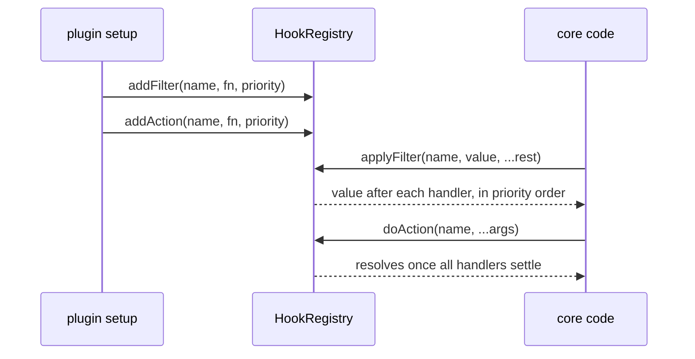
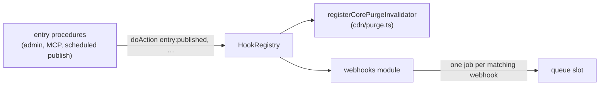

# Hooks

Hooks are core's named extension points, the "hooks" half of the "Plugin system and hooks" component in the component diagram of [`ARCHITECTURE.md`](../../ARCHITECTURE.md). A **filter** is a pipeline: each handler gets the previous handler's value and returns the next. An **action** announces that something happened: handlers run, their results are ignored, and a failure is logged. Plugin authors subscribe in `setup` through `ctx.addFilter` / `ctx.addAction`. Core and plugins fire them through `ctx.hooks`. Hook names are types: core and each plugin declare their names by augmenting `FilterRegistry` and `ActionRegistry`. The registry lives in `packages/core/src/hooks/`.

## At a glance

Entry actions also feed webhooks:

## Surface

Registration (on the plugin setup context, public through `plumix/plugin`):

| API                                                | Behaviour                                                                                                                      |
| -------------------------------------------------- | ------------------------------------------------------------------------------------------------------------------------------ |
| `addFilter(name, fn, { priority })`                | Subscribes to a declared filter. Lower priority runs first, default `DEFAULT_HOOK_PRIORITY` (100), ties by registration order. |
| `addAction(name, fn, { priority })`                | Same for actions. Priority orders when handlers start; they then run concurrently.                                             |
| `registerFilter(shortName, fn)` / `registerAction` | Adds a handler under `<pluginId>:<shortName>`.                                                                                 |

Execution (`HookExecutor`, on `ctx.hooks`; public type):

| Method                                   | Use                                                                                                                                                      |
| ---------------------------------------- | -------------------------------------------------------------------------------------------------------------------------------------------------------- |
| `applyFilter`                            | Async pipeline. Each step gets a `structuredClone` of the value, unless the value can't be cloned. Traced as a `hook: <name>` span.                      |
| `applyFilterSync`                        | Render-time pipeline. No clone. Throws `HookExecutionError` (`async_handler_in_sync_filter`) if a handler returns a promise.                             |
| `applyFilterIsolated`                    | For array-valued filters. A handler that throws or returns a non-array is logged and skipped.                                                            |
| `doAction`                               | Starts every handler in priority order, awaits all with `Promise.allSettled`, and logs each rejection (see Invariants). Traced as a `hook: <name>` span. |
| `getFilterHandlers`, `getActionHandlers` | Sorted handlers, for a caller that runs them itself.                                                                                                     |

Core's hook names, by the module that declares them (paths under `packages/core/src/`):

| Declared in                                     | Names                                                                                                                                                               | Fired from                                                                         |
| ----------------------------------------------- | ------------------------------------------------------------------------------------------------------------------------------------------------------------------- | ---------------------------------------------------------------------------------- |
| `rpc/hooks.ts`                                  | `rpc:<entry\|term\|user\|settings>.<proc>:input` / `:output` filters; `entry:before_save` and `entry:<type>:before_save`                                            | `rpc/procedures/**`                                                                |
| `rpc/hooks.ts`                                  | `entry:published\|updated\|trashed\|restored\|deleted\|transition` plus `entry:<type>:…`; `entry:revision_*`, `entry:autosave_*`, `entry:meta_changed`              | `rpc/procedures/entry/lifecycle.ts`, `meta/entry.ts`                               |
| `rpc/hooks.ts`                                  | `user:*`, `term:*`, `settings:group_changed`, `sync:after`                                                                                                          | `rpc/procedures/**`, `meta/term.ts`, `settings/write.ts`, `context/settle-sync.ts` |
| `rpc/hooks.ts`                                  | `user:signed_in`, `user:signed_out`, `user:registered`, `user:email_*`, `credential:*`, `session:revoked`, `oauth_account:unlinked`, `api_token:*`, `device_code:*` | `auth/**`, `rpc/procedures/auth/**`                                                |
| `theme.ts`                                      | `theme:document` (filter), `theme:ready` (action)                                                                                                                   | `runtime/app.ts`                                                                   |
| `route/render/page-data.ts`, `route/resolve.ts` | `resolve:<single\|archive\|term\|author\|date\|front-page\|search>:data`                                                                                            | same files                                                                         |
| `route/archive-entries.ts`                      | `archive:entries` (sync, narrows an `EntryQuery`)                                                                                                                   | same file                                                                          |
| `route/render/render-template.tsx`              | `render:document`                                                                                                                                                   | same file                                                                          |
| `hooks/block-render.ts`                         | `block:before_render`, `block:after_render` (sync), `blocks:loader:error`                                                                                           | `route/render/render-template.tsx`                                                 |
| `search/admin-search.ts`                        | `admin:search:results` (handlers run by the caller)                                                                                                                 | same file                                                                          |
| `dev/**/types.ts`                               | `debug:panels`, `error_page:panels`, `error_page:hints` (dev only)                                                                                                  | `dev/**/collect.ts(x)`                                                             |

First-party plugins declare their own the same way: `comment:*` (`plugins/comments/src/server/hooks.ts`), `form:validate`, `form:submitted` (`plugins/forms`), `feed:items` (`plugins/feeds`), `menu:tree`, `menu:item`, `menu:saved`, `menu:deleted` (`plugins/menu`), `seo:*` (`plugins/seo/src/`).

## How it works

`HookRegistry` holds one sorted-on-read list per name. Entries carry the plugin id from the setup context (`null` for core), which feeds telemetry and failure logs. `applyFilter` and `doAction` wrap each handler in a telemetry span and a `hookStore` frame. `applyFilterSync` and `applyFilterIsolated` run untraced. `buildApp` creates the registry before plugins install and registers core's own handlers first: search handlers, `registerCorePurgeInvalidator` (which queues cache tags from entry, term and user actions), and dev panels and hints when `process.env.PLUMIX_DEV` is set.

The admin bar takes no hook. Its nodes, core's included, are registrations made with `registerAdminBarNode` and held in the plugin registry's `adminBarNodes` (see [Plugin system](./plugin-system.md)), so no handler can remove another plugin's node ([ADR 0052](../adr/0052-a-plugin-extends-core-through-declared-events-filters-and-registrations.md)).

Handlers take their context as an argument; most payloads end in `ctx: AppContext`. A handler can also read `requestStore`.

Every path that changes an entry fires the same actions. The scheduled publish (`publishDueScheduledEntries` in `rpc/procedures/entry/publish-scheduled.ts`) fires `updated`, `transition` and `published` through `lifecycle.ts`, as an editor's publish does. An agent's MCP write goes through the same procedures, so it runs the `rpc:*:input` and `before_save` filters and fires the same entry actions (see [MCP](./mcp.md)).

Webhooks are declared in code per entry type: several per type, each a URL, custom headers (secrets through `EnvInput`), the events it wants (publish, unpublish, trash, delete, scheduled publish) and a payload (the full entry, none, or chosen fields). A core module registered in `buildApp` beside `registerCorePurgeInvalidator` subscribes to `entry:published`, `entry:transition`, `entry:trashed` and `entry:deleted`, and enqueues one delivery per matching webhook through the job queue behind the `queue` slot. Publishing an entry, by hand or by the scheduled task, sends a POST to each webhook its entry type declares for publish.

- `packages/core/src/hooks/registry.ts`: `HookRegistry`, `HookExecutor`, `isolate`, `sortEntries`.
- `packages/core/src/hooks/types.ts`: `FilterRegistry`, `ActionRegistry`, `FilterName`, `ActionName`, `FilterFn`, `ActionFn`, `DEFAULT_HOOK_PRIORITY`.
- `packages/core/src/hooks/public-hooks.ts`: side-effect imports that keep each augmentation in the published declarations. Imported from `packages/core/src/index.ts`.
- `packages/core/src/hooks/errors.ts`: `HookExecutionError`.
- `packages/core/src/plugin/setup-context.ts`: `addFilter`, `addAction`, `registerFilter`, `registerAction` attach the plugin id.

Related but separate: a field's `.validate()` and `.sanitize()` are per-field callbacks in the meta write pipeline, not registry hooks ([ADR 0005](../adr/0005-composite-field-hooks-run-terminally.md)). Plugin hook docs are in `apps/docs/src/content/docs/going-further/type-augmentation.mdx` and the per-plugin pages.

## Invariants

- A hook name is a TypeScript contract. A rename breaks at compile time. Core has no runtime name check and keeps no aliases ([ADR 0009](../adr/0009-a-renamed-hook-breaks-at-compile-time.md)). `packages/plumix/src/facade-action-hooks.test.ts` checks that `entry:published` reaches `PluginSetupContext["addAction"]` from the built `dist/`.
- An extension point hands out a narrowing query, not a raw filter. `archive:entries` takes and returns an `EntryQuery`, and the public-entries rule is reapplied after it, so a handler can hide an entry but never reveal one ([ADR 0007](../adr/0007-an-extension-point-hands-out-a-query-not-a-filter.md), [ADR 0008](../adr/0008-an-archive-is-one-entry-query.md)).
- Each async filter step works on its own copy, so one handler's mutation can't leak into the next. Sync filters are not copied and must treat the value as read-only.
- One failing action handler never stops the others or the caller. Its failure is logged as an error through the request's `ctx.logger`, naming the hook and the plugin (`core` for core's own), and marks its own `hook:` span `error`, never another handler's. Outside a request (at boot) there is no app logger and no trace yet, so it goes to `console.error`. A registry built with `onActionFailure` reports there instead.
- `sync:after` failures are collected per owner and reported, not thrown (`context/settle-sync.ts`); see [sync and import](./sync-and-import.md).
- Behaviour guarded by `packages/core/src/hooks/registry.test.ts` (ordering, priority, cloning, sync-async error, isolation, action failure).
