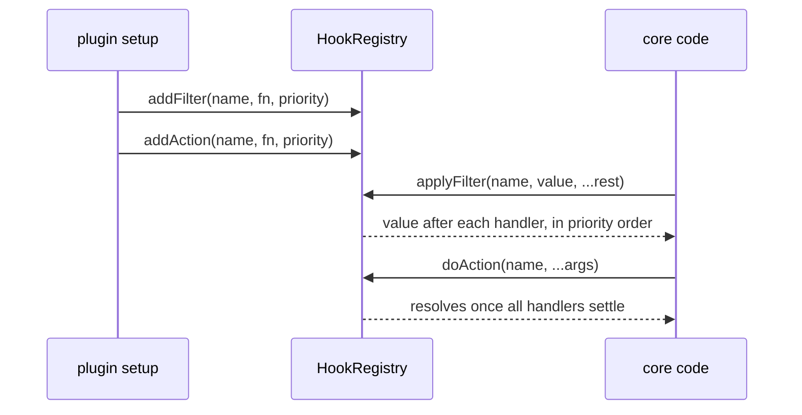

# Hooks

Hooks are core's named extension points. A **filter** is a pipeline: each handler gets the previous handler's value and returns the next. An **action** is a notification: handlers run, their results are ignored, and a failure is logged. Plugin authors subscribe in `setup` through `ctx.addFilter` / `ctx.addAction`. Core and plugins fire them through `ctx.hooks`. Hook names are types: core and each plugin declare their names by augmenting `FilterRegistry` and `ActionRegistry`. The registry lives in `packages/core/src/hooks/`.

## At a glance

## Surface

Registration (on the plugin setup context, public through `plumix/plugin`):

| API                                                | Behaviour                                                                                                                      |
| -------------------------------------------------- | ------------------------------------------------------------------------------------------------------------------------------ |
| `addFilter(name, fn, { priority })`                | Subscribes to a declared filter. Lower priority runs first, default `DEFAULT_HOOK_PRIORITY` (100), ties by registration order. |
| `addAction(name, fn, { priority })`                | Same for actions.                                                                                                              |
| `registerFilter(shortName, fn)` / `registerAction` | Adds a handler under `<pluginId>:<shortName>`.                                                                                 |

Execution (`HookExecutor`, on `ctx.hooks`; public type):

| Method                                   | Use                                                                                                                                                      |
| ---------------------------------------- | -------------------------------------------------------------------------------------------------------------------------------------------------------- |
| `applyFilter`                            | Async pipeline. Each step gets a `structuredClone` of the value, unless the value can't be cloned. Traced as a `hook: <name>` span.                      |
| `applyFilterSync`                        | Render-time pipeline. No clone. Throws `HookExecutionError` (`async_handler_in_sync_filter`) if a handler returns a promise.                             |
| `applyFilterIsolated`                    | For array-valued filters. A handler that throws or returns a non-array is logged and skipped.                                                            |
| `doAction`                               | Starts every handler in priority order, awaits all with `Promise.allSettled`, and reports each rejection to `onActionFailure` (default: `console.warn`). |
| `getFilterHandlers`, `getActionHandlers` | Sorted handlers, for a caller that runs them itself.                                                                                                     |

Core's hook names, by the module that declares them (paths under `packages/core/src/`):

| Declared in                                     | Names                                                                                                                                                  | Fired from                                                    |
| ----------------------------------------------- | ------------------------------------------------------------------------------------------------------------------------------------------------------ | ------------------------------------------------------------- |
| `rpc/hooks.ts`                                  | `rpc:<entry\|term\|user\|settings>.<proc>:input` / `:output` filters; `entry:before_save` and `entry:<type>:before_save`                               | `rpc/procedures/**`                                           |
| `rpc/hooks.ts`                                  | `entry:published\|updated\|trashed\|restored\|deleted\|transition` plus `entry:<type>:…`; `entry:revision_*`, `entry:autosave_*`, `entry:meta_changed` | `rpc/procedures/entry/lifecycle.ts`, `meta/entry.ts`          |
| `rpc/hooks.ts`                                  | `user:*`, `term:*`, `settings:group_changed`, `sync:after`                                                                                             | `rpc/procedures/**`, `meta/term.ts`, `context/settle-sync.ts` |
| `rpc/hooks.ts`                                  | `user:signed_in`, `user:signed_out`, `user:registered`, `user:email_*`, `credential:*`, `session:revoked`, `api_token:*`, `device_code:*`              | `auth/**`, `rpc/procedures/auth/**`                           |
| `theme.ts`                                      | `theme:document` (filter), `theme:ready` (action)                                                                                                      | `runtime/app.ts`                                              |
| `route/render/page-data.ts`, `route/resolve.ts` | `resolve:<single\|archive\|term\|author\|date\|front-page\|search>:data`                                                                               | same files                                                    |
| `route/archive-entries.ts`                      | `archive:entries` (sync, narrows an `EntryQuery`)                                                                                                      | same file                                                     |
| `route/render/render-template.tsx`              | `render:document`                                                                                                                                      | same file                                                     |
| `hooks/block-render.ts`                         | `block:before_render`, `block:after_render` (sync), `blocks:loader:error`                                                                              | `route/render/render-template.tsx`                            |
| `admin-bar/types.ts`                            | `admin_bar:nodes` (isolated)                                                                                                                           | `admin-bar/collect.ts`                                        |
| `search/admin-search.ts`                        | `admin:search:results` (handlers run by the caller)                                                                                                    | same file                                                     |
| `dev/**/types.ts`                               | `debug:panels`, `error_page:panels`, `error_page:hints` (dev only)                                                                                     | `dev/**/collect.ts(x)`                                        |

First-party plugins declare their own the same way: `comment:*` (`plugins/comments/src/server/hooks.ts`), `form:validate`, `form:submitted` (`plugins/forms`), `feed:items` (`plugins/feeds`), `menu:tree`, `menu:item`, `menu:saved`, `menu:deleted` (`plugins/menu`), `seo:*` (`plugins/seo/src/`).

## How it works

`HookRegistry` holds one sorted-on-read list per name. Entries carry the plugin id from the setup context (`null` for core), which feeds telemetry and failure logs. `applyFilter` and `doAction` wrap each handler in a telemetry span and a `hookStore` frame. `applyFilterSync` and `applyFilterIsolated` run untraced. `buildApp` creates the registry before plugins install and registers core's own handlers first (admin bar contributors, search handlers, the purge invalidator, and dev panels and hints when `process.env.PLUMIX_DEV` is set).

Handlers take their context as an argument; most payloads end in `ctx: AppContext`. A handler can also read `requestStore`.

- `packages/core/src/hooks/registry.ts`: `HookRegistry`, `HookExecutor`, `isolate`, `sortEntries`.
- `packages/core/src/hooks/types.ts`: `FilterRegistry`, `ActionRegistry`, `FilterName`, `ActionName`, `FilterFn`, `ActionFn`, `DEFAULT_HOOK_PRIORITY`.
- `packages/core/src/hooks/public-hooks.ts`: side-effect imports that keep each augmentation in the published declarations. Imported from `packages/core/src/index.ts`.
- `packages/core/src/hooks/errors.ts`: `HookExecutionError`.
- `packages/core/src/plugin/setup-context.ts`: `addFilter`, `addAction`, `registerFilter`, `registerAction` attach the plugin id.

Related but separate: a field's `.validate()` and `.sanitize()` are per-field callbacks in the meta write pipeline, not registry hooks ([ADR 0005](../adr/0005-composite-field-hooks-run-terminally.md)).

## Invariants

- A hook name is a TypeScript contract. A rename breaks at compile time. Core has no runtime name check and keeps no aliases ([ADR 0009](../adr/0009-a-renamed-hook-breaks-at-compile-time.md)). Guarded for one action by `packages/plumix/src/facade-action-hooks.test.ts`, which checks `entry:published` reaches `PluginSetupContext["addAction"]` from the built `dist/`.
- An extension point hands out a narrowing query, not a raw filter. `archive:entries` takes and returns an `EntryQuery`, and the public-entries rule is reapplied after it, so a handler can hide an entry but never reveal one ([ADR 0007](../adr/0007-an-extension-point-hands-out-a-query-not-a-filter.md), [ADR 0008](../adr/0008-an-archive-is-one-entry-query.md)).
- Each async filter step works on its own copy, so one handler's mutation can't leak into the next. Sync filters are not copied and must treat the value as read-only.
- One failing action handler never stops the others or the caller.
- `sync:after` failures are collected per owner and reported, not thrown (`context/settle-sync.ts`); see [sync-and-import.md](./sync-and-import.md).
- Behaviour guarded by `packages/core/src/hooks/registry.test.ts` (ordering, priority, cloning, sync-async error, isolation, action failure).

## Status

- Shipped: registry, the four execution modes, typed names, every core name in the table above. Each declared core name has a firing site in `packages/core/src/` (checked with `grep` for each name).
- Shipped: plugin hook docs in `apps/docs/src/content/docs/going-further/type-augmentation.mdx` and per-plugin pages.
- Open: #3246 (publish the editing-copy hook to plugins).

## Gaps

- `public-hooks.ts` lists `route/resolve.js` for all `resolve:*:data` names, but six of the seven are declared in `route/render/page-data.ts`. `archive:entries` (`route/archive-entries.ts`) and `admin:search:results` (`search/admin-search.ts`) are not listed. Whether they reach the published declarations is unguarded: the only type test covers `entry:published`.
- The comment on `FilterName` in `hooks/types.ts` says names come from augmentation "by the Vite plugin". Nothing in `packages/plumix/src/` augments `FilterRegistry` or `ActionRegistry`.
- `hookStore` is written for every traced handler, but nothing in the repo reads it. Its only other mention is the export roster in `packages/plumix/src/facade-curated.test.ts`.
- `registerFilter` / `registerAction` are documented as declaring a plugin-owned hook, but they only subscribe under a prefixed name. The `fn` type is checked against `FilterName`, not against `<id>:<shortName>`. No first-party plugin calls them.
- `doAction` priority orders only when handlers start; they run concurrently. The `HookOptions.priority` comment ("Lower runs first") doesn't say so.
