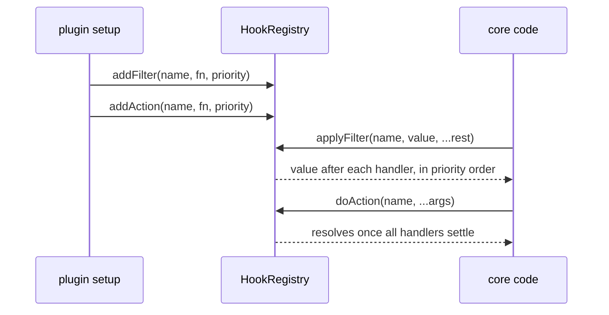
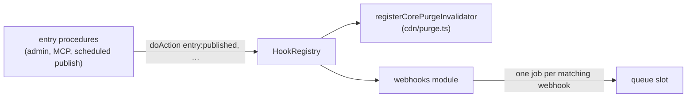

# Hooks

Hooks are core's named extension points, the "hooks" half of the "Plugin system and hooks" component in the component diagram of [`ARCHITECTURE.md`](../../ARCHITECTURE.md). They are moving, one subject at a time, from string names to declared values ([ADR 0052](../adr/0052-a-plugin-extends-core-through-declared-events-filters-and-registrations.md)):

- **Declared events and filters.** An **event** announces that something happened; a **filter** changes a value core is about to use. Each is a value declared with `defineEvent<Payload>(id)` or `defineFilter<Value, Input>(id, { sync })` from `plumix/plugin`, with an id written `<owner>:<name>`. A plugin subscribes in `setup` or `afterSetup` with `ctx.events.on(event, handler, { order })` and `ctx.filters.add(filter, handler, { order })`, and code fires them through the request's `ctx.events.emit(event, payload)` and `ctx.filters.apply(filter, value, input)`. Core's `block` subject is the first to move.
- **String names.** Every other extension point is still a string name: a filter is a pipeline, an action announces something, plugin authors subscribe through `ctx.addFilter` / `ctx.addAction`, and core and plugins fire them through `ctx.hooks`. The names are types, declared by augmenting `FilterRegistry` and `ActionRegistry`.

Both live in one `HookRegistry` per app, in `packages/core/src/hooks/`.

## Declared events and filters

A plugin declares its own events and filters as exported values, grouped into one namespace named after its subject, and lists each in its descriptor so a duplicate id fails boot whether or not anything subscribes. No `declare module` is needed:

```ts
import { defineEvent, defineFilter, definePlugin } from "plumix/plugin";

export const review = {
  posted: defineEvent<{ readonly review: Review }>("reviews:posted"),
  stars: defineFilter<number, { readonly review: Review }>("reviews:stars"),
};

export const reviews = definePlugin("reviews", {
  events: [review.posted],
  filters: [review.stars],
  setup: (ctx) => {
    /* … */
  },
});

// Another plugin, subscribing:
ctx.events.on(review.posted, ({ review }, ctx) => {
  /* … */
});
ctx.filters.add(review.stars, (stars, { review }) => stars, { order: "late" });

// The firing code, on a request:
await ctx.events.emit(review.posted, { review });
const stars = await ctx.filters.apply(review.stars, 5, { review });
```

| API                                           | Behaviour                                                                                                                                                                                               |
| --------------------------------------------- | ------------------------------------------------------------------------------------------------------------------------------------------------------------------------------------------------------- |
| `defineEvent<Payload>(id)`                    | An event value carrying its id and payload type.                                                                                                                                                        |
| `defineFilter<Value, Input>(id, { sync })`    | A filter value carrying its id, value and input types, and its sync flag. A sync filter's handler can't return a promise, which the types reject.                                                       |
| `ctx.events.on(event, handler, { order })`    | In `setup` and `afterSetup`. The handler is `(payload, ctx)`. A filter is a type error here.                                                                                                            |
| `ctx.filters.add(filter, handler, { order })` | In `setup` and `afterSetup`. The handler is `(value, input, ctx)`. An event is a type error here.                                                                                                       |
| `ctx.events.emit(event, payload)`             | Starts every handler in order, awaits all of them, and resolves to the failures as `{ plugin, error }` (`plugin` is `null` for core). Traced as one `event: <id>` span per handler.                     |
| `ctx.filters.apply(filter, value, input)`     | Runs the handlers in sequence. A sync filter returns the value; an async one returns a promise, gives each step a `structuredClone` of the value, and is traced as one `filter: <id>` span per handler. |

`ctx` in a handler is the `AppContext` that fired it, including one derived by spreading another (`withUser`, `withSignal`), which rebinds through `rebindDispatch`.

Handlers run `early`, then unset, then `late`. Within each band core's own handlers run first, then the plugins' in the site's `plugins` config order, then in registration order, so a plugin's `afterSetup` handler still runs before a later plugin's `setup` one.

Core's `block` subject (`packages/core/src/hooks/block-render.ts`), fired from `route/render/render-template.tsx`:

| Value                | Kind        | Payload or value / input                               |
| -------------------- | ----------- | ------------------------------------------------------ |
| `block.loaderFailed` | event       | `{ spec, node, key, error }`, once per rejected loader |
| `block.beforeRender` | sync filter | the block's element / `{ node, context }`              |
| `block.afterRender`  | sync filter | the wrapped element / `{ node, context }`              |

`spyEvent(hooks, event)` and `spyFilter(hooks, filter)` from `plumix/test` record what was emitted or filtered; the dispatcher and RPC harnesses expose them bound as `h.spyEvent` and `h.spyFilter`.

## String names

## At a glance



Entry actions also feed webhooks:



## Surface

Registration (on the plugin setup context, public through `plumix/plugin`):

| API                                                | Behaviour                                                                                                                      |
| -------------------------------------------------- | ------------------------------------------------------------------------------------------------------------------------------ |
| `addFilter(name, fn, { priority })`                | Subscribes to a declared filter. Lower priority runs first, default `DEFAULT_HOOK_PRIORITY` (100), ties by registration order. |
| `addAction(name, fn, { priority })`                | Same for actions. Priority orders when handlers start; they then run concurrently.                                             |
| `registerFilter(shortName, fn)` / `registerAction` | Adds a handler under `<pluginId>:<shortName>`.                                                                                 |

Execution (`HookExecutor`, on `ctx.hooks`; public type):

| Method                                   | Use                                                                                                                                                      |
| ---------------------------------------- | -------------------------------------------------------------------------------------------------------------------------------------------------------- |
| `applyFilter`                            | Async pipeline. Each step gets a `structuredClone` of the value, unless the value can't be cloned. Traced as a `hook: <name>` span.                      |
| `applyFilterSync`                        | Render-time pipeline. No clone. Throws `HookExecutionError` (`async_handler_in_sync_filter`) if a handler returns a promise.                             |
| `applyFilterIsolated`                    | For array-valued filters. A handler that throws or returns a non-array is logged and skipped.                                                            |
| `doAction`                               | Starts every handler in priority order, awaits all with `Promise.allSettled`, and logs each rejection (see Invariants). Traced as a `hook: <name>` span. |
| `getFilterHandlers`, `getActionHandlers` | Sorted handlers, for a caller that runs them itself.                                                                                                     |

Core's hook names, by the module that declares them (paths under `packages/core/src/`):

| Declared in                                     | Names                                                                                                                                                               | Fired from                                                                         |
| ----------------------------------------------- | ------------------------------------------------------------------------------------------------------------------------------------------------------------------- | ---------------------------------------------------------------------------------- |
| `rpc/hooks.ts`                                  | `rpc:<entry\|term\|user\|settings>.<proc>:input` / `:output` filters; `entry:before_save` and `entry:<type>:before_save`                                            | `rpc/procedures/**`                                                                |
| `rpc/hooks.ts`                                  | `entry:published\|updated\|trashed\|restored\|deleted\|transition` plus `entry:<type>:…`; `entry:revision_*`, `entry:autosave_*`, `entry:meta_changed`              | `rpc/procedures/entry/lifecycle.ts`, `meta/entry.ts`                               |
| `rpc/hooks.ts`                                  | `user:*`, `term:*`, `settings:group_changed`, `sync:after`                                                                                                          | `rpc/procedures/**`, `meta/term.ts`, `settings/write.ts`, `context/settle-sync.ts` |
| `rpc/hooks.ts`                                  | `user:signed_in`, `user:signed_out`, `user:registered`, `user:email_*`, `credential:*`, `session:revoked`, `oauth_account:unlinked`, `api_token:*`, `device_code:*` | `auth/**`, `rpc/procedures/auth/**`                                                |
| `route/render/page-data.ts`, `route/resolve.ts` | `resolve:<single\|archive\|term\|author\|date\|front-page\|search>:data`                                                                                            | same files                                                                         |
| `route/archive-entries.ts`                      | `archive:entries` (sync, narrows an `EntryQuery`)                                                                                                                   | same file                                                                          |
| `route/render/render-template.tsx`              | `render:document`                                                                                                                                                   | same file                                                                          |

First-party plugins declare their own the same way: `comment:*` (`plugins/comments/src/server/hooks.ts`), `form:submitted` (`plugins/forms`), `feed:items` (`plugins/feeds`), `menu:tree`, `menu:item`, `menu:saved`, `menu:deleted` (`plugins/menu`), `seo:*` (`plugins/seo/src/`).

## How it works

`HookRegistry` holds one sorted-on-read list per string name, and one per declared event or filter id. Entries carry the plugin id from the setup context (`null` for core), which feeds telemetry and failure logs. `applyFilter` and `doAction` wrap each handler in a telemetry span and a `hookStore` frame. `applyFilterSync` and `applyFilterIsolated` run untraced. `buildApp` creates the registry before plugins install and registers core's own handlers first: `registerCorePurgeInvalidator` (which queues cache tags from entry, term and user actions). Dev panels and hints are registrations, not hooks (see [dev tooling](./dev-tooling.md)).

The admin bar takes no hook. Its nodes, core's included, are registrations made with `registerAdminBarNode` and held in the plugin registry's `adminBarNodes` (see [Plugin system](./plugin-system.md)), so no handler can remove another plugin's node ([ADR 0052](../adr/0052-a-plugin-extends-core-through-declared-events-filters-and-registrations.md)).

Document tags take no hook either. A plugin adds them with `registerDocumentManifest`, held in the plugin registry's `documentManifests`; `buildApp` merges them after the theme's own `document` in plugin config order, validates the result and deep-freezes it onto `PlumixApp.document` once at boot.

Handlers take their context as an argument; most payloads end in `ctx: AppContext`. A handler can also read `requestStore`.

Every path that changes an entry fires the same actions. The scheduled publish (`publishDueScheduledEntries` in `rpc/procedures/entry/publish-scheduled.ts`) fires `updated`, `transition` and `published` through `lifecycle.ts`, as an editor's publish does. An agent's MCP write goes through the same procedures, so it runs the `rpc:*:input` and `before_save` filters and fires the same entry actions (see [MCP](./mcp.md)).

Webhooks are declared in code per entry type: several per type, each a URL, custom headers (secrets through `EnvInput`), the events it wants (publish, unpublish, trash, delete, scheduled publish) and a payload (the full entry, none, or chosen fields). A core module registered in `buildApp` beside `registerCorePurgeInvalidator` subscribes to `entry:published`, `entry:transition`, `entry:trashed` and `entry:deleted`, and enqueues one delivery per matching webhook through the job queue behind the `queue` slot. Publishing an entry, by hand or by the scheduled task, sends a POST to each webhook its entry type declares for publish.

- `packages/core/src/hooks/define.ts`: `defineEvent`, `defineFilter`, and the subscribing and firing types.
- `packages/core/src/hooks/dispatch.ts`: `bindDispatch`, `rebindDispatch`, which build `ctx.events` and `ctx.filters`.
- `packages/core/src/hooks/block-render.ts`: core's `block` subject.
- `packages/core/src/hooks/registry.ts`: `HookRegistry`, `HookExecutor`, `isolate`, `sortEntries`, `sortSubscriptions`.
- `packages/core/src/hooks/types.ts`: `FilterRegistry`, `ActionRegistry`, `FilterName`, `ActionName`, `FilterFn`, `ActionFn`, `DEFAULT_HOOK_PRIORITY`.
- `packages/core/src/hooks/public-hooks.ts`: side-effect imports that keep each augmentation in the published declarations. Imported from `packages/core/src/index.ts`.
- `packages/core/src/hooks/errors.ts`: `HookExecutionError`.
- `packages/core/src/plugin/setup-context.ts`: `events.on`, `filters.add`, `addFilter`, `addAction`, `registerFilter`, `registerAction` attach the plugin id; the first two also its place in the config.
- `packages/core/src/runtime/install-plugins.ts`: rejects an event or filter id declared twice, core's included.

Admin search is not a hook. Its answers come from search providers registered with `ctx.registerSearchProvider({ id, order, search })` into `PluginRegistry.searchProviders`, with core's own provider (id `core`) registered first. `order: "early"` answers ahead of core and `"late"` after every unset provider; a duplicate id fails boot, and a provider that throws is logged through `ctx.logger` and answers nothing. See [Search](./search.md).

Related but separate: a field's `.validate()` and `.sanitize()` are per-field callbacks in the meta write pipeline, not registry hooks ([ADR 0005](../adr/0005-composite-field-hooks-run-terminally.md)). Plugin hook docs are in `apps/docs/src/content/docs/going-further/type-augmentation.mdx` and the per-plugin pages.

## Invariants

- Two declarations sharing an id fail boot with `DuplicateRegistrationError`, naming the id and both owners, whether or not anything subscribes. An event and a filter can't share one either.
- One failing event handler never stops the others or the caller. Its failure is logged as an error through the firing `ctx.logger`, naming the event and the plugin (`core` for core's own), marks its own `event:` span `error`, and is returned by `emit`.
- A throwing filter handler's error reaches the caller of `apply` unchanged.
- Behaviour of the declared API is guarded by `packages/core/src/hooks/registry.test.ts` (ordering, failure, cloning, telemetry), its types by `packages/core/src/hooks/define.test.ts`, and the boot check by `packages/core/src/runtime/install-plugins.test.ts`.

- A hook name is a TypeScript contract. A rename breaks at compile time. Core has no runtime name check and keeps no aliases ([ADR 0009](../adr/0009-a-renamed-hook-breaks-at-compile-time.md)). `packages/plumix/src/facade-action-hooks.test.ts` checks that `entry:published` reaches `PluginSetupContext["addAction"]` from the built `dist/`.
- An extension point hands out a narrowing query, not a raw filter. `archive:entries` takes and returns an `EntryQuery`, and the public-entries rule is reapplied after it, so a handler can hide an entry but never reveal one ([ADR 0007](../adr/0007-an-extension-point-hands-out-a-query-not-a-filter.md), [ADR 0008](../adr/0008-an-archive-is-one-entry-query.md)).
- Each async filter step works on its own copy, so one handler's mutation can't leak into the next. Sync filters are not copied and must treat the value as read-only.
- One failing action handler never stops the others or the caller. Its failure is logged as an error through the request's `ctx.logger`, naming the hook and the plugin (`core` for core's own), and marks its own `hook:` span `error`, never another handler's. Outside a request (at boot) there is no app logger and no trace yet, so it goes to `console.error`. A registry built with `onActionFailure` reports there instead.
- `sync:after` failures are collected per owner and reported, not thrown (`context/settle-sync.ts`); see [sync and import](./sync-and-import.md).
- Behaviour guarded by `packages/core/src/hooks/registry.test.ts` (ordering, priority, cloning, sync-async error, isolation, action failure).
