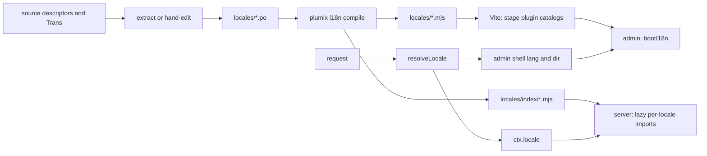

# i18n

Plumix translates its own UI with Lingui 6, and every user-facing string is a Lingui descriptor: the admin, the editor, the admin bar, the welcome screen, block metadata, core's mails and each first-party plugin's labels. A site developer sets the `i18n` config block (default locale, enabled locales, an optional resolver). A plugin author ships `.po` catalogs and declares an `i18n` slot on the descriptor. An editor picks a language in the admin. The code lives in `packages/core/src/i18n/` (locale registry, resolution, `Label`), `packages/plumix/src/cli/commands/i18n.ts` (the `plumix i18n` CLI), `packages/core/i18n-compile/` (the one catalog compile), `packages/core/src/i18n/lingui.ts` (the one Lingui config helper) and `packages/admin/src/lib/` (admin boot and plugin catalog loading). It has no box of its own in ARCHITECTURE.md's component diagram: it is a cross-cutting concern that Routing and render, Mail and the Admin and visual editor each read. Entry content is translated too: an entry has a version per enabled locale, its translation, and the public site, the admin and the APIs serve each one.

## At a glance

## Surface

| Surface                                                                                                                                                                                                 | Kind                                                                                                                                  | Public   |
| ------------------------------------------------------------------------------------------------------------------------------------------------------------------------------------------------------- | ------------------------------------------------------------------------------------------------------------------------------------- | -------- |
| `plumix/i18n`: `Label`, `resolveLabel`, `labelSourceText`, `withContext`, `formatDate`, `formatNumber`, `formatRelative`, re-exported `i18n`, `I18nProvider`, `Trans`, `useLingui`, `MessageDescriptor` | subpath (`packages/plumix/src/i18n/index.ts`)                                                                                         | public   |
| `i18n` config: `defaultLocale`, `locales` (string or `{ code, label, direction, enabled }`), `resolveLocale(request, user)`                                                                             | config slot (`I18nInputFor` in `locale-registry.ts`)                                                                                  | public   |
| `i18n` descriptor slot: `{ sourceLocale, locales, catalogPath }`; `PLUGIN_I18N_SLOT` default for first-party plugins                                                                                    | descriptor field (`PluginI18nSlot` in `packages/core/src/plugin/define.ts`)                                                           | public   |
| `ctx.locale` (`ResolvedLocale`: `code`, `label`, `direction`, `enabled`)                                                                                                                                | context field (`app-context.ts`)                                                                                                      | public   |
| `plumix/lingui`: `defineLinguiConfig({ rootDir, surfaces? })`, `LinguiConfigOptions`, `LinguiSurface`                                                                                                   | build-time subpath (`packages/plumix/src/lingui.ts`, from `@plumix/core/lingui`)                                                      | public   |
| `plumix i18n init`                                                                                                                                                                                      | CLI: writes a `lingui.config.ts` on `plumix/lingui`, adds the three scripts, `prepack` and `@lingui/cli`                              | public   |
| `plumix i18n extract [--check]`                                                                                                                                                                         | CLI: runs `lingui extract`; refuses on a hand-authored catalog; `--check` diffs and restores                                          | public   |
| `plumix i18n compile [--dts]`                                                                                                                                                                           | CLI: `lingui compile --namespace es`, fails on a parse error                                                                          | public   |
| `plumix i18n verify [--src dir]...`                                                                                                                                                                     | CLI: diffs `{ id, message }` literals in source against active msgids                                                                 | public   |
| `user.setLocale`                                                                                                                                                                                        | RPC procedure (`packages/core/src/rpc/procedures/user/set-locale.ts`), needs `user:edit_own`                                          | public   |
| `?lang=`, `plumix_locale` cookie (`Path=/_plumix/`)                                                                                                                                                     | request inputs                                                                                                                        | public   |
| `@plumix/core/lingui`, which core, admin and admin-editor import                                                                                                                                        | `packages/core/src/i18n/lingui.ts`                                                                                                    | internal |
| `@plumix/core/i18n-compile` (`compileCatalogs`), `plumix-compile-catalogs` bin                                                                                                                          | `packages/core/i18n-compile/index.mjs`, `packages/core/bin/`                                                                          | internal |
| `useLabel`                                                                                                                                                                                              | `packages/admin/src/lib/use-label.ts`                                                                                                 | internal |
| `virtual:plumix/plugin-catalogs`                                                                                                                                                                        | Vite virtual module (`packages/plumix/src/vite/plugin-catalogs-codegen.ts`)                                                           | internal |
| `virtual:plumix/catalog-locales`                                                                                                                                                                        | Vite virtual module (`projectCoreCatalogLocales` in `packages/core/src/runtime/catalog-locales.ts`)                                   | internal |
| `catalogLocales` manifest field; `catalog-locales.json` in the admin `dist`                                                                                                                             | manifest field and admin build output (`AdminCatalogLocales`, `AdminShippedCatalogs` in `packages/core/src/plugin/manifest-types.ts`) | internal |
| Root `pnpm i18n:check`                                                                                                                                                                                  | turbo task per package                                                                                                                | repo     |

## How it works

**Descriptors.** A user-visible string is a `Label`: a plain string or a Lingui `MessageDescriptor` (`{ id, message }`). `message` is the English source and the runtime fallback. `resolveLabel` returns `message` when the active catalog lacks the id, so Lingui never warns per render. `labelSourceText` serves server code with no Lingui instance. `withContext` adds a translator-only `context`; resolution still keys on `id`. In the admin, `useLabel` returns a resolver that is stable per locale. It passes no `values`, so an ICU placeholder renders literally.

**Catalogs per package.** Every package with strings, first-party or third-party, has a `lingui.config.ts` built from `defineLinguiConfig` (`packages/core/src/i18n/lingui.ts`). Plugins import it from `plumix/lingui`. Core, admin and admin-editor sit upstream of `plumix` in the build graph, so admin and admin-editor import it from `@plumix/core/lingui` and core from its own source, because core compiles its catalogs before it builds. It is a build-time subpath, apart from the runtime `plumix/i18n`. The helper sets source locale `en`, PO format without line numbers, and one catalog path per surface (default `<rootDir>/locales/{locale}` over `src`). Its `locales` are `en` plus every locale `discoverCatalogLocales` finds under each surface, resolved against the `rootDir` the config passes (`import.meta.dirname`), so adding a language is adding `.po` files and running `i18n:compile`. Its `fallbackLocales` gives every locale an entry, the shipped locales on its chain under the catalog-locale rule below (`shippedChain`), so Lingui never applies its own parent table, which is not CLDR's (it maps `zh-Hant` to `zh`). A partial `de-AT.po` therefore compiles each message it lacks from `de.po`, and `zh-Hant` fills from nothing but the source. A misnamed `.po` gets an empty entry and fails at compile. Core declares five surfaces, each a `<surface>-{locale}.po` set: `admin-area`, `admin-bar`, `welcome`, `blocks`, `mail`. Two kinds of catalog exist:

- **Extracted.** `packages/admin-editor` (header `X-Generator: @lingui/cli`) and `packages/admin` run `lingui extract` over macros and `<Trans>`. Their `i18n:check` is `plumix i18n extract --check`.
- **Hand-authored.** Core and every first-party plugin carry `X-Generator: hand-authored` in each `.po`. Their strings are object literals in server-side code that no Babel macro pass reads. `plumix i18n extract` refuses to run there (`hasHandAuthoredCatalog`); a translator edits `locales/en.po` and the other locales by hand. Their `i18n:check` is `plumix i18n verify`.

**Gates.** `extract --check` snapshots every `.po`, runs `lingui extract --clean`, lists ids added or removed, then restores the snapshot. `verify` scans `.ts`/`.tsx` (tests, `dist` and `node_modules` skipped) with `sourceDescriptorIds`, which counts an `id` only when a `message` key sits at the same depth, plus `id=` on a JSX tag that also carries `message`. `computeIdDrift` reports `missingInCatalog` and `orphanedInCatalog`. Obsolete `#~` entries are ignored.

**Compile.** `compileCatalogs` reads the package's Lingui config through the `@lingui/conf` of the Lingui that compiles it, and discovers each catalog path's locales from the `.po` files its `{locale}` matches. A file not named for its canonical BCP 47 tag fails the compile before Lingui runs, with the name to rename it to (rename `zh_CN.po` to `zh-CN.po`); nothing is renamed. It runs `lingui compile --namespace es` without `--strict`, so a missing translation falls back to source. It fails when Lingui prints `Compilation error`, which Lingui itself only warns about. After a clean compile it writes a gitignored index per catalog path, `locales/index/<surface>.mjs` (`catalogs.mjs` for a bare `{locale}` path): `catalogs`, one lazy `import()` per discovered locale. It sits in a folder of its own so a `locales/*.mjs` glob never reads it as a catalog. `--dts` writes a loose `.d.mts` stub, for the catalogs and the index, for packages imported by name (core, forms). Core, admin and admin-editor call it through the `plumix-compile-catalogs` bin, because they sit upstream of `plumix` in the build graph. In `turbo.json`, `typecheck`, `lint`, `build` and `dev` depend on `i18n:compile`; `i18n:check` depends on `plumix#build`. Unit tests stub every `/locales/` import with an empty catalog, and an index with one that lists the `.po` files on disk, each loading the empty catalog (`tooling/vitest/source-resolver.ts`).

**Catalog locale.** `catalogLocale(locale, shipped, sourceLocale)` (`packages/core/src/i18n/catalog-locale.ts`) picks which shipped catalog serves a locale ([ADR 0054](../adr/0054-a-locales-catalog-is-chosen-once-at-build-from-the-catalogs-that-ship.md)). It walks from the canonical tag to its CLDR parent where CLDR names one, else to the tag with its last subtag dropped, until CLDR's root or a bare language. It skips a step whose `Intl.Locale().maximize()` script differs from the tag's, and returns the first shipped locale equal to a step, by canonical form or by likely subtags (`zh` is `zh-CN`). Otherwise it returns `sourceLocale`. So `de-AT` reads `de`, `es-MX` reads `es-419` and then `es`, `zh-SG` reads `zh-CN`, and `zh-TW`, `zh-HK` and `fil` (with only `fi`) read the source. The CLDR parents are `packages/core/src/i18n/cldr-parent-locales.ts`, which `pnpm --filter @plumix/core cldr:generate` writes from the `cldr-core` devDependency; `cldr-parent-locales.test.ts` regenerates it and fails on any difference.

**Locale registry.** `resolveLocales` (called from `packages/core/src/runtime/define-config.ts`, default `{ defaultLocale: "en", locales: ["en"] }`) canonicalizes each code through `Intl.Locale` (`en_US` becomes `en-US`), labels it with `Intl.DisplayNames`, takes its direction from `getTextInfo()`, and throws `I18nConfigError` when the default is unlisted or disabled, a tag is invalid or a direction is not `ltr`/`rtl`.

**Runtime locale selection.** `resolveLocale` runs in `createAppContext` (`packages/core/src/context/app.ts`) and again for the admin shell in `packages/core/src/runtime/dispatcher.ts`. First enabled match wins:

1. the site's `resolveLocale` override;
2. `?lang=`;
3. the user's `meta.locale`, only under `/_plumix/`;
4. the `plumix_locale` cookie (the browser sends it only under `/_plumix/`);
5. `Accept-Language` via `matchAcceptLanguage`, only under `/_plumix/` (exact, then script, then base language);
6. the default locale.

So a public URL renders one locale per URL unless the site overrides it. The admin shell response gets `lang`/`dir` rewritten (`rewriteAdminShellLangDir`), `private, no-cache` and `vary: cookie, accept-language`. `user.setLocale` writes `meta.locale` and sets the cookie with the site's `basePath`; the admin switcher also pins `?lang=` (`packages/admin/src/routes/_auth/-locale-param.ts`).

**Translations.** A UI string is translated through a catalog; an entry is translated by storing a version of it per enabled locale. The public site renders the translation for the URL's locale, the admin and MCP edit each translation, and REST reads each one.

**Build projection.** At build, the `plumix` Vite plugin projects each of core's request-path surfaces (blocks, mail, welcome, admin bar) onto the site's enabled locales: `projectCoreCatalogLocales` (`packages/core/src/runtime/catalog-locales.ts`) runs `catalogLocale` for every enabled locale against the locales that surface's own index ships, with `en` as source. The result, `{ blocks: { "de-AT": "de", "zh-SG": "zh-CN", fr: "en", … }, mail, welcome, "admin-bar" }`, is served as `virtual:plumix/catalog-locales`, beside `virtual:plumix/plugin-catalogs`. Each runtime adapter's generated entry imports it and hands it to `buildApp` as `catalogLocales`. A site with no `i18n` config enables only its default locale, so it projects to `{ en: "en" }`. An enabled locale no catalog serves maps to the source locale, silently.

**Plugin projection.** Each plugin is a catalog set of its own, projected by the same rule from the locales its slot declares, not yet discovered from its files. `projectPluginI18n` in `packages/core/src/plugin/build-manifest.ts` runs `projectCatalogLocales` over the site's enabled locales against the slot's `locales` and keys the plugin manifest's `catalogs` by enabled locale, each at the `pluginCatalogUrl` of its catalog locale. The source catalog stays included under the source locale. A plugin that ships `en` and `de` on a site enabling `de-AT` and `fr` gets `{ en: …/en.mjs, "de-AT": …/de.mjs, fr: …/en.mjs }`. With no site `i18n` (a bare `buildManifest` call), each declared locale maps to itself. The Vite plugin stages each catalog the manifest names once, at `pluginCatalogStagedPath` of its catalog locale (`stagePluginCatalogs` in `packages/plumix/src/vite/plugin-catalog-resolve.ts`), and fails the build when one has no compiled `.mjs`. `collectPluginCatalogFiles` projects the same way for the server, from the declared locales that have a compiled file, and keys `virtual:plumix/plugin-catalogs` by the source locale and each enabled locale, so a `de-AT` block render or mail merges the plugin's `de` strings.

**Server-side lookup.** No Lingui singleton runs on the server. Each of core's surfaces reads its generated index through `lazyCatalogs` (`packages/core/src/blocks/lazy-catalogs.ts`), which reads a locale through its surface's projection, exactly, and imports that catalog on its first use per isolate, so an isolate loads only the catalogs it serves. No surface strips a region or matches a language at runtime. Without a projection (an app built with none, such as a test), each shipped locale reads its own catalog and nothing else. `buildApp` creates the projected readers: `createBlockCatalogs` and `createMailCatalogs` take the projection beside the plugin catalogs, the admin bar's `barCatalogs` serves both core's bar nodes and `createAdminBarChrome`, and `welcomeCatalogs` backs the welcome theme `buildApp` renders in place of the `welcomeTheme` `plumix()` substituted. The admin bar shows a user's stored locale when the projection names it, else `en`. The welcome screen and the admin bar render synchronously, so the welcome template's `document` and the admin bar chrome load the catalog first and the render reads it. Block render and mails merge plugin catalogs from `virtual:plumix/plugin-catalogs`, once per locale per isolate: `createBlockCatalogs` (`packages/core/src/route/render/block-catalog.ts`) for block render, `createMailCatalogs` (`packages/core/src/mail/catalogs.ts`) for mails, which render in the recipient's locale (ADR 0036). `listAdminAreas` (`packages/core/src/admin-area/i18n.ts`), async because it loads its catalog, negotiates `Accept-Language` with the catalog-locale rule: it runs `catalogLocale` on each entry in header order against its shipped catalogs, and the first entry one serves wins, the source catalog included, so `en-US, de;q=0.5` gets English and `zh-TW` gets English rather than `zh-CN`. An entry that is not a language tag is skipped; with no match it is English.

**Admin.** The admin ships prebuilt, so it learns a site's locales from the manifest. Its build bundles three catalog sets through build-time globs (`catalog-globs.ts`): its own, the editor's and core's blocks. It writes the locales each set bundles to `dist/catalog-locales.json` (`shipCatalogLocales` in `packages/admin/vite.config.ts`, read from the bundle's module ids). Admin staging (`withAdminCatalogLocales` in `packages/plumix/src/vite/admin-catalog-locales.ts`) runs `catalogLocale` for each enabled locale against each set and injects the result as the manifest's `catalogLocales`, so a `de-AT` site gets `{ "de-AT": "de" }` per set. `bootI18n` (`packages/admin/src/lib/i18n-boot.ts`) reads the shell's `<html lang>`, which is the enabled locale, and reads each set's catalog by that code from `catalogLocales`, with no matching: a locale the manifest does not project, as under the admin's own dev server, reads its own catalog, and a missing catalog reads the source. It merges them with admin chrome winning, loads the messages under the enabled locale and activates it, so `de-AT` shows German strings with Austrian dates and numbers while `<html lang>` and `dir` stay `de-AT`. It installs `setI18nResolver` for validation messages. Plugin catalogs come from the plugin manifest (see plugin projection above). `createPluginCatalogLoader` reads a plugin's URL by the enabled locale's code, exactly, prefixes the root-absolute URL with `adminBasePath()`, imports it and loads its messages under the enabled locale, so a `de-AT` admin holds the plugin's `de` strings under `de-AT`. A locale the manifest does not list reads the source catalog, and a failure is logged without blocking the mount. Plugin admin chunks share the admin's Lingui instance through the `plumix/admin/lingui-*` specifier rewrite.

## Invariants

- Public HTML stays one locale per URL: user meta, cookie and `Accept-Language` count only under `/_plumix/`. Guarded by `packages/core/src/i18n/resolve-locale.test.ts`; ADR 0030 records that reading `ctx.locale` is not a principal read ([../adr/0030-a-render-that-reads-the-principal-is-never-shared.md](../adr/0030-a-render-that-reads-the-principal-is-never-shared.md)).
- A render resolves descriptors against a compiled catalog for its locale, and `plumix i18n verify` gates both core and plugin strings ([../adr/0016-a-render-context-resolves-descriptors.md](../adr/0016-a-render-context-resolves-descriptors.md)).
- A mail renders in its recipient's locale; core's mail strings are hand-authored and gated by `verify` ([../adr/0036-a-mail-is-declared-by-name.md](../adr/0036-a-mail-is-declared-by-name.md)).
- `PLUGIN_I18N_SLOT.locales` matches the locales core's `.po` files ship, as core's `lingui.config.ts` discovers them, until #3353 removes the list. Guarded by `packages/core/src/plugin/define.test.ts` ([../adr/0038-a-coupled-invariant-is-collapsed-or-guarded-by-a-test.md](../adr/0038-a-coupled-invariant-is-collapsed-or-guarded-by-a-test.md)).
- The admin's `SOURCE_LOCALE` mirrors `lingui.config.ts`. Guarded by `packages/admin/src/lib/i18n-boot.test.ts`.
- `pluginCatalogUrl` and `pluginCatalogStagedPath` stay in lockstep. Guarded by `packages/core/src/plugin/plugin-catalog-path.test.ts`.
- `extract` never overwrites a hand-authored catalog. Guarded by `packages/plumix/src/cli/commands/i18n.test.ts`.
- The committed CLDR parent data matches the installed `cldr-core`. Guarded by `packages/core/src/i18n/cldr-parent-locales.test.ts`.
- `i18n/` sits below the context layer and is generic over the user type ([../adr/0010-core-is-one-package-of-enforced-layers.md](../adr/0010-core-is-one-package-of-enforced-layers.md)).
