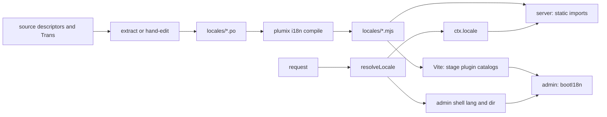

# i18n

Plumix translates its own UI with Lingui 6, and every user-facing string is a Lingui descriptor: the admin, the editor, the admin bar, the welcome screen, block metadata, core's mails and each first-party plugin's labels. A site developer sets the `i18n` config block (default locale, enabled locales, an optional resolver). A plugin author ships `.po` catalogs and declares an `i18n` slot on the descriptor. An editor picks a language in the admin. The code lives in `packages/core/src/i18n/` (locale registry, resolution, `Label`), `packages/plumix/src/cli/commands/i18n.ts` (the `plumix i18n` CLI), `packages/core/i18n-compile/` (the one catalog compile), `tooling/lingui/` (the shared Lingui config) and `packages/admin/src/lib/` (admin boot and plugin catalog loading). It has no box of its own in ARCHITECTURE.md's component diagram: it is a cross-cutting concern that Routing and render, Mail and the Admin and visual editor each read. Entry content is translated too: an entry has a version per enabled locale, its translation, and the public site, the admin and the APIs serve each one.

## At a glance

## Surface

| Surface                                                                                                                                                                                                 | Kind                                                                                                     | Public   |
| ------------------------------------------------------------------------------------------------------------------------------------------------------------------------------------------------------- | -------------------------------------------------------------------------------------------------------- | -------- |
| `plumix/i18n`: `Label`, `resolveLabel`, `labelSourceText`, `withContext`, `formatDate`, `formatNumber`, `formatRelative`, re-exported `i18n`, `I18nProvider`, `Trans`, `useLingui`, `MessageDescriptor` | subpath (`packages/plumix/src/i18n/index.ts`)                                                            | public   |
| `i18n` config: `defaultLocale`, `locales` (string or `{ code, label, direction, enabled }`), `resolveLocale(request, user)`                                                                             | config slot (`I18nInputFor` in `locale-registry.ts`)                                                     | public   |
| `i18n` descriptor slot: `{ sourceLocale, locales, catalogPath }`; `PLUGIN_I18N_SLOT` default for first-party plugins                                                                                    | descriptor field (`PluginI18nSlot` in `packages/core/src/plugin/define.ts`)                              | public   |
| `ctx.locale` (`ResolvedLocale`: `code`, `label`, `direction`, `enabled`)                                                                                                                                | context field (`app-context.ts`)                                                                         | public   |
| `plumix i18n init`                                                                                                                                                                                      | CLI: writes `lingui.config.ts`, adds the three scripts, `prepack`, `@lingui/cli` and `@lingui/format-po` | public   |
| `plumix i18n extract [--check]`                                                                                                                                                                         | CLI: runs `lingui extract`; refuses on a hand-authored catalog; `--check` diffs and restores             | public   |
| `plumix i18n compile [--dts]`                                                                                                                                                                           | CLI: `lingui compile --namespace es`, fails on a parse error                                             | public   |
| `plumix i18n verify [--src dir]...`                                                                                                                                                                     | CLI: diffs `{ id, message }` literals in source against active msgids                                    | public   |
| `user.setLocale`                                                                                                                                                                                        | RPC procedure (`packages/core/src/rpc/procedures/user/set-locale.ts`), needs `user:edit_own`             | public   |
| `?lang=`, `plumix_locale` cookie (`Path=/_plumix/`)                                                                                                                                                     | request inputs                                                                                           | public   |
| `@plumix/lingui-config` (`defineLinguiConfig`, `PLUMIX_LOCALES`)                                                                                                                                        | `tooling/lingui/index.ts`                                                                                | internal |
| `@plumix/core/i18n-compile` (`compileCatalogs`), `plumix-compile-catalogs` bin                                                                                                                          | `packages/core/i18n-compile/index.mjs`, `packages/core/bin/`                                             | internal |
| `useLabel`                                                                                                                                                                                              | `packages/admin/src/lib/use-label.ts`                                                                    | internal |
| `virtual:plumix/plugin-catalogs`                                                                                                                                                                        | Vite virtual module (`packages/plumix/src/vite/plugin-catalogs-codegen.ts`)                              | internal |
| Root `pnpm i18n:check`                                                                                                                                                                                  | turbo task per package                                                                                   | repo     |

## How it works

**Descriptors.** A user-visible string is a `Label`: a plain string or a Lingui `MessageDescriptor` (`{ id, message }`). `message` is the English source and the runtime fallback. `resolveLabel` returns `message` when the active catalog lacks the id, so Lingui never warns per render. `labelSourceText` serves server code with no Lingui instance. `withContext` adds a translator-only `context`; resolution still keys on `id`. In the admin, `useLabel` returns a resolver that is stable per locale. It passes no `values`, so an ICU placeholder renders literally.

**Catalogs per package.** Every package with strings has `lingui.config.ts` built from `defineLinguiConfig`, which defaults to `PLUMIX_LOCALES` (`en`, `uk`, `ar`, `de`, `zh-CN`), PO format without line numbers, and `<rootDir>/locales/{locale}`. Core declares five surfaces, each a `<surface>-{locale}.po` set: `admin-area`, `admin-bar`, `welcome`, `blocks`, `mail`. Two kinds of catalog exist:

- **Extracted.** `packages/admin-editor` (header `X-Generator: @lingui/cli`) and `packages/admin` run `lingui extract` over macros and `<Trans>`. Their `i18n:check` is `plumix i18n extract --check`.
- **Hand-authored.** Core and every first-party plugin carry `X-Generator: hand-authored` in each `.po`. Their strings are object literals in server-side code that no Babel macro pass reads. `plumix i18n extract` refuses to run there (`hasHandAuthoredCatalog`); a translator edits `locales/en.po` and the other locales by hand. Their `i18n:check` is `plumix i18n verify`.

**Gates.** `extract --check` snapshots every `.po`, runs `lingui extract --clean`, lists ids added or removed, then restores the snapshot. `verify` scans `.ts`/`.tsx` (tests, `dist` and `node_modules` skipped) with `sourceDescriptorIds`, which counts an `id` only when a `message` key sits at the same depth, plus `id=` on a JSX tag that also carries `message`. `computeIdDrift` reports `missingInCatalog` and `orphanedInCatalog`. Obsolete `#~` entries are ignored.

**Compile.** `compileCatalogs` runs `lingui compile --namespace es` without `--strict`, so a missing translation falls back to source. It fails when Lingui prints `Compilation error`, which Lingui itself only warns about. `--dts` writes a loose `.d.mts` stub for packages imported by name (core, forms). Core, admin and admin-editor call it through the `plumix-compile-catalogs` bin, because they sit upstream of `plumix` in the build graph. In `turbo.json`, `typecheck`, `lint`, `build` and `dev` depend on `i18n:compile`; `i18n:check` depends on `plumix#build`. Unit tests stub every `/locales/` import with an empty catalog (`tooling/vitest/source-resolver.ts`).

**Locale registry.** `resolveLocales` (called from `packages/core/src/runtime/define-config.ts`, default `{ defaultLocale: "en", locales: ["en"] }`) canonicalizes each code through `Intl.Locale` (`en_US` becomes `en-US`), labels it with `Intl.DisplayNames`, takes its direction from `getTextInfo()`, and throws `I18nConfigError` when the default is unlisted or disabled, a tag is invalid or a direction is not `ltr`/`rtl`.

**Runtime locale selection.** `resolveLocale` runs in `createAppContext` (`packages/core/src/context/app.ts`) and again for the admin shell in `packages/core/src/runtime/dispatcher.ts`. First enabled match wins:

1. the site's `resolveLocale` override;
2. `?lang=`;
3. the user's `meta.locale`, only under `/_plumix/`;
4. the `plumix_locale` cookie (the browser sends it only under `/_plumix/`);
5. `Accept-Language` via `matchAcceptLanguage`, only under `/_plumix/` (exact, then script, then base language);
6. the default locale.

So a public URL renders one locale per URL unless the site overrides it. The admin shell response gets `lang`/`dir` rewritten (`rewriteAdminShellLangDir`), `private, no-cache` and `vary: cookie, accept-language`. `user.setLocale` writes `meta.locale` and sets the cookie with the site's `basePath`; the admin switcher also pins `?lang=` (`packages/admin/src/routes/_auth/-locale-param.ts`).

**Translations.** A UI string is translated through a catalog; an entry is translated by storing a version of it per enabled locale. The public site renders the translation for the URL's locale, the admin and MCP edit each translation, and REST reads each one.

**Server-side lookup.** No Lingui singleton runs on the server. Core imports its compiled catalogs by name and merges plugin catalogs from `virtual:plumix/plugin-catalogs`, once per locale per isolate: `createBlockCatalogs` (`packages/core/src/route/render/block-catalog.ts`) for block render, `createMailCatalogs` (`packages/core/src/mail/catalogs.ts`) for mails, which render in the recipient's locale (ADR 0036). `listAdminAreas` (`packages/core/src/admin-area/i18n.ts`) matches `Accept-Language` against its own catalog keys.

**Admin.** `bootI18n` (`packages/admin/src/lib/i18n-boot.ts`) reads the shell's `<html lang>`, loads admin, editor and core-blocks catalogs from build-time globs (`catalog-globs.ts`), merges them with admin chrome winning, activates the locale, and installs `setI18nResolver` for validation messages. Plugin catalogs come from the plugin manifest: `projectPluginI18n` in `packages/core/src/plugin/build-manifest.ts` intersects each slot's `locales` with the site's enabled locales, always keeps the source locale, and emits `pluginCatalogUrl` URLs. The Vite plugin stages the files at `pluginCatalogStagedPath` (`packages/plumix/src/vite/plugin-catalog-resolve.ts`). `createPluginCatalogLoader` imports each one, falling back to the source catalog and logging a failure without blocking the mount. Plugin admin chunks share the admin's Lingui instance through the `plumix/admin/lingui-*` specifier rewrite.

## Invariants

- Public HTML stays one locale per URL: user meta, cookie and `Accept-Language` count only under `/_plumix/`. Guarded by `packages/core/src/i18n/resolve-locale.test.ts`; ADR 0030 records that reading `ctx.locale` is not a principal read ([../adr/0030-a-render-that-reads-the-principal-is-never-shared.md](../adr/0030-a-render-that-reads-the-principal-is-never-shared.md)).
- A render resolves descriptors against a compiled catalog for its locale, and `plumix i18n verify` gates both core and plugin strings ([../adr/0016-a-render-context-resolves-descriptors.md](../adr/0016-a-render-context-resolves-descriptors.md)).
- A mail renders in its recipient's locale; core's mail strings are hand-authored and gated by `verify` ([../adr/0036-a-mail-is-declared-by-name.md](../adr/0036-a-mail-is-declared-by-name.md)).
- `PLUGIN_I18N_SLOT.locales` matches `defineLinguiConfig()`'s defaults. Guarded by `packages/core/src/plugin/define.test.ts` ([../adr/0038-a-coupled-invariant-is-collapsed-or-guarded-by-a-test.md](../adr/0038-a-coupled-invariant-is-collapsed-or-guarded-by-a-test.md)).
- Core ships a catalog per `PLUMIX_LOCALES` locale for each surface. Guarded by `packages/core/src/admin-area/i18n.test.ts`, `welcome/i18n.test.ts`, `admin-bar/i18n.test.ts`.
- The admin's `SOURCE_LOCALE` mirrors `lingui.config.ts`. Guarded by `packages/admin/src/lib/i18n-boot.test.ts`.
- `pluginCatalogUrl` and `pluginCatalogStagedPath` stay in lockstep. Guarded by `packages/core/src/plugin/plugin-catalog-path.test.ts`.
- `extract` never overwrites a hand-authored catalog. Guarded by `packages/plumix/src/cli/commands/i18n.test.ts`.
- `i18n/` sits below the context layer and is generic over the user type ([../adr/0010-core-is-one-package-of-enforced-layers.md](../adr/0010-core-is-one-package-of-enforced-layers.md)).
