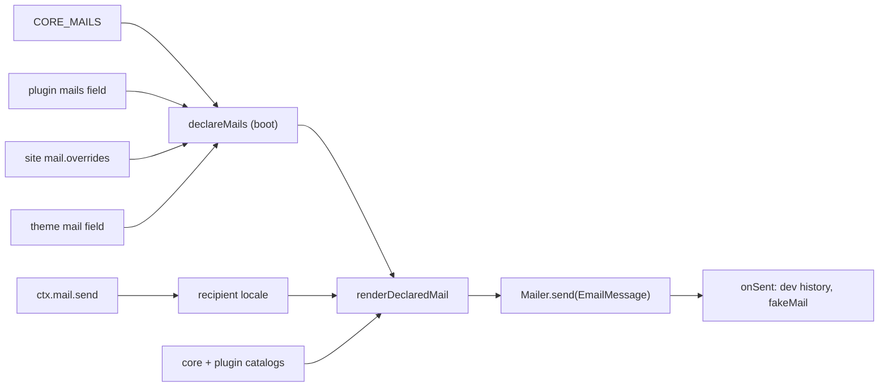

# Mail

Mail is how core and plugins send email. A mail is declared once, by name, with `defineMail`, typed through `MailRegistry`, and sent with `ctx.mail.send(name, props, { to })`. It renders in the recipient's locale and goes out through the site's `mailer` slot. Plugin authors declare mails in the descriptor's `mails` field. Site developers and theme authors override a mail's `subject`, `text` or `html` by name. Operators check the transport with `plumix mail test`. Test authors use `fakeMail` and `renderMail`. The code lives in `packages/core/src/mail/`, `packages/core/src/auth/mailer/`, `packages/core/src/dev/mail/` and `packages/plumix/src/cli/commands/mail.ts`.

## At a glance

Overrides are merged once at boot, one render function at a time. Precedence is site, then theme, then the declaring owner.

## Surface

| Piece                                                                                         | Kind                                | Where                                          | Public                                    |
| --------------------------------------------------------------------------------------------- | ----------------------------------- | ---------------------------------------------- | ----------------------------------------- |
| `defineMail<Props>(name, { subject, text, html?, preview })`                                  | declaration                         | `mail/contract/define.ts`                      | `plumix/plugin`                           |
| `MailRegistry`, `MailName`, `MailParts`, `MailOverride(s)`, `MailRenderContext`, `MailSender` | types                               | `mail/contract/registry.ts`                    | `plumix/plugin`                           |
| `MailerNotConfigured`, `MailError` (`mail_not_declared`)                                      | errors                              | `mail/contract/errors.ts`                      | `MailerNotConfigured` via `plumix/plugin` |
| descriptor `mails: [...]`                                                                     | plugin field                        | `mail/declared.ts` reads `plugin.mails`        | yes                                       |
| `mail: { overrides }`                                                                         | site config slot (`MailConfig`)     | `config.ts`                                    | yes                                       |
| theme `mail` field                                                                            | theme overrides                     | `config.theme.mail`                            | `plumix/theme`                            |
| `mailer`                                                                                      | config slot, `EnvInput<Mailer>`     | `config.ts`, `auth/mailer/resolve.ts`          | yes                                       |
| `Mailer`, `EmailMessage` (`to`, `subject`, `text`, `html?`)                                   | transport contract                  | `auth/contract/mailer.ts`                      | `plumix`                                  |
| `consoleMailer()`, `alwaysTo(to, transport)`                                                  | transports                          | `auth/mailer/`                                 | `plumix`                                  |
| `ctx.mail` / `ctx.mailer`                                                                     | context members                     | `context/app-context.ts`                       | yes                                       |
| `magicLink`, `emailChange`, `mailTest`                                                        | core mails                          | `mail/core-mails.ts`                           | names and props types public              |
| `commentAwaitingModeration`                                                                   | plugin mail                         | `packages/plugins/comments/src/server/mail.ts` | plugin's                                  |
| `plumix mail test <to> [--remote --url --token]`                                              | CLI command                         | `packages/plumix/src/cli/commands/mail.ts`     | yes                                       |
| `POST /_plumix/api/v1/system/mail/test`                                                       | REST route, needs `settings:manage` | `rest/system-mail.ts`                          | yes, when `api` is on                     |
| `/_plumix/debug/mail`, `/_plumix/debug/mail/sent`, debug bar `mail` panel                     | dev routes                          | `dev/mail/`                                    | dev only                                  |
| `fakeMail()`, `renderMail(name, props, options)`                                              | test kit                            | `test/mail-fake.ts`, `test/render-mail.ts`     | `plumix/test`                             |

## How it works

`buildApp` calls `declareMails` once, with core's mails, every plugin's `mails` and the site's and theme's overrides. The result is a `DeclaredMails` map from name to owner and merged definition. Each request's context gets a `MailSender` from `createMailSender`. `send` throws `MailerNotConfigured` when there is no mailer and `MailError.notDeclared` for an unknown name. It then picks the locale. A user recipient, or an address that belongs to a user, uses the stored `meta.locale` if the site enables it. Anything else uses the request's locale. `send` renders `subject`, `text` and `html` against the merged catalog, then calls `mailer.send`. `onSent` fires only after the transport accepts.

The render context carries `locale`, `siteName`, `baseUrl` and `t`. `siteName` is `auth.magicLink.siteName` or the origin's host (`mailSite`). `t` fills `{name}` placeholders only, so a plural takes one message per form (see `emailChangeExpiresOneHour` and `emailChangeExpiresHours`). Core's mail strings are hand-authored in `packages/core/locales/mail-*.po` for `en`, `de`, `uk`, `ar` and `zh-CN`. Core's `i18n:check` script verifies them with `plumix i18n verify --src src/mail`. See [i18n.md](i18n.md).

Under `plumix dev`, `devMail` either supplies `consoleMailer` when the site has no mailer or keeps the site's own. Every accepted mail goes to the debug bar's `mail` panel. Mail caught by the stand-in mailer also goes into the dev store. The gallery renders every declared mail from its `preview` props. See [dev-tooling.md](dev-tooling.md).

- `packages/core/src/mail/declared.ts`: `declareMails`, `applyOverrides`, boot errors `AppBootError.mailNameConflict` and `mailOverrideUndeclared`.
- `packages/core/src/mail/sender.ts`: `createMailSender`, `renderDeclaredMail`, `mailSite`, `recipientLocale`.
- `packages/core/src/mail/catalogs.ts`: `createMailCatalogs` puts plugin catalogs over core's, memoized per locale.
- `packages/core/src/mail/mail-test.ts`: `sendMailTest`, shared by the CLI's local path and the REST route.
- `packages/core/src/context/app.ts`: wires `resolveMailer`, `devMail`, `traceMailer` and `createMailSender` into `ctx.mailer` and `ctx.mail`.
- `packages/core/src/runtime/app.ts`: declares mails at boot and registers the dev mail routes under the `PLUMIX_DEV` gate.
- `packages/core/src/auth/magic-link/routes.ts` and `rpc/procedures/user/request-email-change.ts`: the core senders. Both refuse with a "not configured" error when `ctx.mailer` or `auth.magicLink` is missing.
- `packages/plumix/src/cli/commands/mail.ts`: `mailCommand`. Local sends run in the site; `--remote` posts to the REST route with a token from `resolveApiToken` (see [build-and-cli.md](build-and-cli.md), [rest-api.md](rest-api.md)).

## Invariants

- A mail name has one owner, and an override must name a declared mail. Both are checked at boot. [ADR 0036](../adr/0036-a-mail-is-declared-by-name.md); `packages/core/src/runtime/app-mail-validation.test.ts`.
- Override precedence is site, then theme, then owner, per render function. ADR 0036; `packages/core/src/mail/mail.test.ts`.
- The `Mailer` contract is only `send(EmailMessage)`. A transport never sees a mail's name or props. ADR 0036; `auth/contract/mailer.ts`.
- Every mail carries `preview` props, so the gallery and `renderMail` can render it with no send. `defineMail` requires `preview` in its type.
- A magic-link request returns the same response whether or not the send failed, so it does not reveal registered addresses. ADR 0036; `packages/core/src/auth/magic-link/request.test.ts`.
- `auth.magicLink` without a `mailer` fails config build with `magic_link_requires_mailer`. `packages/core/src/runtime/define-config.ts`; `packages/core/src/config.test.ts`.
- Dev catching and the gallery exist only under the `PLUMIX_DEV` gate. AGENTS.md "Env & secrets"; `packages/plumix/src/vite/dev-gate-tree-shaking.test.ts`; `packages/core/src/dev/mail/dev-mail.test.ts`.
- `alwaysTo` rejects a malformed address when the mailer resolves, with `always_to_invalid_address`. `packages/core/src/auth/mailer/always-to.test.ts`.

## Status

| Piece                                                 | State                   | Evidence                                                                              |
| ----------------------------------------------------- | ----------------------- | ------------------------------------------------------------------------------------- |
| Declared mails, registry, overrides, recipient locale | shipped                 | `mail/mail.test.ts`, `mail/core-mails.test.ts`, `runtime/app-mail-validation.test.ts` |
| Core mails `magicLink`, `emailChange`, `mailTest`     | shipped                 | `mail/core-mails.ts`; `auth/email-change/email-change.test.ts`                        |
| Plugin mail (comments moderation)                     | shipped                 | `plugins/comments/src/server/notify.ts`; `plugins/comments/e2e/magic-link.spec.ts`    |
| `consoleMailer`, `alwaysTo`                           | shipped                 | `auth/mailer/console.test.ts`, `auth/mailer/always-to.test.ts`                        |
| `plumix mail test` and `--remote`                     | shipped (#2842, closed) | `packages/plumix/src/cli/commands/mail.test.ts`, `rest/system-mail.test.ts`           |
| Dev catcher, gallery, Mail panel                      | shipped                 | `dev/mail/dev-mail.test.ts`; `plugins/comments/e2e/mail-gallery.spec.ts`              |
| `fakeMail`, `renderMail`                              | shipped                 | `test/mail-fake.test.ts`, `test/render-mail.test.ts`                                  |
| Provider transports                                   | not shipped             | no `Mailer` implementation beyond `consoleMailer` in `packages/`                      |

`gh issue list -R withplumix/plumix --search mail --state open` returns no mail-specific issue.

## Gaps

- No first-party provider transport ships. `apps/docs/src/content/docs/deployment/secrets.mdx` has the site hand-write a Resend `Mailer` with `fetch`, and `going-further/mail.mdx` uses `declare function resend(...)`.
- `EmailMessage` has no `from`, reply-to or headers. The sender address is the transport's concern alone. `alwaysTo` writes the original recipient into the body because there is no header to carry it.
- The comments plugin's `catch (MailerNotConfigured)` cannot run. `notifyModeratorOfPending` returns early on `!ctx.mailer`. `context/app.ts` passes the same `tracedMailer` to both `ctx.mailer` and `createMailSender`, so `send` never throws `MailerNotConfigured` once that guard passes. ADR 0036 describes the catch as the way comments handle it.
- `ctx.mailer` is still public on `AppContext`. A plugin can call `ctx.mailer.send` directly and skip the name, the overrides and the recipient's locale. Nothing in core or lint stops this.
- Core's mail catalogs cover five locales (`catalogs.ts`). A site locale outside them falls back to each descriptor's English `message` for core's mails.
- Nothing rate-limits `POST /_plumix/api/v1/system/mail/test`. The docs page sends operators to an edge rule instead (`going-further/mail.mdx`, "Testing the mailer").
