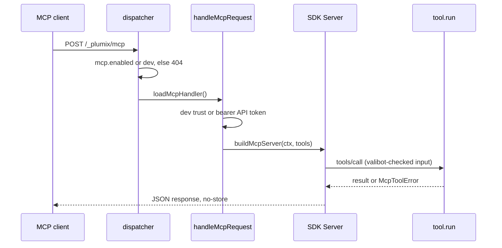

# MCP

Plumix serves a Model Context Protocol endpoint at `/_plumix/mcp`. An MCP client, usually a coding agent, uses it to call tools that read the site. Core contributes content and schema tools, plus dev-only telemetry and error tools. Plugins add tools with `ctx.registerMcpTool`. Site developers turn the endpoint on with the `mcp` config slot. `plumix dev` turns it on automatically for a loopback agent. Plugin authors write `McpTool` values. The code lives in `packages/core/src/mcp/`, with the tool contract in `packages/core/src/context/mcp-tool.ts` and the mount in `packages/core/src/runtime/dispatcher.ts`.

## At a glance

## Surface

| Piece                                                          | Kind                                                         | Where                                                   | Public          |
| -------------------------------------------------------------- | ------------------------------------------------------------ | ------------------------------------------------------- | --------------- |
| `/_plumix/mcp`                                                 | route, POST only, Streamable HTTP, stateless, JSON responses | `runtime/dispatcher.ts` (`MCP_PATH`), `mcp/dispatch.ts` | yes             |
| `mcp: { enabled: true }`                                       | config slot (`InterfaceToggle`), default off                 | `config.ts`                                             | yes             |
| `ctx.registerMcpTool(tool)`                                    | plugin setup registration                                    | `plugin/setup-context.ts`                               | `plumix/plugin` |
| `McpTool { name, description, inputSchema, jsonSchema?, run }` | contract                                                     | `context/mcp-tool.ts`                                   | `plumix/plugin` |
| `McpToolError` (`not_found`, `forbidden`, `bad_input`)         | error a tool throws                                          | `mcp/errors.ts`                                         | `plumix/plugin` |
| `RegisteredMcpTool`                                            | registry entry type                                          | `plugin/registry.ts`                                    | `plumix/plugin` |

Tools served today, all read-only:

| Tool                                                                                       | Owner                                            | When                                                          |
| ------------------------------------------------------------------------------------------ | ------------------------------------------------ | ------------------------------------------------------------- |
| `schema_describe`, `content_list`, `content_get`, `term_list`, `term_get`, `taxonomy_list` | core (`coreMcpTools`)                            | always                                                        |
| `telemetry_requests_list`, `telemetry_request_get`                                         | core `mcp/telemetry-tools.ts`                    | `PLUMIX_DEV` only                                             |
| `error_list`                                                                               | core `mcp/error-tools.ts`                        | `PLUMIX_DEV` only                                             |
| `media_list`, `media_get`                                                                  | `packages/plugins/media/src/mcp-tools.ts`        | plugin installed                                              |
| `form_list`, `form_describe`, `form_submission_list`                                       | `packages/plugins/forms/src/server/mcp-tools.ts` | plugin installed; submissions need `form_submission:moderate` |

The endpoint has no stdio transport, no resources, no prompts and no SSE (`GET` answers 405).

## How it works

The dispatcher checks `/_plumix/mcp` in `tryColdInterfaces`, before the CSRF gate. A bearer token cannot be forged cross-site, so the CSRF check does not apply. `dispatchMcp` returns 404 `mcp-disabled` unless `mcp.enabled` is true or the app runs under `plumix dev`. That check runs before `loadMcpHandler` imports anything, so the SDK stays off the cold start of public renders.

`handleMcpRequest` then resolves trust with `resolveMcpDevTrust`:

- In a production build it is always `"token"`, because `process.env.PLUMIX_DEV` folds to `""`.
- Under dev, a cross-site `Origin` is `"rejected"` (403 `mcp_cross_origin`). A loopback host is `"trusted"`. Any other host is `"token"`.
- `"trusted"` passes the dispatcher's context through as it is. No authenticator has run on it, so the context is anonymous (the `McpDevTrust` docstring).
- `"token"` runs `authenticateBearer`, which accepts only an API token (`apiTokenAuthenticator`). A session cookie gets 401.

Each request builds a fresh registry with `buildMcpToolRegistry` and a fresh SDK `Server` with `buildMcpServer`. It then connects a `WebStandardStreamableHTTPServerTransport` with `sessionIdGenerator: undefined` and `enableJsonResponse: true`. `tools/list` projects each tool's valibot schema to JSON Schema (`toToolInputJsonSchema`). `tool.jsonSchema` replaces that projection when it is set. `tools/call` runs inside one `mcp: <name>` telemetry span. An unknown tool or a bad input becomes a JSON-RPC error. An `McpToolError` becomes an `isError` tool result. Anything else propagates.

Tools read through the same read services as RPC and REST (`entries/read-service.ts` for `content_*`). `ctx.auth.can` intersects the token's scopes with the user's role, so a tool sees only what that principal may read. See [auth-and-access.md](auth-and-access.md).

- `packages/core/src/mcp/dispatch.ts`: `handleMcpRequest`.
- `packages/core/src/mcp/dev-trust.ts`: `resolveMcpDevTrust`.
- `packages/core/src/mcp/server.ts`: `buildMcpServer`, `SERVER_INFO`.
- `packages/core/src/mcp/registry.ts`: `coreMcpTools`, `CORE_MCP_TOOL_NAMES`, `buildMcpToolRegistry`.
- `packages/core/src/plugin/setup-context.ts`: `registerMcpTool` throws on a name clash, with core's names claimed up front.
- `packages/core/src/auth/bearer.ts`: `authenticateBearer`, `hasBearerToken`.

## Invariants

- Production MCP needs an API token. Dev trust is statically off in a build. `packages/core/src/mcp/dispatch.test.ts` ("production (dev trust off) still requires a token over loopback"); `packages/plumix/src/vite/dev-gate-tree-shaking.test.ts`.
- MCP authenticates by bearer token only, never by session cookie. `dispatch.test.ts` ("a session-cookie request is rejected").
- The endpoint is off unless configured, and the handler graph is not imported when it is off. `runtime/dispatcher.ts` `dispatchMcp`; `dispatch.test.ts` ("dev auto-enables the endpoint with no config flag").
- No tool drops tables or runs migrations. `dispatch.test.ts` ("no tool drops tables or migrates").
- Telemetry and error tools are absent outside dev. `dispatch.test.ts` ("without the dev gate the tracing and error tools are not registered").
- A tool name has one owner, and a plugin cannot take a core name. `registerMcpTool` in `plugin/setup-context.ts`.
- Every MCP response is `no-store`. `dispatch.test.ts` ("freshness" block).
- `mcp/` sits in core's `surfaces` layer. [ADR 0010](../adr/0010-core-is-one-package-of-enforced-layers.md); `packages/core/src/layers.test.ts`.
- Dev trust follows the dev layers, not a config flag. [ADR 0003](../adr/0003-dev-config-mirrors-the-dev-layers.md).

## Status

| Piece                               | State     | Evidence                                                                                              |
| ----------------------------------- | --------- | ----------------------------------------------------------------------------------------------------- |
| Endpoint, token auth, dev trust     | shipped   | `packages/core/src/mcp/dispatch.test.ts`                                                              |
| Core content, term and schema tools | shipped   | `dispatch.test.ts`; `mcp/schema-projection.test.ts`                                                   |
| Dev telemetry and error tools       | shipped   | `dispatch.test.ts` (telemetry and `error_list` blocks)                                                |
| Plugin tools (media, forms)         | shipped   | `packages/plugins/media/src/mcp-tools.test.ts`, `packages/plugins/forms/src/server/mcp-tools.test.ts` |
| Write tools                         | not built | every tool is a read; none exists to write                                                            |
| End-to-end coverage                 | none      | no `*.spec.ts` in the repo mentions MCP                                                               |

`gh issue list -R withplumix/plumix --search mcp --state open` returns no MCP issue.

## Gaps

- [ADR 0048](../adr/0048-core-guards-every-edit-with-a-required-token-and-an-enforced-lease.md) plans for "MCP agents" as writers and says "RPC and MCP take `ifMatch` as a required field". No MCP tool writes, so that part of the ADR describes nothing that exists.
- `buildMcpServer` sets `annotations: { readOnlyHint: true }` on every tool, plugin tools included. `McpTool` has no field to declare a write, so a plugin write tool would be advertised as read-only.
- `SERVER_INFO` hard-codes `version: "0.1.0"`. It does not follow the package version.
- `buildMcpServer` uses the SDK's deprecated `Server` class behind two `@typescript-eslint/no-deprecated` disables.
- Tokenless dev calls run anonymous. So `content_list` under `plumix dev` returns only what an anonymous visitor may read, while its description says results are "clamped to what your token may read". The dev-trust tests in `dispatch.test.ts` call only `tools/list`.
- The user docs have no MCP page. `apps/docs/src/content/docs/getting-started/configuration.mdx` (`### mcp`) and `going-further/dev-server.mdx` cover enabling it. No page shows how to connect a client, which tools exist, or how to write one with `registerMcpTool`.
- No e2e suite drives `/_plumix/mcp` through a real runtime. Coverage is unit-tier only.
