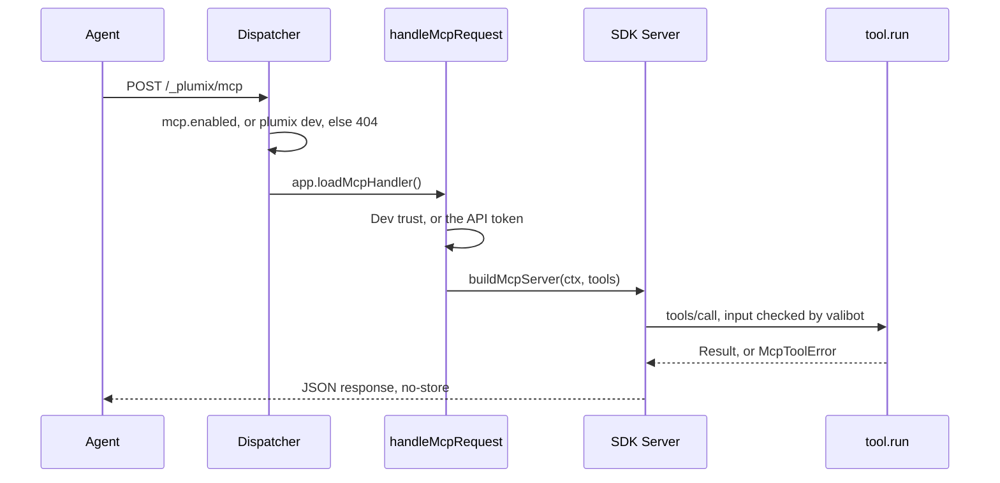

# MCP

Plumix serves a Model Context Protocol endpoint at `/_plumix/mcp`. An agent, such as a coding agent, connects with an API token and calls tools. Core contributes content and schema tools, plus dev-only telemetry and error tools, and plugins add tools with `ctx.registerMcpTool`. An agent also writes, composes and publishes through MCP, held to the same rules as an editor in the admin. Site developers turn the endpoint on with the `mcp` config slot, and `plumix dev` turns it on for an agent on the same machine. Plugin authors write `McpTool` values. MCP is part of the **RPC, REST and MCP** component in [ARCHITECTURE.md](../../ARCHITECTURE.md#components-of-the-app-process). The code lives in `packages/core/src/mcp/`, with the tool contract in `packages/core/src/context/mcp-tool.ts` and the mount in `packages/core/src/runtime/dispatcher.ts`.

## At a glance

A write tool goes further: it checks the token's capabilities, the edit lease and the concurrency token, then writes through the admin's own procedure. [ARCHITECTURE.md](../../ARCHITECTURE.md#behaviour) draws that flow as "an agent publishes a page".

## Surface

| Piece                                                          | Kind                                                         | Where                                                   | Public          |
| -------------------------------------------------------------- | ------------------------------------------------------------ | ------------------------------------------------------- | --------------- |
| `/_plumix/mcp`                                                 | route, POST only, Streamable HTTP, stateless, JSON responses | `runtime/dispatcher.ts` (`MCP_PATH`), `mcp/dispatch.ts` | yes             |
| `mcp: { enabled: true }`                                       | config slot (`InterfaceToggle`), default off                 | `config.ts`                                             | yes             |
| `ctx.registerMcpTool(tool)`                                    | plugin setup registration                                    | `plugin/setup-context.ts`                               | `plumix/plugin` |
| `McpTool { name, description, inputSchema, jsonSchema?, run }` | contract                                                     | `context/mcp-tool.ts`                                   | `plumix/plugin` |
| `McpToolError` (`not_found`, `forbidden`, `bad_input`)         | error a tool throws                                          | `mcp/errors.ts`                                         | `plumix/plugin` |
| `RegisteredMcpTool`                                            | registry entry type                                          | `plugin/registry.ts`                                    | `plumix/plugin` |

Tools served:

| Tool                                                                                       | Owner                                            | When                                                          |
| ------------------------------------------------------------------------------------------ | ------------------------------------------------ | ------------------------------------------------------------- |
| `schema_describe`, `content_list`, `content_get`, `term_list`, `term_get`, `taxonomy_list` | core (`coreMcpTools`)                            | always                                                        |
| `telemetry_requests_list`, `telemetry_request_get`                                         | core `mcp/telemetry-tools.ts`                    | `PLUMIX_DEV` only                                             |
| `error_list`                                                                               | core `mcp/error-tools.ts`                        | `PLUMIX_DEV` only                                             |
| `media_list`, `media_get`                                                                  | `packages/plugins/media/src/mcp-tools.ts`        | plugin installed                                              |
| `form_list`, `form_describe`, `form_submission_list`                                       | `packages/plugins/forms/src/server/mcp-tools.ts` | plugin installed; submissions need `form_submission:moderate` |
| Write tools: create, update and publish entries, compose pages                             | core                                             | the token holds the capability                                |

The endpoint has no stdio transport, no resources, no prompts and no SSE (`GET` answers 405).

## How it works

The dispatcher checks `/_plumix/mcp` in `tryColdInterfaces`, before the CSRF gate: an API token cannot be forged cross-site, so the CSRF check does not apply. `dispatchMcp` returns 404 `mcp-disabled` unless `mcp.enabled` is true or the app runs under `plumix dev`. That check runs before `app.loadMcpHandler` imports anything, so the SDK stays off the cold start of public renders. `withNoStore` marks every answer `no-store`.

`handleMcpRequest` then resolves trust with `resolveMcpDevTrust`:

- In a production build it is always `"token"`, because `process.env.PLUMIX_DEV` folds to `""`.
- Under dev, a cross-site `Origin` is `"rejected"` (403 `mcp_cross_origin`). A loopback host is `"trusted"`. Any other host is `"token"`.
- `"trusted"` passes the dispatcher's context through as it is. No authenticator has run on it, so the principal is anonymous and tools see only what an anonymous visitor may read.
- `"token"` runs `authenticateBearer`, which accepts only an API token (`apiTokenAuthenticator`). A session cookie gets 401.

Each request builds a fresh tool map with `buildMcpToolRegistry` and a fresh SDK `Server` with `buildMcpServer`. It connects a `WebStandardStreamableHTTPServerTransport` with `sessionIdGenerator: undefined` and `enableJsonResponse: true`. `tools/list` projects each tool's valibot schema to JSON Schema (`toToolInputJsonSchema`); `tool.jsonSchema` replaces that projection when set. A tool says whether it writes, and every read tool is listed with `annotations: { readOnlyHint: true }`. `tools/call` runs inside one `mcp: <name>` telemetry span. An unknown tool or a bad input becomes a JSON-RPC error, an `McpToolError` becomes an `isError` tool result, and anything else propagates.

Tools read through the same read services as RPC and REST (`getEntry` and `listEntries` in `entries/read-service.ts` for `content_*`). `ctx.auth.can` intersects the token's scopes with the capabilities its owner's role grants, whether that role is a default or one the site defines, so a tool sees only what that principal may read. See [auth and access](auth-and-access.md).

**Writes.** A write tool is a thin adapter over the procedures the admin calls (`entry.create`, `entry.update`, `entry.publish`, `entry.lease.*`; for example `rpc/procedures/entry/update.ts`), so it inherits the whole write lifecycle described in [RPC and editing](rpc-and-editing.md). The agent's token must hold the capability. The tool takes `ifMatch` as a required field and holds an edit lease with surface `mcp` (`EDIT_LEASE_SURFACES` in `db/schema/edit_leases.ts`), so a write over someone else's live lease is `LOCKED`, which an agent never takes over, and a write from a stale copy is `CONFLICT` ([ADR 0048](../adr/0048-core-guards-every-edit-with-a-required-token-and-an-enforced-lease.md)). Content passes the allowed blocks and style policy in `assertContentValidAgainstRegistries` (`rpc/procedures/entry/content.ts`), so an agent cannot add a new instance of a block outside the theme's `allowedBlocks`, and with design tokens only it cannot store a new literal style value. Every change is captured as a revision that names the agent and the person whose token it used, and the hooks and purges fire as for an editor's save. What an agent may do is what its token may do; a person steers it by choosing that token.

The in-editor agent is not served over MCP. It is an RPC procedure behind an `llm` config slot; see [RPC and editing](rpc-and-editing.md).

- `packages/core/src/mcp/dispatch.ts`: `handleMcpRequest`.
- `packages/core/src/mcp/dev-trust.ts`: `resolveMcpDevTrust`.
- `packages/core/src/mcp/server.ts`: `buildMcpServer`, `SERVER_INFO`.
- `packages/core/src/mcp/registry.ts`: `coreMcpTools`, `CORE_MCP_TOOL_NAMES`, `buildMcpToolRegistry`.
- `packages/core/src/plugin/setup-context.ts`: `registerMcpTool` throws on a name clash, with core's names claimed up front.
- `packages/core/src/auth/bearer.ts`: `authenticateBearer`, `hasBearerToken`.

## Invariants

- Production MCP needs an API token. Dev trust is statically off in a build. `packages/core/src/mcp/dispatch.test.ts` ("production (dev trust off) still requires a token over loopback"); `packages/plumix/src/vite/dev-gate-tree-shaking.test.ts`.
- MCP authenticates by API token only, never by session cookie. `dispatch.test.ts` ("a session-cookie request is rejected").
- The endpoint is off unless configured, and the handler graph is not imported when it is off. `dispatchMcp` in `runtime/dispatcher.ts`; `dispatch.test.ts` ("dev auto-enables the endpoint with no config flag").
- No tool drops tables or runs migrations. `dispatch.test.ts` ("no tool drops tables or migrates").
- Telemetry and error tools are absent outside dev. `dispatch.test.ts` ("without the dev gate the tracing and error tools are not registered").
- A tool name has one owner, and a plugin cannot take a core name. `registerMcpTool` in `plugin/setup-context.ts`.
- Every MCP response is `no-store`. `dispatch.test.ts` ("freshness" block).
- `mcp/` sits in core's `surfaces` layer. [ADR 0010](../adr/0010-core-is-one-package-of-enforced-layers.md); `packages/core/src/layers.test.ts`.
- Dev trust follows the dev layers, not a config flag. [ADR 0003](../adr/0003-dev-config-mirrors-the-dev-layers.md).
