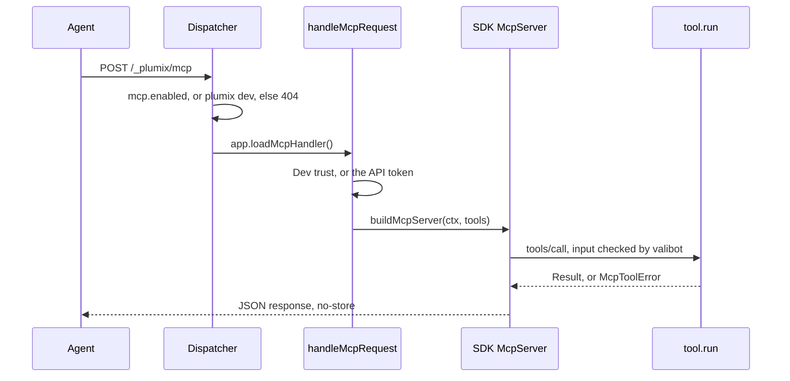

# MCP

Plumix serves a Model Context Protocol endpoint at `/_plumix/mcp`. An agent, such as a coding agent, connects with an API token and calls tools. Core contributes content and schema tools, plus dev-only telemetry and error tools, and plugins add tools with `ctx.registerMcpTool`. An agent also writes, composes and publishes through MCP, held to the same rules as an editor in the admin. Site developers turn the endpoint on with the `mcp` config slot, and `plumix dev` turns it on for an agent on the same machine. Plugin authors write `McpTool` values. MCP is part of the **RPC, REST and MCP** component in [ARCHITECTURE.md](../../ARCHITECTURE.md#components-of-the-app-process). The code lives in `packages/core/src/mcp/`, with the tool contract in `packages/core/src/context/mcp-tool.ts` and the mount in `packages/core/src/runtime/dispatcher.ts`.

## At a glance

A write tool goes further: it checks the token's capabilities, the edit lease and the concurrency token, then writes through the admin's own procedure. [ARCHITECTURE.md](../../ARCHITECTURE.md#behaviour) draws that flow as "an agent publishes a page".

## Surface

| Piece                                                                                           | Kind                                                         | Where                                                   | Public          |
| ----------------------------------------------------------------------------------------------- | ------------------------------------------------------------ | ------------------------------------------------------- | --------------- |
| `/_plumix/mcp`                                                                                  | route, POST only, Streamable HTTP, stateless, JSON responses | `runtime/dispatcher.ts` (`MCP_PATH`), `mcp/dispatch.ts` | yes             |
| `/.well-known/oauth-protected-resource[/<basePath>/_plumix/mcp]`                                | route, RFC 9728 protected-resource metadata                  | `runtime/dispatcher.ts`, `mcp/resource-metadata.ts`     | yes             |
| `mcp: { enabled: true }`                                                                        | config slot (`InterfaceToggle`), default off                 | `config.ts`                                             | yes             |
| `ctx.registerMcpTool(tool)`                                                                     | plugin setup registration                                    | `plugin/setup-context.ts`                               | `plumix/plugin` |
| `McpTool { name, description, inputSchema, jsonSchema?, annotations?, capability?, run }`       | contract                                                     | `context/mcp-tool.ts`                                   | `plumix/plugin` |
| `McpToolError` (`not_found`, `forbidden`, `bad_input`, `conflict`, `locked`, `invalid_content`) | error a tool throws                                          | `mcp/errors.ts`                                         | `plumix/plugin` |
| `RegisteredMcpTool`                                                                             | registry entry type                                          | `plugin/registry.ts`                                    | `plumix/plugin` |

Tools served:

| Tool                                                                                                                                                                                                       | Owner                                                                                  | When                                                          |
| ---------------------------------------------------------------------------------------------------------------------------------------------------------------------------------------------------------- | -------------------------------------------------------------------------------------- | ------------------------------------------------------------- |
| `schema_describe`, `content_list`, `content_get`, X core (`coreMcpTools`)                                                                                                                                  | always                                                                                 |
| `telemetry_requests_list`, `telemetry_request_get`                                                                                                                                                         | core `mcp/telemetry-tools.ts`                                                          | `PLUMIX_DEV` only                                             |
| `error_list`                                                                                                                                                                                               | core `mcp/error-tools.ts`                                                              | `PLUMIX_DEV` only                                             |
| `media_list`, `media_get`                                                                                                                                                                                  | `packages/plugins/media/src/mcp-tools.ts`                                              | plugin installed                                              |
| `form_list`, `form_describe`, `form_submission_list`                                                                                                                                                       | `packages/plugins/forms/src/server/mcp-tools.ts`                                       | plugin installed; submissions need `form_submission:moderate` |
| `content_create`, `content_update`, `content_publish`, `content_discard_draft`, `content_duplicate`, `content_trash`, `content_restore`, `revision_list`, `revision_restore`, `term_create`, `term_update` | core `mcp/*-write-tools.ts`, `mcp/content-lifecycle-tools.ts`, `mcp/revision-tools.ts` | the token holds the capability                                |

The endpoint has no stdio transport, no resources, no prompts and no SSE (`GET` answers 405).

## How it works

The dispatcher checks `/_plumix/mcp` in `tryColdInterfaces`, before the CSRF gate: an API token cannot be forged cross-site, so the CSRF check does not apply. `dispatchMcp` returns 404 `mcp-disabled` unless `mcp.enabled` is true or the app runs under `plumix dev`. That check runs before `app.loadMcpHandler` imports anything, so the SDK stays off the cold start of public renders. `withNoStore` marks every answer `no-store`.

`handleMcpRequest` then resolves trust with `resolveMcpDevTrust`:

- In a production build it is always `"token"`, because `process.env.PLUMIX_DEV` folds to `""`.
- Under dev, a cross-site `Origin` is `"rejected"` (403 `mcp_cross_origin`). A loopback host is `"trusted"`. Any other host is `"token"`.
- `"trusted"` passes the dispatcher's context through as it is. No authenticator has run on it, so the principal is anonymous and tools see only what an anonymous visitor may read.
- `"token"` runs `authenticateBearer` with the endpoint's own URL (`basePath` included) as the audience, which accepts only an API token: one with no audience, or one bound to that URL. A token bound to another URL, or a session cookie, gets 401.

**Discovery and challenges.** An OAuth client given only the site's URL finds out how to authorize from RFC 9728 protected-resource metadata. The dispatcher answers it at the path-specific well-known URI (`/.well-known/oauth-protected-resource` followed by the MCP path, `basePath` included) and at the bare root URI. It matches both on the raw path, before `basePath` is stripped, and 404s them when the endpoint is off. The document names the MCP URL as `resource`, the request origin plus `basePath` as the one authorization server, and `read`, `draft` and `full` as `scopes_supported`. Both URLs come from the request URL the runtime adapter rebuilt from the forwarded scheme and host, so a TLS-terminating proxy can't make them `http`. The 401 is the SDK's `bearerAuthChallengeResponse`: `WWW-Authenticate: Bearer` with `resource_metadata` and `scope="read draft full"`. It asks for every scope because consent offers what was asked for and lets the person narrow it. A tool that sets `capability` gets the SDK's per-tool `scopeChallenge`. When the token's capabilities don't cover it, the call is refused with 403 `insufficient_scope` before the tool runs, naming the narrowest scope whose preset holds the capability (`narrowestPresetHolding` in `auth/token-presets.ts`). Dev trust passes no token, so no challenge applies there, and `run` still checks whatever depends on the input.

Each request builds a fresh tool map with `buildMcpToolRegistry`, and `buildMcpServer` registers each tool on a fresh `McpServer` from `@modelcontextprotocol/server` (SDK v2), with core's package version as its server info. A request on spec 2026-07-28 goes to the SDK's `createMcpHandler`, which answers in JSON while no tool sends a message before its result. Any older request goes to a `WebStandardStreamableHTTPServerTransport` with `sessionIdGenerator: undefined` and `enableJsonResponse: true`, because the SDK's own legacy serving answers over SSE. `tools/list` projects each tool's valibot schema to JSON Schema (`toToolInputJsonSchema`); `tool.jsonSchema` replaces that projection when set. A tool lists its `annotations` (`readOnlyHint`, `destructiveHint`, `idempotentHint`) as given, or `{ readOnlyHint: true }` when it sets none. They are hints for the client, and nothing authorizes on them. The SDK checks the input with the tool's valibot schema, and a bad input becomes an `isError` result whose text carries `bad_input`. `tools/call` then runs the tool inside one `mcp: <name>` telemetry span. An `McpToolError` becomes an `isError` result with its code in the text and in `_meta.code`, and the SDK turns any other error into an `isError` result with only its message. An unknown tool is a JSON-RPC error.

Tools read through the same read services as RPC and REST (`getEntry` and `listEntries` in `entries/read-service.ts` for `content_*`). `ctx.auth.can` intersects the token's scopes with the capabilities its owner's role grants, whether that role is a default or one the site defines, so a tool sees only what that principal may read. See [auth and access](auth-and-access.md).

**Writes.** A write tool is a thin adapter over the procedures the admin calls (`entry.create`, `entry.update`, `entry.publish`, `entry.lease.*`; for example `rpc/procedures/entry/update.ts`), so it inherits the whole write lifecycle described in [RPC and editing](rpc-and-editing.md). The agent's token must hold the capability. The tool takes `ifMatch` as a required field and holds an edit lease with surface `mcp` (`EDIT_LEASE_SURFACES` in `db/schema/edit_leases.ts`), so a write over someone else's live lease is `LOCKED`, which an agent never takes over, and a write from a stale copy is `CONFLICT` ([ADR 0048](../adr/0048-core-guards-every-edit-with-a-required-token-and-an-enforced-lease.md)). Content passes the allowed blocks and style policy in `assertContentValidAgainstRegistries` (`rpc/procedures/entry/content.ts`), so an agent cannot add a new instance of a block outside the theme's `allowedBlocks`, and with design tokens only it cannot store a new literal style value. Every change is captured as a revision that names the agent and the person whose token it used, and the hooks and purges fire as for an editor's save. What an agent may do is what its token may do; a person steers it by choosing that token.
Every write tool calls the procedures the admin calls (`entry.create`, `entry.update`, `entry.publish`, `entry.discardDraft`, `entry.duplicate`, `entry.trash`, `entry.restore`, `entry.revisions.restore`, `term.create`, `term.update`) through `mcpRouterClient` (`packages/core/src/mcp/router-client.ts`), an in-process oRPC client on the request's principal and token scopes whose leases record surface `mcp`. Capabilities, `ifMatch`, leases, revisions and block validation stay in the procedures. A tool whose procedure checks a lease (`content_update`, `content_publish`, `revision_restore`, `term_update`) takes it for the call through `holdingLease` and lapses it with `lapseEditLease` before returning, never accepts `takeOver`, and no lease tool is exposed. `content_publish` publishes a pending draft of a published entry through `entry.publish`, and sets any other entry `published` through `entry.update`. `content_trash` is the only destructive tool, and no tool deletes permanently. A tool that takes no content (`content_duplicate`, `revision_restore`) answers `invalid_content` with the failing paths and tells the agent to report it and stop. `term_create` and `term_update` return `{ id, etag }`, since a term has no status. A procedure's refusal becomes `conflict` (with the current etag), `locked` (with the holder's name) or `invalid_content` (with the failing node paths), each with the next tool to call.

The in-editor agent is not served over MCP. It is an RPC procedure behind an `llm` config slot; see [RPC and editing](rpc-and-editing.md).

- `packages/core/src/mcp/dispatch.ts`: `handleMcpRequest`.
- `packages/core/src/mcp/dev-trust.ts`: `resolveMcpDevTrust`.
- `packages/core/src/mcp/resource-metadata.ts`: `handleProtectedResourceMetadata`, `unauthorizedChallenge`, `capabilityChallenge`.
- `packages/core/src/mcp/server.ts`: `buildMcpServer`, `SERVER_INFO`.
- `packages/core/src/mcp/registry.ts`: `coreMcpTools`, `CORE_MCP_TOOL_NAMES`, `buildMcpToolRegistry`.
- `packages/core/src/plugin/setup-context.ts`: `registerMcpTool` throws on a name clash, with core's names claimed up front.
- `packages/core/src/auth/bearer.ts`: `authenticateBearer`, `hasBearerToken`.

## Invariants

- Production MCP needs an API token. Dev trust is statically off in a build. `packages/core/src/mcp/dispatch.test.ts` ("production (dev trust off) still requires a token over loopback"); `packages/plumix/src/vite/dev-gate-tree-shaking.test.ts`.
- A 401 points at the protected-resource metadata, which is served with and without a `basePath`. `dispatch.test.ts` ("protected-resource metadata", "authorization challenges").
- A token whose capabilities don't cover a tool's `capability` gets 403 `insufficient_scope` before the tool runs. `dispatch.test.ts` ("authorization challenges").
- MCP authenticates by API token only, never by session cookie. `dispatch.test.ts` ("a session-cookie request is rejected").
- MCP accepts an audience-bound token only when its audience is the endpoint's URL. `dispatch.test.ts` ("audience-bound tokens").
- The endpoint is off unless configured, and the handler graph is not imported when it is off. `dispatchMcp` in `runtime/dispatcher.ts`; `dispatch.test.ts` ("dev auto-enables the endpoint with no config flag").
- No tool drops tables or runs migrations. `dispatch.test.ts` ("no tool drops tables or migrates").
- Telemetry and error tools are absent outside dev. `dispatch.test.ts` ("without the dev gate the tracing and error tools are not registered").
- A tool name has one owner, and a plugin cannot take a core name. `registerMcpTool` in `plugin/setup-context.ts`.
- Every MCP response is `no-store`. `dispatch.test.ts` ("freshness" block).
- `mcp/` sits in core's `surfaces` layer. [ADR 0010](../adr/0010-core-is-one-package-of-enforced-layers.md); `packages/core/src/layers.test.ts`.
- Dev trust follows the dev layers, not a config flag. [ADR 0003](../adr/0003-dev-config-mirrors-the-dev-layers.md).
- An MCP write holds no lease once the call returns, and `takeOver` is never accepted. `packages/core/src/mcp/content-write.dispatch.test.ts` ("a write leaves no lease held", "takeOver is not accepted").
- No MCP tool deletes an entry or a term for good. `packages/core/src/mcp/lifecycle.dispatch.test.ts` ("no tool deletes an entry or a term for good").
- Only `content_trash` is listed destructive. `lifecycle.dispatch.test.ts` ("MCP tools/list hints").
- An MCP write takes its lease on surface `mcp`. `packages/core/src/mcp/router-client.test.ts`.
