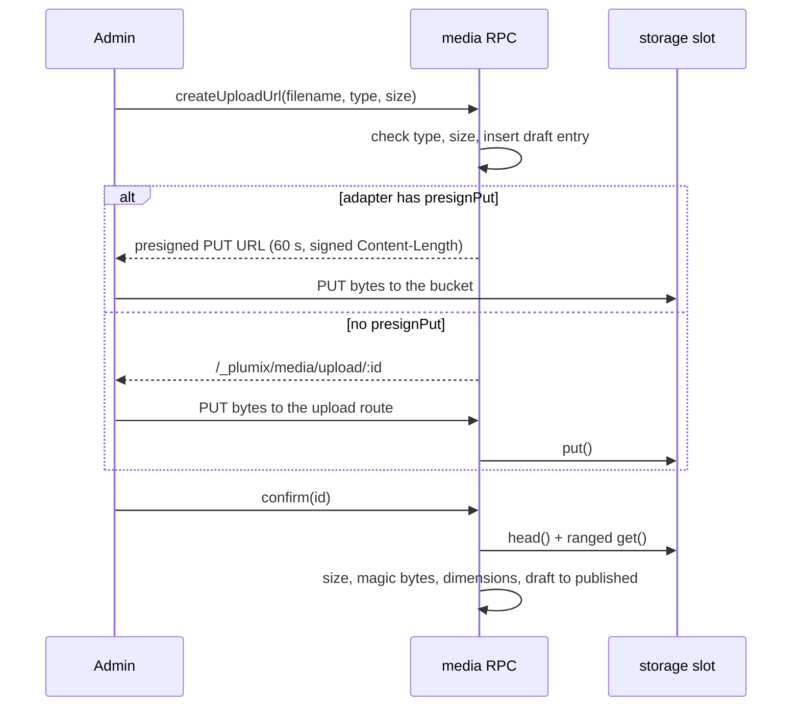
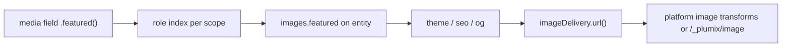

# Media and storage

Object storage and image delivery are two infrastructure slots, `storage` and `imageDelivery`, that a site developer fills with a runtime's adapter. Core defines their contracts and ships a portable `s3()` adapter for any S3-compatible storage; each runtime package ships its own backends. `@plumix/plugin-media` builds the media library on top: uploads, the admin Media Library page, the `media` field builders and the serve route. Image roles let a theme or plugin ask for "the entry's featured image" instead of a meta key. In ARCHITECTURE.md's component diagram the slots are part of Config slots, which talk to the Object storage container, and the media library is one of the Plugins. Contracts live in `packages/core/src/runtime/contract/slots.ts`, the media plugin in `packages/plugins/media`, backends in `packages/runtimes/`.

## At a glance

## Surface

| Item                                                                                                                        | Where                                                                    | Public            |
| --------------------------------------------------------------------------------------------------------------------------- | ------------------------------------------------------------------------ | ----------------- |
| `storage?: ObjectStorage` config slot, `ctx.storage` (`ConnectedObjectStorage`)                                             | `packages/core/src/config.ts`, `context/app-context.ts`                  | yes               |
| `imageDelivery?: ImageDelivery` config slot, `ctx.imageDelivery`                                                            | same                                                                     | yes               |
| `ConnectedObjectStorage`: `put`, `get` (ranged), `head`, `delete`, `list`, `url` (null when private), optional `presignPut` | `runtime/contract/slots.ts`                                              | yes (`plumix`)    |
| `ImageDelivery`: `url`, optional `purge`, `connect`, `acceptsRelativeSources`                                               | same                                                                     | yes               |
| `s3()`, `presignPutUrl`, `signRequest`, `SigV4Error`, `S3Error`                                                             | `plumix/storage/s3` (own subpath, keeps the signer out of other bundles) | yes               |
| `serveRenderedAsset`                                                                                                        | `plumix/plugin`                                                          | yes               |
| `imageTransformUrl`, `parseImageParams`, `negotiateImageFormat`, `IMAGE_ROUTE`                                              | `plumix/runtime` (`runtime/image-rules.ts`)                              | yes, for adapters |
| `Image`, `buildImageAttrs`, `useImageConfig`, `RemotePattern`                                                               | `plumix/blocks/renderer`                                                 | yes               |
| `registerImageRole`, `ImageRoles` (declaration merging), built-ins `featured`, `ogImage`                                    | setup context, `images/contract/role-images.ts`                          | yes               |
| `describeObjectStorageContract`, `fakeS3`                                                                                   | `plumix/test/conformance`                                                | yes, for adapters |

Backends per runtime:

| Runtime    | `storage`                                                                     | `imageDelivery`                                                                         |
| ---------- | ----------------------------------------------------------------------------- | --------------------------------------------------------------------------------------- |
| Cloudflare | `r2({ binding, publicUrlBase?, s3? })`; `presignPut` only with S3 credentials | `images({ zone? })`: Image Transformations under `/cdn-cgi/image/`, no `purge`          |
| Node       | `diskStorage({ dir })`, no presign, `url()` null                              | `images()`: `sharp`, `/_plumix/image`, disk variant cache capped by `cacheSize` (1 GiB) |
| Bun        | `diskStorage({ dir })`, `bunS3()` (presigns via core's signer)                | `images()`: `Bun.Image`, `/_plumix/image`, uncapped variant cache                       |

Media plugin (`media({ acceptedTypes?, maxUploadSize? })`, default 25 MiB, SVG opt-in):

| Kind            | Name                                                                                                 |
| --------------- | ---------------------------------------------------------------------------------------------------- |
| Entry type      | `media` (not public, no archive; deleting one's own upload is a capability granted to default roles) |
| RPC             | `media.createUploadUrl`, `confirm`, `list`, `update`, `delete`                                       |
| Routes          | `PUT /_plumix/media/upload/*` (authenticated), `GET /_plumix/media/serve/*` (public, published only) |
| Admin page      | `/media`, "Library" nav group                                                                        |
| Lookup adapter  | `media`, with `image()` returning a `ResolvedImage`                                                  |
| MCP tools       | `mediaListTool`, `mediaGetTool`                                                                      |
| Blocks / fields | `media/image`, `media/file`; `media`, `mediaList` builders on `@plumix/plugin-media/fields`          |

## How it works

The runtime handler connects each slot once per request and puts it on the context. Absent slots stay `undefined`, and `configuredSlotsOf` tells the admin which slots are filled, so it hides upload UI when there is no storage (ADR 0014).

Uploads are two RPC calls. `createUploadUrl` validates the declared MIME and size, writes a `draft` media entry with a `YYYY/MM/<uuid>.<ext>` storage key, and returns either a presigned URL or the upload route. A presigned PUT signs `content-length`, so the bucket refuses any other body length. The upload route refuses a missing `Content-Length` or one above the declared size. `confirm` re-reads the object: a larger object, or bytes whose magic number contradicts the MIME, are deleted. It reads dimensions from the same ranged sample and flips `draft` to `published` with a compare-and-set on status.

A file's URL is the bucket's public URL when the adapter has one, otherwise `/_plumix/media/serve/<id>`. That route serves only published media, sends `nosniff`, and forces a download for any MIME outside an inline-safe allowlist. On trash or delete, `purgeVariants` calls `imageDelivery.purge` when the adapter has one.

Image roles are resolved once at registration into an index per scope (entry, term, user). `projectImageRoles` reads `images.<role>` out of the hydration the page already ran, and `resolveImageRoles` batches one hydration per group for raw meta such as the sitemap's. The lookup adapter's `image()` turns its own payload into a `ResolvedImage`.

`serveRenderedAsset` renders bytes once, stores them under a content-addressed key, and serves them with an immutable cache header and an ETag. Without storage it renders on every request. The og plugin is its only consumer (`packages/plugins/og/src/card-route.ts`, keys under `og/`).

Key files:

- `packages/core/src/runtime/contract/slots.ts`: `ObjectStorage`, `ConnectedObjectStorage`, `PresignPutOptions`, `ImageDelivery`, `TransformOpts`
- `packages/core/src/runtime/handler.ts`: slot connection, `connectImageDelivery`
- `packages/core/src/storage/s3/`: `s3`, `sigv4.ts`, `fake-s3.ts`
- `packages/core/src/storage/rendered-asset.ts`: `serveRenderedAsset`
- `packages/core/src/runtime/image-rules.ts`: width snapping, format negotiation, remote-source checks
- `packages/core/src/images/role-images.ts`, `packages/core/src/plugin/image-roles.ts`
- `packages/core/src/blocks/renderer/image-attrs.ts`, `image.tsx`: `buildImageAttrs`, `<Image>`
- `packages/core/src/runtime/memory-storage.ts`: in-memory adapter for tests
- `packages/plugins/media/src/rpc.ts`, `upload-route.ts`, `serve-route.ts`, `read-service.ts`, `magic-bytes.ts`, `image-dimensions.ts`, `lookup.ts`
- `packages/runtimes/cloudflare/src/r2.ts`, `images.ts`; `packages/runtimes/node/src/disk-storage.ts`, `images.ts`, `image-cache.ts`, `http/images.ts`; `packages/runtimes/bun/src/disk-storage.ts`, `bun-s3.ts`, `images.ts`, `image-cache.ts`, `http/images.ts`

See [plugin-system.md](plugin-system.md), [runtimes.md](runtimes.md), [cdn-cache.md](cdn-cache.md), [sync-and-import.md](sync-and-import.md) (the `media` sync scope moves storage objects) and [mcp.md](mcp.md).

## Invariants

- A reader asks for a role, never a meta key; roles are an open set; a role field may sit in a group, never in a repeater, and only holds images. [ADR 0004](../adr/0004-image-roles-are-an-open-set.md); `packages/core/src/runtime/app-image-role-validation.test.ts`, `packages/core/src/plugin/image-roles.test.ts`, `packages/core/src/images/role-images.test.ts`.
- The admin offers upload only when the `storage` slot is filled. [ADR 0014](../adr/0014-the-admin-offers-only-what-the-deployment-can-do.md).
- Every storage backend meets one contract: `describeObjectStorageContract` runs against `memoryStorage`, `s3()`, `r2()`, both `diskStorage`s and `bunS3()`. [ADR 0019](../adr/0019-a-runtime-adapter-uses-its-runtimes-primitives-and-is-tested-on-that-runtime.md).
- A presigned PUT is signed for an exact `Content-Length`. `packages/core/src/storage/s3/sigv4.test.ts`, conformance presign cases.
- The serve route never serves a draft or trashed item and never renders a non-allowlisted MIME inline. `packages/plugins/media/src/index.test.ts`.
- A rendered asset key is content-addressed, so nothing purges it. `packages/core/src/storage/rendered-asset.test.ts`.
