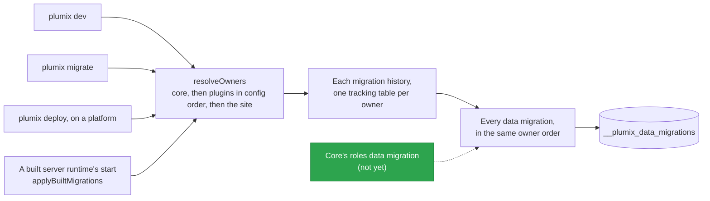

# Migrations

Migrations bring a site's database to the schema and data shape its installed code expects. Each
table owner (core, a plugin, the site's own tables) ships its own migration history, generated by
drizzle, and any owner may ship TypeScript data migrations that run after every migration history.
Package maintainers generate and commit histories; a site developer meets them through `plumix dev`
and `plumix migrate`; an operator through `plumix deploy` on a platform or a built server runtime's
start. Migrations run in the **plumix CLI** container of
[`ARCHITECTURE.md`](../../ARCHITECTURE.md#containers), against the **Database**, and in the app
process of a server runtime before it listens. The runner lives in `packages/plumix/src/cli/migrate/`
and `packages/plumix/src/cli/commands/migrate.ts`; each runtime opens its own database through
`RuntimeMigrations` in its commands module.

## At a glance

## Surface

| Piece                                                    | What it is                                                                                         | Public                                                          |
| -------------------------------------------------------- | -------------------------------------------------------------------------------------------------- | --------------------------------------------------------------- |
| `plumix migrate`                                         | Apply every owner's schema, then data migrations; prints a plan and confirms before a remote write | yes (CLI)                                                       |
| `plumix migrate status`                                  | Applied and pending migrations per owner                                                           | yes                                                             |
| `plumix migrate fresh`                                   | Wipe and re-apply; refuses any production target (`migrateFreshProduction`)                        | yes                                                             |
| `plumix migrate generate`                                | Write the site's next migration for its own tables                                                 | yes                                                             |
| `defineDataMigration({ name, up })`                      | One forward-only step; `up({ db })` gets drizzle with no schema                                    | yes, `plumix/db`                                                |
| `PluginDescriptor.schemaModule` / `dataMigrations`       | A plugin's tables module and its data migrations module                                            | yes, `plumix/plugin`                                            |
| `PlumixConfig.dataMigrations`                            | The site's data migrations module, relative to the config                                          | yes                                                             |
| `RuntimeMigrations`                                      | `targetOptions?`, `legacyTable`, `open`, `openRun`                                                 | yes, `plumix/cli`                                               |
| `MigrationDatabase`                                      | `migrate`, `drizzle`, `all`, `batch`, `wipe`, `restorePoint?`, `close`, `target`                   | yes, `plumix/cli`                                               |
| `applyBuiltMigrations`                                   | What a built server runtime runs before it listens                                                 | yes, `plumix/cli`                                               |
| `migrateBeforeDeploy`, `migrateForDev`                   | The deploy and dev entry points                                                                    | `migrateBeforeDeploy` on `plumix/cli`; `migrateForDev` internal |
| `applyCoreTestSchema`, `applyTestSchema`, `createTestDb` | Test DDL from the shipped histories                                                                | yes, `plumix/test`                                              |
| `pnpm migrations:check`                                  | Runs `db:generate` in every package that has one; fails when `migrations/` changes                 | repo only                                                       |

Where migrations run on each runtime:

|                     | Cloudflare                                                 | Node                                                                        | Bun                            |
| ------------------- | ---------------------------------------------------------- | --------------------------------------------------------------------------- | ------------------------------ |
| At deploy or start  | `plumix deploy` migrates first; the Worker applies nothing | before listen, for `nodeSqlite`; another database slot uses its own tooling | before listen, for `bunSqlite` |
| Remote targets      | `--production`, `--preview`, `--env` (ADR 0045)            | none, local only                                                            | none, local only               |
| Legacy marker table | `d1_migrations`                                            | `__drizzle_migrations`                                                      | `__drizzle_migrations`         |

## How it works

`resolveOwners` lists the owners in application order: core first, then plugins in config order,
then the site. A plugin owns a history when its `schemaModule` resolves into an installed package;
one that resolves inside the site's package counts as the site's (`sitePlugins`). Each history
applies through drizzle's own migrator under `__drizzle_migrations_<owner>`. Plumix chooses only
folders, tracking tables and order (ADR 0027). Data migrations then run in the same owner order.
Each is recorded by owner and name in `__plumix_data_migrations` once `up` resolves. A failure
stops the run and is not recorded, so the next run retries it (ADR 0044).

`plumix dev` calls `migrateForDev`. It writes the site's next migration when the site's tables are
ahead of its history, says to commit it, and applies everything locally. `plumix migrate` and
`migrateBeforeDeploy` check the site's history for drift first (`checkSiteDrift`). A database built
from a legacy single history is adopted when its schema matches the owner histories; the marker is
the runtime's `legacyTable`. Hand-written DDL is an ordinary custom migration in its owner's
history, such as the search plugin's FTS5 table in
`packages/plugins/search/migrations/0001_search_index.sql`.

Core and the audit-log, comments, forms and search plugins ship histories. No data migration ships
yet: `CORE_DATA_MIGRATIONS` is empty, and no first-party plugin sets `dataMigrations`.

- `packages/plumix/src/cli/migrate/owners.ts`: `resolveOwners`, `TRACKING_TABLE_PREFIX`, `sitePlugins`.
- `packages/plumix/src/cli/migrate/apply.ts`: `applyOwners`, `adoptLegacyDatabase`, `reportStatus`.
- `packages/plumix/src/cli/migrate/data.ts`, `data-load.ts`, `data-modules.ts`: `DATA_MIGRATIONS_TABLE`, `applyDataMigrations`.
- `packages/plumix/src/cli/migrate/built.ts`: `copyOwnerHistories`, `applyBuiltMigrations`.
- `packages/core/src/db/data-migration.ts`: `defineDataMigration`. `packages/core/src/cli/data-migrations.ts`: `CORE_DATA_MIGRATIONS`.
- `packages/core/src/cli/migrations.ts`: `CORE_MIGRATIONS_FOLDER`. `packages/core/migrations/`: core's history, `0000_tables` to `0003_edit_leases`.
- `packages/runtimes/*/src/commands/migrations.ts`: each runtime's `open` and `openRun`.
- `packages/core/src/test/harness.ts`: `applyCoreTestSchema` replays `CORE_MIGRATIONS`, the shipped history, with the database client's own drizzle migrator.
- `.github/scripts/migrations-check.mjs`: the `migrations:check` script, run in CI.

## Invariants

- One migration history per owner, one tracking table per owner, order core → plugins → site. Plumix never deletes or rewrites a history. [ADR 0027](../adr/0027-each-table-owner-ships-its-own-migration-history.md); `packages/plumix/src/cli/commands/migrate.test.ts`.
- A package's declared tables are never ahead of its shipped history. `pnpm migrations:check` in CI.
- Data migrations run after every migration history, go forward only, and never reach a request bundle. [ADR 0044](../adr/0044-data-migrations-run-in-typescript-after-every-schema-migration.md); `packages/core/src/db/data-migration.test.ts`, `packages/plumix/src/vite/data-migrations-bundle.test.ts`, `packages/plumix/src/vite/server-bundle-data-migrations.test.ts`.
- A remote target is named in the platform's terms, and a remote write prints a plan and is confirmed. [ADR 0045](../adr/0045-a-runtime-names-its-remote-databases-from-its-platform-config.md).
- A platform runtime's app process applies nothing; `plumix deploy` migrates from the CLI first (`migrateBeforeDeploy`, called from `packages/runtimes/cloudflare/src/commands/deploy.ts`).
- Test databases get core's DDL from the same history production replays (`packages/core/src/test/harness.test.ts`).
- Every runtime's `openRun` reaches the same database `migrate` wrote: `describeRunContract` in each `packages/runtimes/*/src/commands/migrations.test.ts`.

## Not there yet

| Part of the design       | Seam to build on                                                                                                                                                                              | Done when                                                                                                                                                                                            |
| ------------------------ | --------------------------------------------------------------------------------------------------------------------------------------------------------------------------------------------- | ---------------------------------------------------------------------------------------------------------------------------------------------------------------------------------------------------- |
| Stored roles             | Site-defined roles are stored in the database: a `roles` table (name, capabilities) in core's migration history under `packages/core/migrations/`, declared in `packages/core/src/db/schema/` | Core's history builds the `roles` table, no column default names `subscriber`, and `migrations:check` is clean                                                                                       |
| The roles data migration | Core's first data migration in `CORE_DATA_MIGRATIONS` (`packages/core/src/cli/data-migrations.ts`), run after core's history under ADR 0044, wherever migrations run                          | Every `subscriber` becomes `member`; a stored `contributor` role with the same capabilities exists and every contributor holds it, so nobody gains or loses rights; no stored row names `subscriber` |
