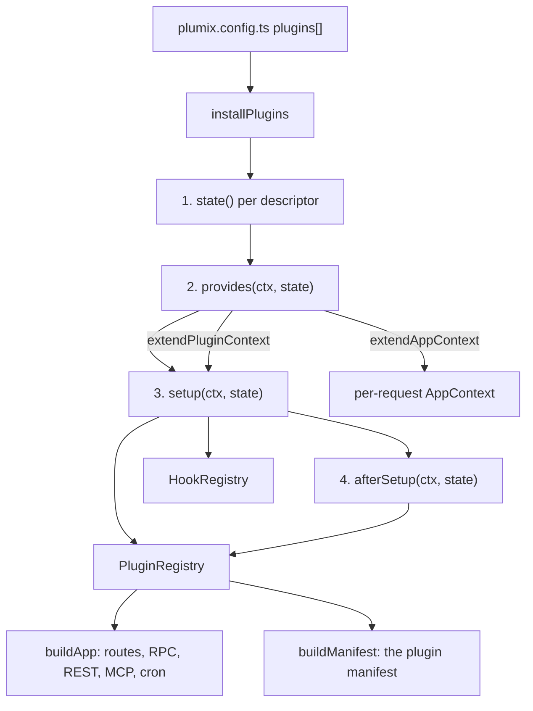

# Plugin system

A plugin is a descriptor built with `definePlugin` from `plumix/plugin`, or a factory that takes options and returns one. A site lists descriptors in `plugins` in `plumix.config.ts`. At boot, core installs them in array order into one `PluginRegistry` and one `HookRegistry`, and everything else (routing, RPC, REST, MCP, the plugin manifest, cron) reads from those two objects. Plugin authors write against this surface; site developers only list and configure plugins. It is the "Plugin system and hooks" component, with "Plugins" beside it, in the component diagram of [`ARCHITECTURE.md`](../../ARCHITECTURE.md). The code lives in `packages/core/src/plugin/` and `packages/core/src/runtime/install-plugins.ts`, and is re-exported through `packages/plumix/src/plugin.ts`.

## At a glance

`installPlugins` runs twice per process in a dev or build: once in `buildApp` (`packages/core/src/runtime/app.ts`) and once in the Vite plugin's manifest pass (`computeManifestAndRegistry` in `packages/plumix/src/vite/manifest.ts`). That is why plugin state comes from `state`, not from a closure.

## Surface

Descriptor fields (`PluginDescriptor` in `packages/core/src/plugin/define.ts`). All public.

| Field                    | What it declares                                                       | Read by                                                                                                 |
| ------------------------ | ---------------------------------------------------------------------- | ------------------------------------------------------------------------------------------------------- |
| `id`                     | `^[a-z][a-z0-9_-]*$`, max 64 chars; becomes path segments and RPC keys | `assertValidPluginId`; `installPlugins` rejects duplicates                                              |
| `state`                  | Per-install factory, awaited before any `provides` (ADR 0058)          | `installPlugins`                                                                                        |
| `provides`               | `extendPluginContext`, `extendAppContext`                              | `createPluginProvidesContext`                                                                           |
| `setup`                  | Required. All registrations below                                      | `createPluginSetupContext`                                                                              |
| `afterSetup`             | Registrations derived from other plugins; gets `ctx.plugins`           | `createPluginAfterSetupContext`                                                                         |
| `shortcodes`             | Shortcodes the editor canvas expands too                               | `installPlugins` registers them; `packages/plumix/src/vite/editor-block-modules.ts`                     |
| `mails`                  | Mails declared by name                                                 | `packages/core/src/mail/declared.ts`                                                                    |
| `authMethods`            | Sign-in methods (ADR 0041)                                             | `packages/core/src/auth/declared-methods.ts`; `packages/plumix/src/vite/auth-method-clients-codegen.ts` |
| `schema`, `schemaModule` | Drizzle tables and the module `plumix migrate` reads                   | `runtime/app.ts` merges `schema`; `packages/plumix/src/cli/migrate/owners.ts`                           |
| `dataMigrations`         | Module of ordered data migrations                                      | `packages/plumix/src/cli/migrate/data-modules.ts`                                                       |
| `i18n`                   | Catalog slot (`PLUGIN_I18N_SLOT` for first-party)                      | `buildManifest`; `packages/plumix/src/vite/plugin-catalog-resolve.ts`                                   |
| `adminEntry`             | Admin source, bundled per site                                         | `packages/plumix/src/vite/admin-plugin-bundle.ts`                                                       |
| `adminChunk`, `adminCss` | Pre-built admin JS and CSS                                             | `stagePluginChunks` in `packages/plumix/src/vite/index.ts`                                              |
| `adminPeerVersion`       | Admin range the plugin expects                                         | `warnOnPluginAdminMismatch` in `packages/plumix/src/vite/index.ts`                                      |

Contribution kinds. Each `setup` call writes one `PluginRegistry` field (`packages/core/src/plugin/registry.ts`); the consumer is the code that reads that field. Paths in the last column are under `packages/core/src/`.

| Kind                                     | Registration API                                                     | Registry field                                     | Consumer                                                                        |
| ---------------------------------------- | -------------------------------------------------------------------- | -------------------------------------------------- | ------------------------------------------------------------------------------- |
| Filter / action handler                  | `addFilter`, `addAction`                                             | `HookRegistry`                                     | Firing sites, see [hooks](./hooks.md)                                           |
| Plugin-prefixed hook handler             | `registerFilter`, `registerAction`                                   | `HookRegistry` as `<id>:<name>`                    | Whoever fires that name                                                         |
| Entry type                               | `registerEntryType`                                                  | `entryTypes`                                       | `route/compile.ts`, `route/resolve.ts`, `access/gate.ts`, `buildManifest`       |
| Taxonomy                                 | `registerTermTaxonomy`                                               | `termTaxonomies`                                   | `route/compile.ts`, `terms/read-service.ts`, `buildManifest`                    |
| Entry / term / user meta box             | `registerEntryMetaBox`, `registerTermMetaBox`, `registerUserMetaBox` | `entryMetaBoxes`, `termMetaBoxes`, `userMetaBoxes` | `buildManifest`, `rest/projection.ts`, `plugin/image-roles.ts`                  |
| Capability                               | `registerCapability`                                                 | `capabilities`                                     | `auth/rbac.ts`                                                                  |
| Settings group / page                    | `registerSettingsGroup`, `registerSettingsPage`                      | `settingsGroups`, `settingsPages`                  | `rpc/procedures/settings/*`, `meta/settle-meta.ts`, `buildManifest`             |
| Rewrite rule                             | `registerRewriteRule`                                                | `rewriteRules`                                     | `route/compile.ts`                                                              |
| Redirects                                | `registerRedirects`                                                  | `redirects`                                        | `runtime/app.ts`                                                                |
| Archive type                             | `registerArchiveType`                                                | `archiveTypes`                                     | `route/compile.ts`, `route/archive-entries.ts`, `runtime/dispatcher.ts`         |
| View                                     | `registerView`                                                       | `views`                                            | `route/compile.ts`, `route/resolve.ts`, `runtime/dispatcher.ts`                 |
| RPC router                               | `registerRpcRouter`                                                  | `rpcRouters`                                       | `runtime/app.ts`, merged into the RPC router under the plugin id                |
| MCP tool                                 | `registerMcpTool`                                                    | `mcpTools`                                         | `mcp/registry.ts`, see [MCP](./mcp.md)                                          |
| Plugin route                             | `registerRoute`                                                      | `rawRoutes`                                        | `runtime/app.ts`, `dev/routes.ts`                                               |
| Public route                             | `registerPublicRoute`                                                | `publicRoutes`                                     | `route/public-routes.ts`, `runtime/app.ts`                                      |
| REST resource                            | `registerRestResource`                                               | `restResources`                                    | `rest/build-handler.ts`, see [REST API](./rest-api.md)                          |
| Admin page, dashboard widget, field type | `registerAdminPage`, `registerDashboardWidget`, `registerFieldType`  | `adminPages`, `dashboardWidgets`, `fieldTypes`     | `buildManifest`, `vite/admin-plugin-bundle.ts` (`buildSynthesisedEntry`)        |
| Block, mark                              | `registerBlock`, `registerBlocks`, `registerMark`                    | `blockSpecs`, `markSpecs`                          | `runtime/app.ts`, `buildManifest`                                               |
| Shortcode                                | `registerShortcode`                                                  | `shortcodeSpecs`                                   | `runtime/app.ts`                                                                |
| Pattern                                  | `registerPattern`                                                    | `patternSpecs`                                     | `buildManifest`                                                                 |
| Lookup adapter                           | `registerLookupAdapter`                                              | `lookupAdapters`                                   | `rpc/procedures/lookup-adapters.ts`, `images/role-images.ts`, `meta/core.ts`    |
| Image role                               | `registerImageRole`                                                  | `imageRoles`                                       | `plugin/image-roles.ts`; indexed by `resolveImageRoleIndex` in `runtime/app.ts` |
| Login link                               | `registerLoginLink`                                                  | `loginLinks`                                       | `rpc/procedures/auth/login-links.ts`                                            |
| Scheduled task                           | `registerScheduledTask`                                              | `scheduledTasks`                                   | `runtime/app.ts`, see [cron](./cron.md)                                         |
| Template dep                             | `registerTemplateDep`                                                | `templateDeps`                                     | `template-deps-core.ts`, `rpc/procedures/entry/resolve-block-deps.ts`           |
| Plugin-context helper                    | `provides` → `extendPluginContext`                                   | merged onto every setup ctx                        | Other plugins' `setup`                                                          |
| App-context helper                       | `provides` → `extendAppContext`                                      | `appContextExtensions`                             | Runtime adapters merge onto each `AppContext`                                   |

Other public exports from `plumix/plugin`: `applyOverride` / `Overridable` (option overrides that merge objects one level and compose arrays), `installPlugins`, `createPluginRegistry`, `buildManifest`, `HookRegistry`, `defineAuthMethod`, `defineMail`.

## How it works

`installPlugins` checks every id, then runs four passes over the array: all `state` factories, all `provides`, all `setup`, all `afterSetup`. Each hook gets the descriptor's own state as its second argument. `provides` runs fully before any `setup`, so a helper from `extendPluginContext` reaches every plugin whatever the order. `afterSetup` sees `ctx.plugins`, live and read-only, holding every `setup` registration and the `afterSetup` registrations of earlier plugins only.

`buildApp` seeds the registry before plugins run: `createPluginRegistry` adds the `featured` and `ogImage` image roles, then core adds its lookup adapters, template deps, settings and scheduled tasks. After install it fires `theme:ready`, indexes image roles, and merges plugin `schema` exports, rejecting a key two owners export.

`registerCapability` records a plugin's capability and the default roles (`member`, `author`, `editor`, `admin`) that get it. `auth/rbac.ts` merges those grants with the site's roles, stored and declared, so a site can grant the capability to any role, its own included.

- `packages/core/src/plugin/define.ts`: `definePlugin`, `PluginDescriptor`, `assertValidPluginId`, `PLUGIN_I18N_SLOT`, `pluginAdminEntryPath`.
- `packages/core/src/plugin/setup-context-types.ts`: `PluginSetupContextBase`, `PluginAfterSetupContext`.
- `packages/core/src/plugin/setup-context.ts`: `createPluginSetupContext`; uses `claimKey` for duplicate checks and the validators in `plugin/validation/`.
- `packages/core/src/plugin/provides-context.ts`: `createPluginProvidesContext`, `RESERVED_EXTENSION_KEYS`, `APP_CONTEXT_BASE_KEYS`.
- `packages/core/src/plugin/registry.ts`: `PluginRegistry`, `MutablePluginRegistry`, `createPluginRegistry`, the option types.
- `packages/core/src/plugin/build-manifest.ts`: `buildManifest`, the plugin manifest the admin reads; see [admin and editor](./admin-and-editor.md).
- `packages/core/src/plugin/errors.ts`: `PluginDefinitionError`, `PluginContextError`, `DuplicateRegistrationError`.

The plugin authoring guide is `apps/docs/src/content/docs/plugins/overview.mdx`.

## Invariants

- Core owns what would be wrong without a plugin; a plugin owns what would only be missing ([ADR 0002](../adr/0002-core-owns-what-would-be-wrong.md)). `registerPublicRoute` exists so a plugin can answer at the site root.
- Plugin state comes from `state`, once per install, private to the plugin ([ADR 0058](../adr/0058-a-plugins-per-install-state-comes-from-its-state-factory.md)). Guarded by the state tests in `packages/core/src/runtime/install-plugins.test.ts` and the type tests in `packages/core/src/plugin/define.test.ts`.
- Sign-in methods are declared on the descriptor; a duplicate or reserved name fails boot ([ADR 0041](../adr/0041-a-sign-in-method-is-a-registered-extension.md)).
- `provides` finishes before any `setup`, and an `extendAppContext` key can't shadow a base `AppContext` field or `__proto__`. Guarded by `packages/core/src/plugin/provides.test.ts`.
- Two plugins with the same id, or two owners of one registered name, fail boot (`duplicatePluginIdInConfig`, `DuplicateRegistrationError`). Guarded by `packages/core/src/runtime/install-plugins.test.ts`.
- `setup`, `afterSetup` and `theme:ready` handlers do no IO and are safe to repeat, because the Vite manifest pass reruns them on every config change (comment on `computeManifestAndRegistry` in `packages/plumix/src/vite/manifest.ts`).
- Plugins are installed in code. No screen enables or disables one.
- Imports go through `plumix`, never `@plumix/*` (the umbrella rule in `AGENTS.md`).
