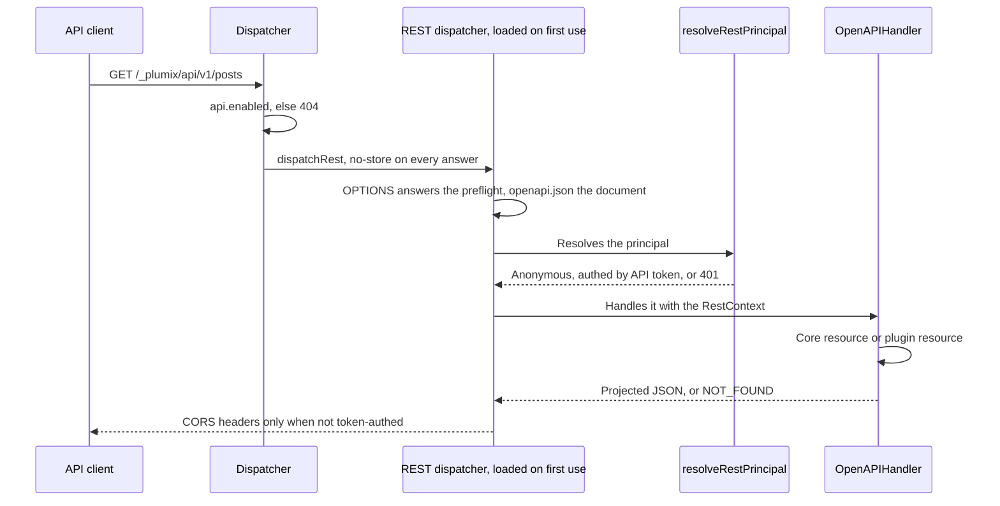

# REST API

The REST API is the public JSON surface at `/_plumix/api/v1/`, with an OpenAPI document generated from the same router. It is off until a site developer sets `api: { enabled: true }`. Anonymous visitors and API clients with an API token read published entries and terms of public types and taxonomies. Plugin authors add their own resources to the same namespace with `registerRestResource`. Operators reach one write route, the mail test that `plumix mail test --remote` calls. Core's resources are read-only: agents write over [MCP](mcp.md), editors over RPC. REST is part of the **RPC, REST and MCP** component in [ARCHITECTURE.md](../../ARCHITECTURE.md#components-of-the-app-process). The code is in `packages/core/src/rest/`, and the user docs are `apps/docs/src/content/docs/apis/rest-api.mdx`.

## At a glance

## Surface

| Piece                                                                       | Where                                               | Public?                                   |
| --------------------------------------------------------------------------- | --------------------------------------------------- | ----------------------------------------- |
| `api?: { enabled?: boolean; cors?: { origins?: string[] \| "*" } }`         | `ApiConfig` in `packages/core/src/config.ts`        | public config slot                        |
| `GET /{collection}` (entries or terms, paginated envelope)                  | `collectionList` in `rest/router.ts`                | public route                              |
| `GET /{collection}/{id}`                                                    | `collectionGet` in `rest/router.ts`                 | public route                              |
| `POST /system/mail/test` (204, or 502 `mail_send_failed`)                   | `rest/system-mail.ts`                               | public route, token and `settings:manage` |
| `GET /openapi.json`                                                         | `rest/build-handler.ts`, `rest/openapi.ts`          | public route                              |
| `registerRestResource({ method?, path, auth, input?, output, handler })`    | plugin setup context, types in `plugin/registry.ts` | public                                    |
| `RestResourceAuth`: `"public"`, `"authenticated"`, `{ capability }`         | `plugin/registry.ts`                                | public                                    |
| Reserved path segments `{collection}` → `entryType`, `{entry}` → `entry`    | `rest/plugin-resources.ts`                          | public                                    |
| `REST_ERRORS`: `NOT_FOUND {kind}`, `UNAUTHORIZED`, `FORBIDDEN {capability}` | `rest/contract/errors.ts`                           | public, passed to handlers as `errors`    |
| Field opt-in `.showInApi()`                                                 | field builders                                      | public                                    |
| `CORE_REST_ROUTES`, `routesOverlap`                                         | `rest/rest-routes.ts`                               | internal, boot check                      |

The only first-party plugin resource is the comments plugin's `GET /{collection}/{entry}/comments` (`packages/plugins/comments/src/index.ts`). The sync routes under `/_plumix/api/v1/system/sync/` share the prefix but are not REST resources: the dispatcher answers them before the `api` check, whether or not the API is on. See [sync and import](sync-and-import.md).

## How it works

**Dispatch.** `tryColdInterfaces` (`packages/core/src/runtime/dispatcher.ts`) handles `/_plumix/api` before the `/_plumix/` CSRF check, because this surface never reads a cookie. `dispatchRest` returns 404 `api-disabled` unless `interfaceEnabled(config.api)`. It loads the handler through `app.loadRestHandler`, and `withNoStore` marks every answer `no-store`, errors included.

**Principal.** `resolveRestPrincipal` (`rest/principal.ts`) returns `anonymous` when there is no `Authorization: Bearer` header. The anonymous context has `user: null`, and its `auth.can` answers with the capabilities of `PUBLIC_PRINCIPAL`, which holds the capabilities of the `member` role, so the entry services clamp it as they would any visitor. A valid API token gives `authed`, with the token's scopes applied through `authenticateBearer`. An invalid token gets 401 rather than being treated as anonymous. `RestContext.restAuthenticated` records whether a real token was used.

**Core resources.** A collection name is the type or taxonomy name made plural (`pluralize` in `rest/rest-base.ts`). Only `isPublic` types and taxonomies resolve, and entry types are tried first. Entries come from `listEntryRows` and `findReadableEntry` (`entries/read-service.ts`), which apply each entry's access policy for the principal ([ADR 0037](../adr/0037-a-public-surface-asks-per-entry-not-per-type.md)). The rows then go through `resolveEntryList`, the same resolution a public page uses. Any read failure, or an entry of the wrong type, becomes the same `NOT_FOUND`. `readPagination` (`rest/schemas.ts`) clamps `page` and `per_page` (default 20, max 100) instead of rejecting them. `?<taxonomy>=a,b` filters by public taxonomies, and `page`/`per_page` are reserved.

**Projection** (`rest/projection.ts`). `projectEntry` copies an explicit list of columns. `meta` holds only fields declared with `showInApi` (`apiVisibleMetaKeys`), `images` only image roles whose field opted in, and `terms` only public taxonomies. The valibot output schemas in `rest/schemas.ts` are also what the OpenAPI document describes. `dateAsDateTime` documents dates as ISO strings.

**Plugin resources.** `buildPluginRestRouter` turns each registered resource into an oRPC procedure on the same `OpenAPIHandler`, so it appears in `openapi.json`. `enforceRestAuth` runs before anything else. `"authenticated"` requires `restAuthenticated`, and a capability is checked with `context.auth.can`, which reads the site's default and site-defined roles. Then `bindSegments` resolves `{collection}` and `{entry}` with core's own resolvers, and the handler receives `entryType` and `entry` with the bound segments removed from `input` ([ADR 0020](../adr/0020-a-plugin-rest-resources-collection-and-entry-segments-are-bound-by-core.md)). At boot, `buildApp` (`runtime/app.ts`) throws `restResourceShadowsCore` or `restResourcePathConflict` when a route overlaps another, using `routesOverlap`, which treats any `{param}` as matching. Core owns every one- and two-segment `GET`.

**CORS** (`rest/cors.ts`). CORS is closed by default, and a preflight without `cors` gets 403. With an allowlist, an allowed origin is echoed back and `Vary: origin` is set even on a miss. The preflight allows `GET` and `OPTIONS`, plus the methods of the `auth: "public"` plugin resources whose path template matches the request path (`buildPreflightMethods`, built once per dispatcher). A token-authed resource's method is never listed. `Access-Control-Allow-Credentials` is never sent. A token-authed response gets no CORS headers, so tokens stay server-to-server.

**Writes.** A REST route that writes a resource made from a copy follows [ADR 0048](../adr/0048-core-guards-every-edit-with-a-required-token-and-an-enforced-lease.md): it sends `ETag`, requires `If-Match` (428 without one, 412 when stale) and answers 423 over someone else's live lease. Core's own REST resources are read-only.

## Invariants

- The API is off unless `api.enabled` is `true`, and when off the dispatcher answers 404 before it imports the handler (`interfaceEnabled`; `rest/dispatch.test.ts`).
- Responses are default-deny: only listed columns, `showInApi` meta, and public taxonomies are sent (`dispatch.test.ts` "public projection", "meta visibility").
- Content the requester may not read is a 404, never a 403, for core and bound plugin routes alike ([ADR 0020](../adr/0020-a-plugin-rest-resources-collection-and-entry-segments-are-bound-by-core.md), [ADR 0037](../adr/0037-a-public-surface-asks-per-entry-not-per-type.md); `dispatch.test.ts` "plugin resource binding", "an entry's access policy").
- An invalid API token is a 401 and never becomes an anonymous read (`dispatch.test.ts` "bearer PAT auth").
- Every answer is `no-store` (`dispatch.test.ts` "freshness").
- A plugin path can't shadow core's or another plugin's route; boot fails (`dispatch.test.ts` "plugin resource collisions").
- `"development"` auth can't be used on a REST resource, because `RestResourceAuth` excludes it at the type level.
