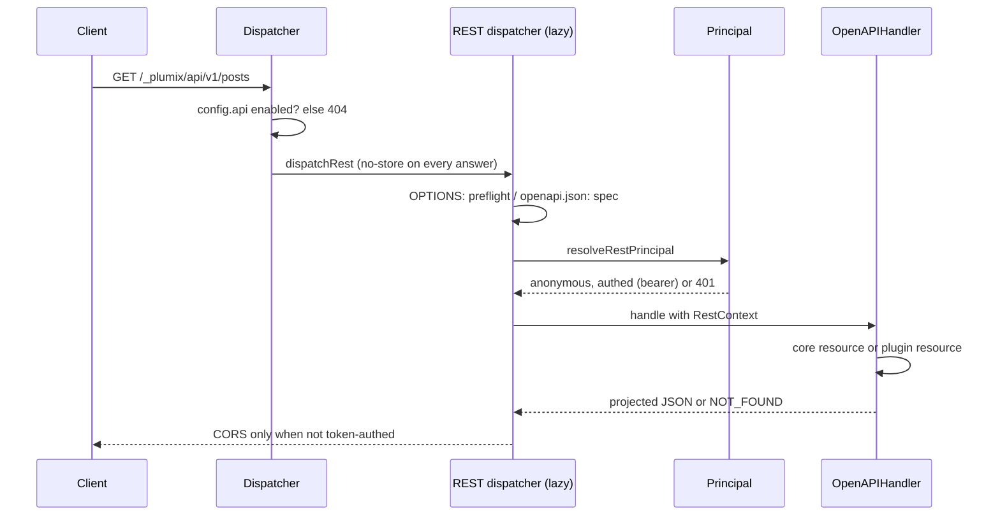

# REST API

The REST API is the public JSON surface at `/_plumix/api/v1/`, with an OpenAPI document generated from the same router. It is off until a site developer sets `api: { enabled: true }`. Anonymous visitors and API-token clients read public entry types and taxonomies. Plugin authors add their own resources to the same namespace with `registerRestResource`. Operators reach one write route, the mail test that `plumix mail test --remote` calls. The code is in `packages/core/src/rest/`, and the user docs are `apps/docs/src/content/docs/apis/rest-api.mdx`.

## At a glance

## Surface

| Piece                                                                       | Where                                               | Public?                                 |
| --------------------------------------------------------------------------- | --------------------------------------------------- | --------------------------------------- |
| `api?: { enabled?: boolean; cors?: { origins?: string[] \| "*" } }`         | `ApiConfig` in `packages/core/src/config.ts`        | public config slot                      |
| `GET /{collection}` (entries or terms, paginated envelope)                  | `rest/router.ts` `collectionList`                   | public route                            |
| `GET /{collection}/{id}`                                                    | `rest/router.ts` `collectionGet`                    | public route                            |
| `POST /system/mail/test` (204, or 502 `mail_send_failed`)                   | `rest/system-mail.ts`                               | public route, token + `settings:manage` |
| `GET /openapi.json`                                                         | `rest/build-handler.ts`, `rest/openapi.ts`          | public route                            |
| `registerRestResource({ method?, path, auth, input?, output, handler })`    | plugin setup context, types in `plugin/registry.ts` | public                                  |
| `RestResourceAuth`: `"public"`, `"authenticated"`, `{ capability }`         | `plugin/registry.ts`                                | public                                  |
| Reserved path segments `{collection}` → `entryType`, `{entry}` → `entry`    | `rest/plugin-resources.ts`                          | public                                  |
| `REST_ERRORS`: `NOT_FOUND {kind}`, `UNAUTHORIZED`, `FORBIDDEN {capability}` | `rest/contract/errors.ts`                           | public, passed to handlers as `errors`  |
| Field opt-in `.showInApi()`                                                 | field builders                                      | public                                  |
| `CORE_REST_ROUTES`, `routesOverlap`                                         | `rest/rest-routes.ts`                               | internal, boot check                    |

The only first-party plugin resource is comments: `GET /{collection}/{entry}/comments` (`packages/plugins/comments/src/index.ts`).

## How it works

**Dispatch.** `tryColdInterfaces` (`packages/core/src/runtime/dispatcher.ts`) handles `/_plumix/api` before the `/_plumix/` CSRF check, because this surface never reads a cookie. `dispatchRest` returns 404 `api-disabled` unless `interfaceEnabled(config.api)`. It loads `buildRestDispatcher` through `loadOnce`, and `withNoStore` marks every answer `no-store`, errors included.

**Principal.** `resolveRestPrincipal` (`rest/principal.ts`) returns `anonymous` when there is no bearer token. The anonymous context has `user: null` and the `subscriber` role's capabilities, so the entry services clamp it as they would any visitor. A valid bearer token gives `authed`, with token scopes applied through `authenticateBearer`. An invalid token gets 401 rather than being treated as anonymous. `RestContext.restAuthenticated` records whether a real token was used.

**Core resources.** A collection name is the type or taxonomy name made plural (`pluralize` in `rest/rest-base.ts`). Only `isPublic` types and taxonomies resolve, and entry types are tried first. Entries come from `listEntryRows` and `findReadableEntry` (`entries/read-service.ts`), which apply each entry's access policy for the principal ([ADR 0037](../adr/0037-a-public-surface-asks-per-entry-not-per-type.md)). The rows then go through `resolveEntryList`, the same resolution a public page uses. Any read failure, or an entry of the wrong type, becomes the same `NOT_FOUND`. `readPagination` clamps `page` and `per_page` (default 20, max 100) instead of rejecting them. `?<taxonomy>=a,b` filters by public taxonomies, and `page`/`per_page` are reserved.

**Projection** (`rest/projection.ts`). `projectEntry` copies an explicit list of columns. `meta` holds only fields declared with `showInApi` (`apiVisibleMetaKeys`), `images` only image roles whose field opted in, and `terms` only public taxonomies. The valibot output schemas in `rest/schemas.ts` are also what the OpenAPI document describes. `dateAsDateTime` documents dates as ISO strings.

**Plugin resources.** `buildPluginRestRouter` turns each registered resource into an oRPC procedure on the same `OpenAPIHandler`, so it appears in `openapi.json`. `enforceRestAuth` runs before anything else. `"authenticated"` requires `restAuthenticated`, and a capability is checked with `context.auth.can`. Then `bindSegments` resolves `{collection}` and `{entry}` with core's own resolvers, and the handler receives `entryType`/`entry` with the bound segments removed from `input` ([ADR 0020](../adr/0020-a-plugin-rest-resources-collection-and-entry-segments-are-bound-by-core.md)). At boot, `buildApp` (`runtime/app.ts`) throws `restResourceShadowsCore` or `restResourcePathConflict` when a route overlaps another, using `routesOverlap`, which treats any `{param}` as matching. Core owns every one- and two-segment `GET`.

**CORS** (`rest/cors.ts`). CORS is closed by default, and a preflight without `cors` gets 403. With an allowlist, an allowed origin is echoed back and `Vary: origin` is set even on a miss. `Access-Control-Allow-Credentials` is never sent. A token-authed response gets no CORS headers, so tokens stay server-to-server.

## Invariants

- The API is off unless `api.enabled` is `true`, and when off the dispatcher answers 404 before it imports the handler (`interfaceEnabled`, `dispatch.test.ts`).
- Responses are default-deny: only listed columns, `showInApi` meta, and public taxonomies are sent (`dispatch.test.ts` "public projection", "meta visibility").
- Content the requester may not read is a 404, never a 403, for core and bound plugin routes alike ([ADR 0020](../adr/0020-a-plugin-rest-resources-collection-and-entry-segments-are-bound-by-core.md), [ADR 0037](../adr/0037-a-public-surface-asks-per-entry-not-per-type.md); `dispatch.test.ts` "plugin resource binding", "an entry's access policy").
- An invalid bearer token is a 401 and never becomes an anonymous read (`dispatch.test.ts` "bearer PAT auth").
- Every answer is `no-store` (`dispatch.test.ts` "freshness").
- A plugin path can't shadow core's or another plugin's route; boot fails (`dispatch.test.ts` "plugin resource collisions").
- `"development"` auth can't be used on a REST resource, because `RestResourceAuth` excludes it at the type level.

## Status

- **Shipped:** the opt-in, the principal, core read resources for entries and terms, projection, pagination, taxonomy filters, the OpenAPI document, CORS, plugin resources with auth modes and binding, collision checks, and the mail test. Tests: `packages/core/src/rest/dispatch.test.ts` (74 tests), `rest/system-mail.test.ts`, `packages/plugins/comments/src/server/rest.test.ts`. No e2e or smoke suite calls `/_plumix/api/v1`, though `plumix sync` uses `/_plumix/api/v1/system/sync/` (`cli/sync-remote.ts`; see [sync-and-import.md](sync-and-import.md)).
- **Not started:** core writes over REST. No open issue tracks REST work; `gh issue list --search "REST"` lists only cross-cutting PRDs (#3227, #3249).

## Gaps

- **ADR 0048 requires REST concurrency that doesn't exist yet.** It says "REST sends `ETag` and requires `If-Match`" with 428/412, and a 423 for a lease. `packages/core/src/rest/` has no `etag`/`If-Match` handling and no core write routes, so the rule doesn't apply yet, and `EDIT_LEASE_SURFACES`' `"rest"` is never written. See [rpc-and-editing.md](rpc-and-editing.md).
- **Preflight allows only `GET`.** `preflightResponse` hard-codes `access-control-allow-methods: GET, OPTIONS`, so a browser on another origin can't call a plugin `POST`/`PUT`/`PATCH`/`DELETE` resource that needs a preflight. The docs say CORS is for "anonymous reads", which matches, but `registerRestResource` doesn't mention this limit.
- **The author is never null, though the schema and docs allow it.** `publicEntrySchema.author` is `v.nullable(...)`, and the docs say "or `null`". But `projectEntry` reads `entry.author.id` from `ResolvedAuthor`, which isn't nullable, so `null` is never produced.
- **Collection names have no override.** They come from naive pluralization. The `pluralize` comment calls a per-type `rest_base` override "a later concern", and none exists.
- **The spec's version never changes.** `generateOpenApiDocument` stamps `info.version: "1.0.0"` no matter which package version is running.
