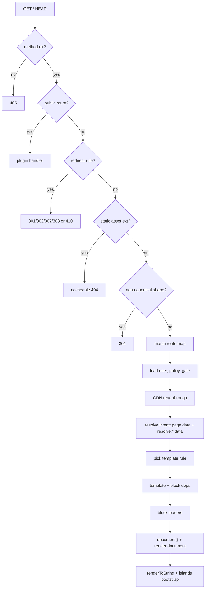

# Routing and render

Public request routing turns a `GET` or `HEAD` on the site into a theme-rendered page. It compiles every registration's permalink configuration into one route map, matches the URL to a route intent, resolves that intent's page data, picks a template from the theme, and renders the document. Site developers configure it through `plumix()` (`routes`, `redirects`, the theme). Plugin authors extend it with rewrite rules, archive types, views and public routes. Theme authors consume it through template rules and template data. It lives in `packages/core/src/route/`, with the dispatch glue in `packages/core/src/runtime/dispatcher.ts`.

## At a glance

A page step (archive or view `resolve`, a template dep, a block loader, `document()`) may throw `pageNotFound()` or `redirectTo()`. `resolvePublicRoute` catches it and answers 404 (theme `notFound`) or the redirect.

## Surface

| Piece                                                                                                                                                                                       | Where                                             | Public?  |
| ------------------------------------------------------------------------------------------------------------------------------------------------------------------------------------------- | ------------------------------------------------- | -------- |
| `routes: { author, date, search }`                                                                                                                                                          | `plumix()` config, `FrameworkRoutesInput`         | public   |
| `redirects`                                                                                                                                                                                 | `plumix()` config, theme, `ctx.registerRedirects` | public   |
| `registerRewriteRule(pattern, intent, { priority })`                                                                                                                                        | plugin setup context                              | public   |
| `registerArchiveType(name, { routes, entries?, perPage?, title?, resolve, cacheable?, access? })`                                                                                           | plugin setup context                              | public   |
| `registerView(name, { routes, access?, cacheable?, resolve })`                                                                                                                              | plugin setup context                              | public   |
| `registerPublicRoute({ path, handler, access?, cacheable? })`, answered ahead of redirects                                                                                                  | plugin setup context                              | public   |
| `registerTemplateDep(kind, { keyedBy, load })`                                                                                                                                              | plugin setup context                              | public   |
| `pageNotFound()`, `redirectTo(location, status?)`                                                                                                                                           | `plumix/support`                                  | public   |
| Template builders `entry`, `entryType`, `term`, `author`, `date`, `frontPage`, `search`, `fallback`, `notFound`, `serverError`                                                              | `plumix/theme`                                    | public   |
| Targeted selectors `forEntryType`, `forTermTaxonomy`, `forAuthor`, `forDate`, `forArchiveType`, `forView` and guards `isEntry`, `isTerm`, …                                                 | `plumix/theme`                                    | public   |
| `resolveEntryData`, `resolveEntryList`, `resolveListingPage`, `resolveArchiveTypePage`                                                                                                      | `plumix/plugin`                                   | public   |
| `buildEntryPermalink(s)`, `buildTermArchiveUrl(s)`, `archiveAtPath`, `archiveBaseRoutes`, `pageFacts`                                                                                       | `plumix/plugin`                                   | public   |
| Filters `resolve:single:data`, `resolve:archive:data`, `resolve:term:data`, `resolve:author:data`, `resolve:date:data`, `resolve:front-page:data`, `resolve:search:data`, `render:document` | hook registry                                     | public   |
| `compileRouteMap`, `routePublicRequest`, `resolvePublicRoute`, `renderThroughTheme`                                                                                                         | `packages/core/src/route/`                        | internal |

Page kinds (ADR 0025, amended by 0035): `entry`, `entryType`, `term`, `author`, `date`, `archiveType`, `view`, `frontPage`, `search`.

## How it works

- **Compile.** `compileRouteMap(registry)` in `packages/core/src/route/compile.ts` builds sorted `RouteRule`s: framework routes at priority 5 (`/page/N`, `/authors/:slug`, the date patterns, `/search`), explicit rewrite rules and archive types at 10, auto rules from `hasArchive` and `rewrite.slug` at 50, root catch-all singles at 60. A family turned off in `routes` is never compiled (`resolveFrameworkRoutes` in `packages/core/src/route/contract/framework-routes.ts`). `assertUniquePatterns` and `assertAutoUrlsResolveToThemselves` throw `RouteCompileError` at boot. `archiveRoutes` derives each listing archive's `/page/:page` form.
- **Route.** `routePublicRequest` in `packages/core/src/route/index.ts` runs the fixed stage order shown above. Public routes compile in `packages/core/src/route/public-routes.ts` (paths under `/_plumix` are rejected at boot). Redirects merge in `assembleRedirects` (`packages/core/src/route/redirects.ts`) with source priorities config 10, plugin 20, theme 30. The canonical normalizer is `canonicalRedirectTarget` in `packages/core/src/seo/canonical.ts`. An unmatched `/` is the front page.
- **Dispatch.** `dispatchPublicRoute` in `packages/core/src/runtime/dispatcher.ts` loads the user only when a session exists, resolves the access policy, gates, chooses the segment, wraps the context with `trackPrincipalReads`, then hands the render to the CDN read-through (see [cdn-cache.md](cdn-cache.md)). A 404 that accepts HTML is re-rendered through the theme's `notFound` template; a throw becomes `serverError` (or the dev error page).
- **Resolve.** `resolveIntent` in `packages/core/src/route/resolve.ts` switches on the intent kind. Built-in listings go through `packages/core/src/route/render/page-data.ts` (`frontPageData`, `archiveData`, `termData`, `authorData`, `dateData`), each applying its `resolve:*:data` filter. Each archive's query is defined once in `archiveEntries` (`packages/core/src/route/archive-entries.ts`), born holding only public entries (ADR 0008). Terms resolve by the last slug segment, and core rules 301 to the canonical term URL (ADR 0012). A single entry resolves through `resolveSingleEntry`, overlays the preview author's autosave, picks an `EditModeDecision`, and calls `resolveEntryData`. Archive types go through `archiveTypePage` (`packages/core/src/route/render/archive-type-page.ts`). Views wrap `resolve`'s `data` in `{ kind: "view", name, params, data }`.
- **Permalinks.** `packages/core/src/route/permalink.ts` builds entry and term URLs, nesting under ancestors where the type exposes hierarchical URLs; batch forms load ancestor chains once.
- **Template hierarchy.** `resolveRule` in `packages/core/src/route/render/rule-resolver.ts`: targeted rules in declaration order, then the generic tier for the node kind, then `fallback`. `archiveType` and `view` have no generic tier. No match and no `fallback` returns `null`, which becomes a 404. `explainTemplateResolution` feeds the debug panel.
- **Theme render.** `renderThroughTheme` in `packages/core/src/route/render/render-template.tsx`: resolve the template, union template and block deps (`collectBlockDepKeys`) and load them once with `loadTemplateDeps`, run block loaders (`prefetchEntryLoaders`) before `document()`, merge the document manifest, force `canonical: false` for views, apply `render:document`, apply the canonical link, then `renderTree`. View transitions apply only in live edit mode (ADR 0031).
- **Personal renders.** `packages/core/src/route/render/personal-render.ts`: `trackPrincipalReads` marks the render personal on `ctx.user`, `ctx.tokenScopes` or `ctx.auth.can()` reads, a principal-dependent locale, or a shown admin bar; `renderIsPersonal` is the verdict the read-through asks for (ADR 0030).

## Invariants

- One entry query per archive; listing and feed read the same query; archive queries hold only public entries. [ADR 0008](../adr/0008-an-archive-is-one-entry-query.md); `packages/core/src/route/archive-entries.test.ts`.
- A term is found by its slug alone; only core-compiled rules (`isPermalinkRoute`) canonicalise by 301. [ADR 0012](../adr/0012-a-term-is-addressed-by-its-slug.md); `packages/core/src/route/resolve.test.ts`.
- A plugin gets page data from core's resolvers, never from rows. `buildResolvedEntries` is not exported. [ADR 0015](../adr/0015-a-plugin-gets-page-data-from-core.md); `packages/plumix/src/facade-curated.test.ts`, `packages/core/src/route/render/page-data.test.ts`.
- Page kinds are named by subject, camelCase. [ADR 0025](../adr/0025-a-page-kind-is-named-by-its-subject.md).
- A framework route family set to `false` is never compiled, and an empty date archive answers 404. [ADR 0029](../adr/0029-a-framework-route-a-site-turns-off-is-never-compiled.md); `packages/core/src/route/compile.test.ts`, `packages/core/src/route/render/page-data.test.ts`.
- A render that reads the principal is never shared. [ADR 0030](../adr/0030-a-render-that-reads-the-principal-is-never-shared.md); `packages/core/src/route/render/personal-render.test.ts`, `packages/core/src/access/gate.integration.test.tsx`.
- Core emits `@view-transition` only when the theme or template opts in, and never in edit or preview. [ADR 0031](../adr/0031-a-theme-opts-into-native-page-transitions-and-owns-their-css.md); `packages/plugins/blog/e2e/view-transitions.spec.ts`.
- A page outcome is recognised by `Symbol.for("plumix.pageOutcome")`; a redirect outcome leaves `private, no-store`; loaders run before `document()`. [ADR 0032](../adr/0032-a-page-step-ends-the-request-by-throwing-an-outcome.md); `packages/core/src/route/page-outcome.dispatch.test.tsx`.
- Core's own redirect statuses are fixed: the gate 302, the canonical normalizer 301; only `GET`/`HEAD` reach a public route. [ADR 0033](../adr/0033-a-redirect-status-is-chosen-by-the-framework.md); `packages/core/src/route/index.test.ts`.
- A view is never CDN-stored unless `cacheable: true` and claims no automatic canonical. [ADR 0035](../adr/0035-an-app-page-is-a-view-not-an-archive.md); `packages/core/src/route/view.dispatch.test.tsx`.
- Route code is a server `capabilities` layer folder (`packages/core/layers.ts`). [ADR 0010](../adr/0010-core-is-one-package-of-enforced-layers.md); `packages/core/src/layers.test.ts`.

## Status

| Piece                                         | Status  | Evidence                                                                                                       |
| --------------------------------------------- | ------- | -------------------------------------------------------------------------------------------------------------- |
| Route compile, priorities, boot errors        | Shipped | `packages/core/src/route/compile.test.ts`, `packages/core/src/route/errors.test.ts`                            |
| Framework route switch                        | Shipped | `packages/core/src/route/compile.test.ts`, `packages/core/src/config.test.ts`                                  |
| Redirects and public routes                   | Shipped | `packages/core/src/route/redirects.dispatch.test.ts`, `packages/core/src/route/public-routes.dispatch.test.ts` |
| Built-in archives, single, search, term canon | Shipped | `packages/core/src/route/resolve.test.ts`                                                                      |
| Archive types and views                       | Shipped | `packages/core/src/route/custom-archive.test.tsx`, `packages/core/src/route/view.dispatch.test.tsx`            |
| Page outcomes                                 | Shipped | `packages/core/src/route/page-outcome.dispatch.test.tsx`                                                       |
| Template hierarchy and explain                | Shipped | `packages/core/src/route/render/template-hierarchy.test.ts`                                                    |
| Personal render tracking                      | Shipped | `packages/core/src/route/render/personal-render.test.ts`                                                       |
| View transitions                              | Shipped | `packages/plugins/blog/e2e/view-transitions.spec.ts`                                                           |
| Archive and view tags derived from reads      | Planned | #3262 (under #3249)                                                                                            |

No browser e2e suite exercises archive, term, date or redirect routing; coverage is the dispatch-level unit tier.

## Gaps

- The `resolve:*:data` filter names keep the vocabulary ADR 0025 retired: `resolve:single:data` (entry), `resolve:archive:data` (entryType) and `resolve:front-page:data` (kebab, not `frontPage`). The glossary's **Page kind** lists `single` and `front-page` under _Avoid_. Defined in `packages/core/src/route/render/page-data.ts`.
- There is no filter for archive-type or view data; only built-in kinds and search have a `resolve:*:data` hook.
- `pageNotFound()` maps to `notFound("public-page-not-found")` in `resolvePublicRoute`. It reaches the theme's `notFound` template only because the dispatcher re-renders every HTML 404 in `renderPublicRoute`. The ADR states the outcome itself takes that path.
- ADR 0033 cites `packages/core/src/route/index.ts` and other files by line number. Those ranges move with every edit.
- Archive types and cacheable views still spell their own CDN tags (`tags` on the resolution); #3262 replaces this.
