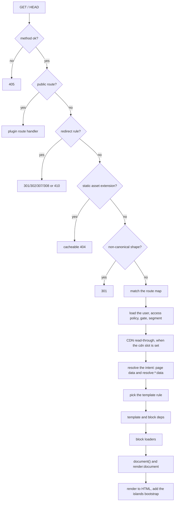

# Routing and render

Public request routing turns a `GET` or `HEAD` on the site into a theme-rendered page. It compiles every registration's permalink configuration into one route map, matches the URL to a route intent, gates it by the entry's access policy, resolves the intent's page data, picks a template from the theme, and renders the document. Site developers configure it through `plumix()` (`routes`, `redirects`, the theme). Plugin authors extend it with rewrite rules, archive types, views and public routes. Theme authors consume it through template rules and template data. It is the **Routing and render** component in [ARCHITECTURE.md](../../ARCHITECTURE.md#components-of-the-app-process), with the **Dispatcher** in front of it. It lives in `packages/core/src/route/`, with the dispatch glue in `packages/core/src/runtime/dispatcher.ts`.

## At a glance

A page step (an archive type's or view's `resolve`, a template dep, a block loader, `document()`) may throw `pageNotFound()` or `redirectTo()`. `resolvePublicRoute` catches it and answers 404 or the redirect.

## Surface

| Piece                                                                                                                                                                                       | Where                                             | Public?  |
| ------------------------------------------------------------------------------------------------------------------------------------------------------------------------------------------- | ------------------------------------------------- | -------- |
| `routes: { author, date, search }`                                                                                                                                                          | `plumix()` config, `FrameworkRoutesInput`         | public   |
| `redirects`                                                                                                                                                                                 | `plumix()` config, theme, `ctx.registerRedirects` | public   |
| `registerRewriteRule(pattern, intent, { priority })`                                                                                                                                        | plugin setup context                              | public   |
| `registerArchiveType(name, { routes, entries?, perPage?, title?, resolve, cacheable?, access? })`                                                                                           | plugin setup context                              | public   |
| `registerView(name, { routes, access?, cacheable?, resolve })`                                                                                                                              | plugin setup context                              | public   |
| `registerPublicRoute({ path, handler, access?, cacheable? })`, answered ahead of redirects                                                                                                  | plugin setup context                              | public   |
| `registerTemplateDep(kind, { keyedBy, load })`                                                                                                                                              | plugin setup context                              | public   |
| `pageNotFound()`, `redirectTo(location, status?)`                                                                                                                                           | `plumix/support`                                  | public   |
| Template builders `entry`, `entryType`, `term`, `author`, `date`, `frontPage`, `search`, `fallback`, `notFound`, `serverError`                                                              | `plumix/theme`                                    | public   |
| Targeted selectors `forEntryType`, `forTermTaxonomy`, `forAuthor`, `forDate`, `forArchiveType`, `forView` and guards `isEntry`, `isTerm`, …                                                 | `plumix/theme`                                    | public   |
| `resolveEntryData`, `resolveEntryList`, `resolveListingPage`, `resolveArchiveTypePage`                                                                                                      | `plumix/plugin`                                   | public   |
| `buildEntryPermalink(s)`, `buildTermArchiveUrl(s)`, `archiveAtPath`, `archiveBaseRoutes`, `pageFacts`                                                                                       | `plumix/plugin`                                   | public   |
| Filters `resolve:single:data`, `resolve:archive:data`, `resolve:term:data`, `resolve:author:data`, `resolve:date:data`, `resolve:front-page:data`, `resolve:search:data`, `render:document` | hook registry                                     | public   |
| `compileRouteMap`, `routePublicRequest`, `resolvePublicRoute`, `renderThroughTheme`                                                                                                         | `packages/core/src/route/`                        | internal |

Page kinds ([ADR 0025](../adr/0025-a-page-kind-is-named-by-its-subject.md), amended by [ADR 0035](../adr/0035-an-app-page-is-a-view-not-an-archive.md)): `entry`, `entryType`, `term`, `author`, `date`, `archiveType`, `view`, `frontPage`, `search`.

## How it works

- **Compile.** `compileRouteMap(registry)` in `packages/core/src/route/compile.ts` builds sorted rules: framework routes at priority 5 (`/page/N`, `/authors/:slug`, the date patterns, `/search`), explicit rewrite rules and archive types at 10, auto rules from `hasArchive` and `rewrite.slug` at 50, root catch-all entries at 60. A family turned off in `routes` is never compiled (`resolveFrameworkRoutes` in `packages/core/src/route/contract/framework-routes.ts`). `assertUniquePatterns` and `assertAutoUrlsResolveToThemselves` throw `RouteCompileError` at boot. `archiveRoutes` derives each listing archive's `/page/:page` form.
- **Route.** `routePublicRequest` in `packages/core/src/route/index.ts` runs the fixed stage order drawn above. Public routes compile in `packages/core/src/route/public-routes.ts`, and a path under `/_plumix` is rejected at boot. Redirects merge in `assembleRedirects` (`packages/core/src/route/redirects.ts`) with the source priorities in `REDIRECT_SOURCE_PRIORITY`: config 10, plugin 20, theme 30. The canonical normalizer is `canonicalRedirectTarget` in `packages/core/src/seo/canonical.ts`. An unmatched `/` is the front page.
- **Dispatch.** `dispatchPublicRoute` in `packages/core/src/runtime/dispatcher.ts` loads the user only when the request carries a session, finds the entry's access policy (`policyForMatch`), gates with `resolveAccess`, and picks the segment. A preview or editor grant forces the `private` segment. It then wraps the context with `trackPrincipalReads` and hands the render to the CDN read-through when the `cdn` slot is set (see [CDN cache](cdn-cache.md)), or renders directly. `renderPublicRoute` re-renders any 404 that accepts HTML through the theme's `notFound` template; a throw becomes `serverError`, or the dev error page.
- **Resolve.** `resolveIntent` in `packages/core/src/route/resolve.ts` switches on the intent kind. Built-in listings go through `packages/core/src/route/render/page-data.ts` (`frontPageData`, `archiveData`, `termData`, `authorData`, `dateData`), each applying its `resolve:*:data` filter. Each archive's entry query is defined once in `archiveEntries` (`packages/core/src/route/archive-entries.ts`), born holding only public entries ([ADR 0008](../adr/0008-an-archive-is-one-entry-query.md)). A term resolves by its last slug segment, and core's rules 301 to the canonical term URL ([ADR 0012](../adr/0012-a-term-is-addressed-by-its-slug.md)). A single entry resolves through `resolveSingleEntry` (`packages/core/src/route/single-entry.ts`), overlays the preview author's autosave, picks an edit mode, and calls `resolveEntryData`. Archive types go through `archiveTypePage` (`packages/core/src/route/render/archive-type-page.ts`). Views wrap `resolve`'s `data` in `{ kind: "view", name, params, data }`.
- **Permalinks.** `packages/core/src/route/permalink.ts` builds entry and term URLs, nesting under ancestors where the type has hierarchical URLs. The batch forms load ancestor chains once.
- **Template hierarchy.** `resolveRule` in `packages/core/src/route/render/rule-resolver.ts` tries targeted rules in declaration order, then the generic tier for the page kind, then `fallback`. `archiveType` and `view` have no generic tier. No match and no `fallback` returns `null`, which becomes a 404. `explainTemplateResolution` (`packages/core/src/route/render/template-hierarchy.ts`) feeds the debug bar.
- **Theme render.** `renderThroughTheme` in `packages/core/src/route/render/render-template.tsx` resolves the template, unions template and block deps (`collectBlockDepKeys`) and loads each once with `loadTemplateDeps`. It runs block loaders (`prefetchEntryLoaders`) before `document()`, merges the document manifest, forces `canonical: false` for views, applies `render:document` and the canonical link, then renders the tree. View transitions apply only in the `live` edit mode ([ADR 0031](../adr/0031-a-theme-opts-into-native-page-transitions-and-owns-their-css.md)).
- **Personal renders.** In `packages/core/src/route/render/personal-render.ts`, `trackPrincipalReads` marks the render personal when it reads `ctx.user`, `ctx.tokenScopes` or `ctx.auth.can()`, uses a principal's own locale, or shows the admin bar. `renderIsPersonal` is the verdict the read-through asks for ([ADR 0030](../adr/0030-a-render-that-reads-the-principal-is-never-shared.md)).

## Invariants

- An archive is one entry query; its listing and feed read the same query, and it holds only public entries. [ADR 0008](../adr/0008-an-archive-is-one-entry-query.md); `packages/core/src/route/archive-entries.test.ts`.
- A term is found by its slug alone; only core-compiled rules (`isPermalinkRoute`) canonicalise by 301. [ADR 0012](../adr/0012-a-term-is-addressed-by-its-slug.md); `packages/core/src/route/resolve.test.ts`.
- A plugin gets page data from core's resolvers, never from rows; `buildResolvedEntries` is not exported. [ADR 0015](../adr/0015-a-plugin-gets-page-data-from-core.md); `packages/plumix/src/facade-curated.test.ts`, `packages/core/src/route/render/page-data.test.ts`.
- Page kinds are named by subject, in camelCase. [ADR 0025](../adr/0025-a-page-kind-is-named-by-its-subject.md).
- A framework route family set to `false` is never compiled, and an empty date archive answers 404. [ADR 0029](../adr/0029-a-framework-route-a-site-turns-off-is-never-compiled.md); `packages/core/src/route/compile.test.ts`, `packages/core/src/route/render/page-data.test.ts`.
- The gate runs before any content resolves, so a gated entry type refuses even a URL that would 404. `packages/core/src/access/gate.test.ts`.
- A render that reads the principal is never shared. [ADR 0030](../adr/0030-a-render-that-reads-the-principal-is-never-shared.md); `packages/core/src/route/render/personal-render.test.ts`, `packages/core/src/access/gate.integration.test.tsx`.
- Core emits `@view-transition` only when the theme or template opts in, and never in edit or preview. [ADR 0031](../adr/0031-a-theme-opts-into-native-page-transitions-and-owns-their-css.md); `packages/plugins/blog/e2e/view-transitions.spec.ts`.
- A page outcome is recognised by `Symbol.for("plumix.pageOutcome")`; a redirect outcome leaves `private, no-store`; loaders run before `document()`. [ADR 0032](../adr/0032-a-page-step-ends-the-request-by-throwing-an-outcome.md); `packages/core/src/route/page-outcome.dispatch.test.tsx`.
- Core's own redirect statuses are fixed: the gate 302, the canonical normalizer 301; only `GET` and `HEAD` reach a public route. [ADR 0033](../adr/0033-a-redirect-status-is-chosen-by-the-framework.md); `packages/core/src/route/index.test.ts`.
- A view is never stored by the CDN unless it sets `cacheable: true`, and it claims no automatic canonical link. [ADR 0035](../adr/0035-an-app-page-is-a-view-not-an-archive.md); `packages/core/src/route/view.dispatch.test.tsx`.
- Route code is a server `capabilities` layer folder (`packages/core/layers.ts`). [ADR 0010](../adr/0010-core-is-one-package-of-enforced-layers.md); `packages/core/src/layers.test.ts`.

## Not there yet

| Part of the design                       | Seam to build on                                                                                                                                                                                                                                                                      | Done when                                                                                                                                                                                                                         | The code today                                                                                                   |
| ---------------------------------------- | ------------------------------------------------------------------------------------------------------------------------------------------------------------------------------------------------------------------------------------------------------------------------------------- | --------------------------------------------------------------------------------------------------------------------------------------------------------------------------------------------------------------------------------- | ---------------------------------------------------------------------------------------------------------------- |
| Gated content requires a capability      | `rolePolicy` in `packages/core/src/access/policy.ts` (exported from `plumix/auth`), which a gated entry type, archive type, view or public route uses as its `access`; `policyForMatch` in `packages/core/src/access/gate.ts`, which the dispatcher calls before any content resolves | A policy that gates on who the reader is requires a capability, not a minimum role, and nothing on the public request path compares roles by rank                                                                                 | `rolePolicy(required)` compares `roleLevel(ctx.user.role)` with `roleLevel(required)`                            |
| Gated content is segmented by capability | The built-in `Segment` type in `packages/core/src/access/contract/access.ts`, `isBuiltinSegment` and `ROLE_PREFIX` in `packages/core/src/access/policy.ts`, and `segmentForAudience` in `packages/core/src/runtime/dispatcher.ts`, which picks the segment the read-through keys by   | The built-in gate segment is `capability:<name>`, replacing `role:<role>`; every reader who holds the capability shares one stored copy, whatever role grants it; the _Code today_ line is gone from **Segment** in `GLOSSARY.md` | `rolePolicy` grants `role:<required>`, and `isBuiltinSegment` accepts `role:` followed by a name in `USER_ROLES` |

Both rows are part of the site-defined roles row in [ARCHITECTURE.md](../../ARCHITECTURE.md#not-there-yet); [auth and access](auth-and-access.md) has the rest of it.
