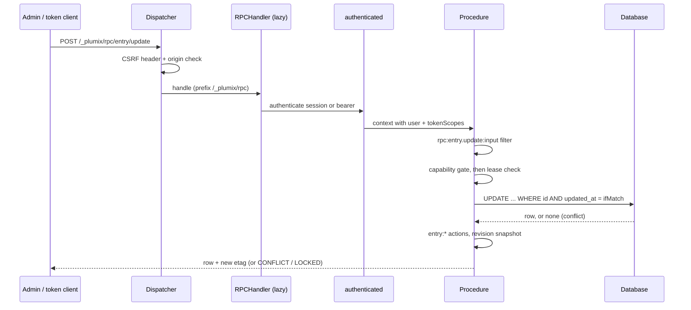

# RPC and editing

The RPC surface is the oRPC router the admin, and any client holding an API token, calls at `/_plumix/rpc/*` to read and write entries, terms, users and settings. It also carries the editing guards from [ADR 0048](../adr/0048-core-guards-every-edit-with-a-required-token-and-an-enforced-lease.md): a required concurrency token on every write made from a copy, and an edit lease that refuses anyone else's write. Plugin authors mount their own routers beside core's and call them through a typed client. Editors meet it through the admin's forms and the visual editor. It lives in `packages/core/src/rpc/`, with the guard helpers in `packages/core/src/db/concurrency.ts` and `packages/core/src/db/edit-lease.ts`.

## At a glance

## Surface

| Piece                                                                                                                                         | Where                                                        | Public?                    |
| --------------------------------------------------------------------------------------------------------------------------------------------- | ------------------------------------------------------------ | -------------------------- |
| `appRouter`, `AppRouter`, `AppRouterClient`                                                                                                   | `rpc/router.ts`, re-exported from `plumix`                   | public type                |
| `base`, `authenticated`, `requireCapability`, `RPC_ERRORS`                                                                                    | `rpc/index.ts`                                               | public, for plugin routers |
| `registerRpcRouter(router)`                                                                                                                   | plugin setup context, mounted at `/_plumix/rpc/<pluginId>/*` | public                     |
| `createPluginRpcClient<TRouter>(pluginId)`, `PluginRpcClient/Inputs/Outputs`                                                                  | `plumix/admin` (`packages/plumix/src/admin/plugin-rpc.ts`)   | public                     |
| `etagOf`, `claim`, `claimVersion`, `claimTerm`, `ConflictError`, `ifMatchObject`, `assertWritable`, `acquire/renew/release/takeOverEditLease` | `plumix/db` (`packages/core/src/db/public.ts`)               | public, for plugin tables  |
| `describeRpcError`, `rpcErrorReason`, `rpcErrorCode`, `useEditLease`, `EditLeaseBanner`, `EditConflictDialog`                                 | `plumix/admin`                                               | public                     |
| `rpc:<procedure>:input` / `:output` filters, `entry:*`, `term:*`, `user:*`, `settings:group_changed` actions                                  | `rpc/hooks.ts`                                               | public hooks               |

Core namespaces, by area (`rpc/procedures/*/index.ts`):

| Namespace  | Procedures                                                                                                                                                                                                                                                                                                                                                 |
| ---------- | ---------------------------------------------------------------------------------------------------------------------------------------------------------------------------------------------------------------------------------------------------------------------------------------------------------------------------------------------------------- |
| `entry`    | `list`, `get`, `create`, `update`, `publish`, `discardDraft`, `trash`, `restore`, `deletePermanent`, `trashMany`, `restoreMany`, `deletePermanentMany`, `duplicate`, `createPreviewLink`, `refreshBlockLoader`, `resolveBlockDeps`, `stats`, `recentActivity`, `revisions.{list,get,restore,setMessage}`, `activity.list`, `lease.{acquire,renew,release}` |
| `term`     | `list`, `get`, `create`, `update`, `delete`, `lease.*`                                                                                                                                                                                                                                                                                                     |
| `user`     | `list`, `get`, `invite`, `update`, `disable`, `enable`, `delete`, `setLocale`, `requestEmailChange`, `cancelEmailChange`, `pendingEmailChange`, `lease.*`                                                                                                                                                                                                  |
| `settings` | `get`, `upsert`, `lease.*`                                                                                                                                                                                                                                                                                                                                 |
| `auth`     | `session`, `signInMethods`, `loginLinks`, `credentials.*`, `sessions.*`, `apiTokens.*`, `deviceFlow.*` (see [auth-and-access.md](auth-and-access.md))                                                                                                                                                                                                      |
| `lookup`   | `list`                                                                                                                                                                                                                                                                                                                                                     |
| `search`   | `query` (see [search.md](search.md))                                                                                                                                                                                                                                                                                                                       |

Error codes (`packages/core/src/rpc-errors.ts`): `UNAUTHORIZED`, `BAD_REQUEST {reason}`, `FORBIDDEN {capability}`, `NOT_FOUND {kind,id}`, `CONFLICT {reason, key?, etag?, updatedAt?, holder?, errors?}`, `LOCKED` (423) `{holder, since}`, `PAYLOAD_TOO_LARGE`, `UNSUPPORTED_MEDIA_TYPE`, `INVALID_BLOCK_CONTENT {issues}`.

## How it works

**Dispatch.** `createPlumixDispatcher` checks the `X-Plumix-Request` header and origin on every `/_plumix/` path (`enforcePlumixCsrf`), then `dispatchRpc` refuses anything but `POST` and calls the handler. The response gets `no-store` (`withNoStore`). `buildRpcHandler` loads through `loadOnce` on the first RPC request, so the procedure graph stays off the public render path. It merges each plugin router under its plugin id and wraps every call in an `rpc: <path>` telemetry span.

**Middleware.** `authenticated` runs the same authenticator as the raw routes and puts the user and `tokenScopes` on the context with `withUser`. It also maps errors: a `ConflictError` thrown anywhere below becomes `CONFLICT` with the lease holder added, and a `LockedError` becomes `LOCKED`. Plugin procedures get the same mapping. `requireCapability(cap)` goes before `.input()`, so a caller without the capability gets `FORBIDDEN` even when the input is also invalid. Entry procedures check per-type capabilities inside the handler (`assertCanEditEntry`, `entryCapabilityByName`).

**Entry lifecycle** (`procedures/entry/lifecycle.ts`). Every save runs `entry:<type>:before_save`, then `entry:before_save`. After a write, actions fire type-scoped first, then generic: `updated`, `transition` (only when the status changed), `published`, `trashed`, `restored`, `deleted`. `entry.create` fires `transition` from a synthetic `draft`. `entry.update` and `entry.publish` call `captureRevisionIfSupported` after the hooks. It does nothing unless the type has `supports: ['revisions']`, and fires `revision_created` and `revision_pruned`.

**Autosave** ([ADR 0003](../adr/0003-an-autosave-stores-edits-not-a-snapshot.md)). On a type with `supports: ['autosave']`, `entry.update` on a published row writes to the caller's own autosave row by default (`saveAs: "draft"`). The draft is validated leniently and stores only the keys the author touched. It fires `autosave_saved` and never `entry:updated`. `entry.publish` promotes the draft with strict validation, and `entry.discardDraft` drops it. `entry.revisions.restore` lands on the autosave row for autosave types, and writes live otherwise.

**Concurrency.** Each editable resource returns an `etag`. Each write made from a copy requires `ifMatch`, which `ifMatchObject` / `versionIfMatchObject` parse:

| Resource            | Token                                        | Lease kind                                  | Lease gate                         |
| ------------------- | -------------------------------------------- | ------------------------------------------- | ---------------------------------- |
| entry               | `updated_at` seconds (`entryRows`)           | `entry`                                     | `assertCanEditEntry`               |
| user                | `updated_at` seconds (`user/concurrency.ts`) | `user`                                      | `assertCanEditUser`                |
| term                | `version` (`claimTerm`)                      | `term`                                      | `<taxonomy>` edit capability       |
| settings group      | marker row counter (`settings/token.ts`)     | `settings_group` (string id)                | `settings:manage`                  |
| media item (plugin) | entry `updated_at` via `claim`               | `entry`                                     | `assertCanEditEntry`               |
| menu (plugin)       | term `version` via `claimTerm`               | `term`, through menu's own lease procedures | `termCapability("menu", "manage")` |

`guardedTable.claimRow` runs one `UPDATE … WHERE id = ? AND updated_at = ?`. If no row comes back, it re-reads the row and throws `ConflictError`. `nextToken` keeps tokens strictly increasing within one second. `writeAsSystem` re-reads and retries for system writes such as trash, bulk actions and scheduled publishing (`publishDueScheduledEntries`). `assertLeaseAllows` calls `assertWritable` after the capability check, so a stale caller who also lacks the capability still gets `FORBIDDEN`. `leaseProcedures(kind, assertMayHold)` builds `acquire/renew/release`. A lease lasts `EDIT_LEASE_DURATION_MS` (120 s) and is renewed every `EDIT_LEASE_RENEW_INTERVAL_MS` (30 s) (`db/contract/edit-lease.ts`). Its row in `edit_leases` records the user and the surface (`admin` for a session, `rpc` for a token, `rpcSurface`).

**Plugin routers.** `registerRpcRouter` throws if the plugin id is a core namespace (`CORE_RPC_NAMESPACES` in `rpc/namespaces.ts`, a value copy of the router's keys typed against `AppRouter`). `buildApp` checks the same thing again at boot. The client is `createPluginRpcClient`, which sends `x-plumix-request: 1` to `<basePath>/_plumix/rpc/<pluginId>`.

**Error display** ([ADR 0018](../adr/0018-the-admin-shows-a-failure-through-a-descriptor-it-chose.md)). The admin maps `data.reason` to a localized descriptor with `describeRpcError` (`packages/core/src/admin/rpc-errors.ts`) and never shows `message`. The ESLint rule `plumix/no-error-message-in-ui` (`tooling/eslint/rules/`) enforces this.

## Invariants

- A write made from a copy carries `ifMatch`, and the update checks it in its `WHERE` clause. A stale or missing token is refused. Guarded by [ADR 0048](../adr/0048-core-guards-every-edit-with-a-required-token-and-an-enforced-lease.md), `db/concurrency.test.ts`, `rpc/procedures/entry/concurrency.test.ts`.
- While someone else holds a live lease, a write is `LOCKED` unless the caller sets `takeOver`. Guarded by `db/edit-lease.test.ts` and the `lease.test.ts` under each of entry, term, user and settings.
- `FORBIDDEN` comes before `CONFLICT`/`LOCKED`, and before input validation for `requireCapability`. Guarded by `rpc/require-capability.test.ts`, `rpc/authenticated.test.ts`.
- A plugin id can't shadow a core namespace. `NAMESPACE_FLAGS` fails typecheck on drift, and `registerRpcRouter` and `buildApp` both throw at runtime.
- An autosave stores edits, not a copy, and never fires `entry:updated`. Guarded by [ADR 0003](../adr/0003-an-autosave-stores-edits-not-a-snapshot.md), `rpc/procedures/entry/update.test.ts`.
- RPC is `POST` only and `no-store`, as the comment on `dispatchRpc` explains.
- The admin never renders an error's `message` ([ADR 0018](../adr/0018-the-admin-shows-a-failure-through-a-descriptor-it-chose.md), `plumix/no-error-message-in-ui`).

## Status

- **Shipped:** the router, middleware, error map, entry lifecycle and hooks, autosave and revisions, tokens and leases for entries, terms, users and settings, plugin routers and the typed client. Unit tests: 43 test files under `packages/core/src/rpc/`. Journeys: `packages/admin/e2e/editor.spec.ts`, `plain-form.spec.ts`, `settings.spec.ts`, `taxonomies.spec.ts`, `users.spec.ts`. These run against a mocked RPC (`packages/admin/e2e/support/rpc-mock.ts`), not the real server.
- **Shipped in plugins:** media `update` takes `ifMatch` and calls `assertWritable` (`packages/plugins/media/src/rpc.ts`). Menu claims its term with `claimTerm` and has its own `lease.*` procedures, which hold a `term` lease (`packages/plugins/menu/src/rpc.ts`).
- **In progress:** one editing-copy controller that owns lease, conflict and read-only state in the admin. #3241 (PRD), #3242 (controller + user editor), #3243 (entry routes), #3244 (settings card), #3245 (term editor), #3246 (publish to plugins, media), #3247 (menu onto core's term lease).

## Gaps

- **The REST and MCP rules in ADR 0048 have no code yet.** The ADR says REST sends `ETag` and answers `428`/`412`, and that MCP takes `ifMatch`. But `packages/core/src/rest/` has no `etag` or `If-Match` handling, and the MCP tools are read-only (`content_list`, `content_get`, `term_list`, `term_get`, `taxonomy_list` in `packages/core/src/mcp/`). `EDIT_LEASE_SURFACES` includes `"mcp"` and `"rest"`, but nothing writes those values.
- **Menu duplicates core's term lease.** Its own `lease.*` procedures hold a `term` lease but check `MENU_MANAGE_CAPABILITY`, not core's `term.lease` gate (#3247). The admin's `EditLeaseKind` is only `"entry" | "user" | "term"` (`packages/core/src/admin/editing.ts`).
- **Seven editors handle lease and conflict state their own way** (loading, Keep mine, Compare). #3241 records each difference.
