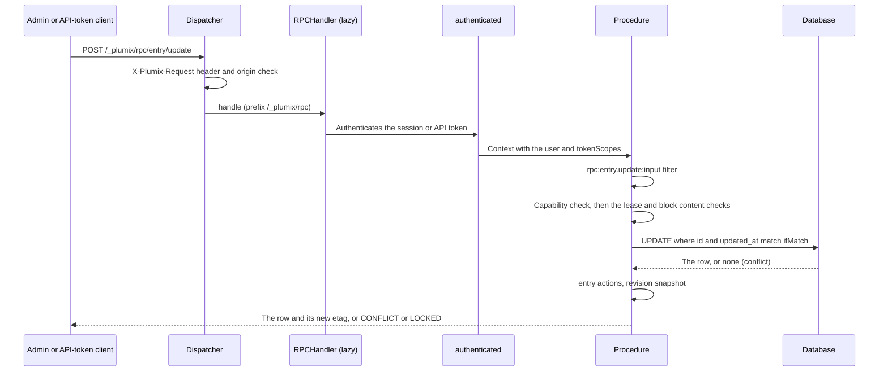
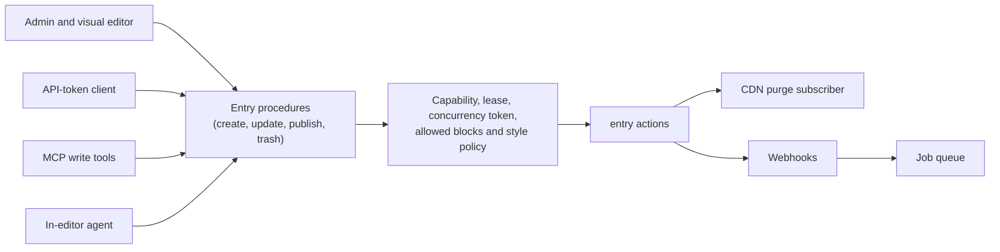

# RPC and editing

The RPC surface is the oRPC router the admin, and any client holding an API token, calls at `/_plumix/rpc/*` to read and write entries, terms, users and settings. It carries the editing guards from [ADR 0048](../adr/0048-core-guards-every-edit-with-a-required-token-and-an-enforced-lease.md): a required concurrency token on every write made from a copy, and an edit lease that refuses anyone else's write. Every writer goes through these procedures: the admin, API-token clients, an agent over MCP and the in-editor agent. Plugin authors mount their own routers beside core's and call them through a typed client. Editors meet it through the admin's forms and the visual editor. It is the RPC part of the **RPC, REST and MCP** component in [ARCHITECTURE.md](../../ARCHITECTURE.md#components-of-the-app-process), reading through **Content services**. It lives in `packages/core/src/rpc/`, with the guard helpers in `packages/core/src/db/concurrency.ts` and `packages/core/src/db/edit-lease.ts`.

## At a glance

Who writes through the procedures, and what an entry action reaches:

## Surface

| Piece                                                                                                                                                        | Where                                                        | Public?                    |
| ------------------------------------------------------------------------------------------------------------------------------------------------------------ | ------------------------------------------------------------ | -------------------------- |
| `appRouter`, `AppRouter`, `AppRouterClient`                                                                                                                  | `packages/core/src/rpc/router.ts`, re-exported from `plumix` | public type                |
| `base`, `authenticated`, `requireCapability`, `RPC_ERRORS`                                                                                                   | `packages/core/src/rpc/index.ts`                             | public, for plugin routers |
| `registerRpcRouter(router)`                                                                                                                                  | plugin setup context, mounted at `/_plumix/rpc/<pluginId>/*` | public                     |
| `createPluginRpcClient<TRouter>(pluginId)`, `PluginRpcClient/Inputs/Outputs`                                                                                 | `plumix/admin` (`packages/plumix/src/admin/plugin-rpc.ts`)   | public                     |
| `etagOf`, `claim`, `claimVersion`, `claimTerm`, `ConflictError`, `ifMatchObject`, `assertWritable`, `acquire/renew/release/takeOverEditLease`, `LockedError` | `plumix/db` (`packages/core/src/db/public.ts`)               | public, for plugin tables  |
| `describeRpcError`, `rpcErrorReason`, `rpcErrorCode`, `useEditLease`, `EditLeaseBanner`, `EditConflictDialog`                                                | `plumix/admin`                                               | public                     |
| `rpc:<procedure>:input` and `:output` filters; `entry:*`, `term:*`, `user:*` and `settings:group_changed` actions                                            | `packages/core/src/rpc/hooks.ts`                             | public hooks               |

Core namespaces, by area (each `index.ts` under `packages/core/src/rpc/procedures/`):

| Namespace  | Procedures                                                                                                                                                                                                                                                                                                                                                 |
| ---------- | ---------------------------------------------------------------------------------------------------------------------------------------------------------------------------------------------------------------------------------------------------------------------------------------------------------------------------------------------------------- |
| `entry`    | `list`, `get`, `create`, `update`, `publish`, `discardDraft`, `trash`, `restore`, `deletePermanent`, `trashMany`, `restoreMany`, `deletePermanentMany`, `duplicate`, `createPreviewLink`, `refreshBlockLoader`, `resolveBlockDeps`, `stats`, `recentActivity`, `revisions.{list,get,restore,setMessage}`, `activity.list`, `lease.{acquire,renew,release}` |
| `term`     | `list`, `get`, `create`, `update`, `delete`, `lease.*`                                                                                                                                                                                                                                                                                                     |
| `user`     | `list`, `get`, `invite`, `update`, `disable`, `enable`, `delete`, `setLocale`, `requestEmailChange`, `cancelEmailChange`, `pendingEmailChange`, `lease.*`                                                                                                                                                                                                  |
| `settings` | `get`, `upsert`, `lease.*`                                                                                                                                                                                                                                                                                                                                 |
| `auth`     | `session`, `signInMethods`, `loginLinks`, `credentials.*`, `sessions.*`, `apiTokens.*`, `deviceFlow.*` (see [auth and access](auth-and-access.md))                                                                                                                                                                                                         |
| `lookup`   | `list`                                                                                                                                                                                                                                                                                                                                                     |
| `search`   | `query` (see [search](search.md))                                                                                                                                                                                                                                                                                                                          |

Error codes (`packages/core/src/rpc-errors.ts`): `UNAUTHORIZED`, `BAD_REQUEST {reason}`, `FORBIDDEN {capability}`, `NOT_FOUND {kind,id}`, `CONFLICT {reason, key?, etag?, updatedAt?, holder?, errors?}`, `LOCKED` (423) `{holder, since}`, `PAYLOAD_TOO_LARGE`, `UNSUPPORTED_MEDIA_TYPE`, `INVALID_BLOCK_CONTENT {issues}`.

## How it works

**Dispatch.** `createPlumixDispatcher` checks the `X-Plumix-Request` header and origin on every `/_plumix/` path (`enforcePlumixCsrf`). `dispatchRpc` then refuses anything but `POST` and calls the handler, and `withNoStore` marks the response. The app loads the handler through `loadOnce` on the first RPC request (`loadRpcHandler` in `packages/core/src/runtime/app.ts`), so the procedure graph stays off the public render path. `buildRpcHandler` merges each plugin router under its plugin id and wraps every call in an `rpc: <path>` telemetry span.

**Middleware.** `authenticated` runs the same authenticator as the raw routes and puts the user and `tokenScopes` on the context with `withUser`. It also maps errors: a `ConflictError` thrown anywhere below becomes `CONFLICT` with the lease holder added, and a `LockedError` becomes `LOCKED`. Plugin procedures get the same mapping. `requireCapability(cap)` goes before `.input()`, so a caller without the capability gets `FORBIDDEN` even when the input is also invalid. Entry procedures check per-type capabilities inside the handler (`assertCanEditEntry`, `entryCapabilityByName`).

**Entry lifecycle** (`packages/core/src/rpc/procedures/entry/lifecycle.ts`). Every save runs `entry:<type>:before_save`, then `entry:before_save`. `entry.create`, `entry.update` and revision restore check the content with `assertContentValidAgainstRegistries` (`packages/core/src/rpc/procedures/entry/content.ts`): every block must be registered, no save adds a new instance of a block the theme removed (an entry that already holds one keeps it and can still be saved), and under a tokens-only style policy no save stores a new literal style value ([blocks and islands](blocks-and-islands.md)). After a write, actions fire type-scoped first, then generic: `updated`, `transition` (only when the status changed), `published`, `trashed`, `restored`, `deleted`. `entry.create` fires `transition` from a synthetic `draft`. `entry.update` and `entry.publish` call `captureRevisionIfSupported` after the hooks. It does nothing unless the type has `supports: ['revisions']`, and fires `revision_created` and `revision_pruned`. Core's CDN purge subscriber listens to these actions ([CDN cache](cdn-cache.md)).

**Autosave** ([ADR 0057](../adr/0057-an-autosave-stores-edits-not-a-snapshot.md)). On a type with `supports: ['autosave']`, `entry.update` on a published entry writes to the caller's own autosave row by default (`saveAs: "draft"`). The draft is validated leniently and stores only the keys the author touched. It fires `autosave_saved` and never `entry:updated`. `entry.publish` promotes the draft with strict validation, and `entry.discardDraft` drops it. `entry.revisions.restore` lands on the autosave row for autosave types, and on the entry itself otherwise.

**Concurrency.** Each editable resource returns an `etag`, its concurrency token. Each write made from a copy requires `ifMatch`, which `ifMatchObject` or `versionIfMatchObject` parses:

| Resource            | Token                                        | Lease kind                                  | Lease gate                         |
| ------------------- | -------------------------------------------- | ------------------------------------------- | ---------------------------------- |
| entry               | `updated_at` seconds (`entryRows`)           | `entry`                                     | `assertCanEditEntry`               |
| user                | `updated_at` seconds (`user/concurrency.ts`) | `user`                                      | `assertCanEditUser`                |
| term                | `version` (`claimTerm`)                      | `term`                                      | `<taxonomy>` edit capability       |
| settings group      | marker row counter (`settings/token.ts`)     | `settings_group` (string id)                | `settings:manage`                  |
| media item (plugin) | entry `updated_at` via `claim`               | `entry`                                     | `assertCanEditEntry`               |
| menu (plugin)       | term `version` via `claimTerm`               | `term`, through menu's own lease procedures | `termCapability("menu", "manage")` |

`guardedTable(...).claimRow` runs one `UPDATE … WHERE id = ? AND updated_at = ?`. If no row comes back, it re-reads the row and throws `ConflictError`. `nextToken` keeps tokens strictly increasing within one second. `writeAsSystem` re-reads and retries for system writes such as trash, bulk actions and scheduled publishing (`publishDueScheduledEntries`). `assertLeaseAllows` (`packages/core/src/rpc/concurrency.ts`) calls `assertWritable` after the capability check, so a stale caller who also lacks the capability still gets `FORBIDDEN`. `leaseProcedures(kind, assertMayHold)` builds `acquire/renew/release`. A lease lasts `EDIT_LEASE_DURATION_MS` (120 s) and is renewed every `EDIT_LEASE_RENEW_INTERVAL_MS` (30 s) (`packages/core/src/db/contract/edit-lease.ts`). Its row in `edit_leases` records the user and the surface: `rpcSurface` writes `admin` for a session and `rpc` for an API token, and an MCP write tool writes `mcp` (`EDIT_LEASE_SURFACES` in `db/schema/edit_leases.ts`).

**Agents.** An agent over MCP writes, composes and publishes through the same entry procedures as the admin ([MCP](mcp.md)). Its write tools take `ifMatch`, hold edit leases on the `mcp` surface, and act with the capabilities of the API token the agent connects with. The in-editor agent drafts a page through an RPC procedure that calls the same entry procedures as an editor. It reaches a model through the `llm` config slot (`packages/core/src/runtime/contract/slots.ts`), so model keys stay on the server, and it builds the draft only from the site's blocks and design tokens. Every change an agent makes is a revision that names the agent and the person it acts for: the token's owner over MCP, the asking editor in the editor.

**Webhooks.** A core module subscribes to the entry actions `lifecycle.ts` fires, as the purge invalidator in `packages/core/src/cdn/purge.ts` does, and enqueues each delivery through the `queue` slot; a scheduled task sends it when the job queue hands it back. Webhooks are declared in code per entry type. Publishing an entry sends a POST, with its headers and payload, to each webhook its entry type declares for publish; unpublish, trash, delete and scheduled publish do the same for theirs.

**Roles.** Procedures ask by capability (`requireCapability`, `context.auth.can`), never by role. The `role` that `user.list`, `user.invite`, `user.update` and the `auth.session` output carry is any default role (member, author, editor, admin) or a role the site defines in the admin or in config, and the admin adds and edits stored roles through procedures ([auth and access](auth-and-access.md)).

**Plugin routers.** `registerRpcRouter` throws if the plugin id is a core namespace (`CORE_RPC_NAMESPACES` in `packages/core/src/rpc/namespaces.ts`, a value copy of the router's keys typed against `AppRouter`). `buildApp` checks the same thing again at boot. The client is `createPluginRpcClient`, which sends `x-plumix-request: 1` to `<basePath>/_plumix/rpc/<pluginId>`.

**Error display** ([ADR 0018](../adr/0018-the-admin-shows-a-failure-through-a-descriptor-it-chose.md)). The admin maps `data.reason` to a localized descriptor with `describeRpcError` (`packages/core/src/admin/rpc-errors.ts`) and never shows `message`. The ESLint rule `plumix/no-error-message-in-ui` (`tooling/eslint/rules/no-error-message-in-ui.ts`) enforces this.

## Invariants

- A write made from a copy carries `ifMatch`, and the update checks it in its `WHERE` clause. A stale or missing token is refused. [ADR 0048](../adr/0048-core-guards-every-edit-with-a-required-token-and-an-enforced-lease.md); `packages/core/src/db/concurrency.test.ts`, `packages/core/src/rpc/procedures/entry/concurrency.test.ts`.
- While someone else holds a live lease, a write is `LOCKED` unless the caller sets `takeOver`. `packages/core/src/db/edit-lease.test.ts` and the `lease.test.ts` under each of entry, term, user and settings.
- `FORBIDDEN` comes before `CONFLICT` and `LOCKED`, and before input validation for `requireCapability`. `packages/core/src/rpc/require-capability.test.ts`, `packages/core/src/rpc/authenticated.test.ts`.
- No save stores a node of an unregistered block that the content it starts from didn't already hold. `packages/core/src/blocks/validate-content.test.ts`.
- A plugin id can't shadow a core namespace. `NAMESPACE_FLAGS` fails typecheck on drift, and `registerRpcRouter` and `buildApp` both throw at runtime.
- An autosave stores edits, not a copy, and never fires `entry:updated`. [ADR 0057](../adr/0057-an-autosave-stores-edits-not-a-snapshot.md); `packages/core/src/rpc/procedures/entry/update.test.ts`.
- RPC is `POST` only and `no-store`, as the comment on `dispatchRpc` explains.
- The admin never renders an error's `message`. [ADR 0018](../adr/0018-the-admin-shows-a-failure-through-a-descriptor-it-chose.md); `plumix/no-error-message-in-ui`.
