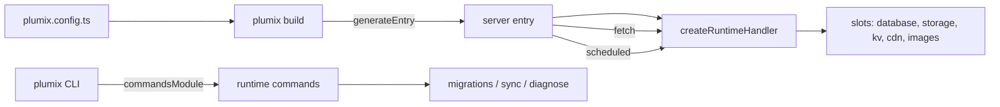

# Runtimes

A runtime adapter is how one Plumix site runs on Cloudflare Workers, a Node process or a Bun process.
Core builds one platform-neutral handler; the adapter generates the server entry that calls it, and
supplies only what the platform knows (static assets, the client address). Infrastructure the site
uses (database, storage, KV, CDN, images) comes through config slots, and each runtime package ships
the slot implementations built on its own primitives. A site developer picks the adapter and slots in
`plumix.config.ts`; a runtime maintainer implements the contract; an operator meets the runtime's
`commands` module through the `plumix` CLI. The contract lives in `packages/core/src/context/` and
`packages/core/src/runtime/contract/`; the adapters live in `packages/runtimes/{cloudflare,node,bun}`.

## At a glance

## Surface

| Piece                | What it is                                                                                                                                                                                  | Where                                                                         | Public                         |
| -------------------- | ------------------------------------------------------------------------------------------------------------------------------------------------------------------------------------------- | ----------------------------------------------------------------------------- | ------------------------------ |
| `RuntimeAdapter`     | `name`, `handler: RuntimeHandlerSpec`, `generateEntry`, `workerExports?`, `commandsModule?`, `refusedAdminAreas?`                                                                           | `packages/core/src/context/runtime-adapter.ts`                                | yes, `plumix/runtime`          |
| `RuntimeHandlerSpec` | `assets`, `disposeTimeoutMs`, `clientAddress`, `prepare`, `wrap`                                                                                                                            | same file                                                                     | yes                            |
| `PlumixHandler`      | `fetch`, `scheduled?`, `run?`, `dispose?`                                                                                                                                                   | same file                                                                     | yes                            |
| `Invocation`         | `env`, `waitUntil?`, `clientAddress?`                                                                                                                                                       | same file                                                                     | yes                            |
| Slot contracts       | `DatabaseAdapter`, `ObjectStorage`, `KV`, `CdnProvider`, `ImageDelivery`, `AssetsBinding`                                                                                                   | `packages/core/src/runtime/contract/slots.ts`                                 | yes                            |
| Commands module      | `commands`, `migrations: RuntimeMigrations`, `diagnose: RuntimeDiagnose`, `sync: RuntimeSync`                                                                                               | `packages/runtimes/*/src/commands/index.ts`                                   | yes, `<pkg>/commands`          |
| Conformance suites   | `describeDatabaseContract`, `describeObjectStorageContract`, `describeKvContract`, `describeCdnContract`, `describeAssetsContract`, `describeSyncContract`, `describeRunContract`, `fakeS3` | `packages/core/src/test/conformance/`                                         | yes, `plumix/test/conformance` |
| Shared runtime e2e   | `runtimeSpec()`                                                                                                                                                                             | `plumix/test/playwright`, called by `packages/runtimes/*/e2e/runtime.spec.ts` | yes                            |
| `AdminArea`          | `apiTokens`, `deviceAuthorization`, `passkeys`, `oauthLinking`, `emailDelivery`                                                                                                             | `runtime-adapter.ts`                                                          | yes                            |

Capability matrix (what each runtime package ships; core's portable slots work on any runtime):

| Feature                     | Cloudflare                                                                | Node                                                       | Bun                                                    |
| --------------------------- | ------------------------------------------------------------------------- | ---------------------------------------------------------- | ------------------------------------------------------ |
| Server                      | Worker module `{ fetch, scheduled }`                                      | `node:http` via `createNodeSite`                           | `Bun.serve` via `createBunSite`                        |
| Database                    | `d1()` (sessions via `connectRequest`)                                    | `nodeSqlite()` (`node:sqlite`)                             | `bunSqlite()` (`bun:sqlite`)                           |
| Portable database           | `plumix/db/libsql`                                                        | `plumix/db/libsql`                                         | `plumix/db/libsql`                                     |
| Object storage              | `r2()`                                                                    | `diskStorage()`                                            | `diskStorage()`, `bunS3()`                             |
| Portable storage            | `plumix/storage/s3`                                                       | `plumix/storage/s3`                                        | `plumix/storage/s3`                                    |
| KV                          | `kv()`                                                                    | none (core `memoryKv`)                                     | none (core `memoryKv`)                                 |
| CDN                         | `@plumix/runtime-cloudflare/cdn` (Workers cache), `plumix/cdn/cloudflare` | `plumix/cdn/cloudflare`                                    | `plumix/cdn/cloudflare`                                |
| Images                      | `images()` (Cloudflare Images)                                            | `images()` (`sharp`, optional peer)                        | `images()` (`Bun.Image`)                               |
| Assets                      | `ASSETS` binding                                                          | `createAssetsLayer` on disk                                | `createAssetsLayer` on disk                            |
| Cron trigger                | `triggers.crons` in wrangler config                                       | in-process scheduler, or `cron: false` + `plumix cron run` | in-process scheduler (no off switch)                   |
| Cron in `plumix dev`        | not wired by Plumix                                                       | yes, `lease: false`                                        | no                                                     |
| `openSync` (sync routes)    | no (501)                                                                  | yes                                                        | yes                                                    |
| Remote migrate/sync targets | `--production`, `--preview`, `--env`                                      | none (local only)                                          | none (local only)                                      |
| Runtime commands            | `dev`, `build`, `deploy`, `preview`, `types`                              | `dev`, `build`                                             | `dev`, `build` (refuses to load under Node)            |
| Migrations at start         | none; `plumix deploy` migrates first                                      | `applyBuiltMigrations` before listen                       | `applyBuiltMigrations` before listen                   |
| `plumix dev`                | Vite + `@cloudflare/vite-plugin`                                          | Vite, Node server environment                              | `bun --bun plumix dev`, Vite with a `node:http` bridge |

## How it works

`buildApp` resolves config, plugins and scheduled tasks; `createRuntimeHandler` composes the handler
from the adapter's `RuntimeHandlerSpec`. The adapter never builds the dispatcher itself.
`generateEntry` returns the entry source as a string of literals, because it is bundled with the
server and a module-scope `node:*` import would fail on Workers. CLI tooling stays out of the
bundle because `commandsModule` is a specifier, not a module. Rules every runtime shares (request
trust, asset serving, the drain deadline `DRAIN_DEADLINE_MS`) are published once on
`plumix/runtime` (ADR 0019).

- `packages/core/src/runtime/handler.ts` — `createRuntimeHandler`: `fetch`, `scheduled`, `run`, `dispose`.
- `packages/core/src/runtime/request-trust.ts`, `asset-path.ts`, `drain.ts` — shared trust, assets, drain.
- `packages/runtimes/cloudflare/src/adapter.ts` — `cloudflare()`; reads `cf-connecting-ip`; `prepare` fails fast without `AsyncLocalStorage` (`nodejs_compat`).
- `packages/runtimes/cloudflare/src/entry-codegen.ts` — `export default { fetch, scheduled }`; `surfaceScheduledFailure` in `scheduled.ts`.
- `packages/runtimes/cloudflare/src/demo/demo-runtime.ts` — the only adapter that sets `refusedAdminAreas` and `workerExports` (the demo Durable Object).
- `packages/runtimes/node/src/adapter.ts`, `site.ts` — `node({ trustProxy, bodySizeLimit, cron, build })`, `createNodeSite`, SIGTERM drain.
- `packages/runtimes/bun/src/adapter.ts`, `site.ts` — `bun({ trustProxy, bodySizeLimit, idleTimeout, build })`, `createBunSite`, `serveProcess`.
- `packages/runtimes/bun/src/commands/bun-commands.ts` — `bunCommands` throws `BunCliError.bunRequired` when `Bun` is absent.
- `packages/plumix/src/vite/index.ts` — copies `refusedAdminAreas` into the plugin manifest and serves `workerExports`.

## Invariants

- An adapter uses its runtime's primitives, and core's portable code fills only the gap a built-in leaves (`bunS3` `put`/`head`/`presignPut` on core's signer). [ADR 0019](../adr/0019-a-runtime-adapter-uses-its-runtimes-primitives-and-is-tested-on-that-runtime.md).
- Core's cron dialect drives Bun, not `Bun.cron`; `packages/runtimes/bun/src/cron-parity.test.ts` pins the expressions they disagree on. ADR 0019.
- Every slot implementation passes the shared conformance suite for its contract (table under Status). ADR 0019.
- A remote database is named in the platform's own terms and every remote write prints a plan and asks first. [ADR 0045](../adr/0045-a-runtime-names-its-remote-databases-from-its-platform-config.md); `packages/runtimes/cloudflare/src/commands/migrations.test.ts`.
- A refused admin area is hidden in the admin and still refused by the runtime's own gate. [ADR 0014](../adr/0014-the-admin-offers-only-what-the-deployment-can-do.md); `packages/core/src/plugin/build-manifest.test.ts`, `packages/runtimes/cloudflare/src/demo/demo-runtime.test.ts`, `packages/admin/e2e/users.spec.ts`.
- Each runtime's suites run on that runtime: Bun's `test:unit` is `bun --bun ./node_modules/vitest/vitest.mjs run` (`packages/runtimes/bun/package.json`).
- Dev-only code gates on `process.env.PLUMIX_DEV` inline (`registerCloudflareErrorHints` in `adapter.ts`); `packages/plumix/src/vite/dev-gate-tree-shaking.test.ts`.

## Status

Conformance coverage, from `grep describe*Contract`:

| Suite          | Runs in                                                                                                                                                  |
| -------------- | -------------------------------------------------------------------------------------------------------------------------------------------------------- |
| Database       | `cloudflare/src/d1.test.ts`, `node/src/node-sqlite.test.ts`, `bun/src/bun-sqlite.test.ts`, `core/src/db/libsql.test.ts`                                  |
| Object storage | `cloudflare/src/r2.test.ts`, `node/src/disk-storage.test.ts`, `bun/src/disk-storage.test.ts`, `bun/src/bun-s3.test.ts`, `core/src/storage/s3/s3.test.ts` |
| KV             | `cloudflare/src/kv.test.ts`, `core/src/runtime/memory-kv.test.ts`                                                                                        |
| CDN            | `cloudflare/src/cdn.test.ts`, `core/src/cdn/cloudflare/cloudflare.test.ts`                                                                               |
| Assets         | `cloudflare/src/adapter.test.ts`, `node/src/http/assets.test.ts`, `bun/src/http/assets.test.ts`                                                          |
| Sync, run      | `*/src/commands/sync.test.ts`, `*/src/commands/migrations.test.ts` in all three                                                                          |

- Shipped: all three adapters, every slot in the matrix, the shared `runtimeSpec()` e2e on each playground, `migrate-fresh.spec.ts` on Cloudflare, `config-edit.spec.ts` on Node.
- Planned: `Invocation.signal` and a shutdown abort for running scheduled tasks on Node and Bun (#3270, blocked by #3269). Workers caching serving the anonymous page to members is open as #3265. `plumix deploy --help` running a deploy is open as #3223.

## Gaps

- ADR 0019 rejects testing against fakes of a built-in, but `cloudflare/src/kv.test.ts` (`fakeNamespace`) and `cloudflare/src/r2.test.ts` (`FakeEntry`) run the KV and object-storage contracts against hand-written fakes of the Workers bindings. Cloudflare's `test:unit` is plain `vitest run` on Node. Only `d1.test.ts` uses wrangler's `getPlatformProxy`.
- ADR 0019 lists the conformance suites as "object storage, assets and the database"; the code also has KV, CDN, sync and run suites. The ADR is out of date.
- `bunDevOptions` in `packages/runtimes/bun/src/commands/dev.ts` returns no scheduler, while `nodeDevOptions` starts cron with `lease: false`. Scheduled tasks never fire under `plumix dev` on Bun.
- `BunConfig` has no `cron` switch, while `NodeConfig.cron` lets an operator hand schedules to `plumix cron run`. The Bun process always starts its scheduler (`serveProcess` in `bun/src/site.ts`).
- In `plumix dev` the Bun runtime serves through `createDevMiddleware` (`bun/src/commands/node-bridge.ts`), a `node:http` bridge, not `Bun.serve`. Only the built server exercises `Bun.serve`.
- No runtime README mentions cron (`grep -n cron packages/runtimes/*/README.md` is empty). The material is only in `apps/docs/src/content/docs/deployment/`.
