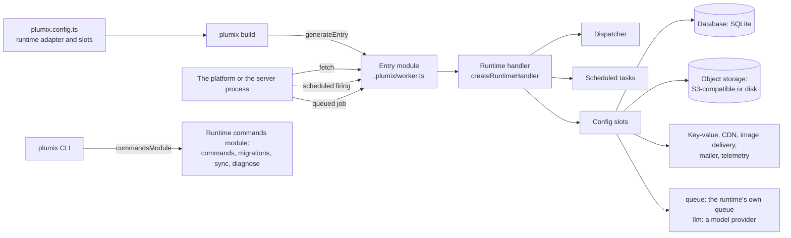

# Runtimes

A runtime adapter is how one Plumix site runs on a managed platform or a server runtime: Cloudflare
Workers, a Node process or a Bun process. Core builds one platform-neutral runtime handler;
the adapter generates the entry module the platform runs and supplies only what the platform knows
(static assets, the client address). Infrastructure the site uses comes through config slots, and
each runtime package ships slot implementations built on its own primitives. A site developer picks
the adapter and slots in `plumix.config.ts`; a runtime maintainer implements the contract; an
operator meets the runtime's commands module through the `plumix` CLI. This page covers the
**Runtime handler** and **Config slots** components of the app process in
[`ARCHITECTURE.md`](../../ARCHITECTURE.md#components-of-the-app-process). The contract lives in
`packages/core/src/context/runtime-adapter.ts` and `packages/core/src/runtime/contract/`; the
adapters live in `packages/runtimes/{cloudflare,node,bun}`.

## At a glance

## Surface

| Piece                | What it is                                                                                                                                                                                  | Where                                                                         | Public                         |
| -------------------- | ------------------------------------------------------------------------------------------------------------------------------------------------------------------------------------------- | ----------------------------------------------------------------------------- | ------------------------------ |
| `RuntimeAdapter`     | `name`, `handler: RuntimeHandlerSpec`, `generateEntry`, `workerExports?`, `commandsModule?`, `refusedAdminAreas?`, `errorHints?`                                                            | `packages/core/src/context/runtime-adapter.ts`                                | yes, `plumix/runtime`          |
| `RuntimeHandlerSpec` | `assets`, `disposeTimeoutMs`, `clientAddress`, `prepare`, `wrap`                                                                                                                            | same file                                                                     | yes                            |
| `PlumixHandler`      | The runtime handler: `fetch`, `scheduled?`, `run?`, `dispose?`                                                                                                                              | same file                                                                     | yes                            |
| `Invocation`         | `env`, `waitUntil?`, `clientAddress?`                                                                                                                                                       | same file                                                                     | yes                            |
| Slot contracts       | `DatabaseAdapter`, `ObjectStorage`, `KV`, `CdnProvider`, `ImageDelivery`, `AssetsBinding`, `queue`, `llm`                                                                                   | `packages/core/src/runtime/contract/slots.ts`                                 | yes                            |
| Other slots          | `mailer` (`packages/core/src/auth/contract/mailer.ts`), `telemetry` (`packages/core/src/context/telemetry.ts`)                                                                              | `PlumixConfig` in `packages/core/src/config.ts`                               | yes                            |
| Commands module      | `commands`, `migrations: RuntimeMigrations`, `diagnose: RuntimeDiagnose`, `sync: RuntimeSync`                                                                                               | `packages/runtimes/*/src/commands/index.ts`                                   | yes, `<pkg>/commands`          |
| Conformance suites   | `describeDatabaseContract`, `describeObjectStorageContract`, `describeKvContract`, `describeCdnContract`, `describeAssetsContract`, `describeSyncContract`, `describeRunContract`, `fakeS3` | `packages/core/src/test/conformance/`                                         | yes, `plumix/test/conformance` |
| Shared runtime e2e   | `runtimeSpec()`                                                                                                                                                                             | `plumix/test/playwright`, called by `packages/runtimes/*/e2e/runtime.spec.ts` | yes                            |
| `AdminArea`          | `apiTokens`, `deviceAuthorization`, `passkeys`, `oauthLinking`, `emailDelivery`                                                                                                             | `runtime-adapter.ts`                                                          | yes                            |

What each runtime package ships. Core's portable slots, `plumix/db/libsql` for the database and
`plumix/storage/s3` for object storage, work on every runtime.

| Feature                     | Cloudflare                                                                  | Node                                                       | Bun                                                    |
| --------------------------- | --------------------------------------------------------------------------- | ---------------------------------------------------------- | ------------------------------------------------------ |
| Server                      | Worker module `{ fetch, scheduled }`                                        | `node:http` via `createNodeSite`                           | `Bun.serve` via `createBunSite`                        |
| Database                    | `d1()` (sessions via `connectRequest`)                                      | `nodeSqlite()` (`node:sqlite`)                             | `bunSqlite()` (`bun:sqlite`)                           |
| Object storage              | `r2()`                                                                      | `diskStorage()`                                            | `diskStorage()`, `bunS3()`                             |
| Key-value                   | `kv()`                                                                      | core's `memoryKv()`                                        | core's `memoryKv()`                                    |
| CDN                         | `@plumix/runtime-cloudflare/cdn` (Workers Caching), `plumix/cdn/cloudflare` | `plumix/cdn/cloudflare`                                    | `plumix/cdn/cloudflare`                                |
| Image delivery              | `images()` (Image Transformations)                                          | `images()` (`sharp`, optional peer)                        | `images()` (`Bun.Image`)                               |
| Static assets               | `ASSETS` binding                                                            | `createAssetsLayer` on disk                                | `createAssetsLayer` on disk                            |
| Job queue                   | the platform's queue                                                        | the runtime's queue                                        | the runtime's queue                                    |
| Scheduler                   | `triggers.crons` in the wrangler config                                     | in-process scheduler, or `cron: false` + `plumix cron run` | in-process scheduler, no off switch                    |
| Scheduler in `plumix dev`   | not wired by Plumix                                                         | yes, `lease: false`                                        | no                                                     |
| Sync routes (`openSync`)    | no, answers 501                                                             | yes, with `nodeSqlite`                                     | yes, with `bunSqlite`                                  |
| Remote migrate/sync targets | `--production`, `--preview`, `--env`                                        | none, local only                                           | none, local only                                       |
| Runtime commands            | `dev`, `build`, `deploy`, `preview`, `types`                                | `dev`, `build`                                             | `dev`, `build` (refuses to load under Node)            |
| Migrations                  | none at start; `plumix deploy` migrates first                               | `applyBuiltMigrations` before listen, for `nodeSqlite`     | `applyBuiltMigrations` before listen, for `bunSqlite`  |
| `plumix dev`                | Vite + `@cloudflare/vite-plugin`                                            | Vite, Node server environment                              | `bun --bun plumix dev`, Vite with a `node:http` bridge |

## How it works

`buildApp` resolves config, plugins and scheduled tasks; `createRuntimeHandler` composes the runtime
handler from the adapter's `RuntimeHandlerSpec`. The adapter never builds the dispatcher itself.
`generateEntry` returns the entry source as a string of literals, because it is bundled with the
server and a module-scope `node:*` import would fail on a runtime without Node built-ins; the Vite
plugin writes it to `.plumix/worker.ts`. CLI tooling stays out of the bundle because
`commandsModule` is a specifier, not a module. Rules every runtime shares (request trust, asset
paths, the drain deadline `DRAIN_DEADLINE_MS`) are published once on `plumix/runtime`.

A slot is a sibling key of `plumix()`, filled by a runtime package or by core's portable providers.
The `queue` slot holds work that outlives a request, such as webhook deliveries; each runtime fills
it with its own queue and that queue's guarantees, and delivers each job back through the runtime
handler to scheduled tasks. Core and plugins enqueue to it, and a conformance suite in
`plumix/test/conformance` holds every queue. The `llm` slot holds the model provider behind the
in-editor agent; the agent's procedure reads it on the server, so model keys never reach the
browser. Core names the contracts in `runtime/contract/slots.ts`; how a runtime stores, retries and
acks a job is the runtime's.

- `packages/core/src/runtime/handler.ts`: `createRuntimeHandler`, with `fetch`, `scheduled`, `run`, `dispose`.
- `packages/core/src/runtime/request-trust.ts`, `asset-path.ts`, `drain.ts`: shared trust, assets, drain.
- `packages/runtimes/cloudflare/src/adapter.ts`: `cloudflare()`; reads `cf-connecting-ip`; `prepare` fails fast without `AsyncLocalStorage` (`nodejs_compat`).
- `packages/runtimes/cloudflare/src/entry-codegen.ts`: `export default { fetch, scheduled }`; `surfaceScheduledFailure` in `scheduled.ts`.
- `packages/runtimes/cloudflare/src/demo/demo-runtime.ts`: the only adapter that sets `refusedAdminAreas` and `workerExports` (the demo Durable Object).
- `packages/runtimes/node/src/adapter.ts`, `site.ts`: `node({ trustProxy, bodySizeLimit, cron, build })`, `createNodeSite`, SIGTERM drain.
- `packages/runtimes/bun/src/adapter.ts`, `site.ts`: `bun({ trustProxy, bodySizeLimit, idleTimeout, build })`, `createBunSite`, `serveProcess`.
- `packages/runtimes/bun/src/commands/bun-commands.ts`: `bunCommands` throws `BunCliError.bunRequired` when `Bun` is absent.
- `packages/plumix/src/vite/index.ts`: writes the entry, copies `refusedAdminAreas` into the plugin manifest and serves `workerExports`.

Where each slot contract's conformance suite runs:

| Suite          | Runs in                                                                                                                                                  |
| -------------- | -------------------------------------------------------------------------------------------------------------------------------------------------------- |
| Database       | `cloudflare/src/d1.test.ts`, `node/src/node-sqlite.test.ts`, `bun/src/bun-sqlite.test.ts`, `core/src/db/libsql.test.ts`                                  |
| Object storage | `cloudflare/src/r2.test.ts`, `node/src/disk-storage.test.ts`, `bun/src/disk-storage.test.ts`, `bun/src/bun-s3.test.ts`, `core/src/storage/s3/s3.test.ts` |
| Key-value      | `cloudflare/src/kv.test.ts`, `core/src/runtime/memory-kv.test.ts`                                                                                        |
| CDN            | `cloudflare/src/cdn.test.ts`, `core/src/cdn/cloudflare/cloudflare.test.ts`                                                                               |
| Assets         | `cloudflare/src/adapter.test.ts`, `node/src/http/assets.test.ts`, `bun/src/http/assets.test.ts`                                                          |
| Sync, run      | `*/src/commands/sync.test.ts`, `*/src/commands/migrations.test.ts` in all three                                                                          |

## Invariants

- An adapter uses its runtime's primitives, and core's portable code fills only the gap a built-in leaves (`bunS3` `put`/`head`/`presignPut` on core's signer). [ADR 0019](../adr/0019-a-runtime-adapter-uses-its-runtimes-primitives-and-is-tested-on-that-runtime.md).
- Core's cron dialect drives Bun, not `Bun.cron`; `packages/runtimes/bun/src/cron-parity.test.ts` pins the expressions they disagree on. ADR 0019.
- Every slot implementation passes the conformance suite for its contract (the table above). ADR 0019.
- A remote database is named in the platform's own terms, and every remote write prints a plan and asks first. [ADR 0045](../adr/0045-a-runtime-names-its-remote-databases-from-its-platform-config.md); `packages/runtimes/cloudflare/src/commands/migrations.test.ts`.
- A refused admin area is hidden in the admin and still refused by the runtime's own gate. [ADR 0014](../adr/0014-the-admin-offers-only-what-the-deployment-can-do.md); `packages/core/src/plugin/build-manifest.test.ts`, `packages/runtimes/cloudflare/src/demo/demo-runtime.test.ts`, `packages/admin/e2e/users.spec.ts`.
- Each runtime's suites run on that runtime: Bun's `test:unit` is `bun --bun ./node_modules/vitest/vitest.mjs run` (`packages/runtimes/bun/package.json`).
- Dev-only code gates on `process.env.PLUMIX_DEV` inline (the `errorHints` value in `packages/runtimes/cloudflare/src/adapter.ts`); `packages/plumix/src/vite/dev-gate-tree-shaking.test.ts`.
- A change to the contract lands in every adapter in the same change, or says why one is left out (`AGENTS.md`, Runtimes).
