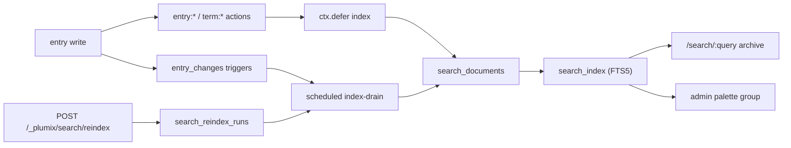

# Search

Search has two layers. Core ships `LIKE` search with no index: the public `/search/<q>` page, the admin command palette (`admin:search:results`) and the `search` filter on entry listings. `@plumix/plugin-search` adds an SQLite FTS5 index over a plain-text projection of entries and terms. That index takes over the public search page and the palette's Content groups. Site developers install the plugin and mark meta fields `.searchable()`. Plugin authors add palette groups through the filter. Operators rebuild the index through the reindex route. Code lives in `packages/core/src/search/`, `packages/core/src/db/search-conditions.ts`, `packages/core/src/route/resolve.ts` and `packages/plugins/search/`.

## At a glance

Without the plugin, `/search/:query` resolves in `resolveSearch` (core). With it, the plugin's archive rules at priority 1 shadow core's priority-5 rules.

## Surface

| Piece                                                   | Kind                                                            | Owner                                       | Public                                               |
| ------------------------------------------------------- | --------------------------------------------------------------- | ------------------------------------------- | ---------------------------------------------------- |
| `/search`, `/search/:query`, `/search/:query/page/:n`   | framework route, page kind `search`                             | core `route/compile.ts`, `route/resolve.ts` | yes; off with `routes: { search: false }` (ADR 0029) |
| `resolve:search:data`                                   | filter on core's `SearchData`                                   | core                                        | yes                                                  |
| `admin:search:results`                                  | producer-set filter (`runAdminSearch`)                          | core `search/admin-search.ts`               | yes, via `plumix/plugin`                             |
| `search.query`                                          | RPC procedure for the palette                                   | core `rpc/procedures/search/`               | internal wire                                        |
| `adminEntryScope`, `entryGroups`                        | helpers for palette producers                                   | core `search/admin-entry-scope.ts`          | yes, `plumix/plugin`                                 |
| `tokenizeSearchQuery`, `entrySearchCondition`           | WordPress-style query parsing, `LIKE` conditions                | core                                        | yes, `plumix/db`                                     |
| `readEntryChanges`, `ackEntryChanges`                   | entry change feed                                               | core `entries/change-feed.ts`               | yes, `plumix/plugin`                                 |
| `excludeFromSearch`                                     | entry type / taxonomy option                                    | core                                        | yes                                                  |
| `.searchable()`                                         | text-like field builders only (`plugin/fields/capabilities.ts`) | core                                        | yes                                                  |
| `search({ ranking, commonTermThreshold })`              | plugin factory; `ranking: "bm25-v1"` only                       | plugin                                      | yes                                                  |
| `SearchArchiveData`, `SearchResult`, `RankingAlgorithm` | types; archive type `search`                                    | plugin                                      | yes                                                  |
| `@plumix/plugin-search/schema`                          | `searchDocuments`, `searchReindexRuns`                          | plugin                                      | yes (`schemaModule`)                                 |
| `search:reindex`                                        | capability, registered at `admin`                               | plugin `contract.ts`                        | yes                                                  |
| `POST` / `GET /_plumix/search/reindex`                  | start a rebuild (idempotent) / read the latest run              | plugin                                      | yes                                                  |
| `index-drain`                                           | scheduled task, no `cron` of its own                            | plugin                                      | internal                                             |

## How it works

**Core, without the plugin.** `resolveSearch` 301s `?q=` to `/search/<q>`, then matches the whole query as one substring over `title` and `excerpt` of public, non-excluded types, narrowed by `publicEntryRows` (ADR 0037). The palette and entry listings split the query with `tokenizeSearchQuery`: quoted phrases, `-word` exclusions, words joined with AND. `entrySearchCondition` skips `entries.content`, because block names and attribute keys in the JSON matched most rows (#2117). The core palette handlers run at priorities 10 (entries), 20 (terms) and 30 (users). `runAdminSearch` merges groups by key in priority order, removes duplicates, caps each group, and turns a handler that throws into an empty group.

**Projection and index.** `search_documents` holds one row per entry or term: a title and plain-text body. Entry bodies come from the excerpt, `extractBlockText` over the block tree, and `extractMetaText` over `.searchable()` fields. A field gated by a capability is left out. `search_index` is an external-content FTS5 table (`porter unicode61 remove_diacritics 2`) kept in sync by three triggers. Each document stores an `extractorVersion` built from the block-roster hash and the meta-roster version. A document whose version is stale gets re-extracted.

**Staying current.** There are three paths:

- In request: `registerIndexInvalidator` hooks `entry:published|updated|trashed|restored|deleted|meta_changed` and `term:created|updated|deleted`, then `ctx.defer`s an index write. Entries are claimed once per request memo and acked from the feed.
- Feed drain: core triggers append to `entry_changes` on every entry write, seeds and imports included. `drainEntryChanges` reads up to 10 batches of 100 and acks by row id after the write.
- Sweeps: `runSearchMaintenance` runs the drain, then `advanceReindex`, then `repairStaleEntries`, then `backfillTerms`. Terms have no feed, so `backfillTerms` finds missing or outdated term documents with a join.

**Reindex.** `startReindex` returns the running run if one exists, otherwise inserts a `search_reindex_runs` row. `advanceReindex` walks entries, then terms, by id cursor, 200 sources per invocation, re-projecting in place so search keeps answering. It skips entries the feed still owes. A batch that fails is retried one source at a time, and each failing source is counted. A throw marks the run `failed`. `sync:after` with the `content` scope starts a rebuild (ADR 0039).

**Query.** `runSearch` compiles the visitor's text to a safe FTS5 `MATCH` with `toMatchExpression` and clamps to searchable types and taxonomies. Entry rows are joined through `searchableEntryRows` (`publicEntryRows`), so access is applied per entry at read time. `planForQuery` picks `ranked` (bm25, title weight 10, body 1) or `recent`. It picks `recent` when a word matches more than `commonTermThreshold` documents (default 12 000) and a walk capped at 500 rows proves recency is cheap. Snippets are escaped HTML with `<mark>` restored (`highlightSnippet`). If the index is missing, `degradedRows` answers with `LIKE` words joined by AND, newest first, and the repair is deferred. The palette producer (`registerAdminSearch`, priority 5) ranks only entries the user can edit. Core's handler fills in the rest.

**Backends per runtime.** There is one backend: SQLite FTS5 in the site database. That is D1 on Cloudflare, `bun:sqlite` on Bun and `nodeSqlite` on Node. No adapter has a search seam. `ensureSearchIndex` rebuilds a missing index or missing triggers without a lock, since D1 has none.

Key files:

- `packages/plugins/search/src/index.ts`: `search`, setup wiring
- `packages/plugins/search/src/server/{queue,drain,reindex,reindex-route,index-writer,document,meta-text}.ts`
- `packages/plugins/search/src/server/{query,query-plan,query-text,query-scope,query-degraded,palette}.ts`
- `packages/plugins/search/src/{archive,ranking,contract}.ts`, `src/db/{schema,ddl}.ts`, `migrations/`
- `packages/core/src/search/*`, `packages/core/src/db/search-conditions.ts`, `packages/core/src/entries/change-feed.ts`, `packages/core/migrations/0001_entry_change_feed.sql`

## Invariants

- The entry feed is appended by triggers, so no write path can skip it. Guarded by `packages/core/src/entries/change-feed.test.ts` and the driver conformance suite `packages/core/src/test/conformance/database.ts`.
- External-content deletes name the old column values. Guarded by `src/db/ddl.test.ts`.
- The plugin's tables ship their own migration history ([ADR 0027](../adr/0027-each-table-owner-ships-its-own-migration-history.md)). Guarded by `src/db/migrations.test.ts`.
- Access is applied per entry when a search runs, never copied into the projection ([ADR 0037](../adr/0037-a-public-surface-asks-per-entry-not-per-type.md)). Guarded by `src/server/query.test.ts` and `src/index.test.ts`.
- A site that turns search off never compiles core's search rules, and the plugin still serves `/search/:query` ([ADR 0029](../adr/0029-a-framework-route-a-site-turns-off-is-never-compiled.md)). Guarded by `packages/core/src/route/compile.test.ts` and `packages/core/src/route/resolve.test.ts`.
- A content sync triggers a full rebuild ([ADR 0039](../adr/0039-a-sync-replaces-a-scope-and-never-merges.md)). No test guards it (see Gaps).
- `term:meta_changed` is not hooked, because term meta is never indexed. The backfill comparison mirrors what `indexTerms` writes. Guarded by `src/server/drain.test.ts`.
- Core's `LIKE` conditions never read `entries.content` (#2117). Guarded by `packages/core/src/entries/read-service.test.ts`.

## Status

| Piece                                             | State           | Evidence                                                                                                                      |
| ------------------------------------------------- | --------------- | ----------------------------------------------------------------------------------------------------------------------------- |
| Core public search, palette, listing filter       | shipped         | `route/resolve.test.ts`, `rpc/procedures/search/index.test.ts`, `search/admin-search.test.ts`, `search/terms-handler.test.ts` |
| FTS5 projection, triggers, auto-repair            | shipped (0.2.0) | `src/db/ddl.test.ts`, `src/server/index-writer.test.ts`                                                                       |
| Ranked and recency plans, snippets, degraded read | shipped         | `query.test.ts`, `query-plan.test.ts`, `query-text.test.ts`                                                                   |
| Terms in results                                  | shipped         | `drain.test.ts`, `document.test.ts`                                                                                           |
| Resumable reindex route                           | shipped         | `reindex.test.ts`                                                                                                             |
| Palette ranking                                   | shipped         | `palette.test.ts`                                                                                                             |
| Pluggable search backend                          | not planned     | no seam in any runtime adapter                                                                                                |

`gh issue list --search "fts5 OR reindex OR plugin-search" --state open` returns nothing. No open issue tracks search.

## Gaps

- No e2e suite. `packages/plugins/search` has no `e2e/` directory, and no runtime e2e touches search. FTS5 behaviour is unit-tested only on the libsql harness (`createTestDb` in `packages/core/src/test/harness.ts`), not on D1, `bun:sqlite` or `node:sqlite`. The runtime suites create an FTS5 table only in `commands/migrations.test.ts`, to test wiping.
- Core's public search and its palette parse queries differently. `resolveSearch` passes the whole query as one substring (`{ value: query, exclude: false }`), while the palette and listings use `tokenizeSearchQuery`. A two-word or `-word` query behaves differently on the public page than in the admin.
- The search page returns two data shapes. Core renders page kind `search` (`SearchData`) and the plugin renders archive type `search` (`SearchArchiveData`). Bare `/search` stays core's, so a theme needs both templates. The docs page `apps/docs/src/content/docs/plugins/search.mdx` says so, and nothing in code unifies them.
- `entry_changes` is acked only by the search plugin, and core has no pruning. On a site without the plugin, the feed grows with every entry write.
- The docs page says entries published before install "stay unfindable until a rebuild". That holds only for writes made before core migration `0001_entry_change_feed` existed. `drainEntryChanges` reads every unacked feed row, including rows written before the plugin was installed.
- No test file for `entriesSearchHandler` or `usersSearchHandler`. Both are covered only through `rpc/procedures/search/index.test.ts`.
- `registerSyncReindex` (`sync:after` starts a rebuild) has no test. No `*.test.ts` under `packages/plugins/search/src` mentions `sync`.
