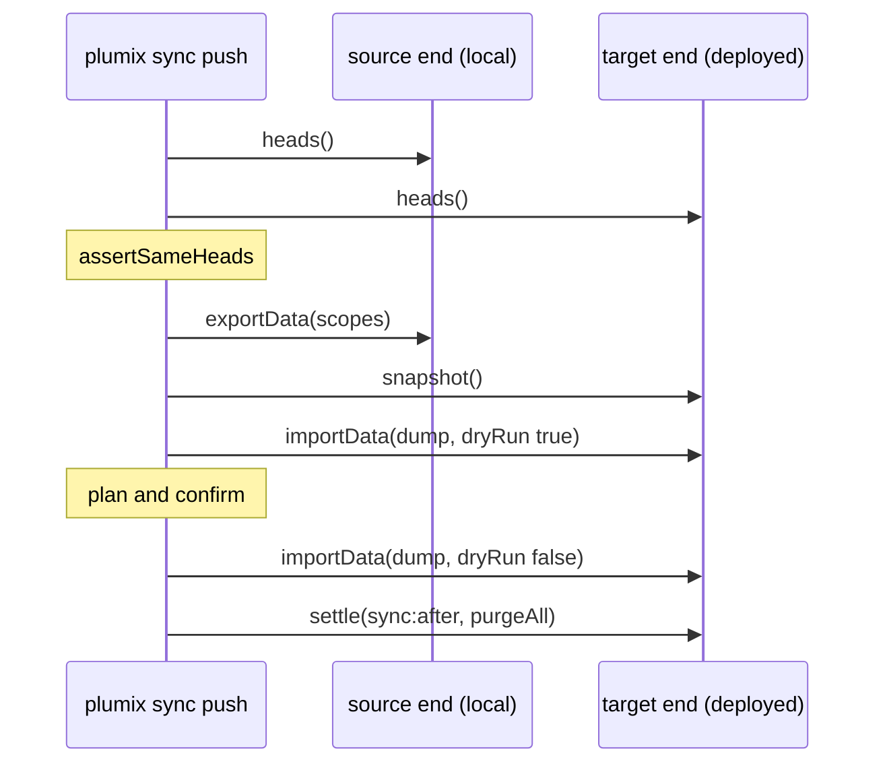

# Sync and import

`plumix sync` moves a site's data between its local database and the deployed one. `pull` copies
deployed to local, and `push` copies local to deployed. `plumix import` loads a sync dump, or an
authoring file of entry and term records, into the local or the deployed site. Both replace whole
tables, one named scope at a time, and never merge. A site developer and an operator run them from
the CLI. The deployed end answers over the `system/sync` REST routes, or over Cloudflare's own APIs.
The commands live in `packages/plumix/src/cli/commands/{sync,import}.ts` and
`packages/plumix/src/cli/sync/`. The replace logic lives in `packages/core/src/cli/sync*.ts`. The
routes live in `packages/core/src/runtime/sync-*.ts`. Each runtime's transport is the `sync` export
of its commands module.

## At a glance

## Surface

| Piece                                                                                          | What it is                                                                                                                            | Public                                           |
| ---------------------------------------------------------------------------------------------- | ------------------------------------------------------------------------------------------------------------------------------------- | ------------------------------------------------ |
| `plumix sync pull\|push`                                                                       | `--scope` (repeatable), `--url`, `--token`, `--binding`, `--dry-run`, `--yes`, `--no-rewrite-urls`, plus the runtime's target options | yes (CLI)                                        |
| `plumix import <dump-dir\|file>`                                                               | Same flags without `--scope`; local without `--url`, deployed with it                                                                 | yes (CLI)                                        |
| Scopes                                                                                         | `content` (`terms`, `entries`, `entry_term`, `settings`), `users` (`users`, `credentials`), `media` (storage objects), `plugin:<id>`  | yes                                              |
| `RuntimeSync`, `SyncEnd`, `DumpReader`, `DumpWriter`, `DumpManifest`                           | The transport contract                                                                                                                | yes, `plumix/cli`                                |
| `SyncDatabase` via `DatabaseAdapter.openSync`                                                  | What the sync routes read and replace                                                                                                 | yes, `plumix/runtime`                            |
| `sync:after` action                                                                            | Runs inside the target after a replace                                                                                                | yes (hook)                                       |
| `GET …/system/sync/heads`, `GET …/export`, `POST …/import`, `POST …/snapshot`, `POST …/settle` | Under `/_plumix/api/v1/`; bearer token whose user holds `settings:manage`                                                             | yes (HTTP)                                       |
| `describeSyncContract`, `memorySync`                                                           | The transport contract suite and its reference                                                                                        | `plumix/test/conformance`; `memorySync` internal |
| `settleSync`                                                                                   | Runs listeners, then `cdn.purgeAll`; reports failures, never throws                                                                   | yes, `plumix/cli`                                |

## How it works

The CLI resolves scopes and opens both ends through the runtime's `RuntimeSync.open`. It compares
every owner's head on both ends before export. The target compares them again before it writes, and
throws `sync_migrations_differ`. Ids travel verbatim. A `users` scope needs `content`, and a plugin
scope whose tables reference content needs it too. `resolveScopes` refuses either pair before
anything opens. With `users` left behind, the dump carries the authors its rows reference. They are
matched on the target by email, and missing ones are added disabled. Auth tables (`SYNC_AUTH_TABLES`)
are never dumped. A push snapshots the target first and prints how to restore it. A pull of `users`
keeps the local admins and their passkeys (`keepLocalAdmins`), because a remote passkey is bound to
the remote origin. URLs naming the source origin are rewritten to the target's unless
`--no-rewrite-urls` is given. A replaced term's concurrency token moves past the target's
(`pastTargetTermTokens`, ADR 0048).

- `packages/core/src/cli/sync.ts`: `CORE_SYNC_SCOPE_TABLES`, `SYNC_AUTH_TABLES`, `headDifferences`, `SyncError`.
- `packages/core/src/cli/sync-scopes.ts` (`resolveScopes`), `sync-replace.ts` (`exportScopes`, `importScopes`), `sync-wire.ts` (the NDJSON stream), `sync-remote.ts` (`remoteSyncEnd`, the HTTP transport).
- `packages/core/src/runtime/sync-transfer.ts`: heads, export, import and snapshot routes. They answer 501 when the database slot has no `openSync`.
- `packages/core/src/runtime/sync-settle.ts` (`handleSyncSettle`), `sync-operator.ts` (`authorizeSyncOperator`, bearer only, ahead of CSRF), `packages/core/src/context/settle-sync.ts`.
- `packages/plumix/src/cli/sync/`: `dump.ts` (dump on disk under `.plumix/sync`), `local-admins.ts`, `rewrite-urls.ts`, `term-tokens.ts`, `settle-remote.ts`.
- `packages/plumix/src/cli/import/records.ts`: the authoring record schema (`term`, `entry` with author email).
- Transports: Node and Bun (`packages/runtimes/{node,bun}/src/commands/sync.ts`) open the SQLite file locally and use `remoteSyncEnd` for the deployed site. Cloudflare (`packages/runtimes/cloudflare/src/commands/sync.ts`) reaches D1 through wrangler, and media through the platform proxy's storage binding. Its snapshot is a D1 Time Travel bookmark.

## Invariants

- A sync replaces whole tables per scope, never merges, and requires equal heads on both ends. [ADR 0039](../adr/0039-a-sync-replaces-a-scope-and-never-merges.md); `packages/core/src/test/conformance/sync.ts` (run by each runtime's `commands/sync.test.ts` and `core/src/test/sync/memory-sync.test.ts`).
- No auth table is ever written to a dump. The `describeSyncContract` case "no auth table is ever written to a dump".
- An import at other heads fails before any write. A contract case, and "a head mismatch fails before the export" in `packages/plumix/src/cli/commands/sync.test.ts`.
- A remote write prints a plan and is confirmed. Without a terminal it needs `--yes`. [ADR 0045](../adr/0045-a-runtime-names-its-remote-databases-from-its-platform-config.md); `sync.test.ts`, `import.test.tsx`.
- The transport is a commands-module export, not an adapter member, so the server bundle carries no wrangler or file-system code. ADR 0039.
- A settle runs every step and reports each failure. The contract case "settle reports a failed listener as a step and still resolves"; `packages/core/src/runtime/sync-settle.test.ts`.
- A sync or import is a system write that moves concurrency tokens without checking them. [ADR 0048](../adr/0048-core-guards-every-edit-with-a-required-token-and-an-enforced-lease.md).

## Status

- Shipped: `sync pull`/`push`, `import` of dumps and authoring files, all four scope kinds, the five REST routes, and transports for all three runtimes. Each passes `describeSyncContract`.
- Tests: `packages/plumix/src/cli/commands/{sync.test.ts,import.test.tsx}`, `packages/plumix/src/cli/sync/*.test.ts`, `packages/core/src/runtime/{sync-settle,sync-transfer}.test.ts`, `packages/core/src/cli/{sync-scopes,sync-remote}.test.ts`.
- No e2e suite drives `plumix sync` or `plumix import`. `grep -rln "plumix sync\|plumix import" packages/*/e2e packages/runtimes/*/e2e` finds nothing.
- No open issue targets sync or import (`gh issue list --search sync` returns only unrelated issues).

## Gaps

- Cloudflare's remote settle ignores `--token`. `settle` calls `settleDeployedSite(options.url ?? "", event)`. That calls `resolveApiToken` with `token: undefined`, so the token the CLI resolved (`options.apiToken`) is never used. On a terminal without `PLUMIX_API_TOKEN` it starts a second device flow. No Cloudflare file reads `options.apiToken`.
- `libsql()` has no `openSync`, so a Node or Bun site on `plumix/db/libsql` answers 501 on the transfer routes. Only `nodeSqlite` and `bunSqlite` set it. ADR 0039 names only D1 as the 501 case.
- Cloudflare's restore hint says Time Travel restores the database, not media. A `media` push to Cloudflare has no snapshot of its objects.
- ADR 0039 says user ids inside JSON are not rewritten when authors are matched by email. That limit is documented but has no test that pins it.
