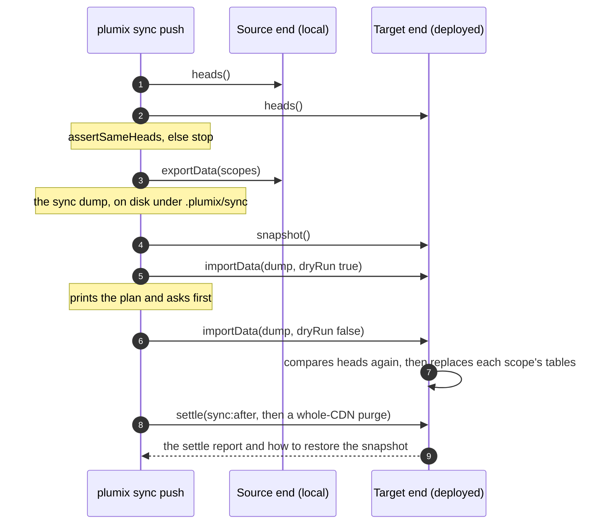

# Sync and import

`plumix sync` moves a site's data between its local database and the deployed one: `pull` copies
deployed to local, and `push` copies local to deployed. `plumix import` loads a sync dump, or an
authoring file of entry and term records, into the local or the deployed site. Both replace whole
tables, one sync scope at a time, and never merge. `plumix export` writes all of a site's content,
local or deployed, to a directory in the documented dump format, so any developer can take the
site's content with one command. A site developer and an operator run them from
the **plumix CLI** container of [`ARCHITECTURE.md`](../../ARCHITECTURE.md#containers). The deployed
end answers through the **Dispatcher**'s sync routes, or through the platform's own database and
storage tools. The commands live in `packages/plumix/src/cli/commands/{sync,import}.ts` and
`packages/plumix/src/cli/sync/`; the replace logic in `packages/core/src/cli/sync*.ts`; the routes
in `packages/core/src/runtime/sync-*.ts`. Each runtime's transport is the `sync` export of its
commands module.

## At a glance

## Surface

| Piece                                                                                | What it is                                                                                                                            | Public                                           |
| ------------------------------------------------------------------------------------ | ------------------------------------------------------------------------------------------------------------------------------------- | ------------------------------------------------ |
| `plumix sync pull\|push`                                                             | `--scope` (repeatable), `--url`, `--token`, `--binding`, `--dry-run`, `--yes`, `--no-rewrite-urls`, plus the runtime's target options | yes (CLI)                                        |
| `plumix import <dump-dir\|file>`                                                     | Same flags without `--scope`; local without `--url`, deployed with it                                                                 | yes (CLI)                                        |
| `plumix export <dir>`                                                                | Every sync scope, written as a sync dump; local without `--url`, deployed with it                                                     | yes (CLI)                                        |
| The dump format                                                                      | `manifest.json` (`format: 1`), one NDJSON file per table, `authors.ndjson`, `objects/` with `index.ndjson`; documented for consumers  | yes                                              |
| Sync scopes                                                                          | `content` (`terms`, `entries`, `entry_term`, `settings`), `users` (`users`, `credentials`), `media` (storage objects), `plugin:<id>`  | yes                                              |
| `RuntimeSync`, `SyncEnd`, `DumpReader`, `DumpWriter`, `DumpManifest`                 | The transport contract                                                                                                                | yes, `plumix/cli`                                |
| `SyncDatabase` via `DatabaseAdapter.openSync`                                        | What the sync routes read and replace                                                                                                 | yes, `plumix/runtime`                            |
| `sync:after` action                                                                  | Runs inside the target after a replace                                                                                                | yes (hook)                                       |
| `GET …/system/sync/heads`, `GET …/export`, `POST …/import`, `…/snapshot`, `…/settle` | Under `/_plumix/api/v1/`; an API token whose user holds `settings:manage`                                                             | yes (HTTP)                                       |
| `describeSyncContract`, `memorySync`                                                 | The transport contract suite and its reference                                                                                        | `plumix/test/conformance`; `memorySync` internal |
| `settleSync`                                                                         | Runs listeners, then `cdn.purgeAll`; reports failures, never throws                                                                   | yes, `plumix/cli`                                |

How each runtime moves a sync:

|                        | Cloudflare                                                                                      | Node and Bun                                                                        |
| ---------------------- | ----------------------------------------------------------------------------------------------- | ----------------------------------------------------------------------------------- |
| Both ends              | D1 and storage through the platform proxy, local or remote; remote bulk writes through wrangler | the SQLite file locally; `remoteSyncEnd` over the sync routes for the deployed site |
| Sync routes            | answer 501, because `d1()` has no `openSync`                                                    | served with `nodeSqlite` and `bunSqlite`; another database slot answers 501         |
| Snapshot of the target | a D1 Time Travel bookmark, covering the database, not media                                     | a `VACUUM INTO` copy beside the SQLite file                                         |

## How it works

The CLI resolves sync scopes and opens both ends through the runtime's `RuntimeSync.open`. It
compares every owner's head (the last applied migration per tracking table) on both ends before
export. The target compares them again before it writes, and throws `sync_migrations_differ`. Ids
travel verbatim. A `users` scope needs `content`, and a plugin scope whose tables reference content
needs it too; `resolveScopes` refuses either pair before anything opens.

With `users` left behind, the dump carries the authors its rows reference. They are matched on the
target by email, and missing ones are added disabled. Auth tables (`SYNC_AUTH_TABLES`) are never
dumped. A push snapshots the target first and prints how to restore it. A pull of `users` keeps the
local admins and their passkeys (`keepLocalAdmins`), because a remote passkey is bound to the remote
origin. URLs naming the source origin are rewritten to the target's unless `--no-rewrite-urls` is
given. A replaced term's concurrency token moves past the target's (`pastTargetTermTokens`, ADR
0048). A sync or import writes as the system: it moves concurrency tokens without checking them, and
it fires no entry actions; the target's `sync:after` listeners and the purge stand in for them.
An author added on the target without a role becomes a `member`.

`plumix export` opens one end the way a sync does and writes every sync scope to the directory it is
given, with no target and no settle. The dump is the format a pull writes and `plumix import` reads:
`manifest.json` names the format version, the source origin, the scopes, the heads and each table's
row count; each table is one NDJSON file of rows, a BLOB as base64; `authors.ndjson` holds the
authors the rows reference; `objects/index.ndjson` maps each storage key to its file under
`objects/`. The format is published in the docs, so another tool can read a dump without Plumix.

- `packages/core/src/cli/sync.ts`: `CORE_SYNC_SCOPE_TABLES`, `SYNC_AUTH_TABLES`, `headDifferences`, `SyncError`.
- `packages/core/src/cli/sync-scopes.ts` (`resolveScopes`), `sync-replace.ts` (`exportScopes`, `importScopes`), `sync-wire.ts` (the NDJSON stream), `sync-remote.ts` (`remoteSyncEnd`, the HTTP transport).
- `packages/core/src/runtime/sync-transfer.ts`: the heads, export, import and snapshot routes.
- `packages/core/src/runtime/sync-settle.ts` (`handleSyncSettle`), `sync-operator.ts` (`authorizeSyncOperator`, API token only, ahead of CSRF), `packages/core/src/context/settle-sync.ts`.
- `packages/plumix/src/cli/sync/`: `dump.ts` (the dump directory format), `local-admins.ts`, `rewrite-urls.ts`, `term-tokens.ts`, `settle-remote.ts`.
- `packages/plumix/src/cli/import/records.ts`: the authoring record schema (`term`, `entry` with author email).
- `packages/runtimes/*/src/commands/sync.ts`: each runtime's transport.

## Invariants

- A sync replaces whole tables per sync scope, never merges, and requires equal heads on both ends. [ADR 0039](../adr/0039-a-sync-replaces-a-scope-and-never-merges.md); `packages/core/src/test/conformance/sync.ts` (run by each runtime's `commands/sync.test.ts` and `core/src/test/sync/memory-sync.test.ts`).
- A sync between ends at equal heads never lands a user whose role the target lacks.
- `plumix export` writes every sync scope, and `plumix import` reads its output back unchanged.
- No auth table is ever written to a dump. The `describeSyncContract` case "no auth table is ever written to a dump".
- An import at other heads fails before any write. A contract case, and "a head mismatch fails before the export" in `packages/plumix/src/cli/commands/sync.test.ts`.
- A remote write prints a plan and is confirmed; without a terminal it needs `--yes`. [ADR 0045](../adr/0045-a-runtime-names-its-remote-databases-from-its-platform-config.md); `sync.test.ts`, `import.test.tsx`.
- The transport is a commands-module export, not an adapter member, so the server bundle carries no CLI or file-system code. ADR 0039.
- A settle runs every step and reports each failure. The contract case "settle reports a failed listener as a step and still resolves"; `packages/core/src/runtime/sync-settle.test.ts`.
- A sync or import is a system write that moves concurrency tokens without checking them. [ADR 0048](../adr/0048-core-guards-every-edit-with-a-required-token-and-an-enforced-lease.md).
